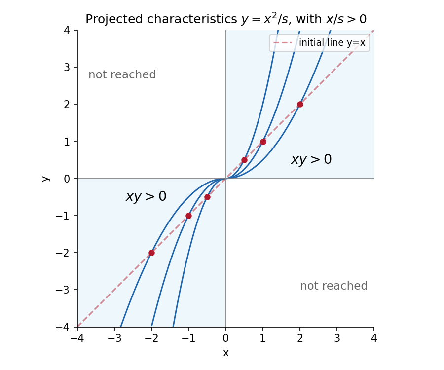

<h1 id="8/solution">Solution</h1>

↑ **Parent:** [8](../8.md)

Choose characteristic parameter $t$ with initial value at $t=0$. The characteristic equations are

$$
\dot x=x,\qquad\dot y=2y,\qquad\dot z=xy,
\qquad(x,y,z)(0)=(s,s,s^2).
$$

The first two integrate immediately; substitution into the third gives

$$
\boxed{x=se^t,\qquad y=se^{2t},\qquad
z=\frac{s^2}{3}(2+e^{3t}),\quad t\in\mathbb R.}
$$

Eliminating $t$ gives the projected parabola

$$
\boxed{y=\frac{x^2}{s},\qquad x/s>0.}
$$

The sign restriction selects the half-parabola actually reached from the initial point.

The projection map $(s,t)\mapsto(se^t,se^{2t})$ has [Jacobian determinant](../../../jacobian-determinant.md) $se^{3t}\neq0$, so the initial curve is noncharacteristic for every allowed $s$. Its global inverse is

$$
s=\frac{x^2}{y},\qquad t=\log(y/x),
$$

defined precisely when $x,y$ have the same nonzero sign. Every such point is reached by exactly one characteristic. Hence the region of unique determination from these initial data projects onto

$$
\boxed{\{(x,y):xy>0\},}
$$

the first and third quadrants. The axes are not reached for finite parameter from $s\neq0$, and the other two quadrants have no [method of characteristics](../../../method-of-characteristics.md) issued from this initial curve.

As a direct check, substitution of the inverse parameters gives the solution

$$
z(x,y)=\frac{2x^4}{3y^2}+\frac{xy}{3}
\quad(xy>0).
$$

It has $z(s,s)=s^2$, and differentiating gives $xz_x+2yz_y=xy$. This is [quadrant uniqueness for unequal dilation characteristics](../../../quadrant-uniqueness-for-unequal-dilation-characteristics.md).

**[Figure 2](#8/image-each-initial-point-determines-one-half-parabola-in-the-first-or-third-quadrant). Each initial point determines one half-parabola in the first or third quadrant**.

## ↑ Ancestors (11)

1. [8](../8.md)
2. [2007](../../2007-split.md)
3. [Past exam of the algebra, analysis and differential equations 1 course of the University of Oxford](../../split.md)
4. [Algebra, analysis and differential equations 1 course of the University of Oxford](../../../algebra-analysis-and-differential-equations-1-course-of-the-university-of-oxford.md)
5. [Year 2 of the mathematics course of the University of Oxford](../../../year-2-of-the-mathematics-course-of-the-university-of-oxford.md)
6. [Mathematics course of the University of Oxford](../../../mathematics-course-of-the-university-of-oxford.md)
7. [Undergraduate course of the University of Oxford](../../../undergraduate-course-of-the-university-of-oxford.md)
8. [Course of the University of Oxford](../../../course-of-the-university-of-oxford.md)
9. [University of Oxford](../../../university-of-oxford-split.md)
10. [List of universities](../../../list-of-universities.md)
11. [Codex Wiki](../../../split.md)
