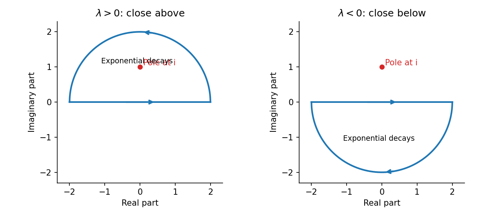

<h1 id="6/solution">Solution</h1>

↑ **Parent:** [6](../6.md)

Let $F(z)=e^{i\lambda z}/(z-i)$. For $\lambda>0$, close the interval $[-R,R]$ by the upper semicircle, counterclockwise. Its only enclosed pole is $z=i$, with [residue](../../../residue.md) $e^{-\lambda}$. The [residue theorem](../../../residue-theorem.md) gives

$$
\int_{-R}^RF(x)\,dx+\int_{\Gamma_R^+}F(z)\,dz=2\pi i e^{-\lambda}.
$$

On $z=Re^{i\theta}$, $|e^{i\lambda z}|=e^{-\lambda R\sin\theta}$ and $|z-i|\geq R-1$. Hence the arc is bounded by

$$
\frac R{R-1}\int_0^\pi e^{-\lambda R\sin\theta}\,d\theta\longrightarrow0
$$

by the supplied estimate, with parameter $\lambda R$.

For $\lambda<0$, close below, with clockwise orientation. The pole at $i$ lies outside, and the exponential decays there. Parametrizing the lower arc yields the same bound with $|\lambda|R$ in place of $\lambda R$. Its contribution again tends to zero, and no residue remains. Therefore

$$
\boxed{\lim_{R\to\infty}\int_{-R}^R\frac{e^{i\lambda x}}{x-i}\,dx
=\begin{cases}2\pi i e^{-\lambda},&\lambda>0,\\0,&\lambda<0.\end{cases}}
$$

**[Figure 1](#6/image-the-exponential-selects-the-half-plane-in-which-the-closing-arc-decays). The exponential selects the half-plane in which the closing arc decays**.

This is the contour-decay mechanism behind [Jordan's lemma](../../../jordan-s-lemma.md); the pole contributes only when the decaying closure encloses it.

## ↑ Ancestors (11)

1. [6](../6.md)
2. [2008](../../2008-split.md)
3. [Past exam of the algebra, analysis and differential equations 1 course of the University of Oxford](../../split.md)
4. [Algebra, analysis and differential equations 1 course of the University of Oxford](../../../algebra-analysis-and-differential-equations-1-course-of-the-university-of-oxford.md)
5. [Year 2 of the mathematics course of the University of Oxford](../../../year-2-of-the-mathematics-course-of-the-university-of-oxford.md)
6. [Mathematics course of the University of Oxford](../../../mathematics-course-of-the-university-of-oxford.md)
7. [Undergraduate course of the University of Oxford](../../../undergraduate-course-of-the-university-of-oxford.md)
8. [Course of the University of Oxford](../../../course-of-the-university-of-oxford.md)
9. [University of Oxford](../../../university-of-oxford-split.md)
10. [List of universities](../../../list-of-universities.md)
11. [Codex Wiki](../../../split.md)
