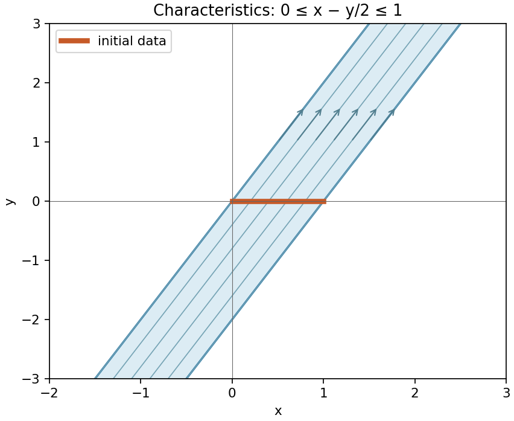
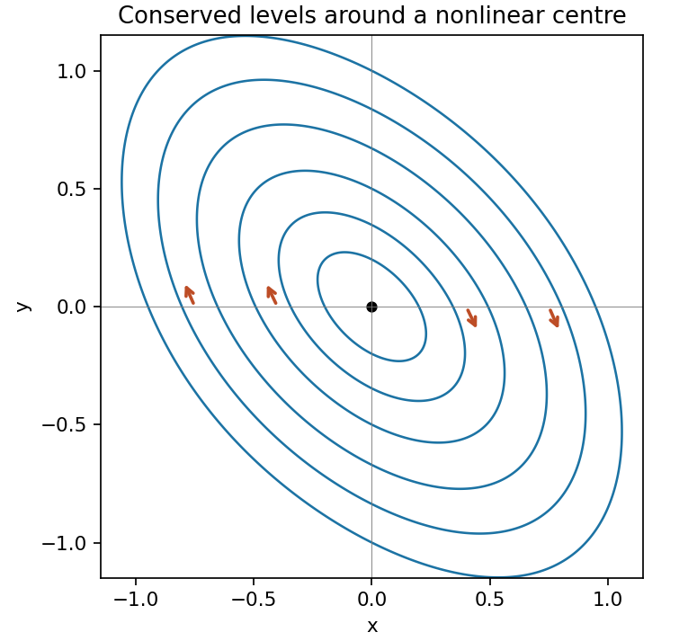

# 2009

↑ **Parent:** [Past exam of the algebra, analysis and differential equations 1 course of the University of Oxford](../past-exam-of-the-algebra-analysis-and-differential-equations-1-course-of-the-university-of-oxford.md)

Source: [released examination bundle](https://www.whatdotheyknow.com/request/maths_past_papers_3), `Part A 2007 11-1.pdf`, pages 121–124. All nine questions are covered. No mark allocations are printed.

**Table of contents**

- [1](#1)
  - [Solution](#1/solution)
- [2](#2)
  - [Solution](#2/solution)
- [3](#3)
  - [Solution](#3/solution)
- [4](#4)
  - [i](#4/i)
    - [a](#4/i/a)
      - [Solution](#4/i/a/solution)
    - [b](#4/i/b)
      - [Solution](#4/i/b/solution)
    - [c](#4/i/c)
      - [Solution](#4/i/c/solution)
  - [ii](#4/ii)
    - [Solution](#4/ii/solution)
- [5](#5)
  - [Solution](#5/solution)
- [6](#6)
  - [Solution](#6/solution)
- [7](#7)
  - [Solution](#7/solution)
- [8](#8)
  - [Solution](#8/solution)
- [9](#9)
  - [Solution](#9/solution)

## 1

↑ **Parent:** [2009](2009.md)

<h3 id="1/solution">Solution</h3>

↑ **Parent:** [1](#1)

The zero [polynomial](../polynomial.md) belongs to $I_v$. If $f,g\in I_v$, linearity gives $(f-g)(T)v=0$. If $a\in K[X]$ and $f\in I_v$, [polynomial](../polynomial.md) evaluation obeys $(af)(T)=a(T)f(T)$, so $(af)(T)v=0$. Thus $I_v$ is an [ideal](../commutative-algebra.md#ideal) of the [polynomial ring](../commutative-algebra.md#polynomial-ring) $K[X]$.

The $n+1$ vectors $v,Tv,\ldots,T^nv$ are linearly dependent in the $n$-dimensional [vector space](../vector-space.md). Their dependence supplies a nonzero [polynomial](../polynomial.md) of [degree](../polynomial.md#degree-of-a-polynomial) at most $n$ in $I_v$. Hence this [ideal](../commutative-algebra.md#ideal) is nonzero. A [polynomial](../polynomial.md) ring over a [field](../algebra.md#field) is a [Euclidean domain](../commutative-algebra.md#euclidean-domain) under [degree](../polynomial.md#degree-of-a-polynomial), and every [ideal](../commutative-algebra.md#ideal) in a Euclidean domain is principal. It follows that $I_v=(m_v)$ for a nonzero [polynomial](../polynomial.md) $m_v$, which can be scaled uniquely to be monic.

For completeness, uniqueness follows because any two generators divide each other and hence differ by a nonzero constant; the monic normalization forces that constant to be one. Since $m_v$ divides the [polynomial](../polynomial.md) of [degree](../polynomial.md#degree-of-a-polynomial) at most $n$ constructed above, its [degree](../polynomial.md#degree-of-a-polynomial) is at most $n$. The generator characterization gives

$$
\boxed{m_v\mid f\quad\Longleftrightarrow\quad f\in I_v\quad\Longleftrightarrow\quad f(T)v=0.}
$$

This is the [minimal polynomial of a vector under a linear operator](../linear-operator-theory.md#minimal-polynomial-of-a-vector-under-a-linear-operator). If $v=0$, the [ideal](../commutative-algebra.md#ideal) is the whole ring and the unique monic generator is the constant [polynomial](../polynomial.md) one.

## 2

↑ **Parent:** [2009](2009.md)

<h3 id="2/solution">Solution</h3>

↑ **Parent:** [2](#2)

A [self-adjoint operator](../linear-operator-theory.md#self-adjoint-operator) satisfies $\langle Tx,y\rangle=\langle x,Ty\rangle$ for every $x,y$. The finite-dimensional [finite-dimensional spectral theorem](../linear-operator-theory.md#finite-dimensional-spectral-theorem) gives an [orthonormal basis](../inner-product.md#orthonormal-basis) of [eigenvectors](../linear-operator-theory.md#eigenvector) and real [eigenvalues](../linear-operator-theory.md#eigenvalue); [eigenvectors](../linear-operator-theory.md#eigenvector) for distinct [eigenvalues](../linear-operator-theory.md#eigenvalue) are orthogonal. Consequently a matrix represents a self-adjoint transformation in some, possibly nonorthonormal, basis exactly when it is [diagonalizable](../linear-operator-theory.md#diagonalizable-matrix) with real [eigenvalues](../linear-operator-theory.md#eigenvalue).

For $A_0$, the [eigenvalues](../linear-operator-theory.md#eigenvalue) are $2,1,0$, all distinct and real. Eigenvectors are $e_1$, $e_2$, and $(0,-1,1)^T$. Thus **$A_0$ can represent a self-adjoint transformation** after choosing a suitable basis.

For $A_1$, the eigenvalue one has algebraic multiplicity two but its [eigenspace](../linear-operator-theory.md#eigenspace) has dimension one. The lower $2\times2$ block is a nontrivial [Jordan block](../linear-operator-theory.md#jordan-block), so the matrix is not [diagonalizable](../linear-operator-theory.md#diagonalizable-matrix). Hence **$A_1$ cannot represent a self-adjoint transformation** in any basis.

For $A_2$, the [eigenspace](../linear-operator-theory.md#eigenspace) for two is spanned by $e_1$ and $(0,1,1)^T$, and the eigenvalue-one [eigenspace](../linear-operator-theory.md#eigenspace) is spanned by $e_2$. These three vectors form an [eigenbasis](../linear-operator-theory.md#eigenbasis). Therefore **$A_2$ can represent a self-adjoint transformation**. To see sufficiency on the given [inner product space](../inner-product.md#inner-product-space), first define the real diagonal transformation in an [orthonormal basis](../inner-product.md#orthonormal-basis) and then apply the inverse of a diagonalizing basis change to obtain the requested matrix. Symmetry of the displayed matrix itself would be required only for an orthonormal representing basis.

## 3

↑ **Parent:** [2009](2009.md)

<h3 id="3/solution">Solution</h3>

↑ **Parent:** [3](#3)

A cubic over a [field](../algebra.md#field) is reducible exactly when it has a [root](../semisimple-lie-algebra.md#root-of-a-root-system) in that [field](../algebra.md#field). For $p(X)=X^3+2X^2+1$ modulo five, direct evaluation gives

$$
\bigl(p(0),p(1),p(2),p(3),p(4)\bigr)=(1,4,2,1,2).
$$

No value is zero, so **$p$ is irreducible in $\mathbb Z_5[X]$**.

The integer [polynomial](../polynomial.md) in the second part reduces to precisely $p$, because $-2008\equiv2$, $2010\equiv0$ and $-2009\equiv1\pmod5$. It is monic, hence primitive, and its [degree](../polynomial.md#degree-of-a-polynomial) is preserved by reduction. The [irreducibility by degree-preserving reduction modulo a prime](../polynomial.md#irreducibility-by-degree-preserving-reduction-modulo-a-prime) criterion states that a primitive integer [polynomial](../polynomial.md) with irreducible reduction of the same [degree](../polynomial.md#degree-of-a-polynomial) is irreducible over the rationals. This follows from [Gauss's lemma](../riemannian-geometry.md#gauss-s-lemma-riemannian-geometry): a rational factorization would give integer factors whose leading coefficients remain nonzero modulo five, contradicting the irreducible reduction. Thus

$$
\boxed{X^3-2008X^2+2010X-2009\text{ is irreducible in }\mathbb Q[X].}
$$

## 4

↑ **Parent:** [2009](2009.md)

<h3 id="4/i">i</h3>

↑ **Parent:** [4](#4)

<h4 id="4/i/a">a</h4>

↑ **Parent:** [I](#4/i)

<h5 id="4/i/a/solution">Solution</h5>

↑ **Parent:** [A](#4/i/a)

For [closed sets](../topology.md#closed-set) in $\mathbb R$, the answers are **$X_1$: no; $X_2$: yes; $X_3$: yes**. The first interval omits its limit point zero. The second contains its finite limit points, and the empty set is closed in every topology.

<h4 id="4/i/b">b</h4>

↑ **Parent:** [I](#4/i)

<h5 id="4/i/b/solution">Solution</h5>

↑ **Parent:** [B](#4/i/b)

For [open sets](../topology.md#open-set) in $\mathbb R$, the answers are **$X_1$: yes; $X_2$: no; $X_3$: yes**. Every point of the positive ray has a small interval contained in it, while zero is not an interior point of the nonnegative ray. The empty set is open by the topology axioms.

<h4 id="4/i/c">c</h4>

↑ **Parent:** [I](#4/i)

<h5 id="4/i/c/solution">Solution</h5>

↑ **Parent:** [C](#4/i/c)

For [open sets](../topology.md#open-set) in $\mathbb C$, the answers are **$X_1$: no; $X_2$: no; $X_3$: yes**. Every complex disk centered at a real point contains nonreal points, so a nonempty subset of the real axis cannot be open in the complex plane. The empty set remains open.

<h3 id="4/ii">ii</h3>

↑ **Parent:** [4](#4)

<h4 id="4/ii/solution">Solution</h4>

↑ **Parent:** [Ii](#4/ii)

The [modulus](../complex-analysis.md#modulus) map is continuous, the denominator $1+|z|$ is positive everywhere, and sums, products and quotients with nonzero denominator preserve [continuity](../calculus.md#continuous-function). Hence **$f$ is continuous throughout $\mathbb C$**.

For $g$, $|g(z)|=|z|$, so $g(z)\to0=g(0)$ as $z\to0$. The chosen argument is continuous locally away from the negative real axis, making $g$ continuous there as well. At a point $-r$, $r>0$, approach along $z=r e^{i\theta}$. From $\theta\uparrow\pi$, $g(z)\to ir$; from $\theta\downarrow-\pi$, $g(z)\to-ir$. The value assigned on the cut is $ir$. Thus **$g$ is discontinuous at every strictly negative real point**, and therefore is not a continuous map on the entire complex plane. Its radial factor is $r$, as printed, rather than the $\sqrt r$ of a square [root](../semisimple-lie-algebra.md#root-of-a-root-system).

## 5

↑ **Parent:** [2009](2009.md)

<h3 id="5/solution">Solution</h3>

↑ **Parent:** [5](#5)

For $f=u+iv$, the [Cauchy-Riemann equations](../analysis.md#cauchy-riemann-equations) are $u_x=v_y$ and $u_y=-v_x$. Holomorphy implies these relations. Conversely, if the first partial derivatives exist and are continuous near a point, satisfying the equations there gives complex differentiability; satisfying them on an [open set](../topology.md#open-set) gives a [holomorphic function](../holomorphic-function.md) on that set.

Let $r=\sqrt{x^2+y^2}$. On the cut plane, $r+x>0$: equality could occur only at a nonpositive real point, which is excluded. Thus $u=\sqrt{(r+x)/2}$ is strictly positive and $v=y/(2u)$ is well defined and smooth. Since $y^2=(r-x)(r+x)$,

$$
u^2=\frac{r+x}2,\qquad v^2=\frac{r-x}2,\qquad2uv=y.
$$

Consequently

$$
\boxed{(u+iv)^2=x+iy=z.}
$$

One can verify [holomorphy](../holomorphic-function.md) directly:

$$
u_x=\frac u{2r}=v_y,\qquad u_y=\frac v{2r}=-v_x.
$$

Here $r>0$ throughout the domain, so all partial derivatives are continuous. Therefore **$f$ is holomorphic**, specifically the [principal square root](../analysis.md#principal-square-root-of-a-complex-number) on the cut plane, with [derivative](../calculus.md#derivative) $f'(z)=1/[2f(z)]$.

## 6

↑ **Parent:** [2009](2009.md)

<h3 id="6/solution">Solution</h3>

↑ **Parent:** [6](#6)

The two bounding circles meet at zero and one, which the [Möbius transformation](../group-theory.md#mobius-transformation) sends to zero and infinity. They therefore become straight lines through zero. More explicitly write $w=f(z)$, so $z=w/(1+w)$. The two disk inequalities become

$$
\operatorname{Re}(\overline\zeta w)>0,\qquad\operatorname{Re}(\zeta w)>0.
$$

Since $\zeta=1/2+i\sqrt3/2$, these say $\operatorname{Re}w>\sqrt3|\operatorname{Im}w|$. Thus

$$
\boxed{f(R)=\{w\ne0:-\pi/6<\arg w<\pi/6\}.}
$$

The positive real axis belongs to the image because $f(1/2)=1$, fixing which sector is intended. Cubing maps this sector bijectively onto the [right half-plane](../complex-analysis.md#right-half-plane): its argument interval of width $\pi/3$ becomes $(-\pi/2,\pi/2)$. The [Cayley transform between the half-plane and disk](../complex-analysis.md#cayley-transform-between-the-half-plane-and-disk) $v\mapsto(v-1)/(v+1)$ then maps that half-plane bijectively onto the [unit disk](../euclidean-geometry.md#unit-disk). Hence a holomorphic bijection is

$$
\boxed{h(z)=\frac{\left(\frac z{1-z}\right)^3-1}{\left(\frac z{1-z}\right)^3+1}
=\frac{z^3-(1-z)^3}{z^3+(1-z)^3}.}
$$

Every denominator is nonzero on the corresponding domain, and the sector width ensures the power map is injective. This is the [conformal map of a symmetric circular lens](../geometry-and-topology.md#conformal-map-of-a-symmetric-circular-lens).

## 7

↑ **Parent:** [2009](2009.md)

<h3 id="7/solution">Solution</h3>

↑ **Parent:** [7](#7)

If two solutions exist, their difference satisfies $d''+d=0$ with $d(0)=d(L)=0$, where $L=\pi/4$. The general solution is $d=a\sin x+b\cos x$. The first endpoint gives $b=0$ and the second gives $a\sin L=0$, hence $a=0$. Thus the solution is unique if it exists.

For the operator $-D^2-1$, choose the homogeneous solutions $\sin x$ and $\sin(L-x)$ satisfying the left and right endpoint conditions. Continuity at $x=s$ and [derivative](../calculus.md#derivative) jump $G_x(s^+,s)-G_x(s^-,s)=-1$ yield the [Dirichlet Green function](../green-s-function.md#dirichlet-green-function)

$$
\boxed{G(x,s)=\frac{\sin(\min\{x,s\})\sin(L-\max\{x,s\})}{\sin L}.}
$$

Indeed it vanishes at both endpoints and satisfies $-G_{xx}-G=\delta_s$. Splitting the integral at $s=x$ and differentiating verifies that $y=\int_0^LG(x,s)f(s)ds$ is twice continuously differentiable for continuous $f$ and solves the boundary-value problem, establishing existence as well.

At zero, $G_x(0,s)=\sin(L-s)/\sin L=\cos s-\sin s$, since $\cot L=1$. Thus

$$
\boxed{y'(0)=\int_0^{\pi/4}f(s)(\cos s-\sin s)ds.}
$$

## 8

↑ **Parent:** [2009](2009.md)

<h3 id="8/solution">Solution</h3>

↑ **Parent:** [8](#8)

The [characteristic equations for a transport equation](../transport-equation.md#characteristic-equations-for-a-transport-equation) are $\dot x=1$, $\dot y=2$, $\dot z=-3z$. Label an initial point by $s\in[0,1]$ and choose [characteristic](../algebra.md#characteristic-of-a-field) time zero on the data segment. Integration gives

$$
x=s+t,\qquad y=2t,\qquad z=e^s e^{-3t}.
$$

Thus $s=x-y/2$ and $t=y/2$, giving

$$
\boxed{z(x,y)=e^{x-2y},\qquad0\leq x-y/2\leq1.}
$$

This is the full infinite strip between the parallel [characteristic](../algebra.md#characteristic-of-a-field) lines $y=2x$ and $y=2x-2$. Both positive and negative [characteristic](../algebra.md#characteristic-of-a-field) times are allowed because the problem specifies no forward-time restriction. Each [characteristic](../algebra.md#characteristic-of-a-field) in this strip meets the data segment exactly once. Outside it, the general solution $z=e^{-3y/2}F(x-y/2)$ contains unrestricted values of $F$, so the data do not determine a unique solution there.

**[Figure 1](#8/image-the-data-segment-determines-the-solution-throughout-the-strip-swept-out-by-its-characteristics). The data segment determines the solution throughout the strip swept out by its characteristics**.

## 9

↑ **Parent:** [2009](2009.md)

<h3 id="9/solution">Solution</h3>

↑ **Parent:** [9](#9)

An equilibrium has $y=-x/2$ from the first equation. Substitution in the second gives $-x(x^2+3)/2=0$, so **the origin is the only real equilibrium**. Its [Jacobian matrix](../multivariable-calculus.md#jacobian-matrix) is

$$
J=\begin{pmatrix}1&2\\-2&-1\end{pmatrix},\qquad\lambda=\pm i\sqrt3.
$$

Purely imaginary linear [eigenvalues](../linear-operator-theory.md#eigenvalue) alone do not classify the nonlinear equilibrium. Use instead

$$
H=x^2+xy+y^2+\frac{x^4}8.
$$

Its derivatives are $H_x=2x+y+x^3/2$ and $H_y=x+2y$, so the vector [field](../algebra.md#field) is $(H_y,-H_x)$. The [chain rule](../calculus.md#chain-rule) gives $\dot H=H_xH_y-H_yH_x=0$. Therefore the nonstationary trajectories in the [phase portrait](../dynamical-systems.md#phase-portrait) lie on the level curves

$$
\boxed{x^2+xy+y^2+x^4/8=C.}
$$

The quadratic part is positive definite, with [eigenvalues](../linear-operator-theory.md#eigenvalue) $1/2$ and $3/2$, so $H$ has a strict local minimum at zero. Small positive level sets are smooth closed ovals surrounding it, and the vector [field](../algebra.md#field) never vanishes on them. They are periodic orbits. Thus **the origin is a nonlinear centre, Lyapunov stable but not asymptotically stable**. The near-origin ellipses have their long axis along $y=-x$. At $(x,0)$ with $x>0$, the velocity points downward, fixing clockwise orientation.

**[Figure 2](#9/image-clockwise-closed-trajectories-around-the-nonlinear-centre-given-by-the-conserved-level-sets). Clockwise closed trajectories around the nonlinear centre, given by the conserved level sets**.

## ↑ Ancestors (9)

1. [Past exam of the algebra, analysis and differential equations 1 course of the University of Oxford](../past-exam-of-the-algebra-analysis-and-differential-equations-1-course-of-the-university-of-oxford.md)
2. [Algebra, analysis and differential equations 1 course of the University of Oxford](../university-of-oxford.md#algebra-analysis-and-differential-equations-1-course-of-the-university-of-oxford)
3. [Year 2 of the mathematics course of the University of Oxford](../university-of-oxford.md#year-2-of-the-mathematics-course-of-the-university-of-oxford)
4. [Mathematics course of the University of Oxford](../university-of-oxford.md#mathematics-course-of-the-university-of-oxford)
5. [Undergraduate course of the University of Oxford](../university-of-oxford.md#undergraduate-course-of-the-university-of-oxford)
6. [Course of the University of Oxford](../university-of-oxford.md#course-of-the-university-of-oxford)
7. [University of Oxford](../university-of-oxford.md)
8. [List of universities](../README.md#list-of-universities)
9. [Codex Wiki](../README.md)
