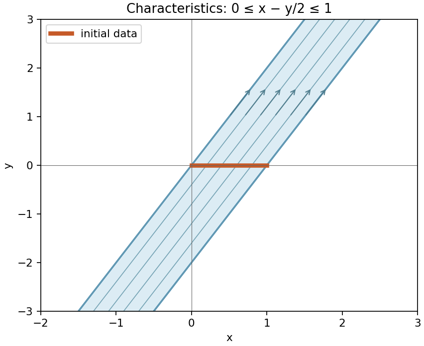

<h1 id="8/solution">Solution</h1>

↑ **Parent:** [8](../8.md)

The [characteristic equations for a transport equation](../../../characteristic-equations-for-a-transport-equation.md) are $\dot x=1$, $\dot y=2$, $\dot z=-3z$. Label an initial point by $s\in[0,1]$ and choose [characteristic](../../../characteristic-of-a-field.md) time zero on the data segment. Integration gives

$$
x=s+t,\qquad y=2t,\qquad z=e^s e^{-3t}.
$$

Thus $s=x-y/2$ and $t=y/2$, giving

$$
\boxed{z(x,y)=e^{x-2y},\qquad0\leq x-y/2\leq1.}
$$

This is the full infinite strip between the parallel [characteristic](../../../characteristic-of-a-field.md) lines $y=2x$ and $y=2x-2$. Both positive and negative [characteristic](../../../characteristic-of-a-field.md) times are allowed because the problem specifies no forward-time restriction. Each [characteristic](../../../characteristic-of-a-field.md) in this strip meets the data segment exactly once. Outside it, the general solution $z=e^{-3y/2}F(x-y/2)$ contains unrestricted values of $F$, so the data do not determine a unique solution there.

**[Figure 1](#8/image-the-data-segment-determines-the-solution-throughout-the-strip-swept-out-by-its-characteristics). The data segment determines the solution throughout the strip swept out by its characteristics**.

## ↑ Ancestors (11)

1. [8](../8.md)
2. [2009](../../2009-split.md)
3. [Past exam of the algebra, analysis and differential equations 1 course of the University of Oxford](../../split.md)
4. [Algebra, analysis and differential equations 1 course of the University of Oxford](../../../algebra-analysis-and-differential-equations-1-course-of-the-university-of-oxford.md)
5. [Year 2 of the mathematics course of the University of Oxford](../../../year-2-of-the-mathematics-course-of-the-university-of-oxford.md)
6. [Mathematics course of the University of Oxford](../../../mathematics-course-of-the-university-of-oxford.md)
7. [Undergraduate course of the University of Oxford](../../../undergraduate-course-of-the-university-of-oxford.md)
8. [Course of the University of Oxford](../../../course-of-the-university-of-oxford.md)
9. [University of Oxford](../../../university-of-oxford-split.md)
10. [List of universities](../../../list-of-universities.md)
11. [Codex Wiki](../../../split.md)
