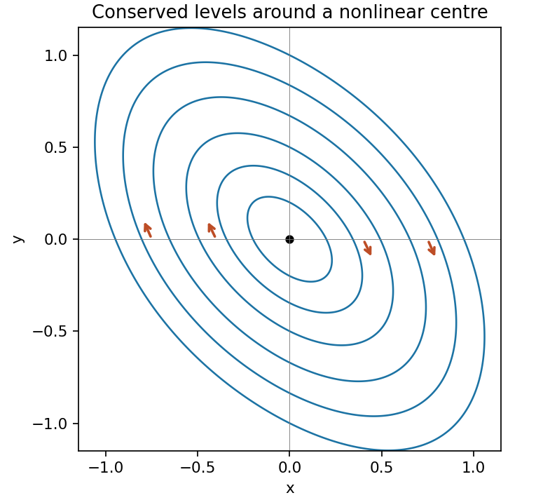

<h1 id="9/solution">Solution</h1>

↑ **Parent:** [9](../9.md)

An equilibrium has $y=-x/2$ from the first equation. Substitution in the second gives $-x(x^2+3)/2=0$, so **the origin is the only real equilibrium**. Its [Jacobian matrix](../../../jacobian-matrix.md) is

$$
J=\begin{pmatrix}1&2\\-2&-1\end{pmatrix},\qquad\lambda=\pm i\sqrt3.
$$

Purely imaginary linear [eigenvalues](../../../eigenvalue.md) alone do not classify the nonlinear equilibrium. Use instead

$$
H=x^2+xy+y^2+\frac{x^4}8.
$$

Its derivatives are $H_x=2x+y+x^3/2$ and $H_y=x+2y$, so the vector [field](../../../field.md) is $(H_y,-H_x)$. The [chain rule](../../../chain-rule.md) gives $\dot H=H_xH_y-H_yH_x=0$. Therefore the nonstationary trajectories in the [phase portrait](../../../phase-portrait.md) lie on the level curves

$$
\boxed{x^2+xy+y^2+x^4/8=C.}
$$

The quadratic part is positive definite, with [eigenvalues](../../../eigenvalue.md) $1/2$ and $3/2$, so $H$ has a strict local minimum at zero. Small positive level sets are smooth closed ovals surrounding it, and the vector [field](../../../field.md) never vanishes on them. They are periodic orbits. Thus **the origin is a nonlinear centre, Lyapunov stable but not asymptotically stable**. The near-origin ellipses have their long axis along $y=-x$. At $(x,0)$ with $x>0$, the velocity points downward, fixing clockwise orientation.

**[Figure 2](#9/image-clockwise-closed-trajectories-around-the-nonlinear-centre-given-by-the-conserved-level-sets). Clockwise closed trajectories around the nonlinear centre, given by the conserved level sets**.

## ↑ Ancestors (11)

1. [9](../9.md)
2. [2009](../../2009-split.md)
3. [Past exam of the algebra, analysis and differential equations 1 course of the University of Oxford](../../split.md)
4. [Algebra, analysis and differential equations 1 course of the University of Oxford](../../../algebra-analysis-and-differential-equations-1-course-of-the-university-of-oxford.md)
5. [Year 2 of the mathematics course of the University of Oxford](../../../year-2-of-the-mathematics-course-of-the-university-of-oxford.md)
6. [Mathematics course of the University of Oxford](../../../mathematics-course-of-the-university-of-oxford.md)
7. [Undergraduate course of the University of Oxford](../../../undergraduate-course-of-the-university-of-oxford.md)
8. [Course of the University of Oxford](../../../course-of-the-university-of-oxford.md)
9. [University of Oxford](../../../university-of-oxford-split.md)
10. [List of universities](../../../list-of-universities.md)
11. [Codex Wiki](../../../split.md)
