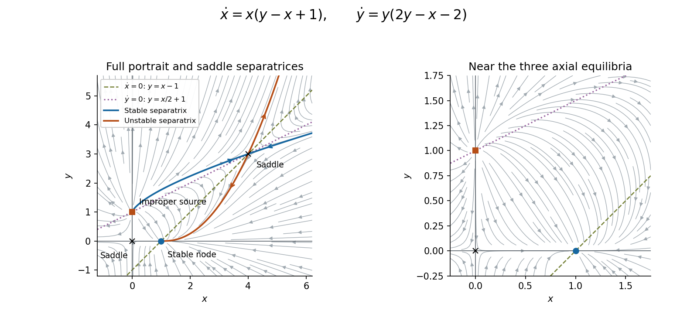

# 2011

↑ **Parent:** [Past exam of the algebra, analysis and differential equations 1 course of the University of Oxford](../past-exam-of-the-algebra-analysis-and-differential-equations-1-course-of-the-university-of-oxford.md)

Source: [released examination bundle](https://www.whatdotheyknow.com/request/maths_past_papers_3), `Part A 2007 11-1.pdf`, pages 259–264. The printed title is Algebra, Analysis and Differential Equations I. The paper is cross-listed for mathematics and mathematics and statistics and contains no printed mark allocations.

**Table of contents**

- [1](#1)
  - [a](#1/a)
    - [i](#1/a/i)
      - [Solution](#1/a/i/solution)
    - [ii](#1/a/ii)
      - [Solution](#1/a/ii/solution)
  - [b](#1/b)
    - [i](#1/b/i)
      - [Solution](#1/b/i/solution)
    - [ii](#1/b/ii)
      - [Solution](#1/b/ii/solution)
- [2](#2)
  - [a](#2/a)
    - [Solution](#2/a/solution)
  - [b](#2/b)
    - [Solution](#2/b/solution)
  - [c](#2/c)
    - [Solution](#2/c/solution)
- [3](#3)
  - [a](#3/a)
    - [Solution](#3/a/solution)
  - [b](#3/b)
    - [Solution](#3/b/solution)
  - [c](#3/c)
    - [Solution](#3/c/solution)
- [4](#4)
  - [i](#4/i)
    - [Solution](#4/i/solution)
  - [ii](#4/ii)
    - [Solution](#4/ii/solution)
  - [iii](#4/iii)
    - [Solution](#4/iii/solution)
  - [a](#4/a)
    - [Solution](#4/a/solution)
  - [b](#4/b)
    - [Solution](#4/b/solution)
  - [c](#4/c)
    - [Solution](#4/c/solution)
- [5](#5)
  - [i](#5/i)
    - [Solution](#5/i/solution)
  - [ii](#5/ii)
    - [Solution](#5/ii/solution)
  - [iii](#5/iii)
    - [Solution](#5/iii/solution)
  - [a](#5/a)
    - [Solution](#5/a/solution)
  - [b](#5/b)
    - [Solution](#5/b/solution)
- [6](#6)
  - [Solution](#6/solution)
- [7](#7)
  - [Solution](#7/solution)
- [8](#8)
  - [Solution](#8/solution)
- [9](#9)
  - [Solution](#9/solution)

## 1

↑ **Parent:** [2011](2011.md)

<h3 id="1/a">a</h3>

↑ **Parent:** [1](#1)

<h4 id="1/a/i">i</h4>

↑ **Parent:** [A](#1/a)

<h5 id="1/a/i/solution">Solution</h5>

↑ **Parent:** [I](#1/a/i)

The [annihilator of a vector subspace](../dual-space.md#annihilator-of-a-vector-subspace) is the [vector subspace](../vector-space.md#vector-subspace) of the [dual space](../dual-space.md) consisting of the [linear functionals](../dual-space.md#linear-functional) that vanish on $U$:

$$
\boxed{U^\circ=\{\lambda\in V':\lambda(u)=0\text{ for every }u\in U\}.}
$$

It is a [vector subspace](../vector-space.md#vector-subspace) because every [linear combination](../vector-space.md#linear-combination) of functionals vanishing on $U$ still vanishes there.

<h4 id="1/a/ii">ii</h4>

↑ **Parent:** [A](#1/a)

<h5 id="1/a/ii/solution">Solution</h5>

↑ **Parent:** [Ii](#1/a/ii)

For the [basis](../vector-space.md#basis) $e_1,\ldots,e_n$, define the [dual basis](../dual-space.md#dual-basis) by

$$
\boxed{e_i'(e_j)=\delta_{ij},\qquad e_i'\Bigl(\sum_j x_je_j\Bigr)=x_i.}
$$

Uniqueness of the [coordinates](../vector-space.md#coordinate-linear-algebra) makes each $e_i'$ well-defined and linear. If $\sum_i a_ie_i'=0$, evaluation at $e_j$ gives $a_j=0$, so these [linear functionals](../dual-space.md#linear-functional) are [linearly independent](../vector-space.md#linear-independence). For any $\lambda\in V'$, evaluation on each [basis vector](../vector-space.md#basis-vector) gives

$$
\lambda=\sum_i\lambda(e_i)e_i'.
$$

Both sides agree on a [basis](../vector-space.md#basis), hence on every [linear combination](../vector-space.md#linear-combination). Thus they also [span](../vector-space.md#linear-span) the [dual space](../dual-space.md) and are a [basis](../vector-space.md#basis) of it.

<h3 id="1/b">b</h3>

↑ **Parent:** [1](#1)

<h4 id="1/b/i">i</h4>

↑ **Parent:** [B](#1/b)

<h5 id="1/b/i/solution">Solution</h5>

↑ **Parent:** [I](#1/b/i)

Let $\varepsilon_i$ denote the coordinate [linear functional](../dual-space.md#linear-functional) dual to the $i$th vector of the [standard basis](../vector-space.md#standard-basis). Writing a vector in the supplied [basis](../vector-space.md#basis) gives

$$
x=c_1v_1+c_2v_2+c_3v_3+c_4v_4
=(c_1+c_2+c_3+c_4,c_2+c_3+c_4,c_3+c_4,c_4)^T.
$$

Successive differences recover the coefficients. Hence the [dual basis](../dual-space.md#dual-basis) is

$$
\boxed{v_1'=\varepsilon_1-\varepsilon_2,\quad
v_2'=\varepsilon_2-\varepsilon_3,\quad
v_3'=\varepsilon_3-\varepsilon_4,\quad v_4'=\varepsilon_4.}
$$

These formulas directly give $v_i'(v_j)=\delta_{ij}$ and exemplify the [dual basis of cumulative coordinate sums](../dual-space.md#dual-basis-of-cumulative-coordinate-sums).

<h4 id="1/b/ii">ii</h4>

↑ **Parent:** [B](#1/b)

<h5 id="1/b/ii/solution">Solution</h5>

↑ **Parent:** [Ii](#1/b/ii)

The [span](../vector-space.md#linear-span) $U$ is the coordinate plane $\{(x_1,x_2,0,0)^T\}$. Consequently its [annihilator of a vector subspace](../dual-space.md#annihilator-of-a-vector-subspace) is $U^\circ=\operatorname{span}\{\varepsilon_3,\varepsilon_4\}$. The [dual map](../dual-space.md#transpose-of-a-linear-map) is composition with $T$, so

$$
T'\varepsilon_3=\varepsilon_3,\qquad T'\varepsilon_4=0.
$$

It follows that

$$
\boxed{T'(U^\circ)=\operatorname{span}\{\varepsilon_3\}.}
$$

Equivalently, $T'(a\varepsilon_3+b\varepsilon_4)$ sends $x$ to $ax_3$.

## 2

↑ **Parent:** [2011](2011.md)

<h3 id="2/a">a</h3>

↑ **Parent:** [2](#2)

<h4 id="2/a/solution">Solution</h4>

↑ **Parent:** [A](#2/a)

The [Gram-Schmidt process](../inner-product.md#gram-schmidt-process) subtracts projections onto directions already constructed and then normalizes. Define recursively

$$
w_k=v_k-\sum_{j<k}\langle v_k,e_j\rangle e_j,\qquad e_k=\frac{w_k}{\|w_k\|},\quad k=1,\ldots,n,
$$

where the empty sum for $k=1$ is zero. Assuming the preceding $e_j$ are [orthonormal](../inner-product.md#orthonormal-set), taking the [inner product](../inner-product.md) of $w_k$ with $e_i$, $i<k$, gives zero. Moreover $w_k\ne0$: otherwise $v_k$ would belong to the [span](../vector-space.md#linear-span) of $v_1,\ldots,v_{k-1}$, contrary to [linear independence](../vector-space.md#linear-independence). Normalization is therefore legitimate and produces an [orthonormal basis](../inner-product.md#orthonormal-basis). At each stage the first $k$ constructed vectors have the same [span](../vector-space.md#linear-span) as the first $k$ original vectors.

<h3 id="2/b">b</h3>

↑ **Parent:** [2](#2)

<h4 id="2/b/solution">Solution</h4>

↑ **Parent:** [B](#2/b)

A real [inner product](../inner-product.md) must be symmetric. Here $\beta_a(e_1,e_2)=-2$ and $\beta_a(e_2,e_1)=-a$, forcing $a=2$. For this value,

$$
\beta_2(x,x)=4x_1^2-4x_1x_2+3x_2^2
=4(x_1-x_2/2)^2+2x_2^2.
$$

This is strictly positive for every nonzero [vector](../vector-space.md#vector). Bilinearity is already given, so symmetry and [positive definiteness](../bilinear-form.md#positive-definiteness) prove

$$
\boxed{a=2\text{ is the unique admissible value}.}
$$

<h3 id="2/c">c</h3>

↑ **Parent:** [2](#2)

<h4 id="2/c/solution">Solution</h4>

↑ **Parent:** [C](#2/c)

Use the [inner product](../inner-product.md) with $a=2$. The required first vector $v_1=(1/2,0)^T$ already has squared [norm](../normed-vector-space.md#norm) $4(1/2)^2=1$. Apply the [Gram-Schmidt process](../inner-product.md#gram-schmidt-process) to $v_1$ followed by $e_2=(0,1)^T$. Since $\beta(e_2,v_1)=-1$, its orthogonal remainder is $w=e_2+v_1=(1/2,1)^T$. Its squared [norm](../normed-vector-space.md#norm) is $\beta(w,w)=1-2+3=2$. Therefore an [orthonormal basis](../inner-product.md#orthonormal-basis) containing the specified vector is

$$
\boxed{\left\{\begin{pmatrix}1/2\\0\end{pmatrix},\quad
\frac1{\sqrt2}\begin{pmatrix}1/2\\1\end{pmatrix}\right\}.}
$$

The second vector may also be replaced by its negative.

## 3

↑ **Parent:** [2011](2011.md)

<h3 id="3/a">a</h3>

↑ **Parent:** [3](#3)

<h4 id="3/a/solution">Solution</h4>

↑ **Parent:** [A](#3/a)

The [Chinese remainder theorem](../mathematics.md#chinese-remainder-theorem) for two comaximal two-sided [ideals](../commutative-algebra.md#ideal) $I,J$ of a ring states that the natural [ring homomorphism](../commutative-algebra.md#ring-homomorphism) induces

$$
\boxed{R/(I\cap J)\cong R/I\times R/J\qquad(I+J=R).}
$$

Indeed, the map $r\mapsto(r+I,r+J)$ has [kernel of a ring homomorphism](../commutative-algebra.md#kernel-of-a-ring-homomorphism) $I\cap J$. Choose $i\in I$, $j\in J$ with $i+j=1$. Given target representatives $a,b\in R$, the element $aj+bi$ is congruent to $a$ modulo $I$ and to $b$ modulo $J$, proving [surjectivity](../algebra.md#surjective-function). The [first isomorphism theorem for rings](../commutative-algebra.md#first-isomorphism-theorem-for-rings) gives the result. For a commutative ring, $I\cap J=IJ$: if $x\in I\cap J$, then $x=xi+xj\in IJ$, while the reverse inclusion follows from the ideal properties.

<h3 id="3/b">b</h3>

↑ **Parent:** [3](#3)

<h4 id="3/b/solution">Solution</h4>

↑ **Parent:** [B](#3/b)

Take $R=\mathbb Z$, $I=a\mathbb Z$ and $J=b\mathbb Z$. Since $a,b$ are [coprime integers](../divisibility.md#coprime-integers), [Bézout's identity](../algebra.md#bezout-s-identity) gives $ra+sb=1$, so $I+J=\mathbb Z$. Their intersection is $ab\mathbb Z$: it consists of integers divisible by both $a$ and $b$, and coprimality makes this equivalent to divisibility by $ab$. Thus the [Chinese remainder theorem](../mathematics.md#chinese-remainder-theorem) gives

$$
\boxed{\mathbb Z_{ab}\longrightarrow\mathbb Z_a\times\mathbb Z_b,\qquad
[n]_{ab}\longmapsto([n]_a,[n]_b)}
$$

as a [ring isomorphism](../algebra.md#ring-isomorphism). This includes $a=1$ or $b=1$, where the corresponding factor is the zero ring.

<h3 id="3/c">c</h3>

↑ **Parent:** [3](#3)

<h4 id="3/c/solution">Solution</h4>

↑ **Parent:** [C](#3/c)

Let $N$ count everyone present, including the host. The grouping, seating and departure conditions give the [modular congruences](../modular-arithmetic.md#modular-congruence)

$$
N\equiv4\pmod5,\qquad N\equiv3\pmod9,\qquad N\equiv1\pmod2.
$$

The first two imply $N=39+45k$, and oddness forces $k$ even. By the [Chinese remainder theorem](../mathematics.md#chinese-remainder-theorem), the complete solution is

$$
\boxed{N\equiv39\pmod{90}.}
$$

Because not every invitee attended, at most $y-1$ guests came, so $N\leq y$. For $y=120$, the only positive possibility is **39 people**. It is feasible: seven groups of five and one of four; three tables of ten and one of nine; nineteen departing pairs and the host.

For $y=150$, both **39 and 129 people** are possible. The latter uses twenty-five groups of five and one of four, three tables of ten and eleven of nine, and sixty-four departing pairs. Thus the larger invitation count destroys uniqueness; it does not force a different attendance.

## 4

↑ **Parent:** [2011](2011.md)

<h3 id="4/i">i</h3>

↑ **Parent:** [4](#4)

<h4 id="4/i/solution">Solution</h4>

↑ **Parent:** [I](#4/i)

In the [subspace topology](../topology.md#subspace-topology) on $S$, a subset $A$ is [open](../topology.md#open-set) in $S$ precisely when $A=S\cap O$ for some [open set](../topology.md#open-set) $O\subseteq\mathbb C$. A subset $B$ is [closed](../topology.md#closed-set) in $S$ precisely when $S\setminus B$ is open in $S$, equivalently $B=S\cap F$ for some [closed set](../topology.md#closed-set) $F\subseteq\mathbb C$.

A [compact space](../topology.md#compact-space) is one for which every [open cover](../topology.md#open-cover) has a finite [subcover](../topology.md#subcover). Here the cover may use relatively open subsets of $S$, or equivalently ambient open subsets covering it. The [Heine-Borel theorem](../topology.md#heine-borel-theorem) states that

$$
\boxed{S\subseteq\mathbb C\text{ is compact}\iff S\text{ is closed and bounded}.}
$$

Closedness and boundedness here refer to the ambient [complex plane](../complex-analysis.md#complex-plane), not merely closedness in $S$ itself.

<h3 id="4/ii">ii</h3>

↑ **Parent:** [4](#4)

<h4 id="4/ii/solution">Solution</h4>

↑ **Parent:** [Ii](#4/ii)

A [connected space](../geometry-and-topology.md#connected-space) $S$ cannot be expressed as $S=A\cup B$ with $A,B$ disjoint nonempty relatively [open sets](../topology.md#open-set). Equivalently, the only subsets simultaneously relatively [open](../topology.md#open-set) and [closed](../topology.md#closed-set) are $\varnothing$ and $S$. A decomposition into such $A,B$ is a separation of the [topological space](../topology.md#topological-space).

<h3 id="4/iii">iii</h3>

↑ **Parent:** [4](#4)

<h4 id="4/iii/solution">Solution</h4>

↑ **Parent:** [Iii](#4/iii)

A [path-connected space](../geometry-and-topology.md#path-connected-space) $S$ has, for every pair $z_0,z_1\in S$, a [continuous](../calculus.md#continuous-function) path $\gamma:[0,1]\to S$ with $\gamma(0)=z_0$ and $\gamma(1)=z_1$. Every [path-connected space](../geometry-and-topology.md#path-connected-space) is a [connected space](../geometry-and-topology.md#connected-space), because a separation of the target would pull a joining path apart and contradict [connectedness of an interval](../geometry-and-topology.md#connectedness-of-an-interval).

<h3 id="4/a">a</h3>

↑ **Parent:** [4](#4)

<h4 id="4/a/solution">Solution</h4>

↑ **Parent:** [A](#4/a)

The [integers](../integer.md) are unbounded in the [complex plane](../complex-analysis.md#complex-plane), so the [Heine-Borel theorem](../topology.md#heine-borel-theorem) shows they are **not compact**. They are also **not connected**: $\{0\}$ and $\mathbb Z\setminus\{0\}$ are disjoint nonempty relatively [open sets](../topology.md#open-set) covering $\mathbb Z$. Each integer is isolated, so the induced [subspace topology](../topology.md#subspace-topology) is discrete.

<h3 id="4/b">b</h3>

↑ **Parent:** [4](#4)

<h4 id="4/b/solution">Solution</h4>

↑ **Parent:** [B](#4/b)

The disc is a [closed set](../topology.md#closed-set) and is bounded in the [complex plane](../complex-analysis.md#complex-plane), so it is **compact** by the [Heine-Borel theorem](../topology.md#heine-borel-theorem). It is [convex](../real-analysis.md#convex-function): the [triangle inequality](../topological-analysis.md#triangle-inequality) gives $|(1-t)z_0+tz_1|\leq2$ for all $t\in[0,1]$ when both endpoints lie in it. Straight segments therefore supply paths, so it is [path-connected](../geometry-and-topology.md#path-connected-space) and hence **connected**.

<h3 id="4/c">c</h3>

↑ **Parent:** [4](#4)

<h4 id="4/c/solution">Solution</h4>

↑ **Parent:** [C](#4/c)

The union is bounded but is not a [closed set](../topology.md#closed-set): the points $-1+1/n$, $n\geq2$, belong to the open disc and tend to $-1$, which lies in neither disc. Thus it is **not compact** by the [Heine-Borel theorem](../topology.md#heine-borel-theorem).

Nevertheless it is **connected**, indeed [path-connected](../geometry-and-topology.md#path-connected-space). Every point of the open disc joins $0$ by a straight segment. The segment from $0$ to $1$ stays in the union, since its points before the endpoint belong to the open disc and the endpoint $1$ belongs to the closed disc. Every point of that closed disc joins $1$ inside it by [convexity](../real-analysis.md#convex-function). Concatenating these paths joins any two points of the union. The fact that the two discs are disjoint does not imply disconnection: their contact point belongs to one of them. This illustrates [connectedness at a one-sided contact point](../geometry-and-topology.md#connectedness-at-a-one-sided-contact-point).

## 5

↑ **Parent:** [2011](2011.md)

<h3 id="5/i">i</h3>

↑ **Parent:** [5](#5)

<h4 id="5/i/solution">Solution</h4>

↑ **Parent:** [I](#5/i)

An [isolated singularity](../isolated-singularity.md) at $a$ means that the function is [holomorphic](../holomorphic-function.md) on some punctured disc $0<|z-a|<r$, while it is undefined or fails to be holomorphic at $a$. The punctured neighbourhood contains no other singularities; this isolation is needed before applying the usual removable/pole/essential classification.

<h3 id="5/ii">ii</h3>

↑ **Parent:** [5](#5)

<h4 id="5/ii/solution">Solution</h4>

↑ **Parent:** [Ii](#5/ii)

A [removable singularity](../isolated-singularity.md#removable-singularity) at $a$ is an [isolated singularity](../isolated-singularity.md) for which one can assign a value at $a$ to obtain a [holomorphic function](../holomorphic-function.md) on the whole disc. Equivalently its [Laurent series](../analysis.md#laurent-series) has no negative powers. A finite limit $L$ supplies the extension value $f(a)=L$.

<h3 id="5/iii">iii</h3>

↑ **Parent:** [5](#5)

<h4 id="5/iii/solution">Solution</h4>

↑ **Parent:** [Iii](#5/iii)

A [pole](../isolated-singularity.md#pole) of order $m\geq1$ at $a$ means

$$
\boxed{f(z)=\frac{g(z)}{(z-a)^m},\qquad g\text{ holomorphic near }a,\quad g(a)\ne0.}
$$

Equivalently the lowest nonzero power in its [Laurent series](../analysis.md#laurent-series) is $(z-a)^{-m}$. In particular, $(z-a)^mf(z)$ tends to a finite nonzero limit.

<h3 id="5/a">a</h3>

↑ **Parent:** [5](#5)

<h4 id="5/a/solution">Solution</h4>

↑ **Parent:** [A](#5/a)

The possible singular points are $i,-i,1$. Near $i$, put $h(z)=1/((z+i)(z-1)^2)$; then

$$
f(z)=\frac{h(z)-1/4}{z-i},\qquad h(i)=\frac14.
$$

The numerator vanishes at $i$, so the apparent pole cancels and **$i$ is removable**. Its extension value is $h'(i)=1/4+3i/8$, obtained from $h'/h=-1/(z+i)-2/(z-1)$.

At $-i$, the first term has a simple [pole](../isolated-singularity.md#pole) with nonzero [residue](../analysis.md#residue)

$$
\lim_{z\to-i}(z+i)f(z)=\frac1{(-2i)(-i-1)^2}=\frac14.
$$

The subtracted term is holomorphic there, so **$-i$ is a simple pole**. At $1$,

$$
\lim_{z\to1}(z-1)^2f(z)=\frac1{1^2+1}=\frac12\ne0,
$$

so **$1$ is a double pole**. There are no other finite singularities.

<h3 id="5/b">b</h3>

↑ **Parent:** [5](#5)

<h4 id="5/b/solution">Solution</h4>

↑ **Parent:** [B](#5/b)

Away from zero, singularities occur exactly when $e^{1/z}=-1$, namely

$$
\boxed{z_k=\frac1{(2k+1)\pi i},\qquad k\in\mathbb Z.}
$$

For $D(z)=z(e^{1/z}+1)$, differentiation at $z_k$ gives $D'(z_k)=1/z_k\ne0$. Thus every $z_k$ is a simple [pole](../isolated-singularity.md#pole), with [residue](../analysis.md#residue) $z_k$.

As $|k|\to\infty$, these [poles](../isolated-singularity.md#pole) accumulate at zero. Therefore **zero is a [non-isolated singularity](../isolated-singularity.md#non-isolated-singularity)**. Every punctured disc around it contains poles, so the function is not holomorphic on any punctured disc there. In particular zero cannot be classified as an isolated [essential singularity](../isolated-singularity.md#essential-singularity); the isolated-singularity classification does not apply. The displayed poles and their [accumulation point](../topology.md#limit-point) zero exhaust the finite singularities.

## 6

↑ **Parent:** [2011](2011.md)

<h3 id="6/solution">Solution</h3>

↑ **Parent:** [6](#6)

The [contour integral](../complex-analysis.md#contour-integral) along a piecewise smooth path is defined by parametrization:

$$
\int_\gamma f(z)\,dz=\int_a^b f(\gamma(t))\gamma'(t)\,dt,
$$

with a sum over the smooth pieces. The [residue theorem](../analysis.md#residue-theorem) states that for a positively oriented simple closed contour and a function holomorphic on and inside it apart from finitely many isolated singularities $a_j$ inside,

$$
\oint_\gamma f(z)\,dz=2\pi i\sum_j\operatorname{Res}(f,a_j).
$$

More generally a closed contour uses the [winding number](../complex-analysis.md#winding-number) of each singularity as its weight.

Set $z=e^{it}$, so $dt=dz/(iz)$ and $\cos t=(z+z^{-1})/2$. The required real [integral](../integral.md) becomes

$$
I=\frac1i\oint_{|z|=1}\frac{z}{2z^4+5z^2+2}\,dz.
$$

The denominator factors as $(2z^2+1)(z^2+2)$. Only the simple [poles](../isolated-singularity.md#pole) $z=\pm i/\sqrt2$ lie inside the [unit circle](../complex-analysis.md#complex-unit-circle). At either one,

$$
\operatorname{Res}\left(\frac z{2z^4+5z^2+2},z_0\right)
=\frac{z_0}{8z_0^3+10z_0}=\frac1{8z_0^2+10}=\frac16.
$$

The [residue theorem](../analysis.md#residue-theorem) now gives

$$
\boxed{I=\frac1i\,2\pi i\left(\frac16+\frac16\right)=\frac{2\pi}{3}.}
$$

## 7

↑ **Parent:** [2011](2011.md)

<h3 id="7/solution">Solution</h3>

↑ **Parent:** [7](#7)

With $y=xv$, direct differentiation gives

$$
x^2y''-2xy'+(x^2+2)y=x^3(v''+v).
$$

The homogeneous [ordinary differential equation](../differential-equation.md#ordinary-differential-equation) therefore has general solution $y=x(A\cos x+B\sin x)$. Choose

$$
y_1(x)=x\cos x,\qquad y_2(x)=x\sin x,
$$

so $y_1(\pi/2)=0$ and $y_2(\pi)=0$. Their [Wronskian](../linear-ordinary-differential-equation.md#wronskian) in the convention $W=y_1y_2'-y_1'y_2$ is $W(x)=x^2$. There is no nonzero homogeneous solution satisfying both [boundary conditions](../differential-equation.md#boundary-condition), since the first forces $B=0$ and the second forces $A=0$.

For the operator as printed, whose leading coefficient is $x^2$, the [Green's function](../green-s-function.md) is

$$
\boxed{G(x,s)=\begin{cases}
\displaystyle\frac{x\cos x\sin s}{s^3},&\pi/2\leq x\leq s\leq\pi,\\
\displaystyle\frac{x\sin x\cos s}{s^3},&\pi/2\leq s\leq x\leq\pi.
\end{cases}}
$$

It satisfies the endpoint [boundary conditions](../differential-equation.md#boundary-condition), is continuous across $x=s$, and its first derivative has jump $1/s^2$. Multiplying that jump by the leading coefficient $s^2$ produces the unit source required by a [Green's function](../green-s-function.md). This factor matters because the operator was not normalized to leading coefficient one; it is an instance of a [Green function under dependent-variable rescaling](../green-s-function.md#green-function-under-dependent-variable-rescaling).

Thus $y(x)=\int_{\pi/2}^\pi G(x,s)f(s)\,ds$. For $f(s)=s^3$, split the integral at $s=x$ to obtain

$$
\begin{aligned}
y(x)&=x\sin x\int_{\pi/2}^x\cos s\,ds+x\cos x\int_x^\pi\sin s\,ds\\
&=x\sin x(\sin x-1)+x\cos x(1+\cos x).
\end{aligned}
$$

Therefore

$$
\boxed{y(x)=x(1+\cos x-\sin x).}
$$

The substitution above gives $v''+v=1$, so the forcing is indeed $x^3$, and both endpoint values vanish.

## 8

↑ **Parent:** [2011](2011.md)

<h3 id="8/solution">Solution</h3>

↑ **Parent:** [8](#8)

Both components vanish at

$$
(0,0),\quad(1,0),\quad(0,1),\quad(4,3).
$$

The [Jacobian matrix](../multivariable-calculus.md#jacobian-matrix) of the vector field is

$$
J(x,y)=\begin{pmatrix}y-2x+1&x\\-y&4y-x-2\end{pmatrix}.
$$

Its [eigenvalues](../linear-operator-theory.md#eigenvalue) classify these [equilibria](../dynamical-systems.md#equilibrium-point-of-a-dynamical-system) by [linearization of a dynamical system](../algebra.md#linearization-of-a-dynamical-system):

$$
\boxed{\begin{array}{c|c|c}
\text{point}&\text{eigenvalues}&\text{type}\\\hline
(0,0)&1,-2&\text{saddle}\\
(1,0)&-1,-3&\text{stable node}\\
(0,1)&2,2&\text{unstable improper node}\\
(4,3)&1-\sqrt{13},\ 1+\sqrt{13}&\text{saddle}
\end{array}}
$$

All real parts are nonzero, so the linear classifications determine the local stability of the nonlinear [autonomous system](../dynamical-systems.md#autonomous-system-mathematics).

At the origin, the stable direction is the $y$-axis and the unstable direction is the $x$-axis. At $(1,0)$ the eigendirections are $(1,0)$ for $-1$ and $(1,-2)$ for $-3$. At $(0,1)$,

$$
J=\begin{pmatrix}2&0\\-1&2\end{pmatrix}
$$

has only one eigendirection, the $y$-axis; its [linearization of a dynamical system](../algebra.md#linearization-of-a-dynamical-system) has solutions $\delta x=Ae^{2t}$, $\delta y=(B-At)e^{2t}$, explaining the [improper node](../dynamical-systems.md#improper-node). At $(4,3)$, stable and unstable tangent vectors are respectively $(4,5-\sqrt{13})$ and $(4,5+\sqrt{13})$.

For the [phase portrait](../dynamical-systems.md#phase-portrait), the axes are invariant, and the remaining [nullclines](../dynamical-systems.md#nullcline) are $y=x-1$ and $y=x/2+1$. Off these lines, the complete directional information is

$$
\operatorname{sgn}\dot x=\operatorname{sgn}(x)\operatorname{sgn}(y-x+1),\qquad
\operatorname{sgn}\dot y=\operatorname{sgn}(y)\operatorname{sgn}(2y-x-2).
$$

In the positive quadrant, arrows point right above $y=x-1$ and left below it, and point up above $y=x/2+1$ and down below it. On the positive $x$-axis, trajectories tend to $(1,0)$. On the $y$-axis, $0<y<1$ flows toward the origin and $y>1$ flows upward. These signs and the saddle directions give the following sketch; the plotted curves illustrate the [phase portrait](../dynamical-systems.md#phase-portrait), with the marked saddle curves tangent to the calculated [eigenvectors](../linear-operator-theory.md#eigenvector).

**[Figure 1](#8/image-phase-portrait-with-the-four-equilibria-both-non-axis-nullclines-and-stable-and-unstable-separatrices-of-the-saddle-at-4-3-arrows-indicate-increasing-time). Phase portrait with the four equilibria, both non-axis nullclines, and stable and unstable separatrices of the saddle at (4,3). Arrows indicate increasing time.**

## 9

↑ **Parent:** [2011](2011.md)

<h3 id="9/solution">Solution</h3>

↑ **Parent:** [9](#9)

Introduce a characteristic parameter $s$ and label each point of the initial segment by $r\in[0,1]$. The [method of characteristics](../transport-equation.md#method-of-characteristics) gives

$$
\frac{dx}{ds}=x-2,\qquad\frac{dy}{ds}=y,\qquad\frac{dz}{ds}=y,
\qquad (x,y,z)|_{s=0}=(1,r,1).
$$

Integrating gives the parametric solution

$$
\boxed{x=2-e^s,\qquad y=re^s,\qquad z=1+r(e^s-1),\quad s\in\mathbb R,\quad0\leq r\leq1.}
$$

The projected [characteristic curves](../transport-equation.md#characteristic-curve) satisfy $y=r(2-x)$, so each lies on a straight line through $(2,0)$. Its branch from the data always has $x<2$; the common vertex is approached only as $s\to-\infty$.

Eliminating $s,r$ using $e^s=2-x$ and $r=y/(2-x)$ yields

$$
\boxed{z(x,y)=1+y-\frac{y}{2-x}=1+\frac{y(1-x)}{2-x}.}
$$

Its derivatives give $(x-2)z_x+yz_y=y$, and substitution of $x=1$ gives the prescribed value one.

The [Jacobian determinant](../multivariable-calculus.md#jacobian-determinant) of $(s,r)\mapsto(x,y)$ is $-e^{2s}\ne0$, and the inverse just displayed is unique. Hence the data determine the solution exactly on

$$
\boxed{\{(x,y):x<2,\ 0\leq y\leq2-x\}.}
$$

This is the [domain determined by a finite segment under a radial characteristic flow](../transport-equation.md#domain-determined-by-a-finite-segment-under-a-radial-characteristic-flow). Its interior is $x<2$, $0<y<2-x$; the two boundary rays come from the endpoints of the initial segment. Every point there lies on exactly one characteristic from the data. Outside this sector, a characteristic either misses the initial segment or lies on the branch $x>2$, which cannot reach it. Thus the formula may be extended beyond this sector, but such an extension is not uniquely specified by the given data.

## ↑ Ancestors (9)

1. [Past exam of the algebra, analysis and differential equations 1 course of the University of Oxford](../past-exam-of-the-algebra-analysis-and-differential-equations-1-course-of-the-university-of-oxford.md)
2. [Algebra, analysis and differential equations 1 course of the University of Oxford](../university-of-oxford.md#algebra-analysis-and-differential-equations-1-course-of-the-university-of-oxford)
3. [Year 2 of the mathematics course of the University of Oxford](../university-of-oxford.md#year-2-of-the-mathematics-course-of-the-university-of-oxford)
4. [Mathematics course of the University of Oxford](../university-of-oxford.md#mathematics-course-of-the-university-of-oxford)
5. [Undergraduate course of the University of Oxford](../university-of-oxford.md#undergraduate-course-of-the-university-of-oxford)
6. [Course of the University of Oxford](../university-of-oxford.md#course-of-the-university-of-oxford)
7. [University of Oxford](../university-of-oxford.md)
8. [List of universities](../README.md#list-of-universities)
9. [Codex Wiki](../README.md)
