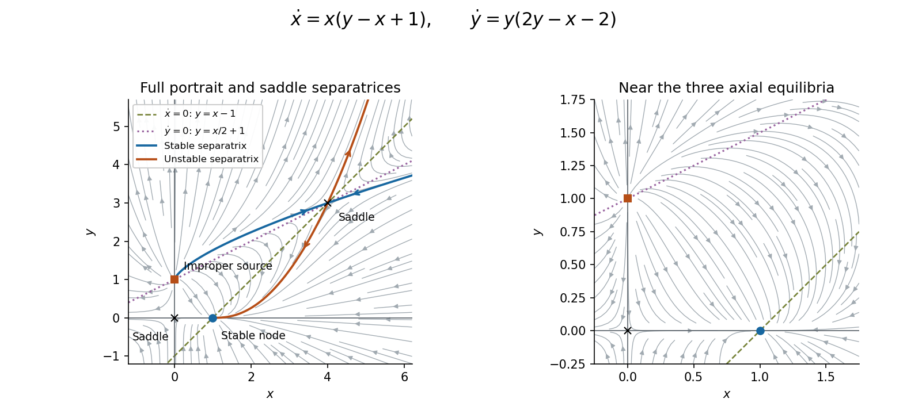

<h1 id="8/solution">Solution</h1>

↑ **Parent:** [8](../8.md)

Both components vanish at

$$
(0,0),\quad(1,0),\quad(0,1),\quad(4,3).
$$

The [Jacobian matrix](../../../jacobian-matrix.md) of the vector field is

$$
J(x,y)=\begin{pmatrix}y-2x+1&x\\-y&4y-x-2\end{pmatrix}.
$$

Its [eigenvalues](../../../eigenvalue.md) classify these [equilibria](../../../equilibrium-point-of-a-dynamical-system.md) by [linearization of a dynamical system](../../../linearization-of-a-dynamical-system.md):

$$
\boxed{\begin{array}{c|c|c}
\text{point}&\text{eigenvalues}&\text{type}\\\hline
(0,0)&1,-2&\text{saddle}\\
(1,0)&-1,-3&\text{stable node}\\
(0,1)&2,2&\text{unstable improper node}\\
(4,3)&1-\sqrt{13},\ 1+\sqrt{13}&\text{saddle}
\end{array}}
$$

All real parts are nonzero, so the linear classifications determine the local stability of the nonlinear [autonomous system](../../../autonomous-system-mathematics.md).

At the origin, the stable direction is the $y$-axis and the unstable direction is the $x$-axis. At $(1,0)$ the eigendirections are $(1,0)$ for $-1$ and $(1,-2)$ for $-3$. At $(0,1)$,

$$
J=\begin{pmatrix}2&0\\-1&2\end{pmatrix}
$$

has only one eigendirection, the $y$-axis; its [linearization of a dynamical system](../../../linearization-of-a-dynamical-system.md) has solutions $\delta x=Ae^{2t}$, $\delta y=(B-At)e^{2t}$, explaining the [improper node](../../../improper-node.md). At $(4,3)$, stable and unstable tangent vectors are respectively $(4,5-\sqrt{13})$ and $(4,5+\sqrt{13})$.

For the [phase portrait](../../../phase-portrait.md), the axes are invariant, and the remaining [nullclines](../../../nullcline.md) are $y=x-1$ and $y=x/2+1$. Off these lines, the complete directional information is

$$
\operatorname{sgn}\dot x=\operatorname{sgn}(x)\operatorname{sgn}(y-x+1),\qquad
\operatorname{sgn}\dot y=\operatorname{sgn}(y)\operatorname{sgn}(2y-x-2).
$$

In the positive quadrant, arrows point right above $y=x-1$ and left below it, and point up above $y=x/2+1$ and down below it. On the positive $x$-axis, trajectories tend to $(1,0)$. On the $y$-axis, $0<y<1$ flows toward the origin and $y>1$ flows upward. These signs and the saddle directions give the following sketch; the plotted curves illustrate the [phase portrait](../../../phase-portrait.md), with the marked saddle curves tangent to the calculated [eigenvectors](../../../eigenvector.md).

**[Figure 1](#8/image-phase-portrait-with-the-four-equilibria-both-non-axis-nullclines-and-stable-and-unstable-separatrices-of-the-saddle-at-4-3-arrows-indicate-increasing-time). Phase portrait with the four equilibria, both non-axis nullclines, and stable and unstable separatrices of the saddle at (4,3). Arrows indicate increasing time.**

## ↑ Ancestors (11)

1. [8](../8.md)
2. [2011](../../2011-split.md)
3. [Past exam of the algebra, analysis and differential equations 1 course of the University of Oxford](../../split.md)
4. [Algebra, analysis and differential equations 1 course of the University of Oxford](../../../algebra-analysis-and-differential-equations-1-course-of-the-university-of-oxford.md)
5. [Year 2 of the mathematics course of the University of Oxford](../../../year-2-of-the-mathematics-course-of-the-university-of-oxford.md)
6. [Mathematics course of the University of Oxford](../../../mathematics-course-of-the-university-of-oxford.md)
7. [Undergraduate course of the University of Oxford](../../../undergraduate-course-of-the-university-of-oxford.md)
8. [Course of the University of Oxford](../../../course-of-the-university-of-oxford.md)
9. [University of Oxford](../../../university-of-oxford-split.md)
10. [List of universities](../../../list-of-universities.md)
11. [Codex Wiki](../../../split.md)
