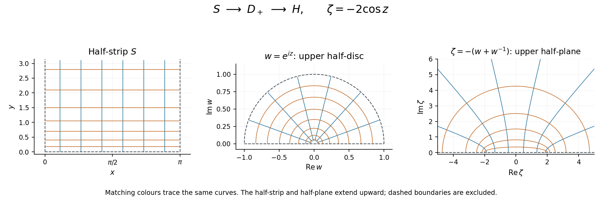

# 2012

↑ **Parent:** [Past exam of the algebra, analysis and differential equations 1 course of the University of Oxford](../past-exam-of-the-algebra-analysis-and-differential-equations-1-course-of-the-university-of-oxford.md)

This paper was printed as Algebra, Analysis and Differential Equations I and was shared by mathematics and mathematics and statistics. Source: [released examination archive](https://www.whatdotheyknow.com/request/maths_papers_2/response/1850333/attach/3/FOI%2020210708%201%20Data.zip?cookie_passthrough=1), member `FOI-20210708-1 - Data/4301 (1).pdf`, pages 1–4. The examination took place on 18 June 2012. No mark allocations are printed. The solutions cover all nine questions.

**Table of contents**

- [1](#1)
  - [a](#1/a)
    - [Solution](#1/a/solution)
  - [b](#1/b)
    - [Solution](#1/b/solution)
  - [c](#1/c)
    - [Solution](#1/c/solution)
- [2](#2)
  - [a](#2/a)
    - [Solution](#2/a/solution)
  - [b](#2/b)
    - [i](#2/b/i)
      - [Solution](#2/b/i/solution)
    - [ii](#2/b/ii)
      - [Solution](#2/b/ii/solution)
    - [iii](#2/b/iii)
      - [Solution](#2/b/iii/solution)
- [3](#3)
  - [a](#3/a)
    - [Solution](#3/a/solution)
  - [b](#3/b)
    - [Solution](#3/b/solution)
  - [c](#3/c)
    - [Solution](#3/c/solution)
- [4](#4)
  - [a](#4/a)
    - [Solution](#4/a/solution)
  - [b](#4/b)
    - [i](#4/b/i)
      - [Solution](#4/b/i/solution)
    - [ii](#4/b/ii)
      - [Solution](#4/b/ii/solution)
  - [c](#4/c)
    - [Solution](#4/c/solution)
- [5](#5)
  - [a](#5/a)
    - [Solution](#5/a/solution)
  - [b](#5/b)
    - [i](#5/b/i)
      - [Solution](#5/b/i/solution)
    - [ii](#5/b/ii)
      - [Solution](#5/b/ii/solution)
- [6](#6)
  - [Solution](#6/solution)
- [7](#7)
  - [Solution](#7/solution)
- [8](#8)
  - [Solution](#8/solution)
- [9](#9)
  - [i](#9/i)
    - [Solution](#9/i/solution)
  - [ii](#9/ii)
    - [Solution](#9/ii/solution)
  - [iii](#9/iii)
    - [Solution](#9/iii/solution)
  - [iv](#9/iv)
    - [Solution](#9/iv/solution)

## 1

↑ **Parent:** [2012](2012.md)

<h3 id="1/a">a</h3>

↑ **Parent:** [1](#1)

<h4 id="1/a/solution">Solution</h4>

↑ **Parent:** [A](#1/a)

The [dual space](../dual-space.md) consists of the [linear functionals](../dual-space.md#linear-functional) on the original [vector space](../vector-space.md), with addition and scalar multiplication defined pointwise:

$$
\boxed{V'=\operatorname{Hom}_F(V,F).}
$$

The [dual map](../dual-space.md#transpose-of-a-linear-map) acts by [function composition](../function.md#function-composition) with $T$:

$$
\boxed{T':V'\longrightarrow U',\qquad T'(\lambda)=\lambda\circ T.}
$$

For $u\in U$, its value is $(T'\lambda)(u)=\lambda(Tu)$. The composite is a [linear functional](../dual-space.md#linear-functional) because both $T$ and $\lambda$ are [linear maps](../vector-space.md#linear-map). Moreover $T'(a\lambda+b\mu)=aT'\lambda+bT'\mu$, so the [dual map](../dual-space.md#transpose-of-a-linear-map) is itself a [linear map](../vector-space.md#linear-map). Its direction is reversed because a measurement on the output of $T$ becomes a measurement on its input.

<h3 id="1/b">b</h3>

↑ **Parent:** [1](#1)

<h4 id="1/b/solution">Solution</h4>

↑ **Parent:** [B](#1/b)

The [annihilator of a vector subspace](../dual-space.md#annihilator-of-a-vector-subspace) consists of the [linear functionals](../dual-space.md#linear-functional) that vanish on every element of that [vector subspace](../vector-space.md#vector-subspace):

$$
\boxed{W^0=\{\lambda\in V':\lambda(w)=0\text{ for every }w\in W\},\qquad
\dim W^0=\dim V-\dim W.}
$$

For the [dimension](../vector-space.md#dimension-vector-space) identity, choose a [basis](../vector-space.md#basis) $w_1,\ldots,w_k$ of $W$ and use [basis extension](../vector-space.md#basis-extension) to obtain $w_1,\ldots,w_n$ for $V$. A [linear functional](../dual-space.md#linear-functional) is determined by its values on these $n$ [basis vectors](../vector-space.md#basis-vector). Belonging to the [annihilator of a vector subspace](../dual-space.md#annihilator-of-a-vector-subspace) sets its first $k$ values to zero and leaves its last $n-k$ values arbitrary. Equivalently the last $n-k$ elements of the [dual basis](../dual-space.md#dual-basis) form a [basis](../vector-space.md#basis) of $W^0$.

<h3 id="1/c">c</h3>

↑ **Parent:** [1](#1)

<h4 id="1/c/solution">Solution</h4>

↑ **Parent:** [C](#1/c)

For a [linear functional](../dual-space.md#linear-functional) $\lambda\in V'$, the definition of the [dual map](../dual-space.md#transpose-of-a-linear-map) gives

$$
\lambda\in\ker T'
\iff \lambda(Tu)=0\text{ for every }u\in U
\iff \lambda|_{\operatorname{im}T}=0.
$$

Thus the [kernel of a linear map](../kernel-of-a-linear-map.md) is precisely the [annihilator of a vector subspace](../dual-space.md#annihilator-of-a-vector-subspace)

$$
\boxed{\ker T'=(\operatorname{im}T)^0.}
$$

Write $n=\dim U$, $m=\dim V$ and $r=\dim\operatorname{im}T$. The [rank-nullity theorem](../kernel-of-a-linear-map.md#rank-nullity-theorem), the [dimension](../vector-space.md#dimension-vector-space) formula for an [annihilator of a vector subspace](../dual-space.md#annihilator-of-a-vector-subspace), and $\dim V'=m$ give

$$
\dim\operatorname{im}T'=m-\dim\ker T'=m-(m-r)=r.
$$

Applying the same [dimension](../vector-space.md#dimension-vector-space) formula in $U$ gives

$$
\dim(\ker T)^0=n-\dim\ker T=r.
$$

Finally, if $\alpha=T'\lambda$ and $u\in\ker T$, then $\alpha(u)=\lambda(Tu)=\lambda(0)=0$. Therefore $\operatorname{im}T'\subseteq(\ker T)^0$. These are finite-dimensional [vector subspaces](../vector-space.md#vector-subspace) of equal [dimension](../vector-space.md#dimension-vector-space), so inclusion is equality:

$$
\boxed{\dim\operatorname{im}T'=\dim(\ker T)^0,\qquad
\operatorname{im}T'=(\ker T)^0.}
$$

This is the [dual image and kernel annihilator identity](../dual-space.md#dual-image-and-kernel-annihilator-identity).

## 2

↑ **Parent:** [2012](2012.md)

<h3 id="2/a">a</h3>

↑ **Parent:** [2](#2)

<h4 id="2/a/solution">Solution</h4>

↑ **Parent:** [A](#2/a)

A [diagonalizable matrix](../linear-operator-theory.md#diagonalizable-matrix) over the [field](../algebra.md#field) $F$ admits an [invertible matrix](../linear-algebra.md#invertible-matrix) $P$ with entries in $F$ such that

$$
\boxed{P^{-1}AP=D\quad\text{with }D\text{ a diagonal matrix over }F.}
$$

Equivalently, the [vector space](../vector-space.md) $F^n$ has a [basis](../vector-space.md#basis) of [eigenvectors](../linear-operator-theory.md#eigenvector) of $A$. Indeed, $AP=PD$ says that each column of $P$ is an [eigenvector](../linear-operator-theory.md#eigenvector) with the corresponding diagonal entry as its [eigenvalue](../linear-operator-theory.md#eigenvalue). Requiring the [basis](../vector-space.md#basis) and [eigenvalues](../linear-operator-theory.md#eigenvalue) to lie in $F$ makes the choice of [field](../algebra.md#field) essential.

<h3 id="2/b">b</h3>

↑ **Parent:** [2](#2)

<h4 id="2/b/i">i</h4>

↑ **Parent:** [B](#2/b)

<h5 id="2/b/i/solution">Solution</h5>

↑ **Parent:** [I](#2/b/i)

Expansion down the last column gives the [characteristic polynomial](../linear-operator-theory.md#characteristic-polynomial)

$$
\chi_A(\lambda)=\det(\lambda I-A)=(\lambda-1)(\lambda^2-\lambda-1).
$$

The quadratic [polynomial](../polynomial.md) has [roots](../semisimple-lie-algebra.md#root-of-a-root-system) $(1\pm\sqrt5)/2$, which are not [rational numbers](../number-theory.md#rational-number). For example, the [rational root theorem](../mathematics.md#rational-root-theorem) restricts any rational root of this monic integer [polynomial](../polynomial.md) to $1$ or $-1$, and neither works. If $A$ had a [diagonalization](../linear-operator-theory.md#diagonalization-of-a-matrix) over $\mathbb Q$, its [characteristic polynomial](../linear-operator-theory.md#characteristic-polynomial) would be a product of linear factors with [rational numbers](../number-theory.md#rational-number) as their [roots](../semisimple-lie-algebra.md#root-of-a-root-system). It is not, so **$A$ is not diagonalizable over $\mathbb Q$**.

<h4 id="2/b/ii">ii</h4>

↑ **Parent:** [B](#2/b)

<h5 id="2/b/ii/solution">Solution</h5>

↑ **Parent:** [Ii](#2/b/ii)

Over the [complex numbers](../complex-analysis.md#complex-number), the [eigenvalues](../linear-operator-theory.md#eigenvalue)

$$
1,\qquad \lambda_+=\frac{1+\sqrt5}{2},\qquad
\lambda_-=\frac{1-\sqrt5}{2}
$$

are distinct. Thus [distinct eigenvalues imply diagonalizability](../linear-operator-theory.md#distinct-eigenvalues-imply-diagonalizability), and **$A$ is diagonalizable over $\mathbb C$**, in fact already over $\mathbb R$.

An explicit [eigenbasis](../linear-operator-theory.md#eigenbasis) is

$$
e_3=\begin{pmatrix}0\\0\\1\end{pmatrix},\qquad
v_+=\begin{pmatrix}1\\\lambda_+\\\lambda_++1\end{pmatrix},\qquad
v_-=\begin{pmatrix}1\\\lambda_-\\\lambda_-+1\end{pmatrix}.
$$

For either quadratic [root](../semisimple-lie-algebra.md#root-of-a-root-system) $\lambda$, the identity $\lambda^2=\lambda+1$ verifies $Av_\lambda=\lambda v_\lambda$. Taking these three columns as $P$ gives $P^{-1}AP=\operatorname{diag}(1,\lambda_+,\lambda_-)$. Their distinct [eigenvalues](../linear-operator-theory.md#eigenvalue) ensure [linear independence](../vector-space.md#linear-independence).

<h4 id="2/b/iii">iii</h4>

↑ **Parent:** [B](#2/b)

<h5 id="2/b/iii/solution">Solution</h5>

↑ **Parent:** [Iii](#2/b/iii)

In the [finite field](../algebra.md#finite-field) $\mathbb F_5=\mathbb Z/5\mathbb Z$, the [characteristic polynomial](../linear-operator-theory.md#characteristic-polynomial) becomes

$$
\chi_A(\lambda)=(\lambda-1)(\lambda-3)^2,
$$

because $(\lambda-3)^2=\lambda^2-\lambda-1$ modulo $5$. Splitting into linear factors does not by itself guarantee [diagonalizability](../linear-operator-theory.md#diagonalizable-matrix): the repeated [eigenvalue](../linear-operator-theory.md#eigenvalue) needs enough [eigenvectors](../linear-operator-theory.md#eigenvector).

Solving $(A-3I)(x,y,z)^T=0$ gives

$$
2x+y=0,\qquad x+3y=0,\qquad y+3z=0,
$$

so $y=3x$ and $z=4x$. Hence

$$
\ker(A-3I)=\operatorname{span}_{\mathbb F_5}\{(1,3,4)^T\}
$$

has [dimension](../vector-space.md#dimension-vector-space) one, although $3$ has [algebraic multiplicity](../linear-operator-theory.md#algebraic-multiplicity) two. The [geometric multiplicity](../linear-operator-theory.md#geometric-multiplicity) is too small, and **$A$ is not diagonalizable over $\mathbb F_5$**. This illustrates [diagonalizability depends on the field](../linear-operator-theory.md#diagonalizability-depends-on-the-field): characteristic zero gave three distinct [eigenvalues](../linear-operator-theory.md#eigenvalue), while reduction modulo $5$ merges two of them.

## 3

↑ **Parent:** [2012](2012.md)

<h3 id="3/a">a</h3>

↑ **Parent:** [3](#3)

<h4 id="3/a/solution">Solution</h4>

↑ **Parent:** [A](#3/a)

A [prime ideal](../commutative-algebra.md#prime-ideal) is a proper [ideal](../commutative-algebra.md#ideal) $I\ne R$ such that $ab\in I$ implies $a\in I$ or $b\in I$. A [maximal ideal](../commutative-algebra.md#maximal-ideal) is a proper [ideal](../commutative-algebra.md#ideal) $I\ne R$ such that there is no [ideal](../commutative-algebra.md#ideal) strictly between $I$ and $R$.

Every [ideal](../commutative-algebra.md#ideal) of the [integers](../integer.md) has the form $(n)=n\mathbb Z$ for a unique nonnegative integer $n$. Its [prime ideals](../commutative-algebra.md#prime-ideal) and [maximal ideals](../commutative-algebra.md#maximal-ideal) are respectively

$$
\boxed{\{(0)\}\cup\{(p):p\text{ prime}\},\qquad
\{(p):p\text{ prime}\}.}
$$

The zero [ideal](../commutative-algebra.md#ideal) is a [prime ideal](../commutative-algebra.md#prime-ideal) because the [integers](../integer.md) form an [integral domain](../commutative-algebra.md#integral-domain). For a [prime number](../prime-number.md) $p$, divisibility of $ab$ by $p$ forces divisibility of one factor, so $(p)$ is a [prime ideal](../commutative-algebra.md#prime-ideal). Also any [ideal](../commutative-algebra.md#ideal) $(d)$ containing $(p)$ has $d\mid p$, so it equals $(p)$ or $(1)$; thus $(p)$ is a [maximal ideal](../commutative-algebra.md#maximal-ideal).

If $n>1$ is composite, write $n=ab$ with $1<a,b<n$. Then $ab\in(n)$ while neither factor belongs to $(n)$, so $(n)$ is not a [prime ideal](../commutative-algebra.md#prime-ideal). A [prime number](../prime-number.md) $p\mid n$ gives $(n)\subsetneq(p)\subsetneq\mathbb Z$, so $(n)$ is not a [maximal ideal](../commutative-algebra.md#maximal-ideal) either. The zero [ideal](../commutative-algebra.md#ideal) is not maximal since $(0)\subsetneq(2)\subsetneq\mathbb Z$, and $(1)=\mathbb Z$ is not proper.

<h3 id="3/b">b</h3>

↑ **Parent:** [3](#3)

<h4 id="3/b/solution">Solution</h4>

↑ **Parent:** [B](#3/b)

If the [quotient ring](../commutative-algebra.md#quotient-ring) $R/I$ is an [integral domain](../commutative-algebra.md#integral-domain), then $I\ne R$, because an [integral domain](../commutative-algebra.md#integral-domain) has $1\ne0$. For $ab\in I$,

$$
(a+I)(b+I)=0+I.
$$

There are no nonzero [zero divisors](../mathematics.md#zero-divisor) in an [integral domain](../commutative-algebra.md#integral-domain), so $a+I=0+I$ or $b+I=0+I$. Thus $a\in I$ or $b\in I$, proving **$I$ is a prime ideal**.

If $R/I$ is a [field](../algebra.md#field), again $I$ is proper. Let $J$ be an [ideal](../commutative-algebra.md#ideal) properly containing $I$, and choose $a\in J\setminus I$. The nonzero element $a+I$ has a [multiplicative inverse](../arithmetic.md#multiplicative-inverse) $b+I$, so $ab-1\in I\subset J$. Since $ab\in J$, subtraction gives $1\in J$, hence $J=R$. Therefore **$I$ is a maximal ideal**. These arguments establish the relevant [prime ideal quotient criterion](../commutative-algebra.md#prime-ideal-quotient-criterion) and [maximal ideal quotient criterion](../commutative-algebra.md#maximal-ideal-quotient-criterion).

<h3 id="3/c">c</h3>

↑ **Parent:** [3](#3)

<h4 id="3/c/solution">Solution</h4>

↑ **Parent:** [C](#3/c)

Set $X=0$ to define a surjective [ring homomorphism](../commutative-algebra.md#ring-homomorphism)

$$
E:\mathbb Q[X,Y]\longrightarrow\mathbb Q[Y],\qquad E(P)=P(0,Y).
$$

Its [kernel of a ring homomorphism](../commutative-algebra.md#kernel-of-a-ring-homomorphism) is exactly $(X)$: the constant coefficient in $X$ must vanish, so every remaining monomial is divisible by $X$. The [first isomorphism theorem for rings](../commutative-algebra.md#first-isomorphism-theorem-for-rings) therefore gives

$$
\boxed{\mathbb Q[X,Y]/(X)\cong\mathbb Q[Y].}
$$

The [polynomial ring](../commutative-algebra.md#polynomial-ring) $\mathbb Q[Y]$ is an [integral domain](../commutative-algebra.md#integral-domain), because the product of two nonzero [polynomials](../polynomial.md) has nonzero leading coefficient. It is not a [field](../algebra.md#field): $Y$ has no polynomial [multiplicative inverse](../arithmetic.md#multiplicative-inverse), since a nonzero product $YQ(Y)$ has positive [degree of a polynomial](../polynomial.md#degree-of-a-polynomial). Consequently **$(X)$ is prime and is not maximal**. Concretely, $(X)\subsetneq(X,Y)\subsetneq\mathbb Q[X,Y]$ is a strict chain of [ideals](../commutative-algebra.md#ideal).

## 4

↑ **Parent:** [2012](2012.md)

<h3 id="4/a">a</h3>

↑ **Parent:** [4](#4)

<h4 id="4/a/solution">Solution</h4>

↑ **Parent:** [A](#4/a)

A subset $\Omega\subseteq\mathbb R^n$ is an [open set](../topology.md#open-set) if every $x\in\Omega$ admits a radius $r>0$ such that the [open ball](../topology.md#open-ball)

$$
B(x,r)=\{y\in\mathbb R^n:|y-x|<r\}
$$

is contained in $\Omega$. A subset $F\subseteq\mathbb R^n$ is a [closed set](../topology.md#closed-set) if its [complement](../set.md#complement-of-a-set) $\mathbb R^n\setminus F$ is an [open set](../topology.md#open-set). Equivalently, $F$ contains the [limit](../calculus.md#limit-of-a-function) of every [convergent sequence](../sequence-and-series.md#convergent-sequence) of its points.

<h3 id="4/b">b</h3>

↑ **Parent:** [4](#4)

<h4 id="4/b/i">i</h4>

↑ **Parent:** [B](#4/b)

<h5 id="4/b/i/solution">Solution</h5>

↑ **Parent:** [I](#4/b/i)

The [distance to a set](../topological-analysis.md#distance-to-a-set) is nonnegative and finite here: any fixed $y_0\in F$ gives $0\leq f(x)\leq|x-y_0|$. For every $y\in F$, the [triangle inequality](../topological-analysis.md#triangle-inequality) gives

$$
|x-y|\leq|x-x'|+|x'-y|.
$$

Taking the [infimum](../real-analysis.md#infimum) over $y\in F$ yields $f(x)\leq|x-x'|+f(x')$. Interchanging $x$ and $x'$ proves

$$
\boxed{|f(x)-f(x')|\leq|x-x'|.}
$$

Thus $f$ is a [Lipschitz function](../real-analysis.md#lipschitz-continuity) with [Lipschitz constant](../real-analysis.md#lipschitz-constant) one, so it is [continuous](../calculus.md#continuous-function). In the epsilon-delta definition of [continuity](../calculus.md#continuous-function), choose $\delta=\varepsilon$.

<h4 id="4/b/ii">ii</h4>

↑ **Parent:** [B](#4/b)

<h5 id="4/b/ii/solution">Solution</h5>

↑ **Parent:** [Ii](#4/b/ii)

If $x\in F$, using $y=x$ in the [infimum](../real-analysis.md#infimum) gives $0\leq f(x)\leq0$, so $f(x)=0$.

Conversely, if $f(x)=0$, the definition of the [infimum](../real-analysis.md#infimum) allows a choice $y_j\in F$ with $|x-y_j|<1/j$. The [sequence](../sequence-and-series.md#sequence) $y_j$ is therefore a [convergent sequence](../sequence-and-series.md#convergent-sequence) with [limit](../calculus.md#limit-of-a-function) $x$. Since $F$ is a [closed set](../topology.md#closed-set), its [limit](../calculus.md#limit-of-a-function) $x$ belongs to $F$. Hence

$$
\boxed{f(x)=0\iff x\in F.}
$$

Closedness matters: without it, zero [distance to a set](../topological-analysis.md#distance-to-a-set) characterizes its [closure](../topology.md#closure-topology), which can contain additional points.

<h3 id="4/c">c</h3>

↑ **Parent:** [4](#4)

<h4 id="4/c/solution">Solution</h4>

↑ **Parent:** [C](#4/c)

Put $F=\mathbb R^n\setminus\Omega$. This is a [closed set](../topology.md#closed-set). First assume $F$ is nonempty. The [Heine-Borel theorem](../topology.md#heine-borel-theorem) makes the nonempty bounded [closed set](../topology.md#closed-set) $K$ a [compact set](../topology.md#compact-space). By the preceding parts, $x\mapsto d(x,F)$ is a [continuous function](../calculus.md#continuous-function) and is strictly positive at every $x\in K$, because $K\subset\Omega$.

The [extreme value theorem](../real-analysis.md#extreme-value-theorem) gives $x_*\in K$ attaining its minimum. Therefore

$$
\boxed{\operatorname{dist}(K,F)=\min_{x\in K}d(x,F)=d(x_*,F)>0.}
$$

The equality with the [distance between two sets](../topological-analysis.md#distance-between-two-sets) follows by taking the two [infima](../real-analysis.md#infimum) successively. Crucially, [compactness](../topology.md#compact-space) supplies a point attaining the minimum; positivity at each point alone would not make an arbitrary [infimum](../real-analysis.md#infimum) positive. This is the principle that a [compact subset of an open set has positive distance from its complement](../topological-analysis.md#compact-subset-of-an-open-set-has-positive-distance-from-its-complement).

If $\Omega=\mathbb R^n$, its [complement](../set.md#complement-of-a-set) is empty. With the usual extended-real convention $\inf\varnothing=+\infty$, the stated inequality holds in that case too.

## 5

↑ **Parent:** [2012](2012.md)

<h3 id="5/a">a</h3>

↑ **Parent:** [5](#5)

<h4 id="5/a/solution">Solution</h4>

↑ **Parent:** [A](#5/a)

A [holomorphic function](../holomorphic-function.md) on the [open set](../topology.md#open-set) $\Omega$ is [complex differentiable](../holomorphic-function.md#complex-differentiability) at every point of $\Omega$: the [limit](../calculus.md#limit-of-a-function)

$$
f'(z)=\lim_{h\to0,\ h\in\mathbb C}\frac{f(z+h)-f(z)}h
$$

exists independently of the direction of approach. Write $f(x+iy)=u(x,y)+iv(x,y)$. The [Cauchy-Riemann equations](../analysis.md#cauchy-riemann-equations) are

$$
\boxed{u_x=v_y,\qquad u_y=-v_x.}
$$

To prove necessity, approach first with real $h$, obtaining $f'(z)=u_x+iv_x$. Approach instead with $h=it$ for real $t$, obtaining

$$
f'(z)=\frac1i(u_y+iv_y)=v_y-iu_y.
$$

Equality of real and imaginary parts yields the displayed [Cauchy-Riemann equations](../analysis.md#cauchy-riemann-equations).

A sufficient condition is that $u$ and $v$ have continuous first [partial derivatives](../multivariable-calculus.md#partial-derivative) throughout $\Omega$ and satisfy the [Cauchy-Riemann equations](../analysis.md#cauchy-riemann-equations) there. Indeed, real [differentiability](../analysis.md#differentiability) gives, for $h=a+ib$,

$$
f(z+h)-f(z)=f_xa+f_yb+o(|h|).
$$

The [Cauchy-Riemann equations](../analysis.md#cauchy-riemann-equations) imply $f_y=if_x$, so this is $f_xh+o(|h|)$. Dividing by $h$ proves [complex differentiability](../holomorphic-function.md#complex-differentiability) and $f'(z)=f_x(z)$ at every point. Merely having first [partial derivatives](../multivariable-calculus.md#partial-derivative) and the equations at a point, without a suitable differentiability hypothesis, would not justify this argument.

<h3 id="5/b">b</h3>

↑ **Parent:** [5](#5)

<h4 id="5/b/i">i</h4>

↑ **Parent:** [B](#5/b)

<h5 id="5/b/i/solution">Solution</h5>

↑ **Parent:** [I](#5/b/i)

For the [continuously differentiable function](../multivariable-calculus.md#continuously-differentiable-function) $f=u+iv$, the specified [Wirtinger derivative](../analysis.md#wirtinger-derivatives) is

$$
\frac{\partial f}{\partial\bar z}
=\frac12\bigl(u_x+iv_x+i(u_y+iv_y)\bigr)
=\frac12\bigl((u_x-v_y)+i(v_x+u_y)\bigr).
$$

A [complex number](../complex-analysis.md#complex-number) vanishes exactly when both real and imaginary parts vanish. Consequently

$$
\boxed{\frac{\partial f}{\partial\bar z}=0
\iff u_x=v_y\text{ and }u_y=-v_x.}
$$

Thus the two real [Cauchy-Riemann equations](../analysis.md#cauchy-riemann-equations) are one complex equation expressed by the [Wirtinger derivative](../analysis.md#wirtinger-derivatives).

<h4 id="5/b/ii">ii</h4>

↑ **Parent:** [B](#5/b)

<h5 id="5/b/ii/solution">Solution</h5>

↑ **Parent:** [Ii](#5/b/ii)

The [continuously differentiable function](../multivariable-calculus.md#continuously-differentiable-function) $z\bar z=x^2+y^2$ is a particular solution, since

$$
\frac{\partial}{\partial\bar z}(x^2+y^2)
=\frac12(2x+i,2y)=z.
$$

If $f$ is any solution, set $h(z)=f(z)-z\bar z$. Then $h$ is [continuously differentiable](../multivariable-calculus.md#continuously-differentiable-function) and its [Wirtinger derivative](../analysis.md#wirtinger-derivatives) vanishes. By the preceding part and the sufficient [Cauchy-Riemann equations](../analysis.md#cauchy-riemann-equations) criterion, $h$ is a [holomorphic function](../holomorphic-function.md) on all of $\mathbb C$, hence an [entire function](../holomorphic-function.md#entire-function).

Conversely, every [entire function](../holomorphic-function.md#entire-function) $h$ has vanishing [Wirtinger derivative](../analysis.md#wirtinger-derivatives), so addition of $h$ preserves the prescribed derivative. Therefore all solutions are

$$
\boxed{f(z)=|z|^2+h(z),\qquad h\text{ any entire function}.}
$$

This is an [inhomogeneous Wirtinger equation with holomorphic forcing](../analysis.md#inhomogeneous-wirtinger-equation-with-holomorphic-forcing): a particular solution plus an arbitrary element of the homogeneous solution space.

## 6

↑ **Parent:** [2012](2012.md)

<h3 id="6/solution">Solution</h3>

↑ **Parent:** [6](#6)

A [conformal map](../geometry-and-topology.md#conformal-map) preserves oriented [angles](../geometry-and-topology.md#angle) between intersecting smooth curves at each point, with a nonzero local scale factor. A sufficient criterion is that $f$ be a [holomorphic function](../holomorphic-function.md) on the [domain](../topology.md#domain-mathematical-analysis) and that $f'(z)\ne0$ everywhere there. Its first-order action then multiplies every tangent direction by the same nonzero [complex number](../complex-analysis.md#complex-number), combining a rotation and a dilation. A conformal bijection additionally requires [injectivity](../algebra.md#injective-function) and [surjectivity](../algebra.md#surjective-function) onto the target.

For $z=x+iy$ in the given half-strip,

$$
w=e^{iz}=e^{-y}(\cos x+i\sin x).
$$

Thus $0<|w|<1$ and $0<\arg w<\pi$. Conversely every such $w$ has a unique argument in $(0,\pi)$ and unique radius in $(0,1)$, giving $x=\arg w$, $y=-\log|w|$. Hence

$$
\boxed{e^{iS}=D_+=\{w:|w|<1,\ \operatorname{Im}w>0\}.}
$$

The [complex exponential](../calculus.md#complex-exponential-function) is [injective](../algebra.md#injective-function) on $S$, and its [derivative](../calculus.md#derivative) $ie^{iz}$ never vanishes.

On $D_+$, use the [Joukowski map](../geometry-and-topology.md#joukowski-map) with a sign change,

$$
J(w)=-\left(w+\frac1w\right).
$$

Since

$$
\operatorname{Im}J(w)=\operatorname{Im}w\left(\frac1{|w|^2}-1\right)>0,
$$

it maps into the [upper half-plane](../complex-analysis.md#upper-half-plane-complex-analysis). To prove [injectivity](../algebra.md#injective-function), $J(w_1)=J(w_2)$ gives

$$
(w_1-w_2)\left(1-\frac1{w_1w_2}\right)=0.
$$

Both moduli are below one, so $w_1w_2\ne1$ and $w_1=w_2$.

For [surjectivity](../algebra.md#surjective-function), take any $\zeta$ in the [upper half-plane](../complex-analysis.md#upper-half-plane-complex-analysis) and solve $w^2+\zeta w+1=0$. The two [roots](../semisimple-lie-algebra.md#root-of-a-root-system) have product one. Neither can lie on the [unit circle](../complex-analysis.md#complex-unit-circle), since there $-(w+w^{-1})$ is real. Exactly one [root](../semisimple-lie-algebra.md#root-of-a-root-system) therefore has modulus below one. For this [root](../semisimple-lie-algebra.md#root-of-a-root-system), the displayed imaginary-part identity forces $\operatorname{Im}w>0$, so it belongs to $D_+$. Finally $J'(w)=w^{-2}-1$ has no [zero](../polynomial.md#zero-of-a-function) in $D_+$. This proves the [Joukowski map from the upper half-disc to the upper half-plane](../geometry-and-topology.md#joukowski-map-from-the-upper-half-disc-to-the-upper-half-plane) is a conformal bijection.

Composing gives the required [conformal map](../geometry-and-topology.md#conformal-map)

$$
\boxed{F(z)=J(e^{iz})=-e^{iz}-e^{-iz}=-2\cos z:\ S\longrightarrow H.}
$$

Its [derivative](../calculus.md#derivative) $2\sin z$ is nonzero on $S$, since the [zeros](../polynomial.md#zero-of-a-function) of the complex [sine](../geometry-and-topology.md#sine) are the real integer multiples of $\pi$.

**[Figure 1](#6/image-the-half-strip-maps-to-the-upper-half-disc-by-the-complex-exponential-and-then-to-the-upper-half-plane-by-a-joukowski-map-matching-colours-follow-curves-through-both-maps). The half-strip maps to the upper half-disc by the complex exponential and then to the upper half-plane by a Joukowski map. Matching colours follow curves through both maps.**

## 7

↑ **Parent:** [2012](2012.md)

<h3 id="7/solution">Solution</h3>

↑ **Parent:** [7](#7)

Near $x=0$, [separation of variables](../partial-differential-equation.md#separation-of-variables) gives $dy/y=dx/(1-x)$, so $\log|y|=-\log(1-x)+C$. The [initial condition](../differential-equation.md#initial-condition) selects

$$
\boxed{y(x)=\frac1{1-x},\qquad -\infty<x<1.}
$$

Direct substitution verifies both the [ordinary differential equation](../differential-equation.md#ordinary-differential-equation) and the [initial condition](../differential-equation.md#initial-condition). The endpoint $x=1$ is excluded because the coefficient and this solution are singular there; the displayed interval is the maximal connected real interval containing the initial point.

For $|x|\leq h<1$ and any two admissible values $y,\widetilde y$,

$$
|f(x,y)-f(x,\widetilde y)|
=\frac{|y-\widetilde y|}{|1-x|}
\leq\frac1{1-h}|y-\widetilde y|.
$$

This is a [Lipschitz condition](../real-analysis.md#lipschitz-continuity) in the dependent variable, uniform in $x$, with [Lipschitz constant](../real-analysis.md#lipschitz-constant) $L=(1-h)^{-1}$. Also $|f(x,y)|\leq(1+k)/(1-h)$ on the prescribed rectangle, so the usual local hypotheses of the [Picard-Lindelöf theorem](../differential-equation.md#picard-lindelof-theorem) hold.

Integrating from the initial point gives the [integral equation](../analysis.md#integral-equation)

$$
y(x)=1+\int_0^x\frac{y(t)}{1-t}\,dt.
$$

Conversely, differentiating this equation using the [fundamental theorem of calculus](../calculus.md#fundamental-theorem-of-calculus) recovers the [initial value problem](../differential-equation.md#initial-value-problem). Start [Picard iteration](../differential-equation.md#picard-iteration) with the constant initial approximation $y_0(x)=1$ and set

$$
y_{n+1}(x)=1+\int_0^x\frac{y_n(t)}{1-t}\,dt.
$$

The first three approximations are

$$
\boxed{y_0=1,\qquad y_1=1-\log(1-x),\qquad
y_2=1-\log(1-x)+\frac12\log^2(1-x).}
$$

To prove the general expression by [mathematical induction](../foundations-of-mathematics.md#mathematical-induction), put $\ell(x)=\log(1-x)$. The initial approximation gives the formula for $n=0$. If it holds for $n$, then the [substitution rule](../integral.md#integration-by-substitution)

$$
\int_0^x\frac{\ell(t)^k}{1-t}\,dt=-\frac{\ell(x)^{k+1}}{k+1}
$$

gives

$$
y_{n+1}(x)=1+\sum_{k=0}^n\frac{(-1)^{k+1}\ell(x)^{k+1}}{(k+1)!}
=\sum_{k=0}^{n+1}\frac{(-1)^k\ell(x)^k}{k!}.
$$

Thus the formula follows at every stage.

For every fixed real $x<1$, these are partial sums of the [exponential series](../calculus.md#exponential-series) evaluated at the finite real number $-\log(1-x)$. Therefore

$$
\boxed{\lim_{n\to\infty}y_n(x)=\exp(-\log(1-x))=\frac1{1-x}
\quad\text{for every }x<1.}
$$

This range is larger than $|x|<1$: the expansion is in powers of $\log(1-x)$, not a [Taylor series](../calculus.md#taylor-series) in $x$. For example it converges at $x=-2$. It also converges uniformly on every [compact interval](../real-analysis.md#compact-interval) contained in $(-\infty,1)$, because $|\log(1-x)|$ is bounded there and the [exponential series](../calculus.md#exponential-series) supplies a uniform summable bound. At $x=1$ the approximations are undefined, while for $x>1$ the real integral from zero crosses the singularity. This is [Picard iteration for a simple-pole linear differential equation](../differential-equation.md#picard-iteration-for-a-simple-pole-linear-differential-equation).

## 8

↑ **Parent:** [2012](2012.md)

<h3 id="8/solution">Solution</h3>

↑ **Parent:** [8](#8)

For a second-order [linear partial differential equation](../partial-differential-equation.md#linear-partial-differential-equation) with principal part $Au_{xx}+2Bu_{xy}+Cu_{yy}$, the discriminant is $B^2-AC$. Here $A=1$, $B=0$, $C=-x^2$, so

$$
\boxed{B^2-AC=x^2>0\quad(x>0).}
$$

The equation is therefore a [hyperbolic partial differential equation](../partial-differential-equation.md#hyperbolic-partial-differential-equation) throughout its domain. The lower-order term $-u_x/x$ does not affect this classification.

The [characteristic curves](../transport-equation.md#characteristic-curve) satisfy

$$
A(dy)^2-2B\,dx\,dy+C(dx)^2=0,
\qquad \frac{dy}{dx}=\pm x.
$$

Integrating gives the two families $y\mp x^2/2=\text{constant}$. Choose coordinates constant along these families:

$$
\xi=x^2-2y,\qquad\eta=x^2+2y.
$$

Their [Jacobian determinant](../multivariable-calculus.md#jacobian-determinant) is $8x\ne0$, so they define an invertible [change of variables](../multivariable-calculus.md#change-of-variables-formula) on $x>0$, with image $\xi+\eta>0$. Write $u(x,y)=U(\xi,\eta)$. The [chain rule](../calculus.md#chain-rule) gives

$$
\begin{aligned}
u_x&=2x(U_\xi+U_\eta),\\
u_{xx}&=2(U_\xi+U_\eta)+4x^2(U_{\xi\xi}+2U_{\xi\eta}+U_{\eta\eta}),\\
u_{yy}&=4(U_{\xi\xi}-2U_{\xi\eta}+U_{\eta\eta}).
\end{aligned}
$$

Both the pure second [partial derivatives](../multivariable-calculus.md#partial-derivative) and the first [partial derivatives](../multivariable-calculus.md#partial-derivative) cancel in the original equation, leaving

$$
16x^2U_{\xi\eta}=0,\qquad\boxed{U_{\xi\eta}=0.}
$$

This is the full [canonical form of a second-order partial differential equation](../partial-differential-equation.md#canonical-form-of-a-second-order-partial-differential-equation), including the effect of the lower-order term. Integrating shows $U_\xi$ is a function of $\xi$ alone, hence

$$
\boxed{u(x,y)=f(x^2-2y)+g(x^2+2y),}
$$

with arbitrary twice [differentiable functions](../analysis.md#differentiable-function) $f,g$. The representation is global on $x>0$: for each fixed $\xi$, the allowed $\eta>-\xi$ form an interval, so $U_\xi$ is independent of $\eta$ throughout that interval; after subtracting its antiderivative, the same reasoning in the other coordinate leaves only $g(\eta)$. These are [quadratic characteristic coordinates for a variable-speed wave equation](../partial-differential-equation.md#quadratic-characteristic-coordinates-for-a-variable-speed-wave-equation).

For the data on $x=1$, set $s=1-2y$, so the other argument is $2-s$. The two [initial conditions](../differential-equation.md#initial-condition) become

$$
f(s)+g(2-s)=1,\qquad 2\bigl(f'(s)+g'(2-s)\bigr)=2.
$$

Differentiating the first equation with respect to $s$ also gives $f'(s)-g'(2-s)=0$. Solving these two linear equations yields $f'(s)=g'(2-s)=1/2$. Since $s$ ranges over all real numbers,

$$
f(s)=\frac{s}{2}+C,\qquad g(t)=\frac{t}{2}-C.
$$

Consequently

$$
\boxed{u(x,y)=x^2.}
$$

Indeed $u_{xx}=2$, $u_{yy}=0$, $u_x=2x$, so the equation and both [initial conditions](../differential-equation.md#initial-condition) hold directly.

## 9

↑ **Parent:** [2012](2012.md)

<h3 id="9/i">i</h3>

↑ **Parent:** [9](#9)

<h4 id="9/i/solution">Solution</h4>

↑ **Parent:** [I](#9/i)

For the [Laplace transform of a derivative](../integral-transform.md#laplace-transform-of-a-derivative), first apply [integration by parts](../calculus.md#integration-by-parts) on a finite interval:

$$
\int_0^T e^{-pt}\dot x(t)\,dt
=e^{-pT}x(T)-x(0)+p\int_0^T e^{-pt}x(t)\,dt.
$$

Under the usual transform hypotheses, including sufficient regularity for [integration by parts](../calculus.md#integration-by-parts), existence of the derivative's [Laplace transform](../integral-transform.md#laplace-transform), and $e^{-pT}x(T)\to0$, passing to the [limit](../calculus.md#limit-of-a-function) gives

$$
\boxed{\mathcal L\{\dot x\}(p)=p\bar x(p)-x(0).}
$$

These conditions hold, for example, for a continuously differentiable $x$ with $x$ and $\dot x$ of [exponential order](../integral-transform.md#exponential-order), in a sufficiently far right half-plane. Existence of $\bar x(p)$ alone does not establish all of these derivative-transform hypotheses; the finite-interval identity displays exactly which boundary term must disappear. The polynomial solution in the last part satisfies them for every $\operatorname{Re}p>0$.

<h3 id="9/ii">ii</h3>

↑ **Parent:** [9](#9)

<h4 id="9/ii/solution">Solution</h4>

↑ **Parent:** [Ii](#9/ii)

For $\operatorname{Re}p>0$, the [complex exponential](../calculus.md#complex-exponential-function) $e^{-pT}$ tends to zero, since its modulus is $e^{-T\operatorname{Re}p}$. Therefore direct [integration](../integral.md) gives

$$
\boxed{\mathcal L\{1\}(p)=\lim_{T\to\infty}\frac{1-e^{-pT}}p=\frac1p.}
$$

The condition on the real part also gives absolute convergence of this [improper integral](../real-analysis.md#improper-integral).

<h3 id="9/iii">iii</h3>

↑ **Parent:** [9](#9)

<h4 id="9/iii/solution">Solution</h4>

↑ **Parent:** [Iii](#9/iii)

Write $I_n(p)=\int_0^\infty e^{-pt}t^n\,dt$. For $\operatorname{Re}p>0$, [exponential decay](../analysis.md#exponential-decay) dominates every fixed power of $t$, so the [improper integral](../real-analysis.md#improper-integral) converges absolutely and $e^{-pT}T^n\to0$. For $n\geq1$, [integration by parts](../calculus.md#integration-by-parts) gives

$$
I_n(p)=\left[-\frac{e^{-pt}t^n}p\right]_0^\infty
+\frac np\int_0^\infty e^{-pt}t^{n-1}\,dt
=\frac np I_{n-1}(p).
$$

The preceding part gives the base case $I_0(p)=1/p$. Repeated application, or [mathematical induction](../foundations-of-mathematics.md#mathematical-induction), yields

$$
\boxed{\mathcal L\{t^n\}(p)=\frac{n!}{p^{n+1}},\qquad \operatorname{Re}p>0.}
$$

<h3 id="9/iv">iv</h3>

↑ **Parent:** [9](#9)

<h4 id="9/iv/solution">Solution</h4>

↑ **Parent:** [Iv](#9/iv)

Taking the [Laplace transform](../integral-transform.md#laplace-transform), using [linearity](../vector-space.md#linearity) and the preceding three formulas, gives

$$
p\bar x(p)-x(0)-\bar x(p)=\frac2{p^2}-\frac2{p^3}
=\frac{2(p-1)}{p^3}.
$$

Since $x(0)=0$, division by $p-1$ gives $\bar x(p)=2/p^3$ for $p\ne1$ in the domain of convergence. There is no genuine singularity at $p=1$: [continuity](../calculus.md#continuous-function) of the [Laplace transform](../integral-transform.md#laplace-transform) there supplies the same value. One can also first work with $\operatorname{Re}p>1$, where division is harmless.

The formula in part (iii) identifies $2/p^3$ as the [Laplace transform](../integral-transform.md#laplace-transform) of $t^2$. By [uniqueness of the Laplace transform](../integral-transform.md#uniqueness-of-the-laplace-transform),

$$
\boxed{\bar x(p)=\frac2{p^3},\qquad x(t)=t^2\quad(t\geq0).}
$$

As a direct check, $\dot x-x=2t-t^2$ and $x(0)=0$. Any two solutions of this [initial value problem](../differential-equation.md#initial-value-problem) differ by $Ce^t$ and have the same initial value, forcing $C=0$. This also verifies uniqueness independently of transform inversion.

## ↑ Ancestors (9)

1. [Past exam of the algebra, analysis and differential equations 1 course of the University of Oxford](../past-exam-of-the-algebra-analysis-and-differential-equations-1-course-of-the-university-of-oxford.md)
2. [Algebra, analysis and differential equations 1 course of the University of Oxford](../university-of-oxford.md#algebra-analysis-and-differential-equations-1-course-of-the-university-of-oxford)
3. [Year 2 of the mathematics course of the University of Oxford](../university-of-oxford.md#year-2-of-the-mathematics-course-of-the-university-of-oxford)
4. [Mathematics course of the University of Oxford](../university-of-oxford.md#mathematics-course-of-the-university-of-oxford)
5. [Undergraduate course of the University of Oxford](../university-of-oxford.md#undergraduate-course-of-the-university-of-oxford)
6. [Course of the University of Oxford](../university-of-oxford.md#course-of-the-university-of-oxford)
7. [University of Oxford](../university-of-oxford.md)
8. [List of universities](../README.md#list-of-universities)
9. [Codex Wiki](../README.md)
