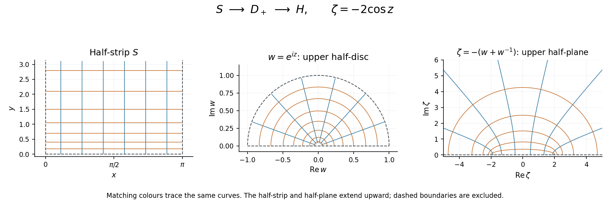

<h1 id="6/solution">Solution</h1>

↑ **Parent:** [6](../6.md)

A [conformal map](../../../conformal-map.md) preserves oriented [angles](../../../angle.md) between intersecting smooth curves at each point, with a nonzero local scale factor. A sufficient criterion is that $f$ be a [holomorphic function](../../../holomorphic-function-split.md) on the [domain](../../../domain-mathematical-analysis.md) and that $f'(z)\ne0$ everywhere there. Its first-order action then multiplies every tangent direction by the same nonzero [complex number](../../../complex-number.md), combining a rotation and a dilation. A conformal bijection additionally requires [injectivity](../../../injective-function.md) and [surjectivity](../../../surjective-function.md) onto the target.

For $z=x+iy$ in the given half-strip,

$$
w=e^{iz}=e^{-y}(\cos x+i\sin x).
$$

Thus $0<|w|<1$ and $0<\arg w<\pi$. Conversely every such $w$ has a unique argument in $(0,\pi)$ and unique radius in $(0,1)$, giving $x=\arg w$, $y=-\log|w|$. Hence

$$
\boxed{e^{iS}=D_+=\{w:|w|<1,\ \operatorname{Im}w>0\}.}
$$

The [complex exponential](../../../complex-exponential-function.md) is [injective](../../../injective-function.md) on $S$, and its [derivative](../../../derivative.md) $ie^{iz}$ never vanishes.

On $D_+$, use the [Joukowski map](../../../joukowski-map.md) with a sign change,

$$
J(w)=-\left(w+\frac1w\right).
$$

Since

$$
\operatorname{Im}J(w)=\operatorname{Im}w\left(\frac1{|w|^2}-1\right)>0,
$$

it maps into the [upper half-plane](../../../upper-half-plane-complex-analysis.md). To prove [injectivity](../../../injective-function.md), $J(w_1)=J(w_2)$ gives

$$
(w_1-w_2)\left(1-\frac1{w_1w_2}\right)=0.
$$

Both moduli are below one, so $w_1w_2\ne1$ and $w_1=w_2$.

For [surjectivity](../../../surjective-function.md), take any $\zeta$ in the [upper half-plane](../../../upper-half-plane-complex-analysis.md) and solve $w^2+\zeta w+1=0$. The two [roots](../../../root-of-a-root-system.md) have product one. Neither can lie on the [unit circle](../../../complex-unit-circle.md), since there $-(w+w^{-1})$ is real. Exactly one [root](../../../root-of-a-root-system.md) therefore has modulus below one. For this [root](../../../root-of-a-root-system.md), the displayed imaginary-part identity forces $\operatorname{Im}w>0$, so it belongs to $D_+$. Finally $J'(w)=w^{-2}-1$ has no [zero](../../../zero-of-a-function.md) in $D_+$. This proves the [Joukowski map from the upper half-disc to the upper half-plane](../../../joukowski-map-from-the-upper-half-disc-to-the-upper-half-plane.md) is a conformal bijection.

Composing gives the required [conformal map](../../../conformal-map.md)

$$
\boxed{F(z)=J(e^{iz})=-e^{iz}-e^{-iz}=-2\cos z:\ S\longrightarrow H.}
$$

Its [derivative](../../../derivative.md) $2\sin z$ is nonzero on $S$, since the [zeros](../../../zero-of-a-function.md) of the complex [sine](../../../sine.md) are the real integer multiples of $\pi$.

**[Figure 1](#6/image-the-half-strip-maps-to-the-upper-half-disc-by-the-complex-exponential-and-then-to-the-upper-half-plane-by-a-joukowski-map-matching-colours-follow-curves-through-both-maps). The half-strip maps to the upper half-disc by the complex exponential and then to the upper half-plane by a Joukowski map. Matching colours follow curves through both maps.**

## ↑ Ancestors (11)

1. [6](../6.md)
2. [2012](../../2012-split.md)
3. [Past exam of the algebra, analysis and differential equations 1 course of the University of Oxford](../../split.md)
4. [Algebra, analysis and differential equations 1 course of the University of Oxford](../../../algebra-analysis-and-differential-equations-1-course-of-the-university-of-oxford.md)
5. [Year 2 of the mathematics course of the University of Oxford](../../../year-2-of-the-mathematics-course-of-the-university-of-oxford.md)
6. [Mathematics course of the University of Oxford](../../../mathematics-course-of-the-university-of-oxford.md)
7. [Undergraduate course of the University of Oxford](../../../undergraduate-course-of-the-university-of-oxford.md)
8. [Course of the University of Oxford](../../../course-of-the-university-of-oxford.md)
9. [University of Oxford](../../../university-of-oxford-split.md)
10. [List of universities](../../../list-of-universities.md)
11. [Codex Wiki](../../../split.md)
