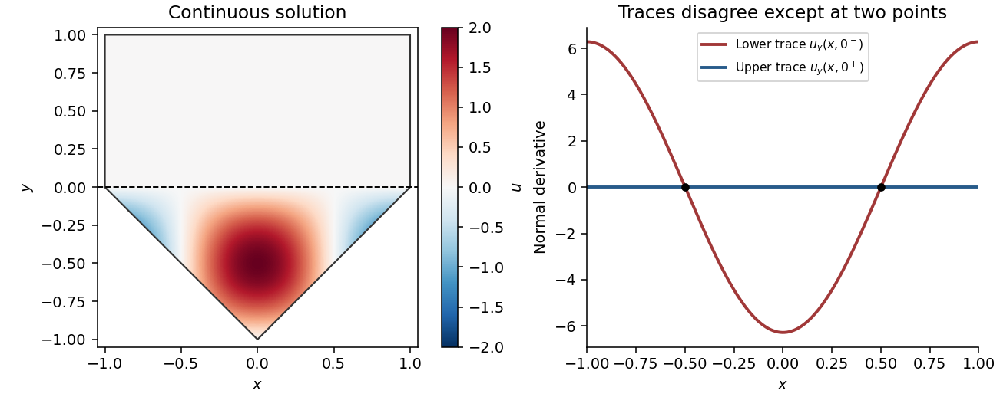

# 2013

↑ **Parent:** [Past exam of the algebra, analysis and differential equations 1 course of the University of Oxford](../past-exam-of-the-algebra-analysis-and-differential-equations-1-course-of-the-university-of-oxford.md)

Source: [Mathematics Part A release](https://www.whatdotheyknow.com/request/maths_papers_2/response/1850333/attach/3/FOI%2020210708%201%20Data.zip?cookie_passthrough=1), member `FOI-20210708-1 - Data/4301.pdf`, dated 17 June 2013. All 35 source leaf parts are answered below.

The department's [solution-release policy](https://www.maths.ox.ac.uk/members/students/undergraduate-courses/examinations-assessments) excludes ordinary odd years; bounded exact-paper checks found no matching advertisement of full or selected worked answers. No parts are skipped.

**Table of contents**

- [Algebra](#algebra)
  - [1](#algebra/1)
    - [a](#algebra/1/a)
      - [Solution](#algebra/1/a/solution)
    - [b](#algebra/1/b)
      - [Solution](#algebra/1/b/solution)
    - [c](#algebra/1/c)
      - [Solution](#algebra/1/c/solution)
  - [2](#algebra/2)
    - [a](#algebra/2/a)
      - [Solution](#algebra/2/a/solution)
    - [b](#algebra/2/b)
      - [Solution](#algebra/2/b/solution)
  - [3](#algebra/3)
    - [a](#algebra/3/a)
      - [Solution](#algebra/3/a/solution)
    - [b](#algebra/3/b)
      - [Solution](#algebra/3/b/solution)
    - [c](#algebra/3/c)
      - [Solution](#algebra/3/c/solution)
- [Analysis](#analysis)
  - [4](#analysis/4)
    - [a](#analysis/4/a)
      - [Solution](#analysis/4/a/solution)
    - [b](#analysis/4/b)
      - [Solution](#analysis/4/b/solution)
    - [c](#analysis/4/c)
      - [Solution](#analysis/4/c/solution)
    - [d](#analysis/4/d)
      - [Solution](#analysis/4/d/solution)
  - [5](#analysis/5)
    - [a](#analysis/5/a)
      - [Solution](#analysis/5/a/solution)
    - [b](#analysis/5/b)
      - [Solution](#analysis/5/b/solution)
    - [c](#analysis/5/c)
      - [Solution](#analysis/5/c/solution)
  - [6](#analysis/6)
    - [a](#analysis/6/a)
      - [i](#analysis/6/a/i)
        - [Solution](#analysis/6/a/i/solution)
      - [ii](#analysis/6/a/ii)
        - [Solution](#analysis/6/a/ii/solution)
      - [iii](#analysis/6/a/iii)
        - [Solution](#analysis/6/a/iii/solution)
      - [iv](#analysis/6/a/iv)
        - [Solution](#analysis/6/a/iv/solution)
    - [b](#analysis/6/b)
      - [i](#analysis/6/b/i)
        - [Solution](#analysis/6/b/i/solution)
      - [ii](#analysis/6/b/ii)
        - [Solution](#analysis/6/b/ii/solution)
    - [c](#analysis/6/c)
      - [Solution](#analysis/6/c/solution)
- [Differential Equations](#differential-equations)
  - [7](#differential-equations/7)
    - [a](#differential-equations/7/a)
      - [Solution](#differential-equations/7/a/solution)
    - [b](#differential-equations/7/b)
      - [Solution](#differential-equations/7/b/solution)
    - [c](#differential-equations/7/c)
      - [Solution](#differential-equations/7/c/solution)
    - [d](#differential-equations/7/d)
      - [Solution](#differential-equations/7/d/solution)
    - [e](#differential-equations/7/e)
      - [Solution](#differential-equations/7/e/solution)
    - [f](#differential-equations/7/f)
      - [Solution](#differential-equations/7/f/solution)
  - [8](#differential-equations/8)
    - [a](#differential-equations/8/a)
      - [Solution](#differential-equations/8/a/solution)
    - [b](#differential-equations/8/b)
      - [Solution](#differential-equations/8/b/solution)
    - [c](#differential-equations/8/c)
      - [Solution](#differential-equations/8/c/solution)
    - [d](#differential-equations/8/d)
      - [Solution](#differential-equations/8/d/solution)
  - [9](#differential-equations/9)
    - [a](#differential-equations/9/a)
      - [Solution](#differential-equations/9/a/solution)
    - [b](#differential-equations/9/b)
      - [Solution](#differential-equations/9/b/solution)
    - [c](#differential-equations/9/c)
      - [Solution](#differential-equations/9/c/solution)

## Algebra

↑ **Parent:** [2013](2013.md)

<h3 id="algebra/1">1</h3>

↑ **Parent:** [Algebra](#algebra)

<h4 id="algebra/1/a">a</h4>

↑ **Parent:** [1](#algebra/1)

<h5 id="algebra/1/a/solution">Solution</h5>

↑ **Parent:** [A](#algebra/1/a)

The [dual space](../dual-space.md) is the [vector space](../vector-space.md) of all [linear functionals](../dual-space.md#linear-functional) on $V$:

$$
\boxed{V'=\operatorname{Hom}_F(V,F).}
$$

Addition and scalar multiplication are defined pointwise. The [annihilator of a vector subspace](../dual-space.md#annihilator-of-a-vector-subspace) is

$$
\boxed{U^0=\{f\in V':f(u)=0\text{ for every }u\in U\}.}
$$

It is a [vector subspace](../vector-space.md#vector-subspace) of $V'$: linear combinations of functionals vanishing on $U$ also vanish on $U$.

<h4 id="algebra/1/b">b</h4>

↑ **Parent:** [1](#algebra/1)

<h5 id="algebra/1/b/solution">Solution</h5>

↑ **Parent:** [B](#algebra/1/b)

Choose a [basis](../vector-space.md#basis) $u_1,\ldots,u_m$ of $U$. Because $v\notin U$, the list $u_1,\ldots,u_m,v$ is [linearly independent](../vector-space.md#linear-independence). Extend it to a [basis](../vector-space.md#basis) of $V$. A [linear functional](../dual-space.md#linear-functional) is specified uniquely by its values on a [basis](../vector-space.md#basis), so define $f$ to be zero on the $u_j$ and on every added basis vector other than $v$, and set $f(v)=1$.

Then $f$ vanishes on every [linear combination](../vector-space.md#linear-combination) of the $u_j$, so $f\in U^0$, while

$$
\boxed{f(v)=1\neq0.}
$$

This proves that the [annihilator of a vector subspace](../dual-space.md#annihilator-of-a-vector-subspace) separates every vector outside the subspace from that subspace; no [inner product](../inner-product.md) or preferred coordinates are needed.

<h4 id="algebra/1/c">c</h4>

↑ **Parent:** [1](#algebra/1)

<h5 id="algebra/1/c/solution">Solution</h5>

↑ **Parent:** [C](#algebra/1/c)

Every $g_i\in U^0$ vanishes on $U$, so $U\subseteq\bigcap_i\ker g_i$. Conversely, suppose $v\in\bigcap_i\ker g_i$. Every $f\in U^0$ is a [linear combination](../vector-space.md#linear-combination) $\sum_i a_ig_i$, giving $f(v)=0$. If $v\notin U$, part (b) supplies a functional in $U^0$ with $f(v)\neq0$, a contradiction. Therefore

$$
\boxed{U=\bigcap_{i=1}^k\ker g_i.}
$$

For the dimension statement, take a [basis](../vector-space.md#basis) $u_1,\ldots,u_m$ of $U$ and extend it to a [basis](../vector-space.md#basis) $u_1,\ldots,u_n$ of $V$. Relative to the corresponding [dual basis](../dual-space.md#dual-basis), a functional belongs to $U^0$ precisely when its first $m$ coefficients are zero. Thus

$$
\boxed{k=\dim U^0=n-m=\dim V-\dim U.}
$$

If $U=V$, this says $k=0$ and the empty intersection is understood to be $V$.

In the coordinate example choose the [linear functionals](../dual-space.md#linear-functional) $g_1(x,y,z)=y$ and $g_2(x,y,z)=z$. Their [kernels](../kernel-of-a-linear-map.md) are the two coordinate planes

$$
\boxed{W_1=\{(x,0,z):x,z\in\mathbb R\},\qquad
W_2=\{(x,y,0):x,y\in\mathbb R\}.}
$$

Their intersection is the stated axis, and $k=2=3-1$.

<h3 id="algebra/2">2</h3>

↑ **Parent:** [Algebra](#algebra)

<h4 id="algebra/2/a">a</h4>

↑ **Parent:** [2](#algebra/2)

<h5 id="algebra/2/a/solution">Solution</h5>

↑ **Parent:** [A](#algebra/2/a)

The [adjoint operator](../hilbert-space.md#adjoint-operator) $T^*$ is characterized by

$$
\boxed{\langle Tv,w\rangle=\langle v,T^*w\rangle\quad\text{for all }v,w\in V.}
$$

This identity works with either convention for which argument of the complex [inner product](../inner-product.md) is linear, provided the convention is used consistently.

For uniqueness, subtract the two given identities to get $\langle v,(S-T^*)w\rangle=0$ for every $v,w$. Fix $w$ and choose $v=(S-T^*)w$. Then [positive definiteness](../bilinear-form.md#positive-definiteness) gives

$$
\|(S-T^*)w\|^2=0,
$$

so $(S-T^*)w=0$. As $w$ was arbitrary, $\boxed{S=T^*}$. The decisive fact is that a vector orthogonal to every vector, including itself, must be zero.

<h4 id="algebra/2/b">b</h4>

↑ **Parent:** [2](#algebra/2)

<h5 id="algebra/2/b/solution">Solution</h5>

↑ **Parent:** [B](#algebra/2/b)

First suppose $E=E^*$. For $u\in U=\operatorname{im}E$, choose $v$ with $Ev=u$. For $w\in W=\ker E$,

$$
\langle u,w\rangle=\langle Ev,w\rangle=\langle v,Ew\rangle=0.
$$

Thus $U\subseteq W^\perp$. The [direct sum of vector spaces](../vector-space.md#direct-sum) gives $\dim U=\dim V-\dim W$, while the [orthogonal complement](../hilbert-space.md#orthogonal-complement) has $\dim W^\perp=\dim V-\dim W$. Equal finite dimensions imply $U=W^\perp$.

Conversely, suppose $U=W^\perp$. Decompose arbitrary vectors as $v=u+w$ and $v'=u'+w'$, with $u,u'\in U$ and $w,w'\in W$. Since $E$ is the indicated [projection](../vector-space.md#projection-linear-algebra), $Ev=u$ and $Ev'=u'$. Orthogonality makes the cross terms vanish, so

$$
\langle Ev,v'\rangle=\langle u,u'\rangle=\langle v,Ev'\rangle.
$$

Therefore $E$ satisfies the defining identity of its own [adjoint operator](../hilbert-space.md#adjoint-operator). By uniqueness from part (a), $E=E^*$. Hence

$$
\boxed{E=E^*\quad\Longleftrightarrow\quad U=W^\perp.}
$$

This is the characterization of an [orthogonal projection](../hilbert-space.md#orthogonal-projection) among projections along a complementary subspace.

<h3 id="algebra/3">3</h3>

↑ **Parent:** [Algebra](#algebra)

<h4 id="algebra/3/a">a</h4>

↑ **Parent:** [3](#algebra/3)

<h5 id="algebra/3/a/solution">Solution</h5>

↑ **Parent:** [A](#algebra/3/a)

A [Euclidean domain](../commutative-algebra.md#euclidean-domain) is an [integral domain](../commutative-algebra.md#integral-domain) $R$ admitting a [Euclidean function](../commutative-algebra.md#euclidean-function) $\delta:R\setminus\{0\}\to\mathbb Z_{\geq0}$ such that division with a smaller remainder is possible: for every $a\in R$ and nonzero $b\in R$, there are $q,r\in R$ with

$$
\boxed{a=qb+r,\qquad r=0\ \text{or}\ \delta(r)<\delta(b).}
$$

Thus the [Euclidean function](../commutative-algebra.md#euclidean-function) measures progress in repeated division. Definitions which additionally normalize it to be nondecreasing under multiplication give the same class of [Euclidean domains](../commutative-algebra.md#euclidean-domain); the division property is the one needed below.

<h4 id="algebra/3/b">b</h4>

↑ **Parent:** [3](#algebra/3)

<h5 id="algebra/3/b/solution">Solution</h5>

↑ **Parent:** [B](#algebra/3/b)

For the [zero ideal](../commutative-algebra.md#zero-ideal), choose $d=0$. Otherwise choose a nonzero $d\in I$ for which the [Euclidean function](../commutative-algebra.md#euclidean-function) $\delta(d)$ is minimal; the [well-ordering principle](../arithmetic.md#well-ordering-principle-for-the-natural-numbers) guarantees such a choice. For any $a\in I$, perform Euclidean division:

$$
a=qd+r,\qquad r=0\ \text{or}\ \delta(r)<\delta(d).
$$

Because $I$ is an [ideal](../commutative-algebra.md#ideal), $r=a-qd\in I$. A nonzero remainder would contradict the minimal choice of $d$, so $r=0$ and $a\in Rd$. Thus $I\subseteq Rd$. Conversely, $d\in I$ implies $Rd\subseteq I$, proving

$$
\boxed{I=Rd.}
$$

Every [ideal](../commutative-algebra.md#ideal) is therefore a [principal ideal](../commutative-algebra.md#principal-ideal); in particular, a [Euclidean domain](../commutative-algebra.md#euclidean-domain) is a [principal ideal domain](../commutative-algebra.md#principal-ideal-domain).

<h4 id="algebra/3/c">c</h4>

↑ **Parent:** [3](#algebra/3)

<h5 id="algebra/3/c/solution">Solution</h5>

↑ **Parent:** [C](#algebra/3/c)

For the [Gaussian integers](../commutative-algebra.md#gaussian-integer), use the [Gaussian norm](../commutative-algebra.md#gaussian-integer-norm)

$$
\boxed{\delta(a+bi)=a^2+b^2\quad(a+bi\neq0).}
$$

To identify the [ideal](../commutative-algebra.md#ideal), note that $a^2+b^2$ is even if and only if $a,b$ have the same parity. Also

$$
\frac{a+bi}{1+i}=\frac{a+b}{2}+\frac{b-a}{2}i.
$$

This quotient is a [Gaussian integer](../commutative-algebra.md#gaussian-integer) precisely when $a,b$ have the same parity. Therefore the prescribed set consists exactly of the multiples of $1+i$, giving

$$
\boxed{I=\mathbb Z[i](1+i),\qquad d=1+i.}
$$

Any associate of $1+i$ would generate the same [principal ideal](../commutative-algebra.md#principal-ideal).

## Analysis

↑ **Parent:** [2013](2013.md)

<h3 id="analysis/4">4</h3>

↑ **Parent:** [Analysis](#analysis)

<h4 id="analysis/4/a">a</h4>

↑ **Parent:** [4](#analysis/4)

<h5 id="analysis/4/a/solution">Solution</h5>

↑ **Parent:** [A](#analysis/4/a)

Under the assumed continuous real differentiability, the necessary and sufficient conditions are the [Cauchy-Riemann equations](../analysis.md#cauchy-riemann-equations) at every point of $U$:

$$
\boxed{u_x=v_y,\qquad u_y=-v_x.}
$$

Necessity follows by computing the complex [derivative](../calculus.md#derivative) along real and imaginary increments. For sufficiency, real differentiability gives the first-order expansion

$$
f(z+h)-f(z)=(u_x+iv_x)\operatorname{Re}h+(u_y+iv_y)\operatorname{Im}h+o(|h|).
$$

The [Cauchy-Riemann equations](../analysis.md#cauchy-riemann-equations) turn the linear part into $(u_x+iv_x)h$, so the complex [derivative](../calculus.md#derivative) exists and equals $u_x+iv_x$. Thus $f$ is a [holomorphic function](../holomorphic-function.md) on $U$.

<h4 id="analysis/4/b">b</h4>

↑ **Parent:** [4](#analysis/4)

<h5 id="analysis/4/b/solution">Solution</h5>

↑ **Parent:** [B](#analysis/4/b)

At any $z\neq0$, take sufficiently small $h$ so $z+h\neq0$. The complex difference quotient is

$$
\frac{(z+h)^{-1}-z^{-1}}h=-\frac1{z(z+h)}\longrightarrow-\frac1{z^2}.
$$

Hence the complex [derivative](../calculus.md#derivative) exists at every point of the punctured plane, and

$$
\boxed{f'(z)=-z^{-2},\qquad f\text{ is holomorphic on }\mathbb C\setminus\{0\}.}
$$

The excluded point is essential to the domain statement: the reciprocal has a [simple pole](../isolated-singularity.md#simple-pole) there.

<h4 id="analysis/4/c">c</h4>

↑ **Parent:** [4](#analysis/4)

<h5 id="analysis/4/c/solution">Solution</h5>

↑ **Parent:** [C](#analysis/4/c)

Write $z=x+iy$. Both moduli are nonnegative, so squaring preserves their strict inequality:

$$
|z|<|z-i|\quad\Longleftrightarrow\quad x^2+y^2<x^2+(y-1)^2
\quad\Longleftrightarrow\quad 2y<1.
$$

Thus

$$
\boxed{c=\frac12.}
$$

The boundary is the perpendicular bisector of $0$ and $i$ in the [complex plane](../complex-analysis.md#complex-plane); the strict inequality selects the half-plane containing $0$.

<h4 id="analysis/4/d">d</h4>

↑ **Parent:** [4](#analysis/4)

<h5 id="analysis/4/d/solution">Solution</h5>

↑ **Parent:** [D](#analysis/4/d)

Use the reciprocal [Möbius transformation](../group-theory.md#mobius-transformation)

$$
\boxed{F(z)=\frac1z.}
$$

It is a [holomorphic function](../holomorphic-function.md) on $U_1$ by part (b). For $z\neq0$,

$$
|F(z)+i|=\frac{|1+iz|}{|z|}=\frac{|z-i|}{|z|}.
$$

Part (c) now gives $z\in U_1$ if and only if $|F(z)+i|>1$, so $F(U_1)\subseteq U_2$. Conversely, $0\notin U_2$ because $|0+i|=1$. For any $w\in U_2$, put $z=1/w$; the same identity gives $|z-i|>|z|$, so $z\in U_1$ and $F(z)=w$. Finally, reciprocation is injective on nonzero complex numbers. This proves bijectivity, with inverse

$$
\boxed{F^{-1}(w)=\frac1w.}
$$

The inverse is also holomorphic, so this is a [biholomorphism](../riemann-surfaces.md#biholomorphism).

<h3 id="analysis/5">5</h3>

↑ **Parent:** [Analysis](#analysis)

<h4 id="analysis/5/a">a</h4>

↑ **Parent:** [5](#analysis/5)

<h5 id="analysis/5/a/solution">Solution</h5>

↑ **Parent:** [A](#analysis/5/a)

For a piecewise continuously differentiable [contour](../complex-analysis.md#complex-integration-contour) $\gamma:[a,b]\to U$, the [contour integral](../complex-analysis.md#contour-integral) is defined by

$$
\boxed{\int_\gamma f(z)\,dz=\int_a^b f(\gamma(t))\gamma'(t)\,dt.}
$$

If the contour has corners, integrate on its finitely many differentiable pieces and sum the results. The integral on the right is taken componentwise as an ordinary real-parameter integral of a complex-valued function. The factor $\gamma'(t)$ encodes both the speed and orientation of the [contour](../complex-analysis.md#complex-integration-contour).

<h4 id="analysis/5/b">b</h4>

↑ **Parent:** [5](#analysis/5)

<h5 id="analysis/5/b/solution">Solution</h5>

↑ **Parent:** [B](#analysis/5/b)

Choose the continuous argument with values in $(-\pi/2,3\pi/2)$ and define

$$
\boxed{\operatorname{Log}z=\log|z|+i\operatorname{Arg}z,\qquad -\frac\pi2<\operatorname{Arg}z<\frac{3\pi}2.}
$$

Its [branch cut](../analysis.md#branch-cut) is the nonpositive imaginary axis, including zero, exactly the removed ray. Locally away from that ray, the [Cauchy-Riemann equations](../analysis.md#cauchy-riemann-equations) or the local inverse of the exponential show that it is a [holomorphic logarithm](../complex-analysis.md#holomorphic-logarithm), with [derivative](../calculus.md#derivative) $1/z$ and $e^{\operatorname{Log}z}=z$. The chosen interval fixes the additive ambiguity by integer multiples of $2\pi i$.

<h4 id="analysis/5/c">c</h4>

↑ **Parent:** [5](#analysis/5)

<h5 id="analysis/5/c/solution">Solution</h5>

↑ **Parent:** [C](#analysis/5/c)

Use the branch from part (b) and close the real interval $[-R,R]$ with the upper semicircle, oriented counterclockwise. For $\operatorname{Im}z\geq0$, the number $z+i\alpha$ has positive imaginary part, so the numerator is a [holomorphic logarithm](../complex-analysis.md#holomorphic-logarithm) throughout a neighbourhood of the contour and its interior. The branch point $-i\alpha$ lies strictly below the contour. The only enclosed [pole](../isolated-singularity.md#pole) of

$$
H(z)=\frac{\operatorname{Log}(z+i\alpha)}{z^2+\beta^2}
$$

is the [simple pole](../isolated-singularity.md#simple-pole) at $i\beta$, with [residue](../analysis.md#residue)

$$
\operatorname{Res}_{z=i\beta}H=\frac{\operatorname{Log}(i(\alpha+\beta))}{2i\beta}
=\frac{\log(\alpha+\beta)+i\pi/2}{2i\beta}.
$$

To justify discarding the arc, take $R>\max\{\beta,\alpha+1\}$. On it, $|z+i\alpha|$ lies between $R-\alpha$ and $R+\alpha$, and the argument has bounded absolute value. Hence

$$
\left|\int_{\text{arc}}H(z)\,dz\right|
\leq\frac{\pi R\{\log(R+\alpha)+3\pi/2\}}{R^2-\beta^2}\longrightarrow0.
$$

The real-axis integral is absolutely convergent, since its integrand is $O(\log|x|/x^2)$ at infinity and has no real singularities. The [residue theorem](../analysis.md#residue-theorem) therefore gives

$$
\boxed{\int_{-\infty}^{\infty}\frac{\operatorname{Log}(x+i\alpha)}{x^2+\beta^2}\,dx
=\frac\pi\beta\log(\alpha+\beta)+\frac{i\pi^2}{2\beta}.}
$$

Finally, $\operatorname{Re}\operatorname{Log}(x+i\alpha)=\tfrac12\log(x^2+\alpha^2)$. Taking twice the real part yields

$$
\boxed{\int_{-\infty}^{\infty}\frac{\log(x^2+\alpha^2)}{x^2+\beta^2}\,dx
=\frac{2\pi}{\beta}\log(\alpha+\beta).}
$$

The branch choice affects the first integral's imaginary part; the second integral is real and independent of that choice.

<h3 id="analysis/6">6</h3>

↑ **Parent:** [Analysis](#analysis)

<h4 id="analysis/6/a">a</h4>

↑ **Parent:** [6](#analysis/6)

<h5 id="analysis/6/a/i">i</h5>

↑ **Parent:** [A](#analysis/6/a)

<h6 id="analysis/6/a/i/solution">Solution</h6>

↑ **Parent:** [I](#analysis/6/a/i)

An [isolated singularity](../isolated-singularity.md) at $a$ means that $f$ is holomorphic in some punctured disk $0<|z-a|<r$, while $a$ itself is an excluded point or a point where the given function is not holomorphic. There are no other singularities arbitrarily close to $a$. By [Laurent's theorem](../analysis.md#laurent-theorem), the function has a unique [Laurent series](../analysis.md#laurent-series) on that punctured disk:

$$
f(z)=\sum_{j=-\infty}^{\infty}c_j(z-a)^j.
$$

The negative-power terms form its [principal part of a Laurent series](../analysis.md#principal-part-of-a-laurent-series).

<h5 id="analysis/6/a/ii">ii</h5>

↑ **Parent:** [A](#analysis/6/a)

<h6 id="analysis/6/a/ii/solution">Solution</h6>

↑ **Parent:** [Ii](#analysis/6/a/ii)

A [removable singularity](../isolated-singularity.md#removable-singularity) is an [isolated singularity](../isolated-singularity.md) for which the function on the punctured disk extends to a [holomorphic function](../holomorphic-function.md) on the full disk, by assigning or correcting its value at $a$. In [Laurent series](../analysis.md#laurent-series) terms,

$$
\boxed{c_j=0\text{ for every }j<0.}
$$

The remaining power series defines the extension with value $c_0$ at $a$. Conversely, a holomorphic extension has a [Taylor series](../calculus.md#taylor-series) there, so uniqueness of the [Laurent series](../analysis.md#laurent-series) forces all negative coefficients to vanish.

<h5 id="analysis/6/a/iii">iii</h5>

↑ **Parent:** [A](#analysis/6/a)

<h6 id="analysis/6/a/iii/solution">Solution</h6>

↑ **Parent:** [Iii](#analysis/6/a/iii)

A [pole](../isolated-singularity.md#pole) of order $m\geq1$ at $a$ has finitely many negative powers in its [Laurent series](../analysis.md#laurent-series), the lowest being exactly $-m$:

$$
c_{-m}\neq0,\qquad c_j=0\quad(j<-m).
$$

Equivalently,

$$
\boxed{f(z)=(z-a)^{-m}h(z),\qquad h\text{ holomorphic near }a,\ h(a)\neq0.}
$$

Thus $(z-a)^m f(z)$ has a holomorphic extension with nonzero value at $a$, whereas multiplying by any smaller power does not remove the singularity.

<h5 id="analysis/6/a/iv">iv</h5>

↑ **Parent:** [A](#analysis/6/a)

<h6 id="analysis/6/a/iv/solution">Solution</h6>

↑ **Parent:** [Iv](#analysis/6/a/iv)

A [zero](../holomorphic-function.md#order-of-a-zero-of-a-holomorphic-function) of order $n\geq1$ at $a$ means that $f$ is holomorphic near $a$ and

$$
f(a)=f'(a)=\cdots=f^{(n-1)}(a)=0,\qquad f^{(n)}(a)\neq0.
$$

Equivalently its [Taylor series](../calculus.md#taylor-series) starts with the nonzero coefficient of $(z-a)^n$, so

$$
\boxed{f(z)=(z-a)^n h(z),\qquad h\text{ holomorphic near }a,\ h(a)\neq0.}
$$

Unlike a [pole](../isolated-singularity.md#pole), a zero is a regular point of the function itself; its reciprocal has a pole of the corresponding order.

<h4 id="analysis/6/b">b</h4>

↑ **Parent:** [6](#analysis/6)

<h5 id="analysis/6/b/i">i</h5>

↑ **Parent:** [B](#analysis/6/b)

<h6 id="analysis/6/b/i/solution">Solution</h6>

↑ **Parent:** [I](#analysis/6/b/i)

By the finite-order [zero](../holomorphic-function.md#order-of-a-zero-of-a-holomorphic-function) factorizations,

$$
f(z)=(z-a)^mF(z),\qquad g(z)=(z-a)^nG(z),\qquad F(a)G(a)\neq0,
$$

with $F,G$ holomorphic near $a$. Shrinking the disk if necessary, continuity ensures $G$ never vanishes there, so $F/G$ is holomorphic and nonzero at $a$. Consequently

$$
\frac{f(z)}{g(z)}=(z-a)^{m-n}\frac{F(z)}{G(z)}.
$$

If $n>m$, the exponent is $-(n-m)$, with a holomorphic nonvanishing factor. Hence

$$
\boxed{f/g\text{ has a pole of order }n-m.}
$$

<h5 id="analysis/6/b/ii">ii</h5>

↑ **Parent:** [B](#analysis/6/b)

<h6 id="analysis/6/b/ii/solution">Solution</h6>

↑ **Parent:** [Ii](#analysis/6/b/ii)

With the same factors, if $n\leq m$, then

$$
\frac{f(z)}{g(z)}=(z-a)^{m-n}\frac{F(z)}{G(z)}
$$

has no negative power and extends holomorphically across $a$. Thus its apparent singularity is a [removable singularity](../isolated-singularity.md#removable-singularity), with extension value

$$
\boxed{\left(\frac fg\right)(a)=\begin{cases}F(a)/G(a),&m=n,\\0,&m>n.\end{cases}}
$$

For $m>n$ the extended quotient has a [zero](../holomorphic-function.md#order-of-a-zero-of-a-holomorphic-function) of order $m-n$; for $m=n$ the extension is nonzero.

<h4 id="analysis/6/c">c</h4>

↑ **Parent:** [6](#analysis/6)

<h5 id="analysis/6/c/solution">Solution</h5>

↑ **Parent:** [C](#analysis/6/c)

The complex sine has simple zeros exactly at $z=k\pi$, $k\in\mathbb Z$, because $\sin(k\pi)=0$ and $\cos(k\pi)=(-1)^k\neq0$. Hence the denominator has a zero of order three at each of these points and nowhere else.

At $0$, the numerator has order two, so the quotient has a [simple pole](../isolated-singularity.md#simple-pole). Indeed its leading term is $-\pi^4/z$. At $\pi$, the numerator has order one, so there is a [pole](../isolated-singularity.md#pole) of order two. At $-\pi$, the numerator has order three, cancelling the denominator's order-three zero, so the singularity is removable. Its extension value is

$$
\lim_{z\to-\pi}\frac{z^2(z-\pi)(z+\pi)^3}{\sin^3z}
=\frac{(-\pi)^2(-2\pi)}{\cos^3(-\pi)}=2\pi^3.
$$

At every remaining $k\pi$, the numerator is nonzero, giving a [pole](../isolated-singularity.md#pole) of order three. Thus the complete finite-plane classification is

$$
\boxed{\begin{array}{c|c}
z&\text{classification}\\\hline
0&\text{pole of order }1\\
\pi&\text{pole of order }2\\
-\pi&\text{removable, extension value }2\pi^3\\
k\pi,\quad k\in\mathbb Z\setminus\{-1,0,1\}&\text{pole of order }3
\end{array}}
$$

Away from this discrete set the denominator is nonzero, so the quotient is holomorphic.

## Differential Equations

↑ **Parent:** [2013](2013.md)

<h3 id="differential-equations/7">7</h3>

↑ **Parent:** [Differential Equations](#differential-equations)

<h4 id="differential-equations/7/a">a</h4>

↑ **Parent:** [7](#differential-equations/7)

<h5 id="differential-equations/7/a/solution">Solution</h5>

↑ **Parent:** [A](#differential-equations/7/a)

Collect the two dependent variables in a column vector. The [vector field](../multivariable-calculus.md#vector-field) and initial vector are

$$
\boxed{F(x,Z)=\begin{pmatrix}(|z_2|+x^2+1)^{-1}\\(|z_1|+1)^{-1}\end{pmatrix},
\qquad B=\begin{pmatrix}1\\0\end{pmatrix}.}
$$

The given [system of ordinary differential equations](../differential-equation.md#system-of-ordinary-differential-equations) is then $Y'=F(x,Y)$ with $Y(0)=B$. Both components of $F$ are continuous on all of $\mathbb R\times\mathbb R^2$, since their denominators are at least one.

<h4 id="differential-equations/7/b">b</h4>

↑ **Parent:** [7](#differential-equations/7)

<h5 id="differential-equations/7/b/solution">Solution</h5>

↑ **Parent:** [B](#differential-equations/7/b)

Each denominator is at least one and positive, so each component of $F$ lies in $(0,1]$. Taking the [maximum norm](../normed-vector-space.md#supremum-norm) therefore gives

$$
\boxed{\|F(x,Z)\|_\infty=\max\!\left\{\frac1{|z_2|+x^2+1},\frac1{|z_1|+1}\right\}\leq1.}
$$

This is a global bound, so in particular the constant $M=1$ is valid throughout the specified cube.

<h4 id="differential-equations/7/c">c</h4>

↑ **Parent:** [7](#differential-equations/7)

<h5 id="differential-equations/7/c/solution">Solution</h5>

↑ **Parent:** [C](#differential-equations/7/c)

For $a,b\geq0$ and $c\geq1$,

$$
\left|\frac1{a+c}-\frac1{b+c}\right|=\frac{|a-b|}{(a+c)(b+c)}\leq|a-b|.
$$

Apply this to the first component with $a=|z_2|$, $b=|w_2|$, $c=x^2+1$. The [reverse triangle inequality](../topological-analysis.md#reverse-triangle-inequality) gives

$$
|F_1(x,Z)-F_1(x,W)|\leq\big||z_2|-|w_2|\big|\leq|z_2-w_2|.
$$

For the second component use $a=|z_1|$, $b=|w_1|$, $c=1$ to obtain $|F_2(x,Z)-F_2(x,W)|\leq|z_1-w_1|$. Taking the maximum yields

$$
\boxed{\|F(x,Z)-F(x,W)\|_\infty\leq\|Z-W\|_\infty.}
$$

Thus $F$ is globally [Lipschitz continuous](../real-analysis.md#lipschitz-continuity) in the dependent vector, uniformly in $x$, with [Lipschitz constant](../real-analysis.md#lipschitz-constant) $1$. Differentiability of the absolute-value function at zero is unnecessary.

<h4 id="differential-equations/7/d">d</h4>

↑ **Parent:** [7](#differential-equations/7)

<h5 id="differential-equations/7/d/solution">Solution</h5>

↑ **Parent:** [D](#differential-equations/7/d)

A [Lipschitz condition](../real-analysis.md#lipschitz-continuity) here is uniform in the independent variable: there is a finite constant $L\geq0$ such that, whenever both $(x,Z)$ and $(x,W)$ belong to the cube,

$$
\boxed{\|F(x,Z)-F(x,W)\|_\infty\leq L\|Z-W\|_\infty.}
$$

The same $L$ must work for every allowed $x,Z,W$. Part (c) proves this with $L=1$. This controls changes in the dependent variables; no Lipschitz condition in $x$ is required for the [Picard-Lindelöf theorem](../differential-equation.md#picard-lindelof-theorem).

<h4 id="differential-equations/7/e">e</h4>

↑ **Parent:** [7](#differential-equations/7)

<h5 id="differential-equations/7/e/solution">Solution</h5>

↑ **Parent:** [E](#differential-equations/7/e)

The quantitative [Picard-Lindelöf theorem](../differential-equation.md#picard-lindelof-theorem) applies on a rectangle $|x-x_0|\leq a$, $\|Z-B\|_\infty\leq b$. Suppose $F$ is continuous there, bounded in [maximum norm](../normed-vector-space.md#supremum-norm) by $M$, and uniformly [Lipschitz continuous](../real-analysis.md#lipschitz-continuity) in $Z$. Then the [initial value problem](../differential-equation.md#initial-value-problem) $Y'=F(x,Y)$, $Y(x_0)=B$, has a unique solution on

$$
\boxed{|x-x_0|\leq h,\qquad h=\min\{a,b/M\},}
$$

with the usual interpretation $b/M=\infty$ if $M=0$. The solution remains in the dependent-variable ball. Its endpoints are included when $F$ is continuous on the closed rectangle, as here. Equivalently, existence first on every smaller interval and the derivative bound give extension to those endpoints.

For the given cube, $x_0=0$ and $a=b=1$. Thus the theorem gives $h=\min\{1,1/M\}$ once a bound $M$ and a uniform [Lipschitz constant](../real-analysis.md#lipschitz-constant) have been established. The theorem does not require $Lh<1$: convergence of [Picard iteration](../differential-equation.md#picard-iteration) can be proved by factorial estimates or by using successive shorter intervals.

<h4 id="differential-equations/7/f">f</h4>

↑ **Parent:** [7](#differential-equations/7)

<h5 id="differential-equations/7/f/solution">Solution</h5>

↑ **Parent:** [F](#differential-equations/7/f)

The [vector field](../multivariable-calculus.md#vector-field) is continuous on the cube. Part (b) gives $M=1$, and part (c) supplies a uniform [Lipschitz constant](../real-analysis.md#lipschitz-constant) $L=1$. In the quantitative [Picard-Lindelöf theorem](../differential-equation.md#picard-lindelof-theorem), the independent-variable half-width and the dependent-variable radius are both one, so

$$
h=\min\{1,1/1\}=1.
$$

Therefore

$$
\boxed{\text{There is a unique solution for every }x\in[-1,1].}
$$

The global derivative bound also makes the cube condition explicit. Along any solution segment starting at the initial point,

$$
\|Y(x)-B\|_\infty
=\left\|\int_0^xF(s,Y(s))\,ds\right\|_\infty\leq|x|.
$$

Thus it cannot leave the dependent-variable ball before $|x|=1$. Bounded derivatives give limiting endpoint values, and local existence extends to them because $F$ is defined continuously on all space. Uniform Lipschitz continuity ensures that all such local pieces agree on overlaps, proving uniqueness throughout the closed interval.

<h3 id="differential-equations/8">8</h3>

↑ **Parent:** [Differential Equations](#differential-equations)

<h4 id="differential-equations/8/a">a</h4>

↑ **Parent:** [8](#differential-equations/8)

<h5 id="differential-equations/8/a/solution">Solution</h5>

↑ **Parent:** [A](#differential-equations/8/a)

Use the convention $A u_{xx}+2B u_{xy}+C u_{yy}=0$, with discriminant $B^2-AC$. Here $A=1$, $B=0$, $C=\operatorname{sign}(y)$.

For $y>0$, the discriminant is $-1<0$, so the equation is an [elliptic partial differential equation](../partial-differential-equation.md#elliptic-partial-differential-equation), already in the canonical [Laplace equation](../partial-differential-equation.md#laplace-equation) form $u_{xx}+u_{yy}=0$.

For $y<0$, the discriminant is $1>0$, so it is a [hyperbolic partial differential equation](../partial-differential-equation.md#hyperbolic-partial-differential-equation), the [wave equation](../wave-equation.md) $u_{xx}-u_{yy}=0$. Introduce characteristic coordinates

$$
\xi=x+y,\qquad\eta=x-y.
$$

Then $\partial_x=\partial_\xi+\partial_\eta$ and $\partial_y=\partial_\xi-\partial_\eta$, giving

$$
u_{xx}-u_{yy}=4u_{\xi\eta}=0.
$$

On $y=0$, the discriminant vanishes and the principal part has rank one; the degenerate [parabolic type](../partial-differential-equation.md#parabolic-partial-differential-equation) is $u_{xx}=0$. This is an interface line, rather than an open parabolic subdomain. Thus

$$
\boxed{\begin{array}{c|c|c}
y>0&\text{elliptic}&u_{xx}+u_{yy}=0\\
y<0&\text{hyperbolic}&u_{\xi\eta}=0\\
y=0&\text{degenerate parabolic}&u_{xx}=0
\end{array}}
$$

This is a [mixed-type partial differential equation](../partial-differential-equation.md#mixed-type-partial-differential-equation). The classification concerns the principal part and remains meaningful even though the coefficient jumps at the interface.

<h4 id="differential-equations/8/b">b</h4>

↑ **Parent:** [8](#differential-equations/8)

<h5 id="differential-equations/8/b/solution">Solution</h5>

↑ **Parent:** [B](#differential-equations/8/b)

In the lower triangular region, the characteristic coordinates obey $-1\leq\xi<\eta\leq1$. Integrating the canonical [wave equation](../wave-equation.md) $u_{\xi\eta}=0$ gives

$$
u(x,y)=F(\xi)+G(\eta).
$$

On the right characteristic edge, $\eta=1$ and $x=(\xi+1)/2$, so its prescribed value gives $F(\xi)+G(1)=-\sin(\pi\xi)$. On the left edge, $\xi=-1$ and $x=(\eta-1)/2$, giving $F(-1)+G(\eta)=\sin(\pi\eta)$. At the common vertex the two values agree and equal zero; hence $F(-1)+G(1)=0$.

Adding the two edge identities and subtracting this vertex identity determines the entire solution:

$$
\boxed{u(x,y)=\sin\bigl(\pi(x-y)\bigr)-\sin\bigl(\pi(x+y)\bigr)
=-2\cos(\pi x)\sin(\pi y),\quad y<0.}
$$

The apparent freedom to add a constant to $F$ and subtract it from $G$ does not change $u$. Every classical lower-region solution has the displayed separated form, so these two characteristic boundary traces determine it uniquely. Substitution into $u_{xx}-u_{yy}=0$ and into both edge values directly verifies existence.

<h4 id="differential-equations/8/c">c</h4>

↑ **Parent:** [8](#differential-equations/8)

<h5 id="differential-equations/8/c/solution">Solution</h5>

↑ **Parent:** [C](#differential-equations/8/c)

The lower formula has a smooth continuation as a function of $(x,y)$, and on $y=0$ it has trace $u(x,0)=0$. Its second tangential derivative is

$$
u_{xx}(x,y)=2\pi^2\cos(\pi x)\sin(\pi y),
$$

which vanishes at $y=0$. Hence the continued lower formula satisfies the equation restricted to the interface, where the formal equation is $u_{xx}=0$.

Assuming the solution itself is continuous across the interface, the upper region therefore has the [Dirichlet boundary value problem](../analysis.md#dirichlet-problem)

$$
\boxed{\begin{gathered}
u_{xx}+u_{yy}=0\quad(-1<x<1,\ 0<y<1),\\
u(-1,y)=u(1,y)=0,\qquad u(x,1)=u(x,0)=0.
\end{gathered}}
$$

The zero function satisfies these data. The [maximum principle for harmonic functions](../partial-differential-equation.md#maximum-principle-for-harmonic-functions), applied to both $u$ and $-u$, proves uniqueness among harmonic functions continuous on the closed rectangle. Thus $\boxed{u=0\text{ for }y\geq0}$ is the continuous upper continuation. Satisfaction of the degenerate interface equation does not impose continuity of the normal derivative; that is the issue in part (d).

<h4 id="differential-equations/8/d">d</h4>

↑ **Parent:** [8](#differential-equations/8)

<h5 id="differential-equations/8/d/solution">Solution</h5>

↑ **Parent:** [D](#differential-equations/8/d)

Differentiate the uniquely determined lower solution and the zero upper solution:

$$
u_y(x,y)=\begin{cases}-2\pi\cos(\pi x)\cos(\pi y),&y<0,\\0,&y>0.\end{cases}
$$

Their one-sided traces are

$$
\boxed{u_y(x,0^-)=-2\pi\cos(\pi x),\qquad u_y(x,0^+)=0.}
$$

They disagree, for example at $x=0$, so the [normal derivative](../differential-geometry.md#normal-derivative) is not continuous across the interface. The jump, defined as upper trace minus lower trace, is $2\pi\cos(\pi x)$. It vanishes at the two interior points $x=\pm1/2$, but not identically on the interface.

This illustrates that [continuous transmission need not preserve normal derivatives](../partial-differential-equation.md#continuous-transmission-need-not-preserve-normal-derivatives). In fact, at any point where these traces differ, the two-sided first derivative with respect to $y$ does not exist. The resulting function is continuous and smooth separately on each open side, but is not globally $C^1$. Consequently a globally classical $C^2$ solution satisfying all these data cannot exist. The calculation in part (c) evaluates the smooth lower formula on the interface; it does not supply the missing cross-interface regularity.

**[Figure 1](#differential-equations/8/d/image-continuous-piecewise-solution-and-unequal-normal-derivative-traces). Continuous piecewise solution and unequal normal derivative traces**.

<h3 id="differential-equations/9">9</h3>

↑ **Parent:** [Differential Equations](#differential-equations)

<h4 id="differential-equations/9/a">a</h4>

↑ **Parent:** [9](#differential-equations/9)

<h5 id="differential-equations/9/a/solution">Solution</h5>

↑ **Parent:** [A](#differential-equations/9/a)

Inside the half-plane of convergence, the differentiation theorem for the [Laplace transform](../integral-transform.md#laplace-transform) permits differentiation with respect to the transform variable. Since $\partial_p e^{-pt}=-te^{-pt}$,

$$
\boxed{\overline x'(p)=-\int_0^\infty t x(t)e^{-pt}\,dt=\mathcal L[-tx(t)](p).}
$$

Repeating the argument, or applying induction using $\partial_p^n e^{-pt}=(-t)^n e^{-pt}$, gives

$$
\boxed{\overline x^{(n)}(p)=\int_0^\infty(-t)^n x(t)e^{-pt}\,dt
=(-1)^n\mathcal L[t^n x(t)](p),\qquad n\geq1.}
$$

The identities hold for $\operatorname{Re}p>0$, within the stated convergence half-plane. The usual transform differentiation theorem uses an interior margin in the real part of $p$ to control the polynomial factors in $t$; it makes no assertion on the boundary $\operatorname{Re}p=0$.

<h4 id="differential-equations/9/b">b</h4>

↑ **Parent:** [9](#differential-equations/9)

<h5 id="differential-equations/9/b/solution">Solution</h5>

↑ **Parent:** [B](#differential-equations/9/b)

Integrating the complex exponential and taking its even and odd combinations gives the standard [Laplace transforms](../integral-transform.md#laplace-transform)

$$
\boxed{\mathcal L[a_1](p)=\frac p{p^2+\omega^2},\qquad
\mathcal L[a_2](p)=\frac\omega{p^2+\omega^2}.}
$$

For example, $\mathcal L[e^{i\omega t}]=(p-i\omega)^{-1}$ for $\operatorname{Re}p>0$, and the real sine and cosine identities follow by combining the two signs of $i\omega$.

Apply part (a) once to the cosine transform and twice to the sine transform:

$$
\begin{aligned}
\mathcal L[a_3](p)&=-\frac d{dp}\frac p{p^2+\omega^2}
=\boxed{\frac{p^2-\omega^2}{(p^2+\omega^2)^2}},\\
\mathcal L[a_4](p)&=\frac{d^2}{dp^2}\frac\omega{p^2+\omega^2}
=\boxed{\frac{2\omega(3p^2-\omega^2)}{(p^2+\omega^2)^3}}.
\end{aligned}
$$

All four transforms are valid on the stated right half-plane.

<h4 id="differential-equations/9/c">c</h4>

↑ **Parent:** [9](#differential-equations/9)

<h5 id="differential-equations/9/c/solution">Solution</h5>

↑ **Parent:** [C](#differential-equations/9/c)

Write $\omega=\sqrt2$ and $Y(p)=\overline y(p)$. The zero initial data and the [Laplace transform of a derivative](../integral-transform.md#laplace-transform-of-a-derivative) give $\mathcal L[y'']=p^2Y$. Transforming the forcing with part (b),

$$
\begin{aligned}
(p^2+2)Y
&=\sqrt2\,\frac{p^2-2}{(p^2+2)^2}
+\frac12\frac{\sqrt2}{p^2+2}\\
&=\frac{\sqrt2(3p^2-2)}{2(p^2+2)^2}.
\end{aligned}
$$

Therefore

$$
\boxed{Y(p)=\frac{\sqrt2(6p^2-4)}{4(p^2+2)^3}.}
$$

Part (b) with $\omega=\sqrt2$ gives $\mathcal L[t^2\sin(\sqrt2t)]=2\sqrt2(3p^2-2)/(p^2+2)^3$. Comparing coefficients and using uniqueness of the [Laplace transform](../integral-transform.md#laplace-transform),

$$
\boxed{y(t)=\frac{t^2}{4}\sin(\sqrt2\,t).}
$$

As a direct check, $y'=\tfrac t2\sin(\sqrt2t)+\tfrac{\sqrt2t^2}4\cos(\sqrt2t)$, so both initial values vanish. Differentiating once more cancels the $t^2\sin(\sqrt2t)$ terms in $y''+2y$, leaving $\sqrt2t\cos(\sqrt2t)+\tfrac12\sin(\sqrt2t)$ as required. This also checks the factor $1/4$ in the inverse transform.

## ↑ Ancestors (9)

1. [Past exam of the algebra, analysis and differential equations 1 course of the University of Oxford](../past-exam-of-the-algebra-analysis-and-differential-equations-1-course-of-the-university-of-oxford.md)
2. [Algebra, analysis and differential equations 1 course of the University of Oxford](../university-of-oxford.md#algebra-analysis-and-differential-equations-1-course-of-the-university-of-oxford)
3. [Year 2 of the mathematics course of the University of Oxford](../university-of-oxford.md#year-2-of-the-mathematics-course-of-the-university-of-oxford)
4. [Mathematics course of the University of Oxford](../university-of-oxford.md#mathematics-course-of-the-university-of-oxford)
5. [Undergraduate course of the University of Oxford](../university-of-oxford.md#undergraduate-course-of-the-university-of-oxford)
6. [Course of the University of Oxford](../university-of-oxford.md#course-of-the-university-of-oxford)
7. [University of Oxford](../university-of-oxford.md)
8. [List of universities](../README.md#list-of-universities)
9. [Codex Wiki](../README.md)
