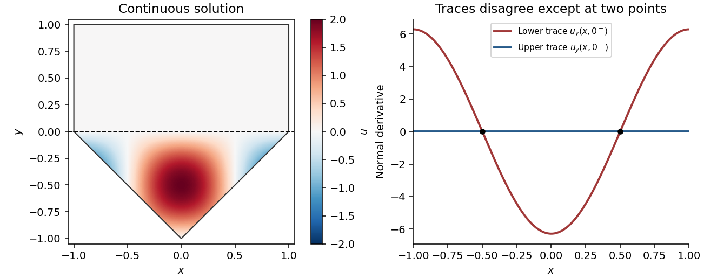

<h1 id="differential-equations/8/d/solution">Solution</h1>

↑ **Parent:** [D](../d.md)

Differentiate the uniquely determined lower solution and the zero upper solution:

$$
u_y(x,y)=\begin{cases}-2\pi\cos(\pi x)\cos(\pi y),&y<0,\\0,&y>0.\end{cases}
$$

Their one-sided traces are

$$
\boxed{u_y(x,0^-)=-2\pi\cos(\pi x),\qquad u_y(x,0^+)=0.}
$$

They disagree, for example at $x=0$, so the [normal derivative](../../../../../normal-derivative.md) is not continuous across the interface. The jump, defined as upper trace minus lower trace, is $2\pi\cos(\pi x)$. It vanishes at the two interior points $x=\pm1/2$, but not identically on the interface.

This illustrates that [continuous transmission need not preserve normal derivatives](../../../../../continuous-transmission-need-not-preserve-normal-derivatives.md). In fact, at any point where these traces differ, the two-sided first derivative with respect to $y$ does not exist. The resulting function is continuous and smooth separately on each open side, but is not globally $C^1$. Consequently a globally classical $C^2$ solution satisfying all these data cannot exist. The calculation in part (c) evaluates the smooth lower formula on the interface; it does not supply the missing cross-interface regularity.

**[Figure 1](#differential-equations/8/d/image-continuous-piecewise-solution-and-unequal-normal-derivative-traces). Continuous piecewise solution and unequal normal derivative traces**.

## ↑ Ancestors (13)

1. [D](../d.md)
2. [8](../../8.md)
3. [Differential Equations](../../../differential-equations.md)
4. [2013](../../../../2013-split.md)
5. [Past exam of the algebra, analysis and differential equations 1 course of the University of Oxford](../../../../split.md)
6. [Algebra, analysis and differential equations 1 course of the University of Oxford](../../../../../algebra-analysis-and-differential-equations-1-course-of-the-university-of-oxford.md)
7. [Year 2 of the mathematics course of the University of Oxford](../../../../../year-2-of-the-mathematics-course-of-the-university-of-oxford.md)
8. [Mathematics course of the University of Oxford](../../../../../mathematics-course-of-the-university-of-oxford.md)
9. [Undergraduate course of the University of Oxford](../../../../../undergraduate-course-of-the-university-of-oxford.md)
10. [Course of the University of Oxford](../../../../../course-of-the-university-of-oxford.md)
11. [University of Oxford](../../../../../university-of-oxford-split.md)
12. [List of universities](../../../../../list-of-universities.md)
13. [Codex Wiki](../../../../../split.md)
