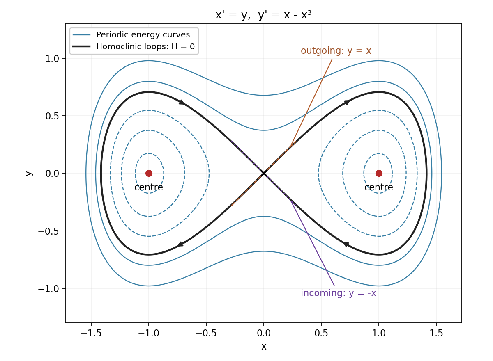

<h1 id="7/solution">Solution</h1>

↑ **Parent:** [7](../7.md)

A [critical point of a dynamical system](../../../equilibrium-point-of-a-dynamical-system.md) is a point where both components of the [vector field](../../../vector-field.md) vanish. For a continuously differentiable [vector field](../../../vector-field.md), strictly negative real parts of both [eigenvalues](../../../eigenvalue.md) of its [Jacobian matrix](../../../jacobian-matrix.md) imply [asymptotic stability](../../../asymptotic-stability.md) of the equilibrium. If an isolated critical point is a [center of a planar dynamical system](../../../center-equilibrium.md) and the [eigenvalues](../../../eigenvalue.md) are distinct, they must be a nonzero purely imaginary conjugate pair. Purely imaginary [eigenvalues](../../../eigenvalue.md) alone do not in general prove nonlinear stability; the [nonlinear ordinary differential equation](../../../nonlinear-ordinary-differential-equation.md) system must still be examined.

Here the critical points are $(0,0)$ and $(\pm1,0)$, with Jacobian $\begin{pmatrix}0&1\\1-3x^2&0\end{pmatrix}$. At zero its [eigenvalues](../../../eigenvalue.md) are $1,-1$, giving an unstable [saddle equilibrium](../../../saddle-equilibrium.md). The unstable direction is $(1,1)$ and the stable direction is $(1,-1)$. Thus trajectories leaving the origin are tangent to $y=x$, and those returning are tangent to $y=-x$, with both opposite rays included.

An exact [first integral](../../../first-integral.md) is

$$
H(x,y)=\frac{y^2}{2}-\frac{x^2}{2}+\frac{x^4}{4},\qquad
\frac{dH}{dt}=(-x+x^3)y+y(x-x^3)=0.
$$

The two homoclinic loops belong to $H=0$:

$$
y^2=x^2\left(1-\frac{x^2}{2}\right),\qquad |x|\le\sqrt2.
$$

They confirm the incoming and outgoing tangent directions. For example the right loop is $x=\sqrt2\operatorname{sech}(t-t_0)$, $y=-\sqrt2\operatorname{sech}(t-t_0)\tanh(t-t_0)$; changing both signs gives the left loop.

**[Figure 1](#7/image-periodic-energy-curves-and-the-two-homoclinic-loops-of-the-nonlinear-planar-system). Periodic energy curves and the two homoclinic loops of the nonlinear planar system**.

At $(1,0)$ put $x=1+X$, $y=Y$. The exact equations are $X'=Y$, $Y'=-2X-3X^2-X^3$, so the [linearization of a dynamical system](../../../linearization-of-a-dynamical-system.md) gives $X''+2X=0$. Its nonconstant solutions have

$$
\boxed{T=\frac{2\pi}{\sqrt2}=\sqrt2\pi,\qquad2X^2+Y^2=\text{constant}.}
$$

The same linear classification holds at $(-1,0)$. For the [nonlinear ordinary differential equation](../../../nonlinear-ordinary-differential-equation.md) system, $H$ has strict local minima $-1/4$ at both points. Levels $-1/4<H<0$ are two families of smooth closed ovals, proving that both are stable centers, rather than asymptotically stable equilibria. These give actual [periodic orbits](../../../periodic-orbit.md) of the [nonlinear ordinary differential equation](../../../nonlinear-ordinary-differential-equation.md) system, with small-amplitude periods tending to $\sqrt2\pi$.

## ↑ Ancestors (11)

1. [7](../7.md)
2. [2004](../../2004-split.md)
3. [Past exam of the algebra, analysis and differential equations II course of the University of Oxford](../../split.md)
4. [Algebra, analysis and differential equations II course of the University of Oxford](../../../algebra-analysis-and-differential-equations-ii-course-of-the-university-of-oxford.md)
5. [Year 2 of the mathematics course of the University of Oxford](../../../year-2-of-the-mathematics-course-of-the-university-of-oxford.md)
6. [Mathematics course of the University of Oxford](../../../mathematics-course-of-the-university-of-oxford.md)
7. [Undergraduate course of the University of Oxford](../../../undergraduate-course-of-the-university-of-oxford.md)
8. [Course of the University of Oxford](../../../course-of-the-university-of-oxford.md)
9. [University of Oxford](../../../university-of-oxford-split.md)
10. [List of universities](../../../list-of-universities.md)
11. [Codex Wiki](../../../split.md)
