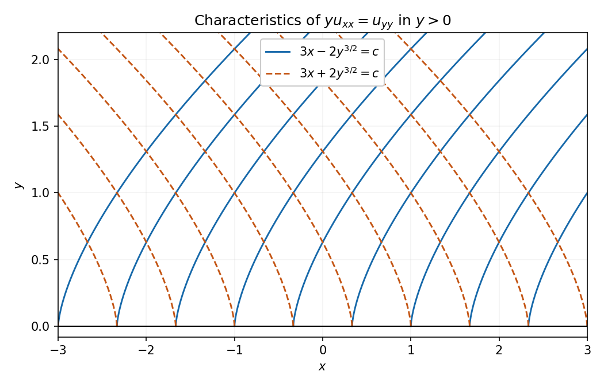

# 2005

↑ **Parent:** [Past exam of the algebra, analysis and differential equations II course of the University of Oxford](../past-exam-of-the-algebra-analysis-and-differential-equations-2-course-of-the-university-of-oxford.md)

**Table of contents**

- [Algebra](#algebra)
  - [1](#algebra/1)
    - [Solution](#algebra/1/solution)
  - [2](#algebra/2)
    - [i](#algebra/2/i)
      - [Solution](#algebra/2/i/solution)
    - [ii](#algebra/2/ii)
      - [Solution](#algebra/2/ii/solution)
    - [iii](#algebra/2/iii)
      - [Solution](#algebra/2/iii/solution)
  - [3](#algebra/3)
    - [i](#algebra/3/i)
      - [Solution](#algebra/3/i/solution)
    - [ii](#algebra/3/ii)
      - [Solution](#algebra/3/ii/solution)
- [Analysis](#analysis)
  - [4](#analysis/4)
    - [i](#analysis/4/i)
      - [Solution](#analysis/4/i/solution)
    - [ii](#analysis/4/ii)
      - [Solution](#analysis/4/ii/solution)
    - [iii](#analysis/4/iii)
      - [Solution](#analysis/4/iii/solution)
  - [5](#analysis/5)
    - [i](#analysis/5/i)
      - [Solution](#analysis/5/i/solution)
    - [ii](#analysis/5/ii)
      - [Solution](#analysis/5/ii/solution)
  - [6](#analysis/6)
    - [Solution](#analysis/6/solution)
- [Differential equations](#differential-equations)
  - [7](#differential-equations/7)
    - [Solution](#differential-equations/7/solution)
  - [8](#differential-equations/8)
    - [Solution](#differential-equations/8/solution)
  - [9](#differential-equations/9)
    - [Solution](#differential-equations/9/solution)

## Algebra

↑ **Parent:** [2005](2005.md)

<h3 id="algebra/1">1</h3>

↑ **Parent:** [Algebra](#algebra)

<h4 id="algebra/1/solution">Solution</h4>

↑ **Parent:** [1](#algebra/1)

Expanding gives $(I-E)^2-(I-E)=E^2-E$, so either operator is [idempotent](../commutative-algebra.md#idempotent) exactly when the other is. For an [idempotent](../commutative-algebra.md#idempotent) $E$,

$$
v=(v-Ev)+Ev,\qquad E(v-Ev)=0.
$$

If $w\in\ker E\cap\operatorname{Im}E$, write $w=Eu$; then $0=Ew=E^2u=Eu=w$. Hence $V=\ker E\oplus\operatorname{Im}E$.

Next,

$$
(E_1+E_2)^2-(E_1+E_2)=E_1E_2+E_2E_1.
$$

If the right side vanishes, left multiplication by $E_1$ gives $E_1E_2+E_1E_2E_1=0$, while right multiplication gives $E_1E_2E_1+E_2E_1=0$. Subtraction shows $E_1E_2=E_2E_1$, and their original sum now gives $2E_1E_2=0$. Over the real or complex numbers this implies **$E_1E_2=E_2E_1=0$**.

For three [idempotents](../commutative-algebra.md#idempotent) summing to $I$, each pair sum equals the complementary [idempotent](../commutative-algebra.md#idempotent) $I-E_k$. Thus every product of distinct operators vanishes. Every [vector](../vector-space.md#vector) equals $E_1v+E_2v+E_3v$. If $v_1+v_2+v_3=0$ with $v_i\in\operatorname{Im}E_i$, applying $E_j$ gives $v_j=0$. Therefore

$$
\boxed{V=\operatorname{Im}E_1\oplus\operatorname{Im}E_2\oplus\operatorname{Im}E_3.}
$$

Take a [basis](../vector-space.md#basis) of each summand and unite the three [bases](../vector-space.md#basis). A [vector](../vector-space.md#vector) in the $j$th [basis](../vector-space.md#basis) has [eigenvalue](../linear-operator-theory.md#eigenvalue) one for $E_j$ and [zero](../polynomial.md#zero-of-a-function) for the other two, so this is the requested common [eigenbasis](../linear-operator-theory.md#eigenbasis). [Zero](../polynomial.md#zero-of-a-function) summands simply contribute no [basis](../vector-space.md#basis) [vectors](../vector-space.md#vector).

<h3 id="algebra/2">2</h3>

↑ **Parent:** [Algebra](#algebra)

<h4 id="algebra/2/i">i</h4>

↑ **Parent:** [2](#algebra/2)

<h5 id="algebra/2/i/solution">Solution</h5>

↑ **Parent:** [I](#algebra/2/i)

A real [inner product](../inner-product.md) is a symmetric bilinear map $\langle\cdot,\cdot\rangle:V\times V\to\mathbb R$ with $\langle v,v\rangle>0$ for $v\ne0$. It defines $\|v\|=\sqrt{\langle v,v\rangle}$. Set $W=\operatorname{span}\{e_1,\ldots,e_k\}$ and $Pv=\sum_i\langle v,e_i\rangle e_i$. Orthonormality gives $v-Pv\perp W$, hence the [Pythagorean identity](../inner-product.md#pythagorean-theorem-in-an-inner-product-space) gives

$$
\|v\|^2=\|v-Pv\|^2+\sum_i\langle v,e_i\rangle^2.
$$

This proves [Bessel's inequality](../hilbert-space.md#bessel-s-inequality). **Equality holds exactly when $v\in W$.**

<h4 id="algebra/2/ii">ii</h4>

↑ **Parent:** [2](#algebra/2)

<h5 id="algebra/2/ii/solution">Solution</h5>

↑ **Parent:** [Ii](#algebra/2/ii)

If $v=0$, equality is immediate. If $v\ne0$, the nonnegative squared [norm](../normed-vector-space.md#norm)

$$
0\leq\left\|u-\frac{\langle u,v\rangle}{\|v\|^2}v\right\|^2=\|u\|^2-\frac{\langle u,v\rangle^2}{\|v\|^2}
$$

proves the [Cauchy-Schwarz inequality](../probability-and-statistics.md#cauchy-schwarz-inequality). Equality holds precisely when the displayed [vector](../vector-space.md#vector) vanishes. Thus **equality is equivalent to [linear dependence](../vector-space.md#linear-dependence) of $u,v$**, including the cases with a [zero](../polynomial.md#zero-of-a-function) [vector](../vector-space.md#vector).

<h4 id="algebra/2/iii">iii</h4>

↑ **Parent:** [2](#algebra/2)

<h5 id="algebra/2/iii/solution">Solution</h5>

↑ **Parent:** [Iii](#algebra/2/iii)

The sum in question is $\langle Pu,Pv\rangle$. Applying Cauchy-Schwarz and then [Bessel's inequality](../hilbert-space.md#bessel-s-inequality) gives

$$
|\langle Pu,Pv\rangle|^2\leq\|Pu\|^2\|Pv\|^2\leq\|u\|^2\|v\|^2.
$$

If either original [vector](../vector-space.md#vector) is [zero](../polynomial.md#zero-of-a-function), equality holds. If both are nonzero, equality forces both projection [norms](../normed-vector-space.md#norm) to equal their original [norms](../normed-vector-space.md#norm) and also forces dependence of the projected [vectors](../vector-space.md#vector). Thus **apart from the [zero](../polynomial.md#zero-of-a-function)-[vector](../vector-space.md#vector) cases, equality holds exactly when $u,v\in W$ and $u,v$ are [linearly dependent](../vector-space.md#linear-dependence)**.

For the final unnumbered request, apply Cauchy-Schwarz in $\mathbb R^k$ to $p_i=a^{i/2}$ and $q_i=a^{-i/2}$. Their [inner product](../inner-product.md) is $k$, so

$$
\boxed{\left(\sum_{i=1}^ka^i\right)\left(\sum_{i=1}^ka^{-i}\right)\geq k^2.}
$$

Equality requires the positive [vectors](../vector-space.md#vector) $p,q$ to be proportional, equivalently $a^i$ constant for $i=1,\ldots,k$. For $k\geq2$ this is **$a=1$**. If $k=1$, equality holds for every $a>0$.

<h3 id="algebra/3">3</h3>

↑ **Parent:** [Algebra](#algebra)

<h4 id="algebra/3/i">i</h4>

↑ **Parent:** [3](#algebra/3)

<h5 id="algebra/3/i/solution">Solution</h5>

↑ **Parent:** [I](#algebra/3/i)

An [integral domain](../commutative-algebra.md#integral-domain) is a nonzero [commutative ring](../commutative-algebra.md#commutative-ring) with identity and no [zero divisors](../mathematics.md#zero-divisor). A [principal ideal domain](../commutative-algebra.md#principal-ideal-domain) is an [integral domain](../commutative-algebra.md#integral-domain) in which every [ideal](../commutative-algebra.md#ideal) is generated by one element.

The [leading coefficient](../polynomial.md#leading-coefficient-of-a-polynomial) of a product of nonzero real [polynomials](../polynomial.md) is nonzero, so $\mathbb R[x]$ is an [integral domain](../commutative-algebra.md#integral-domain). The [zero](../polynomial.md#zero-of-a-function) [ideal](../commutative-algebra.md#ideal) is principal. In any nonzero [ideal](../commutative-algebra.md#ideal) $J$, choose a nonzero [polynomial](../polynomial.md) $g$ of least [degree](../polynomial.md#degree-of-a-polynomial). Divide an arbitrary $f\in J$ by $g$: $f=qg+r$ with $r=0$ or $\deg r<\deg g$. Since $r\in J$, minimality forces $r=0$. Thus $J=(g)$ and **$\mathbb R[x]$ is a [principal ideal domain](../commutative-algebra.md#principal-ideal-domain)**.

In $\mathbb Z[x]$ consider $J=(2,x)$. If $J=(h)$, then $h$ divides the constant [polynomial](../polynomial.md) 2, so $h$ is constant, and divisibility of $x$ forces $h=\pm1$. That would give $J=\mathbb Z[x]$. But the constant coefficient of every element $2p+xq$ is even, so $1\notin J$. This contradiction proves **$\mathbb Z[x]$ is not a [principal ideal domain](../commutative-algebra.md#principal-ideal-domain)**.

<h4 id="algebra/3/ii">ii</h4>

↑ **Parent:** [3](#algebra/3)

<h5 id="algebra/3/ii/solution">Solution</h5>

↑ **Parent:** [Ii](#algebra/3/ii)

Let $J=\bigcup_nI_n$. It contains [zero](../polynomial.md#zero-of-a-function). If $a,b\in J$, both belong to $I_N$ for some common $N$, so $a-b\in I_N\subseteq J$. If $r\in R$, then $ra\in I_N\subseteq J$. These are the [ideal](../commutative-algebra.md#ideal) axioms, proving $J$ is an [ideal](../commutative-algebra.md#ideal).

In a [principal ideal domain](../commutative-algebra.md#principal-ideal-domain) write $J=(g)$. Since $g\in J$, there is $n_0$ with $g\in I_{n_0}$. For $n\geq n_0$,

$$
(g)\subseteq I_{n_0}\subseteq I_n\subseteq J=(g).
$$

All inclusions are equalities. Hence **the chain stabilizes at $I_{n_0}$**. This includes $J=(0)$ and is the [ascending chain condition](../algebra.md#ascending-chain-condition) for [ideals](../commutative-algebra.md#ideal).

## Analysis

↑ **Parent:** [2005](2005.md)

<h3 id="analysis/4">4</h3>

↑ **Parent:** [Analysis](#analysis)

<h4 id="analysis/4/i">i</h4>

↑ **Parent:** [4](#analysis/4)

<h5 id="analysis/4/i/solution">Solution</h5>

↑ **Parent:** [I](#analysis/4/i)

If $f$ is [holomorphic](../holomorphic-function.md) on a neighborhood of the closed disc, the differentiated [Cauchy integral formula](../analysis.md#cauchy-integral-formula) is

$$
f^{(k)}(a)=\frac{k!}{2\pi i}\int_{|z-a|=r}\frac{f(z)}{(z-a)^{k+1}}\,dz,
$$

with positive orientation. On the circle the integrand has modulus at most $M/r^{k+1}$ and the [contour](../complex-analysis.md#complex-integration-contour) has length $2\pi r$. Thus

$$
\boxed{|f^{(k)}(a)|\leq\frac{k!M}{r^k}.}
$$

<h4 id="analysis/4/ii">ii</h4>

↑ **Parent:** [4](#analysis/4)

<h5 id="analysis/4/ii/solution">Solution</h5>

↑ **Parent:** [Ii](#analysis/4/ii)

Take a circle of radius $R\geq S$ about [zero](../polynomial.md#zero-of-a-function). The [Cauchy estimate](../analysis.md#cauchy-estimate) gives, for each integer $k>n$,

$$
|f^{(k)}(0)|\leq k!CR^{n-k}\longrightarrow0\quad(R\to\infty).
$$

Therefore all these derivatives vanish. The [Taylor series](../calculus.md#taylor-series) of an [entire function](../holomorphic-function.md#entire-function) converges to it everywhere, and hence

$$
\boxed{f(z)=\sum_{k=0}^{n}\frac{f^{(k)}(0)}{k!}z^k.}
$$

As usual $n$ is a nonnegative integer; if a real exponent is allowed, the [degree](../polynomial.md#degree-of-a-polynomial) is at most its integer part. A negative growth exponent forces $f=0$.

<h4 id="analysis/4/iii">iii</h4>

↑ **Parent:** [4](#analysis/4)

<h5 id="analysis/4/iii/solution">Solution</h5>

↑ **Parent:** [Iii](#analysis/4/iii)

For a bounded [entire function](../holomorphic-function.md#entire-function), the preceding result with $n=0$ gives [Liouville's theorem](../complex-analysis.md#liouville-theorem). If a nonconstant [polynomial](../polynomial.md) $p$ had no complex root, $1/p$ would be entire. The leading term gives $|p(z)|\to\infty$ at infinity, so $1/p$ is bounded outside a large disc and is also bounded on the remaining compact disc. [Liouville's theorem](../complex-analysis.md#liouville-theorem) would make $1/p$, and hence $p$, constant. This proves the [fundamental theorem of algebra](../algebra.md#fundamental-theorem-of-algebra).

Finally, away from the [zeros](../polynomial.md#zero-of-a-function) of $\cos z$, the [holomorphic](../holomorphic-function.md) quotient $h=f/\cos z$ has modulus at most $C$. At each [zero](../polynomial.md#zero-of-a-function) it therefore has a [removable singularity](../isolated-singularity.md#removable-singularity). These isolated points have no finite accumulation, so removing all of them gives a bounded [entire function](../holomorphic-function.md#entire-function). [Liouville's theorem](../complex-analysis.md#liouville-theorem) gives a constant $c$ with $|c|\leq C$, and

$$
\boxed{f(z)=c\cos z.}
$$

Conversely every such multiple satisfies the assumed bound.

<h3 id="analysis/5">5</h3>

↑ **Parent:** [Analysis](#analysis)

<h4 id="analysis/5/i">i</h4>

↑ **Parent:** [5](#analysis/5)

<h5 id="analysis/5/i/solution">Solution</h5>

↑ **Parent:** [I](#analysis/5/i)

Integrate $e^{iz}/z$ around the upper half-disc with the upper half-disc of radius $\varepsilon$ about [zero](../polynomial.md#zero-of-a-function) removed. The real segments run from $-R$ to $-\varepsilon$ and $\varepsilon$ to $R$; the small semicircle is clockwise. There are no poles inside this indented [contour](../complex-analysis.md#complex-integration-contour).

The large arc contribution tends to [zero](../polynomial.md#zero-of-a-function): its modulus is at most $\int_0^\pi e^{-R\sin\theta}\,d\theta$, which tends to [zero](../polynomial.md#zero-of-a-function) by [dominated convergence](../measure-theory.md#dominated-convergence-theorem). On the small arc $z=\varepsilon e^{i\theta}$, $\theta$ decreases from $\pi$ to [zero](../polynomial.md#zero-of-a-function), so its integral tends to $\int_\pi^0i\,d\theta=-i\pi$. The [contour](../complex-analysis.md#complex-integration-contour) theorem consequently gives

$$
\operatorname{PV}\int_{-\infty}^{\infty}\frac{e^{ix}}x\,dx=i\pi.
$$

Taking imaginary parts is legitimate for each truncated integral. The imaginary integrand $\sin x/x$ is continuous at [zero](../polynomial.md#zero-of-a-function) after assigning its limiting value one, so the inner indentation can be removed. Therefore

$$
\boxed{\lim_{R\to\infty}\int_{-R}^{R}\frac{\sin x}{x}\,dx=\pi.}
$$

<h4 id="analysis/5/ii">ii</h4>

↑ **Parent:** [5](#analysis/5)

<h5 id="analysis/5/ii/solution">Solution</h5>

↑ **Parent:** [Ii](#analysis/5/ii)

Let $\omega=e^{2\pi i/3}$ and integrate $1/(1+z^3)$ around the positively oriented sector from argument [zero](../polynomial.md#zero-of-a-function) to $2\pi/3$, with outer radius $R>1$. The single pole inside is $z_0=e^{i\pi/3}$, with [residue](../analysis.md#residue) $1/(3z_0^2)=1/(3\omega)$. The outward real radial segment contributes $I_R=\int_0^R dx/(1+x^3)$; the return radial segment contributes $-\omega I_R$ because $(\omega x)^3=x^3$.

On the circular arc, $|1+z^3|\geq R^3-1$, so its integral has modulus at most $(2\pi R/3)/(R^3-1)\to0$. Thus the [residue theorem](../analysis.md#residue-theorem) yields

$$
(1-\omega)I=\frac{2\pi i}{3\omega}.
$$

Since $\omega(1-\omega)=\omega-\omega^2=i\sqrt3$,

$$
\boxed{\int_0^\infty\frac{dx}{1+x^3}=\frac{2\pi}{3\sqrt3}.}
$$

The ordinary improper integral converges at both endpoints, so no principal-value interpretation is needed here.

<h3 id="analysis/6">6</h3>

↑ **Parent:** [Analysis](#analysis)

<h4 id="analysis/6/solution">Solution</h4>

↑ **Parent:** [6](#analysis/6)

For $y''+p(x)y'+q(x)y=0$, a singular point at [zero](../polynomial.md#zero-of-a-function) is regular when $xp(x)$ and $x^2q(x)$ extend analytically to [zero](../polynomial.md#zero-of-a-function). Here

$$
p(x)=\frac{\lambda-x}{x(1-x)},\qquad q(x)=\frac1{x(1-x)},
$$

so these products are analytic at [zero](../polynomial.md#zero-of-a-function). The equation remains singular there because $q$ has a pole.

Substitute $y=\sum_{n\geq0}a_nx^{n+\sigma}$. The lowest power gives the [indicial equation](../linear-ordinary-differential-equation.md#indicial-equation) $\sigma(\sigma-1+\lambda)=0$. Comparing the next powers gives

$$
\boxed{\sigma=0\text{ or }1-\lambda,\qquad a_{n+1}=\frac{(n+\sigma)^2-1}{(n+\sigma+1)(n+\sigma+\lambda)}a_n.}
$$

For $0<\lambda<1$ the denominators do not vanish. With $\sigma=0$, $a_1=-a_0/\lambda$ and $a_2=0$, so

$$
y_1=a_0(1-x/\lambda),\qquad\boxed{R_1=\infty.}
$$

With $\sigma=1-\lambda$, the recurrence becomes

$$
a_{n+1}=\frac{(n-\lambda)(n+2-\lambda)}{(n+2-\lambda)(n+1)}a_n=\frac{n-\lambda}{n+1}a_n.
$$

Consequently $y_2=a_0x^{1-\lambda}(1-x)^\lambda$ on $0<x<1$, with the [binomial series](../sequence-and-series.md#binomial-series) for its last factor. The nonzero coefficient ratios tend to one, giving **radius one for that power-series factor**. The factor $x^{1-\lambda}$ specifies the Frobenius branch; the different leading powers prove independence.

When $\lambda=1$, both indicial roots become [zero](../polynomial.md#zero-of-a-function) and the analytic Frobenius solution in both cases is a multiple of $1-x$. To obtain the missing solution use [reduction of order](../linear-ordinary-differential-equation.md#reduction-of-order). Away from [zero](../polynomial.md#zero-of-a-function) and one, $p=1/x$, hence

$$
y_2=(1-x)\int\frac{dx}{x(1-x)^2}=1+(1-x)\log\left|\frac{x}{1-x}\right|.
$$

Thus the real general solution on any interval avoiding the singular points is

$$
\boxed{y=C_1(1-x)+C_2\left[1+(1-x)\log\left|\frac{x}{1-x}\right|\right].}
$$

Its [Wronskian](../linear-ordinary-differential-equation.md#wronskian) with $1-x$ is $1/x\ne0$, proving independence. For complex solutions choose a logarithm branch on a suitable simply connected region.

## Differential equations

↑ **Parent:** [2005](2005.md)

<h3 id="differential-equations/7">7</h3>

↑ **Parent:** [Differential equations](#differential-equations)

<h4 id="differential-equations/7/solution">Solution</h4>

↑ **Parent:** [7](#differential-equations/7)

On $[-a,a]$ let $F=\|f\|_\infty$ and bound $|K|$ by $M$ on the compact integration region. Write $Th(x)=\int_0^xK(x,s)h(s)\,ds$. The iteration gives $y_n=\sum_{j=0}^nT^jf$. Induction, integrating absolute values also when $x<0$, gives

$$
|T^jf(x)|\leq F\frac{M^j|x|^j}{j!}.
$$

The exponential series is summable uniformly for $|x|\leq a$. The [Weierstrass M-test](../probability-and-statistics.md#weierstrass-m-test) therefore proves [uniform convergence](../sequence-and-series.md#uniform-convergence) to a [continuous function](../calculus.md#continuous-function) $y$. Also $\|T(y_n-y)\|_\infty\leq Ma\|y_n-y\|_\infty\to0$, so passing to the limit yields $y=f+Ty$.

For the indicated kernel, twice differentiating its integral gives

$$
y'(x)=\int_0^x sy(s)\,ds,\qquad y''(x)=xy(x),\qquad y(0)=1,\quad y'(0)=0.
$$

Conversely integrating the differential equation twice, with these [initial conditions](../differential-equation.md#initial-condition), gives the integral equation. This is valid also for negative $x$, either by oriented integration or by differentiating the double-integral identity.

For every finite $a$ the continuous kernel $(x-s)s$ meets the preceding hypotheses. Solutions on overlapping intervals agree: if $d=Td$ is their difference, iteration gives $\|d\|_\infty\leq\|d\|_\infty(Ma)^j/j!$ for every $j$, forcing $d=0$. The solutions therefore patch to **one solution defined on all of $\mathbb R$**.

<h3 id="differential-equations/8">8</h3>

↑ **Parent:** [Differential equations](#differential-equations)

<h4 id="differential-equations/8/solution">Solution</h4>

↑ **Parent:** [8](#differential-equations/8)

Put

$$
z(x)=-\int_0^x\sin(x-s)f(s)\,ds.
$$

Leibniz differentiation gives $z'=-\int_0^x\cos(x-s)f(s)\,ds$ and $z''=-f(x)+\int_0^x\sin(x-s)f(s)\,ds=-f-z$. Thus $z$ satisfies both [zero](../polynomial.md#zero-of-a-function) [initial conditions](../differential-equation.md#initial-condition) and the inhomogeneous equation. Every solution with $y(0)=0$ is $y=A\sin x+z(x)$.

On $[0,1]$, the second endpoint determines $A=-z(1)/\sin1$ uniquely, since $\sin1\ne0$. Collecting the integrals, and using the [sine addition formula](../geometry-and-topology.md#sine-addition-formula) for $s<x$, gives

$$
\boxed{G(x,s)=\frac{\sin(\min\{x,s\})\sin(1-\max\{x,s\})}{\sin1}.}
$$

This continuous kernel vanishes at the endpoints, satisfies $G_{xx}+G=0$ off $x=s$, and has derivative jump $-1$, as required for $-y''-y=f$. The preceding construction proves existence, and a homogeneous solution with both endpoints [zero](../polynomial.md#zero-of-a-function) must vanish, proving uniqueness.

On $[0,\pi]$, instead, the second boundary value becomes

$$
y(\pi)=z(\pi)=-\int_0^\pi f(s)\sin s\,ds.
$$

Thus **solvability is equivalent to $\int_0^\pi f(s)\sin s\,ds=0$**. When it holds, all solutions are

$$
\boxed{y(x)=A\sin x-\int_0^x\sin(x-s)f(s)\,ds,\qquad A\in\mathbb R.}
$$

There is one free homogeneous mode because the endpoint length is resonant.

<h3 id="differential-equations/9">9</h3>

↑ **Parent:** [Differential equations](#differential-equations)

<h4 id="differential-equations/9/solution">Solution</h4>

↑ **Parent:** [9](#differential-equations/9)

For a nonzero principal part the [discriminant](../polynomial.md#discriminant) $\Delta=b^2-ac$ classifies the equation: it is **hyperbolic for $\Delta>0$, parabolic for $\Delta=0$, and elliptic for $\Delta<0$**. These are the three definitions requested by the inline roman labels.

In the hyperbolic case the [characteristic equation](../linear-ordinary-differential-equation.md#characteristic-equation-of-a-constant-coefficient-differential-equation) $a(dy)^2-2b\,dx\,dy+c(dx)^2=0$ gives two distinct real tangent directions. Locally, with suitably smooth coefficients, solve the corresponding characteristic [ordinary differential equations](../differential-equation.md#ordinary-differential-equation) to obtain two independent families of curves. Label their level sets $\phi=\text{constant}$ and $\psi=\text{constant}$. Their gradients satisfy

$$
a\phi_x^2+2b\phi_x\phi_y+c\phi_y^2=0,\qquad a\psi_x^2+2b\psi_x\psi_y+c\psi_y^2=0,
$$

and the coordinate Jacobian is nonzero. The [chain rule](../calculus.md#chain-rule) therefore eliminates $u_{\phi\phi}$ and $u_{\psi\psi}$. The remaining mixed coefficient $2[a\phi_x\psi_x+b(\phi_x\psi_y+\phi_y\psi_x)+c\phi_y\psi_y]$ is nonzero: otherwise the invertible coordinate change would send the nondegenerate principal quadratic form to [zero](../polynomial.md#zero-of-a-function). Divide by this coefficient and absorb all first-order terms into $g$, giving $u_{\phi\psi}=g(\phi,\psi,u,u_\phi,u_\psi)$. This canonical reduction is local; a global chart is not automatic.

For the specific equation $a=y,b=0,c=-1$, so it is hyperbolic exactly on **$y>0$**, elliptic for $y<0$, and degenerate parabolic on $y=0$. For $\phi=3x-2y^{3/2}$ and $\psi=3x+2y^{3/2}$, the Jacobian is $18\sqrt y\ne0$. Direct differentiation gives

$$
yu_{xx}-u_{yy}=36y\,u_{\phi\psi}+\frac3{2\sqrt y}(u_\phi-u_\psi).
$$

Since $\psi-\phi=4y^{3/2}$, the canonical form is

$$
\boxed{u_{\phi\psi}=\frac{u_\psi-u_\phi}{6(\psi-\phi)}.}
$$

The characteristic families are $3x-2y^{3/2}=c$ and $3x+2y^{3/2}=c$, with slopes $dx/dy=\pm\sqrt y$. They are distinct for $y>0$ and meet the degeneracy line with coincident vertical tangent directions.

**[Figure 1](#differential-equations/9/image-the-two-characteristic-families-in-the-hyperbolic-region). The two characteristic families in the hyperbolic region**.

## ↑ Ancestors (9)

1. [Past exam of the algebra, analysis and differential equations II course of the University of Oxford](../past-exam-of-the-algebra-analysis-and-differential-equations-2-course-of-the-university-of-oxford.md)
2. [Algebra, analysis and differential equations II course of the University of Oxford](../university-of-oxford.md#algebra-analysis-and-differential-equations-ii-course-of-the-university-of-oxford)
3. [Year 2 of the mathematics course of the University of Oxford](../university-of-oxford.md#year-2-of-the-mathematics-course-of-the-university-of-oxford)
4. [Mathematics course of the University of Oxford](../university-of-oxford.md#mathematics-course-of-the-university-of-oxford)
5. [Undergraduate course of the University of Oxford](../university-of-oxford.md#undergraduate-course-of-the-university-of-oxford)
6. [Course of the University of Oxford](../university-of-oxford.md#course-of-the-university-of-oxford)
7. [University of Oxford](../university-of-oxford.md)
8. [List of universities](../README.md#list-of-universities)
9. [Codex Wiki](../README.md)
