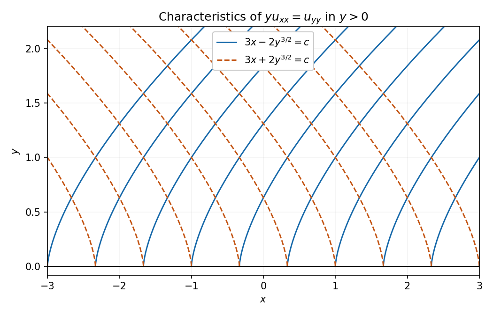

<h1 id="differential-equations/9/solution">Solution</h1>

↑ **Parent:** [9](../9.md)

For a nonzero principal part the [discriminant](../../../../discriminant.md) $\Delta=b^2-ac$ classifies the equation: it is **hyperbolic for $\Delta>0$, parabolic for $\Delta=0$, and elliptic for $\Delta<0$**. These are the three definitions requested by the inline roman labels.

In the hyperbolic case the [characteristic equation](../../../../characteristic-equation-of-a-constant-coefficient-differential-equation.md) $a(dy)^2-2b\,dx\,dy+c(dx)^2=0$ gives two distinct real tangent directions. Locally, with suitably smooth coefficients, solve the corresponding characteristic [ordinary differential equations](../../../../ordinary-differential-equation.md) to obtain two independent families of curves. Label their level sets $\phi=\text{constant}$ and $\psi=\text{constant}$. Their gradients satisfy

$$
a\phi_x^2+2b\phi_x\phi_y+c\phi_y^2=0,\qquad a\psi_x^2+2b\psi_x\psi_y+c\psi_y^2=0,
$$

and the coordinate Jacobian is nonzero. The [chain rule](../../../../chain-rule.md) therefore eliminates $u_{\phi\phi}$ and $u_{\psi\psi}$. The remaining mixed coefficient $2[a\phi_x\psi_x+b(\phi_x\psi_y+\phi_y\psi_x)+c\phi_y\psi_y]$ is nonzero: otherwise the invertible coordinate change would send the nondegenerate principal quadratic form to [zero](../../../../zero-of-a-function.md). Divide by this coefficient and absorb all first-order terms into $g$, giving $u_{\phi\psi}=g(\phi,\psi,u,u_\phi,u_\psi)$. This canonical reduction is local; a global chart is not automatic.

For the specific equation $a=y,b=0,c=-1$, so it is hyperbolic exactly on **$y>0$**, elliptic for $y<0$, and degenerate parabolic on $y=0$. For $\phi=3x-2y^{3/2}$ and $\psi=3x+2y^{3/2}$, the Jacobian is $18\sqrt y\ne0$. Direct differentiation gives

$$
yu_{xx}-u_{yy}=36y\,u_{\phi\psi}+\frac3{2\sqrt y}(u_\phi-u_\psi).
$$

Since $\psi-\phi=4y^{3/2}$, the canonical form is

$$
\boxed{u_{\phi\psi}=\frac{u_\psi-u_\phi}{6(\psi-\phi)}.}
$$

The characteristic families are $3x-2y^{3/2}=c$ and $3x+2y^{3/2}=c$, with slopes $dx/dy=\pm\sqrt y$. They are distinct for $y>0$ and meet the degeneracy line with coincident vertical tangent directions.

**[Figure 1](#differential-equations/9/image-the-two-characteristic-families-in-the-hyperbolic-region). The two characteristic families in the hyperbolic region**.

## ↑ Ancestors (12)

1. [9](../9.md)
2. [Differential equations](../../differential-equations.md)
3. [2005](../../../2005-split.md)
4. [Past exam of the algebra, analysis and differential equations II course of the University of Oxford](../../../split.md)
5. [Algebra, analysis and differential equations II course of the University of Oxford](../../../../algebra-analysis-and-differential-equations-ii-course-of-the-university-of-oxford.md)
6. [Year 2 of the mathematics course of the University of Oxford](../../../../year-2-of-the-mathematics-course-of-the-university-of-oxford.md)
7. [Mathematics course of the University of Oxford](../../../../mathematics-course-of-the-university-of-oxford.md)
8. [Undergraduate course of the University of Oxford](../../../../undergraduate-course-of-the-university-of-oxford.md)
9. [Course of the University of Oxford](../../../../course-of-the-university-of-oxford.md)
10. [University of Oxford](../../../../university-of-oxford-split.md)
11. [List of universities](../../../../list-of-universities.md)
12. [Codex Wiki](../../../../split.md)
