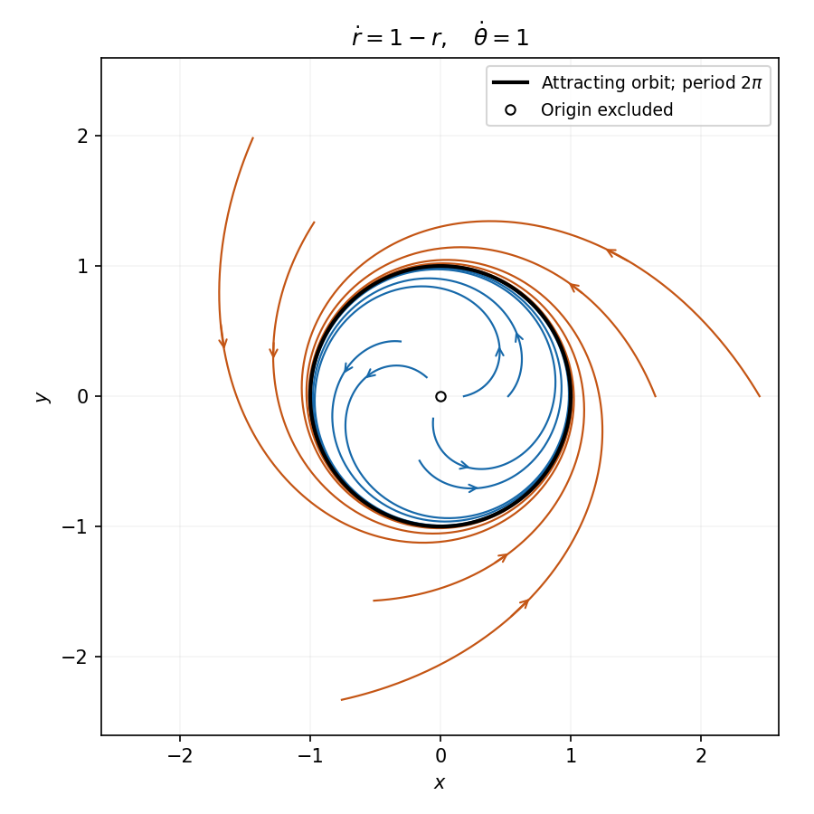
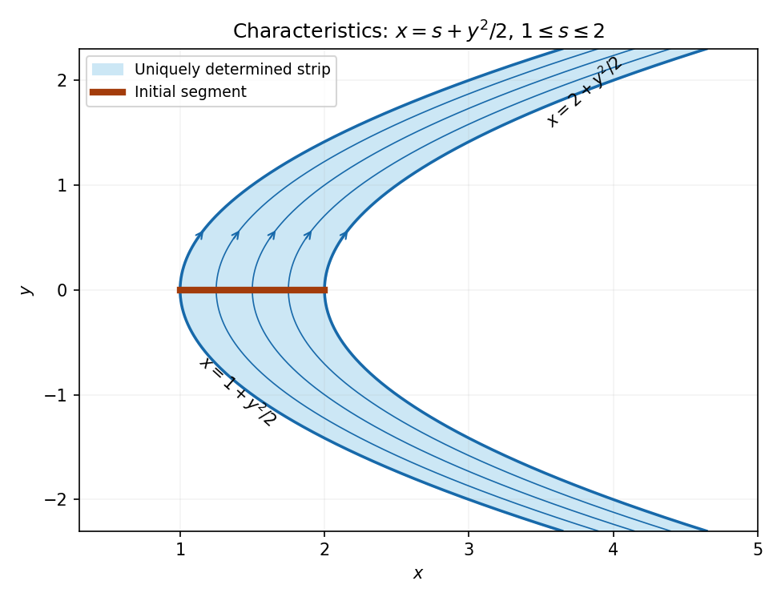

# 2006

↑ **Parent:** [Past exam of the algebra, analysis and differential equations II course of the University of Oxford](../past-exam-of-the-algebra-analysis-and-differential-equations-2-course-of-the-university-of-oxford.md)

**Table of contents**

- [Algebra](#algebra)
  - [1](#algebra/1)
    - [Solution](#algebra/1/solution)
  - [2](#algebra/2)
    - [Solution](#algebra/2/solution)
  - [3](#algebra/3)
    - [a](#algebra/3/a)
      - [Solution](#algebra/3/a/solution)
    - [b](#algebra/3/b)
      - [Solution](#algebra/3/b/solution)
- [Analysis](#analysis)
  - [4](#analysis/4)
    - [i](#analysis/4/i)
      - [Solution](#analysis/4/i/solution)
    - [ii](#analysis/4/ii)
      - [Solution](#analysis/4/ii/solution)
  - [5](#analysis/5)
    - [Solution](#analysis/5/solution)
  - [6](#analysis/6)
    - [Solution](#analysis/6/solution)
- [Differential equations](#differential-equations)
  - [7](#differential-equations/7)
    - [Solution](#differential-equations/7/solution)
  - [8](#differential-equations/8)
    - [Solution](#differential-equations/8/solution)
  - [9](#differential-equations/9)
    - [i](#differential-equations/9/i)
      - [Solution](#differential-equations/9/i/solution)
    - [ii](#differential-equations/9/ii)
      - [Solution](#differential-equations/9/ii/solution)
    - [iii](#differential-equations/9/iii)
      - [Solution](#differential-equations/9/iii/solution)
    - [iv](#differential-equations/9/iv)
      - [Solution](#differential-equations/9/iv/solution)

## Algebra

↑ **Parent:** [2006](2006.md)

<h3 id="algebra/1">1</h3>

↑ **Parent:** [Algebra](#algebra)

<h4 id="algebra/1/solution">Solution</h4>

↑ **Parent:** [1](#algebra/1)

Put $p(t)=\prod_{j=1}^m(t-\mu_j)$ and define the [Lagrange interpolation polynomials](../interpolation.md#lagrange-polynomial)

$$
\ell_j(t)=\prod_{k\ne j}\frac{t-\mu_k}{\mu_j-\mu_k}.
$$

Their denominators are nonzero and $\ell_j(\mu_i)=\delta_{ij}$. The [polynomial](../polynomial.md) $\sum_j\ell_j-1$ has degree at most $m-1$ and vanishes at all $m$ distinct [scalars](../vector-space.md#scalar), so it is zero. Suppose condition (a) holds, and put $E_j=\ell_j(T)$. Since $(t-\mu_j)\ell_j(t)$ is a constant multiple of $p(t)$,

$$
(T-\mu_jI)E_j=0,\qquad\sum_jE_j=I.
$$

Thus each $E_jv$ lies in $V_j$, and every [vector](../vector-space.md#vector) is a sum of such [vectors](../vector-space.md#vector). If $\sum_jv_j=0$ with $v_j\in V_j$, applying $E_i$ gives $v_i=0$, because $\ell_i(T)v_j=\ell_i(\mu_j)v_j$. Hence the sum is direct, proving (b). Conversely, on each $V_j$ the factor $T-\mu_jI$ vanishes; the factors commute, so $p(T)$ vanishes on every summand and therefore on $V$. This proves the equivalence **without invoking primary decomposition**.

If $ST=TS$ and $v\in V_j$, then $(T-\mu_jI)Sv=S(T-\mu_jI)v=0$, so $S[V_j]\subseteq V_j$. Conversely, if each summand is preserved, then on $V_j$ both $ST$ and $TS$ act as $\mu_jS$. They agree on all summands and hence on $V$. Therefore

$$
\boxed{ST=TS\iff S[V_j]\subseteq V_j\text{ for every }j.}
$$

<h3 id="algebra/2">2</h3>

↑ **Parent:** [Algebra](#algebra)

<h4 id="algebra/2/solution">Solution</h4>

↑ **Parent:** [2](#algebra/2)

The [dual space](../dual-space.md) $V^*$ is the [vector space](../vector-space.md) of [linear maps](../vector-space.md#linear-map) $V\to\mathbb F$, with pointwise operations. For the given [basis](../vector-space.md#basis) define coordinate forms $e^i$ by $e^i(\sum_ja_je_j)=a_i$. These are linear and satisfy $e^i(e_j)=\delta_{ij}$. If $\sum_ic_ie^i=0$, evaluation at $e_j$ gives $c_j=0$. For every [linear form](../dual-space.md#linear-functional) $\phi$,

$$
\phi(v)=\sum_i\phi(e_i)e^i(v),
$$

so the coordinate forms span the dual and form its [dual basis](../dual-space.md#dual-basis).

In the [polynomial](../polynomial.md) example write $p(X)=a+bX+cX^2$. Then

$$
\phi_1(p)=a,\qquad\phi_2(p)=a+b+c,\qquad\phi_3(p)=a-b+c.
$$

These recover all three [coefficients](../vector-space.md#coefficient), so they span $V^*$ and, since the dual has [dimension](../vector-space.md#dimension-vector-space) three, form a [basis](../vector-space.md#basis). Explicitly the [basis](../vector-space.md#basis) dual to $1,X,X^2$ is

$$
\boxed{e^1=\phi_1,\qquad e^2=\frac{\phi_2-\phi_3}2,\qquad e^3=\frac{\phi_2+\phi_3}2-\phi_1.}
$$

Evaluation on the three monomials verifies the dual-[basis](../vector-space.md#basis) identities directly.

<h3 id="algebra/3">3</h3>

↑ **Parent:** [Algebra](#algebra)

<h4 id="algebra/3/a">a</h4>

↑ **Parent:** [3](#algebra/3)

<h5 id="algebra/3/a/solution">Solution</h5>

↑ **Parent:** [A](#algebra/3/a)

An element $a$ of an [integral domain](../commutative-algebra.md#integral-domain) is an [irreducible element](../commutative-algebra.md#irreducible-element) when it is nonzero and not a [unit](../algebra.md#unit-in-a-ring), and any [factorization](../algebra.md#factorization) $a=bc$ has at least one [unit](../algebra.md#unit-in-a-ring) factor. The exclusions of zero and [units](../algebra.md#unit-in-a-ring) are part of the definition.

<h4 id="algebra/3/b">b</h4>

↑ **Parent:** [3](#algebra/3)

<h5 id="algebra/3/b/solution">Solution</h5>

↑ **Parent:** [B](#algebra/3/b)

An element $a$ is a [prime element](../commutative-algebra.md#prime-element) when it is nonzero and not a [unit](../algebra.md#unit-in-a-ring), and $a\mid bc$ implies $a\mid b$ or $a\mid c$. If $a=bc$ and $a$ is a [prime element](../commutative-algebra.md#prime-element), assume for example $b=ad$. Cancellation in $a=adc$ gives $dc=1$, so $c$ is a [unit](../algebra.md#unit-in-a-ring). This proves every [prime element](../commutative-algebra.md#prime-element) is an [irreducible element](../commutative-algebra.md#irreducible-element).

In a [Euclidean domain](../commutative-algebra.md#euclidean-domain), each nonzero [ideal](../commutative-algebra.md#ideal) has a generator of least Euclidean value: division of another member by that generator leaves a remainder in the [ideal](../commutative-algebra.md#ideal) of smaller value, so the remainder must vanish. Let $a$ be an [irreducible element](../commutative-algebra.md#irreducible-element) and suppose $a\mid bc$ but $a\nmid b$. Write $(a,b)=(d)$. Since $d\mid a$, irreducibility says $d$ is a [unit](../algebra.md#unit-in-a-ring) or is associate to $a$. The second case would give $a\mid b$, so $d$ is a [unit](../algebra.md#unit-in-a-ring). Hence $1=ra+sb$ for some $r,s$. Multiplying by $c$ shows $a\mid c$. Thus **irreducibles in a [Euclidean domain](../commutative-algebra.md#euclidean-domain) are prime**.

For $R=\mathbb Z[i\sqrt7]$, use the multiplicative integer [field norm](../algebraic-number-theory.md#field-norm) $N(m+ni\sqrt7)=m^2+7n^2$. [Units](../algebra.md#unit-in-a-ring) have [field norm](../algebraic-number-theory.md#field-norm) one and are exactly $\pm1$. If $2=uv$ were a product of nonunits, their norms would be integers greater than one multiplying to four, hence both would have [field norm](../algebraic-number-theory.md#field-norm) two. But $m^2+7n^2=2$ has no integer solution: $n\ne0$ makes the left side at least seven, and $n=0$ would give $m^2=2$. Therefore **2 is an [irreducible element](../commutative-algebra.md#irreducible-element)**.

On the other hand,

$$
(1+i\sqrt7)(1-i\sqrt7)=8
$$

is divisible by 2, while neither factor is, because [divisibility](../divisibility.md) by 2 requires both integer [coefficients](../vector-space.md#coefficient) to be even. Thus **2 is not a [prime element](../commutative-algebra.md#prime-element)** in this [ring](../commutative-algebra.md#ring). It is also **not a [prime element](../commutative-algebra.md#prime-element) in $\mathbb Z[i]$**: $2\mid(1+i)^2=2i$, but $2\nmid1+i$. In fact $2=(1+i)(1-i)$ is already a nontrivial [factorization](../algebra.md#factorization) there.

## Analysis

↑ **Parent:** [2006](2006.md)

<h3 id="analysis/4">4</h3>

↑ **Parent:** [Analysis](#analysis)

<h4 id="analysis/4/i">i</h4>

↑ **Parent:** [4](#analysis/4)

<h5 id="analysis/4/i/solution">Solution</h5>

↑ **Parent:** [I](#analysis/4/i)

A function is [holomorphic](../holomorphic-function.md) on an [open set](../topology.md#open-set) if it is [complex differentiable](../holomorphic-function.md#complex-differentiability) at every point of that set. At $z_0=x_0+iy_0$, take difference quotients first along real increments. Their limit is $f'(z_0)$, so $u_x=\operatorname{Re}f'(z_0)$ and $v_x=\operatorname{Im}f'(z_0)$. Along imaginary increments,

$$
\frac{f(z_0+ih)-f(z_0)}h\longrightarrow if'(z_0),
$$

so $u_y=-\operatorname{Im}f'(z_0)$ and $v_y=\operatorname{Re}f'(z_0)$. These limits prove existence of all four [partial derivatives](../multivariable-calculus.md#partial-derivative) and the [Cauchy-Riemann equations](../analysis.md#cauchy-riemann-equations) $u_x=v_y$, $u_y=-v_x$.

For the first example, the identity function and the reciprocal function are [holomorphic](../holomorphic-function.md) away from zero, so **$f$ is [holomorphic](../holomorphic-function.md) on the given domain**, with

$$
\boxed{f'(z)=1-z^{-2}.}
$$

<h4 id="analysis/4/ii">ii</h4>

↑ **Parent:** [4](#analysis/4)

<h5 id="analysis/4/ii/solution">Solution</h5>

↑ **Parent:** [Ii](#analysis/4/ii)

Write $r=\sqrt{x^2+y^2}>0$. For $u=x/(1+r)$, $v=y/(1+r)$,

$$
u_x=\frac1{1+r}-\frac{x^2}{r(1+r)^2},\qquad v_y=\frac1{1+r}-\frac{y^2}{r(1+r)^2},\qquad u_y=v_x=-\frac{xy}{r(1+r)^2}.
$$

The two [Cauchy-Riemann equations](../analysis.md#cauchy-riemann-equations) would require $x^2=y^2$ and $xy=0$ simultaneously, impossible when $r>0$. Thus $f$ is not [complex differentiable](../holomorphic-function.md#complex-differentiability) at any nonzero point.

At zero, however,

$$
\frac{f(h)-f(0)}h=\frac1{1+|h|}\longrightarrow1.
$$

So **$f$ is [complex differentiable](../holomorphic-function.md#complex-differentiability) at zero, with [derivative](../calculus.md#derivative) one, but is not [holomorphic](../holomorphic-function.md) on $\mathbb C$ or on any nonempty open subset**. [Complex differentiability](../holomorphic-function.md#complex-differentiability) at a single point is weaker than [holomorphy](../holomorphic-function.md) in a neighborhood.

<h3 id="analysis/5">5</h3>

↑ **Parent:** [Analysis](#analysis)

<h4 id="analysis/5/solution">Solution</h4>

↑ **Parent:** [5](#analysis/5)

Choose a small positively oriented circle $C_\varepsilon$ about $z_0$ inside the given region. Cauchy's theorem on the region between the two [contours](../complex-analysis.md#complex-integration-contour) gives

$$
\int_\gamma\frac{f(z)}{z-z_0}\,dz=\int_{C_\varepsilon}\frac{f(z)}{z-z_0}\,dz=i\int_0^{2\pi}f(z_0+\varepsilon e^{it})\,dt.
$$

[Continuity](../calculus.md#continuous-function) makes the last integrand converge uniformly to $f(z_0)$ as $\varepsilon\downarrow0$. Its limit is $2\pi if(z_0)$, proving the [Cauchy integral formula](../analysis.md#cauchy-integral-formula).

The same formula holds with an interior point $w$ near $z_0$. Subtract its value at $z_0$ and divide by $w-z_0$:

$$
\frac{f(w)-f(z_0)}{w-z_0}=\frac1{2\pi i}\int_\gamma\frac{f(z)}{(z-w)(z-z_0)}\,dz.
$$

The [contour](../complex-analysis.md#complex-integration-contour) is a positive distance from $z_0$, so the integrands converge uniformly as $w\to z_0$. Passing to the limit gives the differentiated formula

$$
\boxed{f'(z_0)=\frac1{2\pi i}\int_\gamma\frac{f(z)}{(z-z_0)^2}\,dz.}
$$

On the [unit circle](../complex-analysis.md#complex-unit-circle), $\bar z=1/z$ and $\operatorname{Im}z=(z-\bar z)/(2i)$, proving the requested identity. Hence the requested integral is

$$
\frac1{2i}\left[\int_{|z|=1}\frac{dz}{3z-1}-\int_{|z|=1}\frac{dz}{z^2(3z-1)}\right].
$$

The first integral is $2\pi i/3$. For the second use

$$
\frac1{z^2(3z-1)}=-\frac1{z^2}-\frac3z+\frac9{3z-1}.
$$

The differentiated formula applied to the constant function gives $\int z^{-2}\,dz=0$; the remaining two terms integrate to $-6\pi i+6\pi i=0$. Therefore

$$
\boxed{\int_{|z|=1}\frac{\operatorname{Im}z}{z(3z-1)}\,dz=\frac\pi3.}
$$

<h3 id="analysis/6">6</h3>

↑ **Parent:** [Analysis](#analysis)

<h4 id="analysis/6/solution">Solution</h4>

↑ **Parent:** [6](#analysis/6)

At a zero $a$, [Taylor's theorem](../calculus.md#taylor-s-theorem) gives $f(z)=\sum_{n\geq0}c_n(z-a)^n$ near $a$. If some [coefficient](../vector-space.md#coefficient) is nonzero, let $m$ be the least such index. Then $f(z)=(z-a)^mq(z)$ with $q(a)\ne0$, and [continuity](../calculus.md#continuous-function) makes $q$ nonzero on a smaller disc. Thus $a$ is an isolated zero. A [limit point](../topology.md#limit-point) of zeros is also a zero by [continuity](../calculus.md#continuous-function) and cannot be isolated, so all Taylor [coefficients](../vector-space.md#coefficient) there vanish and $f$ vanishes on a nonempty open disc.

Let $A$ be the set of points having a neighborhood on which $f$ vanishes. It is nonempty and open. A point in its relative closure either already belongs to $A$ or is a [limit point](../topology.md#limit-point) of distinct zeros; the preceding argument puts it in $A$ in either case. Thus $A$ is also relatively closed. [Connectedness](../geometry-and-topology.md#connected-space) of $D$ gives $A=D$, proving **$f$ is identically zero**.

For conjugate reflection, the disc is invariant under conjugation, and

$$
\frac{h(z+w)-h(z)}w=\overline{\frac{g(\bar z+\bar w)-g(\bar z)}{\bar w}}\longrightarrow\overline{g'(\bar z)}.
$$

Hence **$h$ is [holomorphic](../holomorphic-function.md)**, with [derivative](../calculus.md#derivative) $\overline{g'(\bar z)}$. If $g$ is real on the real diameter, then for real $x\in(-1,1)$, $h(x)=\overline{g(x)}=g(x)$. The [holomorphic](../holomorphic-function.md) difference $g-h$ therefore has zeros accumulating at zero, and the [identity theorem](../complex-analysis.md#identity-theorem) just proved gives **$g=h$ on the entire disc**.

## Differential equations

↑ **Parent:** [2006](2006.md)

<h3 id="differential-equations/7">7</h3>

↑ **Parent:** [Differential equations](#differential-equations)

<h4 id="differential-equations/7/solution">Solution</h4>

↑ **Parent:** [7](#differential-equations/7)

Assume the [vector field](../multivariable-calculus.md#vector-field) and multiplier are continuously differentiable, as required for [Green's theorem](../multivariable-calculus.md#green-theorem) and [uniqueness](../mathematical-logic.md#uniqueness) of trajectories. A nonconstant periodic [trajectory](../classical-mechanics.md#trajectory) of a planar [autonomous system](../dynamical-systems.md#autonomous-system-mathematics) is a simple closed orbit: [uniqueness](../mathematical-logic.md#uniqueness) prevents crossings, and one traversal can be taken over its least period. Let $\Omega$ be its bounded interior. Along the orbit $dx=f\,dt$, $dy=g\,dt$, so

$$
\oint_{\partial\Omega}\phi f\,dy-\phi g\,dx=\int\phi(fg-gf)\,dt=0.
$$

[Green's theorem](../multivariable-calculus.md#green-theorem) identifies this with $\iint_\Omega[\partial_x(\phi f)+\partial_y(\phi g)]\,dx\,dy$, which is strictly positive by hypothesis, a contradiction. Thus there is **no nonconstant [periodic orbit](../dynamical-systems.md#periodic-orbit)**. This standard periodic-orbit criterion does not by itself exclude stationary solutions.

For the first concrete system choose $\phi=-1$. Then

$$
\partial_x(\phi f)+\partial_y(\phi g)=e^{-x}>0.
$$

There are also no [equilibria](../dynamical-systems.md#equilibrium-point-of-a-dynamical-system): $f=0$ requires $y=1$, but then $g=-e^{-x}-x^2<0$. Consequently it has **no [periodic solution](../differential-equation.md#periodic-solution), including constant ones**.

For the second system the origin is outside the domain of the printed [vector field](../multivariable-calculus.md#vector-field). For $r>0$,

$$
\dot r=\frac{x\dot x+y\dot y}{r}=1-r,\qquad\dot\theta=\frac{x\dot y-y\dot x}{r^2}=1.
$$

Thus for an admissible initial point with $\rho=\sqrt{a^2+b^2}>0$,

$$
\boxed{r(t)=1+(\rho-1)e^{-t},\qquad\theta(t)=\alpha+t,}
$$

where $a=\rho\cos\alpha$, $b=\rho\sin\alpha$. These formulas are valid while $r>0$, in particular for every $t\geq0$. Trajectories rotate counterclockwise, spiral outward when $0<r<1$, and inward when $r>1$, approaching the [unit circle](../complex-analysis.md#complex-unit-circle). On $r=1$ they give $x(t)=\cos(\alpha+t)$, $y(t)=\sin(\alpha+t)$, a **[periodic orbit](../dynamical-systems.md#periodic-orbit) with least period $2\pi$**. It is an attracting [limit cycle](../dynamical-systems.md#limit-cycle). There is no contradiction with the preceding criterion: this [vector field](../multivariable-calculus.md#vector-field) is singular at the origin and has the exhibited closed orbit.

**[Figure 1](#differential-equations/7/image-counterclockwise-trajectories-approach-the-attracting-unit-circle). Counterclockwise trajectories approach the attracting unit circle**.

<h3 id="differential-equations/8">8</h3>

↑ **Parent:** [Differential equations](#differential-equations)

<h4 id="differential-equations/8/solution">Solution</h4>

↑ **Parent:** [8](#differential-equations/8)

With parameter $t$ along a [characteristic curve](../transport-equation.md#characteristic-curve), the equations are

$$
\frac{dx}{dt}=y,\qquad\frac{dy}{dt}=1,\qquad\frac{du}{dt}=u,\qquad(x,y,u)|_{t=0}=(s,0,s).
$$

Their solutions are $y=t$, $x=s+t^2/2$ and $u=se^t$. Thus the projected curve satisfies $y^2=2(x-s)$, as required. Eliminating the parameters gives

$$
\boxed{u(x,y)=\left(x-\frac{y^2}2\right)e^y.}
$$

Indeed $u_x=e^y$ and $u_y=e^y(x-y^2/2-y)$, so $yu_x+u_y=u$, and the initial values hold.

The parameter map $(s,t)\mapsto(s+t^2/2,t)$ has Jacobian one and is globally invertible. Every point whose [characteristic curve](../transport-equation.md#characteristic-curve) meets the initial segment therefore lies in the strip

$$
\boxed{1\leq x-\frac{y^2}2\leq2,\qquad -\infty<y<\infty.}
$$

The uniquely determined open region is its interior, with the boundary values determined on the two endpoint [characteristic curves](../transport-equation.md#characteristic-curve). Both signs of $y$ are included. Outside the strip, a general solution is $u=e^yF(x-y^2/2)$ with $F(s)=s$ only required for $1\leq s\leq2$. Smooth perturbations of $F$ supported outside that interval produce different solutions with the same prescribed data, proving the stated region is exact.

**[Figure 2](#differential-equations/8/image-the-characteristic-strip-determined-by-the-entire-initial-segment). The characteristic strip determined by the entire initial segment**.

<h3 id="differential-equations/9">9</h3>

↑ **Parent:** [Differential equations](#differential-equations)

<h4 id="differential-equations/9/i">i</h4>

↑ **Parent:** [9](#differential-equations/9)

<h5 id="differential-equations/9/i/solution">Solution</h5>

↑ **Parent:** [I](#differential-equations/9/i)

For a function for which the integral converges, the [Laplace transform](../integral-transform.md#laplace-transform) is

$$
\bar f(p)=\int_0^\infty e^{-pt}f(t)\,dt.
$$

For a [continuous](../calculus.md#continuous-function) function of [exponential order](../integral-transform.md#exponential-order) this exists in a sufficiently far right half-plane. For the first input,

$$
\boxed{\overline1(p)=\frac1p\qquad(\operatorname{Re}p>0).}
$$

This follows by evaluating the exponential antiderivative and using its decay at infinity.

<h4 id="differential-equations/9/ii">ii</h4>

↑ **Parent:** [9](#differential-equations/9)

<h5 id="differential-equations/9/ii/solution">Solution</h5>

↑ **Parent:** [Ii](#differential-equations/9/ii)

[Integration by parts](../calculus.md#integration-by-parts), whose boundary term vanishes for $\operatorname{Re}p>0$, gives

$$
\boxed{\overline t(p)=\int_0^\infty te^{-pt}\,dt=\frac1p\int_0^\infty e^{-pt}\,dt=\frac1{p^2}.}
$$

<h4 id="differential-equations/9/iii">iii</h4>

↑ **Parent:** [9](#differential-equations/9)

<h5 id="differential-equations/9/iii/solution">Solution</h5>

↑ **Parent:** [Iii](#differential-equations/9/iii)

Combining the exponential factors gives

$$
\boxed{\overline{e^{-ct}}(p)=\int_0^\infty e^{-(p+c)t}\,dt=\frac1{p+c}\qquad(\operatorname{Re}(p+c)>0).}
$$

<h4 id="differential-equations/9/iv">iv</h4>

↑ **Parent:** [9](#differential-equations/9)

<h5 id="differential-equations/9/iv/solution">Solution</h5>

↑ **Parent:** [Iv](#differential-equations/9/iv)

The same [integration by parts](../calculus.md#integration-by-parts) with $p$ replaced by $p+c$ gives

$$
\boxed{\overline{te^{-ct}}(p)=\frac1{(p+c)^2}\qquad(\operatorname{Re}(p+c)>0).}
$$

For the remaining unnumbered requests, the [derivative](../calculus.md#derivative) and [convolution](../fourier-analysis.md#convolution) formulas, under the usual convergence hypotheses, are

$$
\overline{f'}(p)=p\bar f(p)-f(0),\qquad\overline{f*g}(p)=\bar f(p)\bar g(p),\qquad(f*g)(t)=\int_0^tf(t-s)g(s)\,ds.
$$

Applying them to the general equation yields $p\bar x-a+\bar k\bar x=\bar y$ and therefore

$$
\boxed{\bar x(p)=\frac{\bar y(p)+a}{p+\bar k(p)}.}
$$

For the particular data, $\bar y=1/p$, $\bar k=1/(p+2)$ and $a=0$, so

$$
\bar x(p)=\frac{p+2}{p(p+1)^2}=\frac2p-\frac2{p+1}-\frac1{(p+1)^2}.
$$

The four transforms above give

$$
\boxed{x(t)=2-(2+t)e^{-t},\qquad\lim_{t\to\infty}x(t)=2.}
$$

As a direct check, $x(0)=0$, $x'=(1+t)e^{-t}$, and

$$
\int_0^te^{-2(t-s)}x(s)\,ds=1-(1+t)e^{-t}.
$$

Adding the last two expressions gives one, verifying the original equation as well as the required limit.

## ↑ Ancestors (9)

1. [Past exam of the algebra, analysis and differential equations II course of the University of Oxford](../past-exam-of-the-algebra-analysis-and-differential-equations-2-course-of-the-university-of-oxford.md)
2. [Algebra, analysis and differential equations II course of the University of Oxford](../university-of-oxford.md#algebra-analysis-and-differential-equations-ii-course-of-the-university-of-oxford)
3. [Year 2 of the mathematics course of the University of Oxford](../university-of-oxford.md#year-2-of-the-mathematics-course-of-the-university-of-oxford)
4. [Mathematics course of the University of Oxford](../university-of-oxford.md#mathematics-course-of-the-university-of-oxford)
5. [Undergraduate course of the University of Oxford](../university-of-oxford.md#undergraduate-course-of-the-university-of-oxford)
6. [Course of the University of Oxford](../university-of-oxford.md#course-of-the-university-of-oxford)
7. [University of Oxford](../university-of-oxford.md)
8. [List of universities](../README.md#list-of-universities)
9. [Codex Wiki](../README.md)
