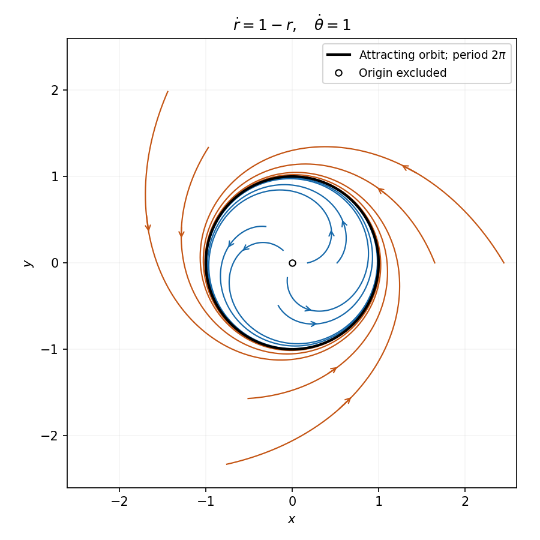

<h1 id="differential-equations/7/solution">Solution</h1>

↑ **Parent:** [7](../7.md)

Assume the [vector field](../../../../vector-field.md) and multiplier are continuously differentiable, as required for [Green's theorem](../../../../green-theorem.md) and [uniqueness](../../../../uniqueness.md) of trajectories. A nonconstant periodic [trajectory](../../../../trajectory.md) of a planar [autonomous system](../../../../autonomous-system-mathematics.md) is a simple closed orbit: [uniqueness](../../../../uniqueness.md) prevents crossings, and one traversal can be taken over its least period. Let $\Omega$ be its bounded interior. Along the orbit $dx=f\,dt$, $dy=g\,dt$, so

$$
\oint_{\partial\Omega}\phi f\,dy-\phi g\,dx=\int\phi(fg-gf)\,dt=0.
$$

[Green's theorem](../../../../green-theorem.md) identifies this with $\iint_\Omega[\partial_x(\phi f)+\partial_y(\phi g)]\,dx\,dy$, which is strictly positive by hypothesis, a contradiction. Thus there is **no nonconstant [periodic orbit](../../../../periodic-orbit.md)**. This standard periodic-orbit criterion does not by itself exclude stationary solutions.

For the first concrete system choose $\phi=-1$. Then

$$
\partial_x(\phi f)+\partial_y(\phi g)=e^{-x}>0.
$$

There are also no [equilibria](../../../../equilibrium-point-of-a-dynamical-system.md): $f=0$ requires $y=1$, but then $g=-e^{-x}-x^2<0$. Consequently it has **no [periodic solution](../../../../periodic-solution.md), including constant ones**.

For the second system the origin is outside the domain of the printed [vector field](../../../../vector-field.md). For $r>0$,

$$
\dot r=\frac{x\dot x+y\dot y}{r}=1-r,\qquad\dot\theta=\frac{x\dot y-y\dot x}{r^2}=1.
$$

Thus for an admissible initial point with $\rho=\sqrt{a^2+b^2}>0$,

$$
\boxed{r(t)=1+(\rho-1)e^{-t},\qquad\theta(t)=\alpha+t,}
$$

where $a=\rho\cos\alpha$, $b=\rho\sin\alpha$. These formulas are valid while $r>0$, in particular for every $t\geq0$. Trajectories rotate counterclockwise, spiral outward when $0<r<1$, and inward when $r>1$, approaching the [unit circle](../../../../complex-unit-circle.md). On $r=1$ they give $x(t)=\cos(\alpha+t)$, $y(t)=\sin(\alpha+t)$, a **[periodic orbit](../../../../periodic-orbit.md) with least period $2\pi$**. It is an attracting [limit cycle](../../../../limit-cycle.md). There is no contradiction with the preceding criterion: this [vector field](../../../../vector-field.md) is singular at the origin and has the exhibited closed orbit.

**[Figure 1](#differential-equations/7/image-counterclockwise-trajectories-approach-the-attracting-unit-circle). Counterclockwise trajectories approach the attracting unit circle**.

## ↑ Ancestors (12)

1. [7](../7.md)
2. [Differential equations](../../differential-equations.md)
3. [2006](../../../2006-split.md)
4. [Past exam of the algebra, analysis and differential equations II course of the University of Oxford](../../../split.md)
5. [Algebra, analysis and differential equations II course of the University of Oxford](../../../../algebra-analysis-and-differential-equations-ii-course-of-the-university-of-oxford.md)
6. [Year 2 of the mathematics course of the University of Oxford](../../../../year-2-of-the-mathematics-course-of-the-university-of-oxford.md)
7. [Mathematics course of the University of Oxford](../../../../mathematics-course-of-the-university-of-oxford.md)
8. [Undergraduate course of the University of Oxford](../../../../undergraduate-course-of-the-university-of-oxford.md)
9. [Course of the University of Oxford](../../../../course-of-the-university-of-oxford.md)
10. [University of Oxford](../../../../university-of-oxford-split.md)
11. [List of universities](../../../../list-of-universities.md)
12. [Codex Wiki](../../../../split.md)
