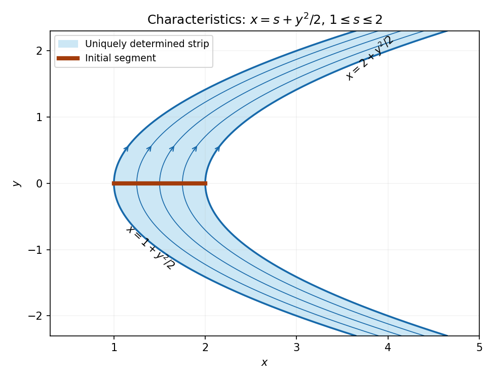

<h1 id="differential-equations/8/solution">Solution</h1>

↑ **Parent:** [8](../8.md)

With parameter $t$ along a [characteristic curve](../../../../characteristic-curve.md), the equations are

$$
\frac{dx}{dt}=y,\qquad\frac{dy}{dt}=1,\qquad\frac{du}{dt}=u,\qquad(x,y,u)|_{t=0}=(s,0,s).
$$

Their solutions are $y=t$, $x=s+t^2/2$ and $u=se^t$. Thus the projected curve satisfies $y^2=2(x-s)$, as required. Eliminating the parameters gives

$$
\boxed{u(x,y)=\left(x-\frac{y^2}2\right)e^y.}
$$

Indeed $u_x=e^y$ and $u_y=e^y(x-y^2/2-y)$, so $yu_x+u_y=u$, and the initial values hold.

The parameter map $(s,t)\mapsto(s+t^2/2,t)$ has Jacobian one and is globally invertible. Every point whose [characteristic curve](../../../../characteristic-curve.md) meets the initial segment therefore lies in the strip

$$
\boxed{1\leq x-\frac{y^2}2\leq2,\qquad -\infty<y<\infty.}
$$

The uniquely determined open region is its interior, with the boundary values determined on the two endpoint [characteristic curves](../../../../characteristic-curve.md). Both signs of $y$ are included. Outside the strip, a general solution is $u=e^yF(x-y^2/2)$ with $F(s)=s$ only required for $1\leq s\leq2$. Smooth perturbations of $F$ supported outside that interval produce different solutions with the same prescribed data, proving the stated region is exact.

**[Figure 2](#differential-equations/8/image-the-characteristic-strip-determined-by-the-entire-initial-segment). The characteristic strip determined by the entire initial segment**.

## ↑ Ancestors (12)

1. [8](../8.md)
2. [Differential equations](../../differential-equations.md)
3. [2006](../../../2006-split.md)
4. [Past exam of the algebra, analysis and differential equations II course of the University of Oxford](../../../split.md)
5. [Algebra, analysis and differential equations II course of the University of Oxford](../../../../algebra-analysis-and-differential-equations-ii-course-of-the-university-of-oxford.md)
6. [Year 2 of the mathematics course of the University of Oxford](../../../../year-2-of-the-mathematics-course-of-the-university-of-oxford.md)
7. [Mathematics course of the University of Oxford](../../../../mathematics-course-of-the-university-of-oxford.md)
8. [Undergraduate course of the University of Oxford](../../../../undergraduate-course-of-the-university-of-oxford.md)
9. [Course of the University of Oxford](../../../../course-of-the-university-of-oxford.md)
10. [University of Oxford](../../../../university-of-oxford-split.md)
11. [List of universities](../../../../list-of-universities.md)
12. [Codex Wiki](../../../../split.md)
