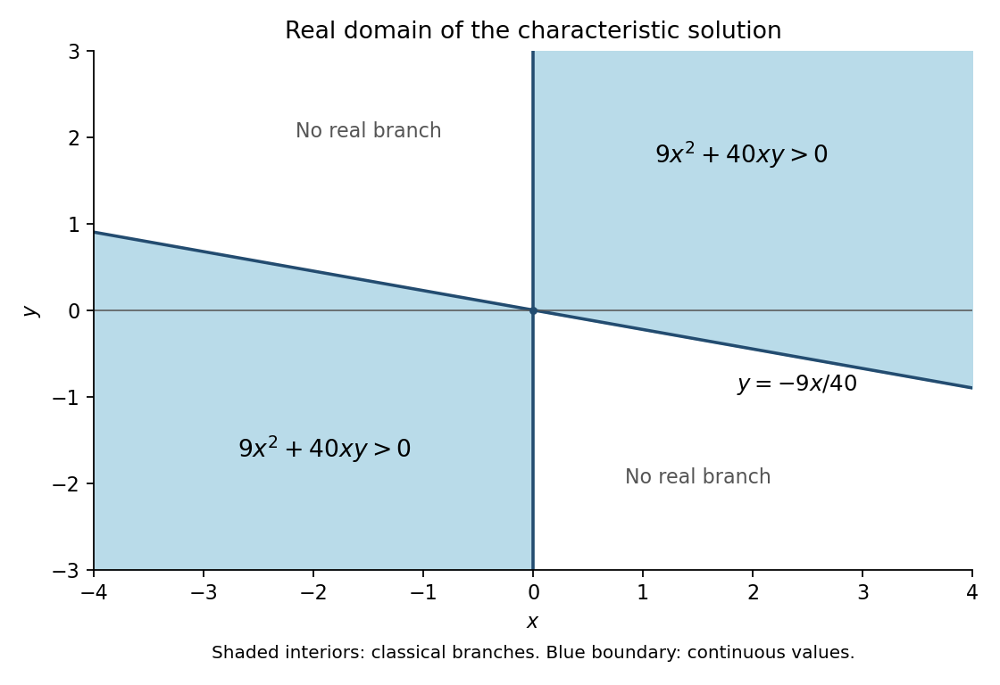

# 2008 printed variant

↑ **Parent:** [Past exam of the algebra, analysis and differential equations II course of the University of Oxford](../past-exam-of-the-algebra-analysis-and-differential-equations-2-course-of-the-university-of-oxford.md)

This printed variant of AC2 was released in [FOI 20210708 1 Data](https://www.whatdotheyknow.com/request/maths_papers_2/response/1850333/attach/3/FOI%2020210708%201%20Data.zip?cookie_passthrough=1). Its localized difference is the finite-dimensional wording in 2(i), while the later dimension formula still uses $n$. The solutions are reused from the corresponding native-paper draft, with $n=\dim V$ made explicit in that part. The full statement transcription is held separately.

**Table of contents**

- [1](#1)
  - [i](#1/i)
    - [Solution](#1/i/solution)
  - [ii](#1/ii)
    - [Solution](#1/ii/solution)
- [2](#2)
  - [i](#2/i)
    - [Solution](#2/i/solution)
  - [ii](#2/ii)
    - [Solution](#2/ii/solution)
- [3](#3)
  - [Solution](#3/solution)
  - [a](#3/a)
    - [Solution](#3/a/solution)
  - [b](#3/b)
    - [Solution](#3/b/solution)
- [4](#4)
  - [a](#4/a)
    - [Solution](#4/a/solution)
  - [b](#4/b)
    - [Solution](#4/b/solution)
- [5](#5)
  - [Solution](#5/solution)
  - [i](#5/i)
    - [Solution](#5/i/solution)
  - [ii](#5/ii)
    - [Solution](#5/ii/solution)
  - [iii](#5/iii)
    - [Solution](#5/iii/solution)
- [6](#6)
  - [Solution](#6/solution)
  - [i](#6/i)
    - [Solution](#6/i/solution)
  - [ii](#6/ii)
    - [Solution](#6/ii/solution)
  - [iii](#6/iii)
    - [Solution](#6/iii/solution)
- [7](#7)
  - [Solution](#7/solution)
- [8](#8)
  - [Solution](#8/solution)
- [9](#9)
  - [a](#9/a)
    - [Solution](#9/a/solution)
    - [i](#9/a/i)
      - [Solution](#9/a/i/solution)
    - [ii](#9/a/ii)
      - [Solution](#9/a/ii/solution)
    - [iii](#9/a/iii)
      - [Solution](#9/a/iii/solution)
    - [iv](#9/a/iv)
      - [Solution](#9/a/iv/solution)
    - [v](#9/a/v)
      - [Solution](#9/a/v/solution)
    - [vi](#9/a/vi)
      - [Solution](#9/a/vi/solution)
  - [b](#9/b)
    - [Solution](#9/b/solution)
  - [c](#9/c)
    - [Solution](#9/c/solution)

## 1

↑ **Parent:** [2008 printed variant](2008-printed-variant.md)

<h3 id="1/i">i</h3>

↑ **Parent:** [1](#1)

<h4 id="1/i/solution">Solution</h4>

↑ **Parent:** [I](#1/i)

Proceed by induction on $n=\dim V$. The zero-dimensional case is immediate. Over $\mathbb C$, the [fundamental theorem of algebra](../algebra.md#fundamental-theorem-of-algebra) supplies a root $\lambda$ of the [characteristic polynomial](../linear-operator-theory.md#characteristic-polynomial). Since $\det(T-\lambda I)=0$, there is a nonzero vector $v_1$ with $Tv_1=\lambda v_1$. The line $W=\mathbb Cv_1$ is invariant, so $T$ induces a [linear map](../vector-space.md#linear-map) $\overline T$ on $V/W$. By induction, choose an upper triangular [basis](../vector-space.md#basis) for that quotient and lift its vectors to $v_2,\ldots,v_n$. Then $Tv_j\in\operatorname{span}(v_1,\ldots,v_j)$ for every $j$. Thus $v_1,\ldots,v_n$ is the required [basis](../vector-space.md#basis) and $\boxed{T\text{ is triangularizable}}$.

The same conclusion holds over $F$ when the [characteristic polynomial](../linear-operator-theory.md#characteristic-polynomial) splits over $F$. Indeed an [eigenvalue](../linear-operator-theory.md#eigenvalue) then lies in $F$, and the [block matrix](../vector-space.md#block-matrix) arising from the invariant line gives $\chi_T(X)=(X-\lambda)\chi_{\overline T}(X)$. The quotient [characteristic polynomial](../linear-operator-theory.md#characteristic-polynomial) therefore also splits, so the induction works over $F$ without requiring [algebraic closure](../algebra.md#algebraic-closure).

<h3 id="1/ii">ii</h3>

↑ **Parent:** [1](#1)

<h4 id="1/ii/solution">Solution</h4>

↑ **Parent:** [Ii](#1/ii)

Write $N=T-I$. [Cayley-Hamilton theorem](../cayley-hamilton-theorem.md) gives $N^3=0$. Its [minimal polynomial](../linear-operator-theory.md#minimal-polynomial) is therefore $X^k$ for exactly one $k\in\{1,2,3\}$, so the possibilities for that of $T$ are

$$
\boxed{X-1,\quad(X-1)^2,\quad(X-1)^3.}
$$

Let $d=\dim\ker N$, which is the [dimension](../vector-space.md#dimension-vector-space) of the only [eigenspace](../linear-operator-theory.md#eigenspace). If $d=3$, then $N=0$ and $T=I$.

If $d=2$, [rank-nullity theorem](../kernel-of-a-linear-map.md#rank-nullity-theorem) gives $\dim\operatorname{im}N=1$. The restriction of the nilpotent map $N$ to this invariant line is zero, so $N^2=0$. Choose $v_3$ with $v_2=Nv_3\ne0$, and choose $v_1\in\ker N$ independent of $v_2$. Then $v_3\notin\ker N$, so these three vectors form a [basis](../vector-space.md#basis); its [matrix](../vector-space.md#matrix) for $T$ is the printed $J_1(1)\oplus J_2(1)$.

If $d=1$, then $\operatorname{im}N$ has [dimension](../vector-space.md#dimension-vector-space) two, so $N^2$ cannot vanish: otherwise $\operatorname{im}N\subseteq\ker N$. Choose $v_3$ with $N^2v_3\ne0$ and set $v_2=Nv_3$, $v_1=N^2v_3$. Applying $N^2$ and then $N$ to a putative linear relation proves these three vectors independent. The [matrix](../vector-space.md#matrix) is the printed $J_3(1)$.

These cases exhaust the possible [eigenspace](../linear-operator-theory.md#eigenspace) dimensions. They are pairwise dissimilar because similarity preserves the [eigenspace](../linear-operator-theory.md#eigenspace) [dimension](../vector-space.md#dimension-vector-space), equivalently the three different minimal [polynomials](../polynomial.md). Hence every [matrix](../vector-space.md#matrix) is similar to **exactly one** of the three displayed forms.

## 2

↑ **Parent:** [2008 printed variant](2008-printed-variant.md)

<h3 id="2/i">i</h3>

↑ **Parent:** [2](#2)

<h4 id="2/i/solution">Solution</h4>

↑ **Parent:** [I](#2/i)

Write $n=\dim V$, which is finite by hypothesis. This supplies the meaning of the $n$ used later in the variant; the proof is otherwise unchanged.

The functional $\ell(u)=\langle u,v\rangle$ is linear and nonzero because $\ell(v)=\langle v,v\rangle>0$. It therefore has rank one, and [rank-nullity theorem](../kernel-of-a-linear-map.md#rank-nullity-theorem) gives

$$
\boxed{v^\perp=\ker\ell,\qquad\dim v^\perp=n-1.}
$$

No Gram–Schmidt argument is needed. Every vector decomposes uniquely as $u=w+av$, where $w\perp v$ and $a=\langle u,v\rangle/\langle v,v\rangle$. Substitution gives $S_v(w+av)=w-av$. Thus the [eigenspace](../linear-operator-theory.md#eigenspace) for $-1$ is $\mathbb Rv$, and that for $+1$ is $v^\perp$. The latter is an actual [eigenvalue](../linear-operator-theory.md#eigenvalue) when $n\ge2$; when $n=1$ its [eigenspace](../linear-operator-theory.md#eigenspace) is zero and only $-1$ occurs. In the plane the map is **[reflection](../linear-algebra.md#reflection-mathematics) in the line perpendicular to $v$**.

<h3 id="2/ii">ii</h3>

↑ **Parent:** [2](#2)

<h4 id="2/ii/solution">Solution</h4>

↑ **Parent:** [Ii](#2/ii)

For [equal-length crystallographic root configurations in a plane](../semisimple-lie-algebra.md#equal-length-crystallographic-root-configurations-in-a-plane), taking $u=v$ in the closure condition gives $S_v(v)=-v$, so every vector occurs with its negative. For fixed $v\in\Phi$, a vector $u\in\Phi$ has $\langle u,v\rangle\in\{-1,-1/2,0,1/2,1\}$, because both vectors are [unit vectors](../vector-space.md#unit-vector). Thus its angle relative to $v$ belongs to the finite list $0,\pm\pi/3,\pm\pi/2,\pm2\pi/3,\pi$.

If all vectors are collinear, the set is exactly $\{v,-v\}$, giving two opposite points of the [unit circle](../complex-analysis.md#complex-unit-circle).

If an [orthogonal](../inner-product.md#orthogonal-vectors) vector $w$ occurs, closure supplies $\pm v,\pm w$. A [unit vector](../vector-space.md#unit-vector) making an angle of $\pi/3$ or $2\pi/3$ with $v$ would have [inner product](../inner-product.md) $\pm\sqrt3/2$ with $w$, contradicting integrality of twice that [inner product](../inner-product.md). Thus these four points are the whole set: the vertices of a [square](../euclidean-geometry.md#square).

In the remaining case a noncollinear pair makes an angle of $\pi/3$ or $2\pi/3$. Changing a sign, take their angles as $0,\pi/3$. Reflecting the second in the line perpendicular to the first supplies the angle $2\pi/3$, and negation supplies the other three hexagon vertices. No perpendicular vector can occur, by the preceding inner-product obstruction. The initial finite list now leaves only these six points. Conversely the opposite pair, [square](../euclidean-geometry.md#square) and [regular hexagon](../euclidean-geometry.md#regular-hexagon) each satisfy both [reflection](../linear-algebra.md#reflection-mathematics) closure and the integrality condition. Hence

$$
\boxed{|\Phi|\in\{2,4,6\}.}
$$

## 3

↑ **Parent:** [2008 printed variant](2008-printed-variant.md)

<h3 id="3/solution">Solution</h3>

↑ **Parent:** [3](#3)

For the [polynomial ring](../commutative-algebra.md#polynomial-ring), use the [Euclidean function](../commutative-algebra.md#euclidean-function) $\delta(f)=\deg f$ on nonzero [polynomials](../polynomial.md). If $a,b\in F[X]$ and $b\ne0$, subtract the multiple of $b$ that cancels the leading term of $a$. The leading [coefficient](../vector-space.md#coefficient) of $b$ is invertible in the [field](../algebra.md#field), and every subtraction strictly lowers the degree of the remainder. This process terminates with $a=qb+r$ and either $r=0$ or $\deg r<\deg b$. Thus $\boxed{F[X]\text{ is a Euclidean domain}}$.

For the [Gauss lemma for polynomials](../commutative-algebra.md#gauss-lemma-for-polynomials), call an [integer](../integer.md) [polynomial](../polynomial.md) [primitive](../commutative-algebra.md#primitive-polynomial) when its [coefficient](../vector-space.md#coefficient) gcd is one. If two [primitive](../commutative-algebra.md#primitive-polynomial) [polynomials](../polynomial.md) had a nonprimitive product, a prime $p$ would divide every product [coefficient](../vector-space.md#coefficient). Reducing modulo $p$ would give a zero product of two nonzero [polynomials](../polynomial.md) in the [integral domain](../commutative-algebra.md#integral-domain) $\mathbb F_p[X]$, a contradiction. Therefore **the product of [primitive](../commutative-algebra.md#primitive-polynomial) [integer](../integer.md) [polynomials](../polynomial.md) is [primitive](../commutative-algebra.md#primitive-polynomial)**.

To transfer a rational factorization, write each nonzero rational factor as a rational scalar times a [primitive](../commutative-algebra.md#primitive-polynomial) [integer](../integer.md) [polynomial](../polynomial.md) by clearing denominators and removing the [coefficient](../vector-space.md#coefficient) gcd. Thus $f=qAB$ with [primitive](../commutative-algebra.md#primitive-polynomial) $A,B\in\mathbb Z[X]$ and $q\in\mathbb Q$. Their product is [primitive](../commutative-algebra.md#primitive-polynomial) by the lemma. If $q=m/n$ in lowest terms, integrality of every [coefficient](../vector-space.md#coefficient) of $f$ forces $n$ to divide every [coefficient](../vector-space.md#coefficient) of $AB$, so $n=1$. Hence $q\in\mathbb Z$; absorbing $q$ into either factor produces the required [integer](../integer.md) factorization with the same positive factor degrees. In particular irreducibility of a [primitive polynomial](../commutative-algebra.md#primitive-polynomial) over $\mathbb Z$ and over $\mathbb Q$ is equivalent.

Finally, let $a/b$ in lowest terms, $b>0$, be a rational root of a monic degree-$d$ [integer](../integer.md) [polynomial](../polynomial.md). Multiplying the equation by $b^d$ shows $b\mid a^d$. [Coprimality](../divisibility.md#coprime-integers) forces $b=1$. Thus $\boxed{\text{every rational root of a monic integer polynomial is an integer}}$.

<h3 id="3/a">a</h3>

↑ **Parent:** [3](#3)

<h4 id="3/a/solution">Solution</h4>

↑ **Parent:** [A](#3/a)

An [integral domain](../commutative-algebra.md#integral-domain) is a [commutative ring](../commutative-algebra.md#commutative-ring) with identity $1\ne0$ and no [zero divisors](../mathematics.md#zero-divisor): $ab=0$ implies $a=0$ or $b=0$. Equivalently nonzero elements admit cancellation in multiplication.

<h3 id="3/b">b</h3>

↑ **Parent:** [3](#3)

<h4 id="3/b/solution">Solution</h4>

↑ **Parent:** [B](#3/b)

A [Euclidean domain](../commutative-algebra.md#euclidean-domain) is an [integral domain](../commutative-algebra.md#integral-domain) equipped with a function $\delta:R\setminus\{0\}\to\mathbb N$ such that for every $a\in R$ and nonzero $b\in R$ there are $q,r\in R$ with $a=qb+r$ and either $r=0$ or $\delta(r)<\delta(b)$. One may additionally require $\delta(a)\le\delta(ab)$ for nonzero $a,b$; degree on a [polynomial ring](../commutative-algebra.md#polynomial-ring) also satisfies this convention.

## 4

↑ **Parent:** [2008 printed variant](2008-printed-variant.md)

<h3 id="4/a">a</h3>

↑ **Parent:** [4](#4)

<h4 id="4/a/solution">Solution</h4>

↑ **Parent:** [A](#4/a)

Let $h=f^{-1}$, $w_0=f(z_0)$ and $z=h(w)$. [Continuity](../calculus.md#continuous-function) of $h$ gives $z\to z_0$ as $w\to w_0$, and injectivity gives $z\ne z_0$ when $w\ne w_0$. Therefore

$$
\frac{h(w)-h(w_0)}{w-w_0}=\left(\frac{f(z)-f(z_0)}{z-z_0}\right)^{-1}\longrightarrow\frac1{f'(z_0)}.
$$

The assumed nonvanishing [derivative](../calculus.md#derivative) makes this limit well defined. It exists at every $w_0\in V$, so $h$ is [holomorphic](../holomorphic-function.md), with $\boxed{h'(w)=1/f'(h(w))}$.

Squaring maps the first [quadrant](../linear-algebra.md#quadrant-plane-geometry) bijectively onto the [upper half-plane](../complex-analysis.md#upper-half-plane-complex-analysis). For $\zeta$ in that half-plane, $|\zeta-i|<|\zeta+i|$, and the [Cayley transform](../group-theory.md#cayley-transform-complex-analysis) $(\zeta-i)/(\zeta+i)$ maps it bijectively onto the [unit disc](../topology.md#unit-disc). Their composition is

$$
\boxed{F(z)=\frac{z^2-i}{z^2+i}.}
$$

The inverse is the unique first-[quadrant](../linear-algebra.md#quadrant-plane-geometry) [square root](../algebra.md#square-root) of $i(1+w)/(1-w)$, and is [holomorphic](../holomorphic-function.md) by the first argument. Hence $H(w)=g(F^{-1}(w))$ is [holomorphic](../holomorphic-function.md) throughout the disc. Its [Taylor series](../calculus.md#taylor-series) at zero converges for $|w|<1$, locally uniformly there. Substituting $w=F(z)$ gives the stated expansion, with $c_n=H^{(n)}(0)/n!$, convergent at every point of the [quadrant](../linear-algebra.md#quadrant-plane-geometry) and locally uniformly on it.

<h3 id="4/b">b</h3>

↑ **Parent:** [4](#4)

<h4 id="4/b/solution">Solution</h4>

↑ **Parent:** [B](#4/b)

If a [holomorphic](../holomorphic-function.md) [bijection](../function.md#bijection) existed, its inverse would be an entire function taking values in the [unit disc](../topology.md#unit-disc). [Liouville theorem](../complex-analysis.md#liouville-theorem) would make that inverse constant, contradicting bijectivity. Thus **no [holomorphic](../holomorphic-function.md) [bijection](../function.md#bijection) exists**.

A [continuous](../calculus.md#continuous-function) [bijection](../function.md#bijection) does exist, even a [homeomorphism](../topology.md#homeomorphism):

$$
\boxed{h(z)=\frac{z}{1-|z|},\qquad h^{-1}(w)=\frac{w}{1+|w|}.}
$$

Both maps preserve the argument and change the radius by the mutually inverse strictly increasing functions $r\mapsto r/(1-r)$ and $s\mapsto s/(1+s)$. The displayed formulas also prove [continuity](../calculus.md#continuous-function) at zero and everywhere else.

## 5

↑ **Parent:** [2008 printed variant](2008-printed-variant.md)

<h3 id="5/solution">Solution</h3>

↑ **Parent:** [5](#5)

An [isolated singularity](../isolated-singularity.md) at $a$ means that the function is [holomorphic](../holomorphic-function.md) throughout some punctured disc $0<|z-a|<r$. Its [residue](../analysis.md#residue) is the [Laurent coefficient](../analysis.md#laurent-coefficient) $c_{-1}$, equivalently $(2\pi i)^{-1}\int_{|z-a|=\rho}f(z)\,dz$. The singularity is removable if all negative [Laurent coefficients](../analysis.md#laurent-coefficient) vanish, a [pole](../isolated-singularity.md#pole) of order $k$ if only finitely many are nonzero and the lowest power is $-k$, and essential if infinitely many negative [coefficients](../vector-space.md#coefficient) are nonzero.

For the final [contour integral](../complex-analysis.md#contour-integral), expand $e^{tz}e^{t/z}$. On the [circle](../topology.md#circle) these exponential series converge absolutely and uniformly for $t$ in every bounded set, so their product can be integrated term by term. In

$$
\sum_{j,k\ge0}\frac{t^{j+k}}{j!k!}z^{j-k-2},
$$

only $j-k-2=-1$ contributes. Set $k=m$, $j=m+1$. Thus

$$
\boxed{b_m=\frac{2\pi i}{m!(m+1)!},\qquad m\ge0.}
$$

The resulting power series converges for every complex $t$ by the ratio test. The [coefficients](../vector-space.md#coefficient) are independent of the positive radius $R$.

<h3 id="5/i">i</h3>

↑ **Parent:** [5](#5)

<h4 id="5/i/solution">Solution</h4>

↑ **Parent:** [I](#5/i)

Both numerator and denominator have simple zeros at zero, and $1-e^{-z}=z+O(z^2)$. Their quotient tends to one and extends holomorphically with that value. Hence the singularity is **removable**, and $\boxed{\operatorname{Res}_0 f=0}$ because its [Laurent series](../analysis.md#laurent-series) has no negative powers.

<h3 id="5/ii">ii</h3>

↑ **Parent:** [5](#5)

<h4 id="5/ii/solution">Solution</h4>

↑ **Parent:** [Ii](#5/ii)

Use $\sin z=z+O(z^3)$ and

$$
(1-e^{-z})^{-3}=z^{-3}(1-z/2+O(z^2))^{-3}=z^{-3}(1+3z/2+O(z^2)).
$$

Their product is $z^{-2}+(3/2)z^{-1}+O(1)$. Thus the singularity is a **[pole](../isolated-singularity.md#pole) of order two**, with $\boxed{\operatorname{Res}_0 f=3/2}$.

<h3 id="5/iii">iii</h3>

↑ **Parent:** [5](#5)

<h4 id="5/iii/solution">Solution</h4>

↑ **Parent:** [Iii](#5/iii)

The denominator vanishes at $z_k=1/(2\pi i k)$ for every nonzero [integer](../integer.md) $k$. These points approach zero, the denominator has a [simple zero](../holomorphic-function.md#simple-zero) at each, and $\sin z_k\ne0$ because a nonzero purely imaginary number is not a zero of sine. Hence there are [poles](../isolated-singularity.md#pole) arbitrarily close to zero. The origin is a **nonisolated singularity**, so it has no [residue](../analysis.md#residue) defined by a [Laurent series](../analysis.md#laurent-series) on a punctured disc. In particular it must not be classified as an isolated [essential singularity](../isolated-singularity.md#essential-singularity) merely because $e^{1/z}$ has one.

## 6

↑ **Parent:** [2008 printed variant](2008-printed-variant.md)

<h3 id="6/solution">Solution</h3>

↑ **Parent:** [6](#6)

The [identity theorem for holomorphic functions](../complex-analysis.md#identity-theorem) says that a [holomorphic function](../holomorphic-function.md) on a connected [open set](../topology.md#open-set) which has distinct zeros accumulating at a point of the set is identically zero. Equivalently, two [holomorphic](../holomorphic-function.md) functions agreeing on such a set of points agree everywhere in that connected [open set](../topology.md#open-set).

To prove it, expand at an accumulation point $a$. If the first nonzero [Taylor coefficient](../calculus.md#taylor-coefficient) had index $m$, the function would factor as $(z-a)^m h(z)$ with $h(a)\ne0$. [Continuity](../calculus.md#continuous-function) would make $h$ nonzero near $a$, so no other zeros could approach $a$, a contradiction. Thus all [coefficients](../vector-space.md#coefficient) vanish and the function vanishes on a neighborhood of $a$. Let $E$ be the set of points having such a zero neighborhood. It is nonempty and open. If a point in the domain is a limit point of $E$, it is either already in $E$ or is an accumulation point of distinct zeros, and the same Taylor argument puts it in $E$. Thus $E$ is relatively closed as well. [Connectedness](../geometry-and-topology.md#connected-space) forces $E$ to be the whole domain. Apply this result to the difference of two functions for the equivalent formulation.

<h3 id="6/i">i</h3>

↑ **Parent:** [6](#6)

<h4 id="6/i/solution">Solution</h4>

↑ **Parent:** [I](#6/i)

The given distinct zeros converge to $i$, which lies inside the connected [upper half-plane](../complex-analysis.md#upper-half-plane-complex-analysis). The [identity theorem for holomorphic functions](../complex-analysis.md#identity-theorem) forces the function to vanish identically. Thus $\boxed{\text{no}}$.

<h3 id="6/ii">ii</h3>

↑ **Parent:** [6](#6)

<h4 id="6/ii/solution">Solution</h4>

↑ **Parent:** [Ii](#6/ii)

Here the zeros accumulate only at the boundary point zero. An explicit [holomorphic](../holomorphic-function.md), nonzero example on the [upper half-plane](../complex-analysis.md#upper-half-plane-complex-analysis) is

$$
\boxed{f(z)=\sin(\pi i/z).}
$$

At $z_n=i/(n+1)$ its argument is $\pi(n+1)$, so it vanishes. It is [holomorphic](../holomorphic-function.md) because the only excluded point of its formula is zero; it is not identically zero, for instance at $z=2i$. Thus the answer is **yes**.

<h3 id="6/iii">iii</h3>

↑ **Parent:** [6](#6)

<h4 id="6/iii/solution">Solution</h4>

↑ **Parent:** [Iii](#6/iii)

The domain has two [connected components](../geometry-and-topology.md#connected-component). The zeros force the function to vanish on the [upper half-plane](../complex-analysis.md#upper-half-plane-complex-analysis) but impose nothing on the lower one. Define

$$
\boxed{f(z)=\begin{cases}0,&\operatorname{Im}z>0,\\1,&\operatorname{Im}z<0.\end{cases}}
$$

This function is locally constant and hence [holomorphic](../holomorphic-function.md) on the stated [open set](../topology.md#open-set), and is not identically zero on that whole set. Thus the answer is **yes**. [Connectedness](../geometry-and-topology.md#connected-space) is exactly the missing hypothesis for a global identity conclusion.

## 7

↑ **Parent:** [2008 printed variant](2008-printed-variant.md)

<h3 id="7/solution">Solution</h3>

↑ **Parent:** [7](#7)

Differentiate the [Wronskian](../linear-ordinary-differential-equation.md#wronskian):

$$
w'=uv''-u''v=u(-qv)-(-qu)v=0.
$$

It is therefore constant. [Linear dependence](../vector-space.md#linear-dependence) plainly makes it zero. Conversely, if it is zero, the two initial-data vectors $(u(0),u'(0))$ and $(v(0),v'(0))$ are linearly dependent. Some constants $A,B$, not both zero, make $Au+Bv$ and its [derivative](../calculus.md#derivative) zero at zero. Uniqueness for a linear second-order equation with [continuous](../calculus.md#continuous-function) [coefficients](../vector-space.md#coefficient) then makes $Au+Bv$ identically zero. Thus $\boxed{w=0\iff u,v\text{ are linearly dependent}}$.

For the prescribed integral put $K(x,s)=[u(x)v(s)-u(s)v(x)]/w$. Then $K(x,x)=0$, $K_x(x,x)=-1$, and $K_{xx}(x,s)=-q(x)K(x,s)$. [Differentiation](../calculus.md#differentiation) under the integral, using [continuity](../calculus.md#continuous-function) of the [coefficients](../vector-space.md#coefficient) and forcing, gives

$$
y'(x)=\int_0^xK_x(x,s)f(s)\,ds,\qquad y''(x)=-f(x)-q(x)y(x).
$$

This proves the required inhomogeneous equation, with the sign of the forcing as printed.

For the explicit forcing take $u=\cosh x$, $v=\sinh x$, so $w=1$ and $K(x,s)=-\sinh(x-s)$. Since $2/(e^s+e^{-s})=\operatorname{sech}s$, the integral is

$$
-\int_0^x\sinh(x-s)\operatorname{sech}s\,ds=-x\sinh x+\cosh x\log\cosh x.
$$

Indeed expand $\sinh(x-s)=\sinh x\cosh s-\cosh x\sinh s$ and integrate $1$ and $\tanh s$. Adding the entire homogeneous solution gives

$$
\boxed{y(x)=A\cosh x+B\sinh x+\cosh x\log\cosh x-x\sinh x,\quad A,B\in\mathbb R.}
$$

Finally multiply the other equation by $\sin x$ and integrate from zero to $\pi$. [Integration by parts](../calculus.md#integration-by-parts) gives

$$
\int_0^\pi(y''+y)\sin x\,dx=[y'\sin x-y\cos x]_0^\pi=y(\pi)+y(0)=0.
$$

Thus $\boxed{\int_0^\pi f(s)\sin s\,ds=0}$ is necessary. It is also sufficient: the solution with $y(0)=0$ is $B\sin x-\int_0^x\sin(x-s)f(s)\,ds$, and the integral condition gives its value zero at $\pi$.

## 8

↑ **Parent:** [2008 printed variant](2008-printed-variant.md)

<h3 id="8/solution">Solution</h3>

↑ **Parent:** [8](#8)

Use the characteristic parameter $t$ and write

$$
\dot x=3y-4u,\qquad\dot y=-3x+5u,\qquad\dot u=4x-5y.
$$

Direct [differentiation](../calculus.md#differentiation) gives

$$
\frac d{dt}(5x+4y+3u)=0,\qquad\frac d{dt}(x^2+y^2+u^2)=0.
$$

A characteristic beginning at $(s,0,0)$ therefore satisfies $5x+4y+3u=5s$ and $x^2+y^2+u^2=s^2$. Eliminating $s$ gives

$$
16u^2-(30x+24y)u+9y^2-40xy=0.
$$

Its discriminant as a quadratic in $u$ is $100(9x^2+40xy)$. Requiring the root to be zero when $y=0$ selects

$$
\boxed{u(x,y)=\begin{cases}\dfrac{15x+12y-5\sqrt{9x^2+40xy}}{16},&x>0,\\[5pt]\dfrac{15x+12y+5\sqrt{9x^2+40xy}}{16},&x<0.\end{cases}}
$$

The selected branch is differentiable in each of the two regions where the radical is strictly positive, and substitution into the differentiated quadratic identity verifies the [partial differential equation](../partial-differential-equation.md) there. On the initial line away from the origin the characteristic vector has nonzero $y$ component $-3s$, so these are the locally unique branches determined by that line.

The maximal real-valued continuation of these branches has the printed domain

$$
\boxed{D=\{9x^2+40xy\ge0\}=\{x\ge0,\ y\ge-9x/40\}\cup\{x\le0,\ y\le-9x/40\}.}
$$

At $x=0$ the [continuous](../calculus.md#continuous-function) limiting value is $u(0,y)=3y/4$. The two bounding lines are $x=0$ and $y=-9x/40$, and the included sectors are the one above the sloping line on the right and the one below it on the left.

As in the [fold boundary of a characteristic graph](../transport-equation.md#fold-boundary-of-a-characteristic-graph), the closed-domain statement concerns the formula's real values. A [classical solution](../partial-differential-equation.md#classical-solution) requires first derivatives on an [open set](../topology.md#open-set). Along the nonzero boundary points $9x^2+40xy=0$, the radical's transverse [derivative](../calculus.md#derivative) is singular, so the formula is generally not a [classical solution](../partial-differential-equation.md#classical-solution) there; its two classical domains are the interiors of the shaded sectors. The origin is characteristic for the initial data and does not supply a differentiable neighborhood solution. This qualification preserves the source's stated closed set while distinguishing it from the domain of a [classical solution](../partial-differential-equation.md#classical-solution).

**[Figure 1](#8/image-real-domain-and-classical-interiors-of-the-characteristic-solution). Real domain and classical interiors of the characteristic solution**.

## 9

↑ **Parent:** [2008 printed variant](2008-printed-variant.md)

<h3 id="9/a">a</h3>

↑ **Parent:** [9](#9)

<h4 id="9/a/solution">Solution</h4>

↑ **Parent:** [A](#9/a)

A [critical point](../dynamical-systems.md#equilibrium-point-of-a-dynamical-system) is an [equilibrium](../dynamical-systems.md#equilibrium-point-of-a-dynamical-system): $\boxed{f(a,b)=g(a,b)=0}$. Put $X=x-a$, $Y=y-b$. The [Jacobian matrix](../multivariable-calculus.md#jacobian-matrix) $J$ gives the first-order linearized equation $(\dot X,\dot Y)^\mathsf T=J(X,Y)^\mathsf T$. The following [eigenvalue](../linear-operator-theory.md#eigenvalue) tests classify that linearized system. For a continuously differentiable nonlinear system, the cases with nonzero real parts persist as the usual local node, [saddle](../dynamical-systems.md#saddle-equilibrium) or spiral classifications. The purely imaginary case needs extra nonlinear information, as explained in (iv).

<h4 id="9/a/i">i</h4>

↑ **Parent:** [A](#9/a)

<h5 id="9/a/i/solution">Solution</h5>

↑ **Parent:** [I](#9/a/i)

Both [eigenvalues](../linear-operator-theory.md#eigenvalue) are real and negative: $\boxed{\lambda_1<0,\ \lambda_2<0}$, with distinctness as assumed. The two independent real eigendirections carry exponentially decaying factors $e^{\lambda_jt}$, giving a [stable node](../dynamical-systems.md#stable-node).

<h4 id="9/a/ii">ii</h4>

↑ **Parent:** [A](#9/a)

<h5 id="9/a/ii/solution">Solution</h5>

↑ **Parent:** [Ii](#9/a/ii)

Both [eigenvalues](../linear-operator-theory.md#eigenvalue) are real and positive: $\boxed{\lambda_1>0,\ \lambda_2>0}$. The real eigendirections carry exponentially growing factors, giving an [unstable node](../dynamical-systems.md#unstable-node).

<h4 id="9/a/iii">iii</h4>

↑ **Parent:** [A](#9/a)

<h5 id="9/a/iii/solution">Solution</h5>

↑ **Parent:** [Iii](#9/a/iii)

The [eigenvalues](../linear-operator-theory.md#eigenvalue) are real and have opposite signs: $\boxed{\lambda_1\lambda_2<0}$. One [eigendirection](../linear-operator-theory.md#eigendirection) contracts and the other expands, giving a [saddle](../dynamical-systems.md#saddle-equilibrium).

<h4 id="9/a/iv">iv</h4>

↑ **Parent:** [A](#9/a)

<h5 id="9/a/iv/solution">Solution</h5>

↑ **Parent:** [Iv](#9/a/iv)

For the linearized system a [centre](../dynamical-systems.md#center-equilibrium) occurs when $\boxed{\lambda_{1,2}=\pm i\beta,\ \beta\ne0}$. Its real solutions are periodic ellipses after an invertible linear coordinate change.

As explained by [a centre in the linearization need not be a nonlinear centre](../dynamical-systems.md#a-centre-in-the-linearization-need-not-be-a-nonlinear-centre), for a nonlinear system these [eigenvalues](../linear-operator-theory.md#eigenvalue) alone do **not** guarantee a [centre](../dynamical-systems.md#center-equilibrium). For example $\dot X=-Y-X(X^2+Y^2)$, $\dot Y=X-Y(X^2+Y^2)$ has [eigenvalues](../linear-operator-theory.md#eigenvalue) $\pm i$ at zero but polar equations $\dot r=-r^3$, $\dot\theta=1$, so trajectories spiral inward. Removing the cubic terms gives a genuine [centre](../dynamical-systems.md#center-equilibrium) with the same Jacobian. Thus there is no [eigenvalue](../linear-operator-theory.md#eigenvalue)-only sufficient condition for a nonlinear [centre](../dynamical-systems.md#center-equilibrium) in the stated generality.

<h4 id="9/a/v">v</h4>

↑ **Parent:** [A](#9/a)

<h5 id="9/a/v/solution">Solution</h5>

↑ **Parent:** [V](#9/a/v)

The [eigenvalues](../linear-operator-theory.md#eigenvalue) are a nonreal conjugate pair $\boxed{\alpha\pm i\beta,\ \alpha<0,\ \beta\ne0}$. The factor $e^{\alpha t}$ contracts while the imaginary part produces rotation, giving a [stable spiral](../dynamical-systems.md#stable-spiral).

<h4 id="9/a/vi">vi</h4>

↑ **Parent:** [A](#9/a)

<h5 id="9/a/vi/solution">Solution</h5>

↑ **Parent:** [Vi](#9/a/vi)

The [eigenvalues](../linear-operator-theory.md#eigenvalue) are a nonreal conjugate pair $\boxed{\alpha\pm i\beta,\ \alpha>0,\ \beta\ne0}$. The exponential factor expands while the imaginary part produces rotation, giving an [unstable spiral](../dynamical-systems.md#unstable-spiral).

<h3 id="9/b">b</h3>

↑ **Parent:** [9](#9)

<h4 id="9/b/solution">Solution</h4>

↑ **Parent:** [B](#9/b)

The [equilibrium](../dynamical-systems.md#equilibrium-point-of-a-dynamical-system) equations are $x(1+x-2y)=0$ and $(x-1)y=0$. If $x=0$, the second equation gives $y=0$. Otherwise either $y=0$, giving $x=-1$, or $x=1$, giving $y=1$. Thus there are exactly three equilibria. The Jacobian is

$$
J(x,y)=\begin{pmatrix}1+2x-2y&-2x\\y&x-1\end{pmatrix}.
$$

At $(0,0)$ it is $\operatorname{diag}(1,-1)$: **a [saddle](../dynamical-systems.md#saddle-equilibrium)**. At $(-1,0)$ it is $\begin{pmatrix}-1&2\\0&-2\end{pmatrix}$, with [eigenvalues](../linear-operator-theory.md#eigenvalue) $-1,-2$: **a [stable node](../dynamical-systems.md#stable-node)**. At $(1,1)$ it is $\begin{pmatrix}1&-2\\1&0\end{pmatrix}$, with [characteristic polynomial](../linear-operator-theory.md#characteristic-polynomial) $\lambda^2-\lambda+2$ and [eigenvalues](../linear-operator-theory.md#eigenvalue) $(1\pm i\sqrt7)/2$: **an [unstable spiral](../dynamical-systems.md#unstable-spiral)**. All three are hyperbolic, so the nonlinear local classifications follow from [linearization](../algebra.md#linearization).

<h3 id="9/c">c</h3>

↑ **Parent:** [9](#9)

<h4 id="9/c/solution">Solution</h4>

↑ **Parent:** [C](#9/c)

Suppose a nonconstant [periodic orbit](../dynamical-systems.md#periodic-orbit) exists for the continuously differentiable planar [vector field](../multivariable-calculus.md#vector-field). Uniqueness implies that its image over a minimal period is a simple closed curve, enclosing a region $\Omega$ of positive area. Along the orbit, the differential form $f\,dy-g\,dx$ vanishes because $dx=f\,dt$ and $dy=g\,dt$. [Green's theorem](../multivariable-calculus.md#green-theorem), with positive orientation, therefore gives

$$
0=\oint_{\partial\Omega}(f\,dy-g\,dx)=\iint_\Omega(f_x+g_y)\,dx\,dy<0,
$$

a contradiction. This is the [Bendixson-Dulac criterion](../dynamical-systems.md#bendixson-dulac-theorem) in the whole plane; the fact that the enclosed region also lies in the domain is essential.

For the second-order equation set $y=\dot x$. The equivalent system is $\dot x=y$, $\dot y=-(1+x^2)y-\cos x$. Its [divergence](../multivariable-calculus.md#divergence) is $\boxed{-(1+x^2)<0}$ throughout the plane. Hence **there are no nonconstant periodic solutions**.

The nonconstant qualification is necessary: the [equilibrium](../dynamical-systems.md#equilibrium-point-of-a-dynamical-system) solutions $x(t)\equiv\pi/2+k\pi$, $k\in\mathbb Z$, do exist and are periodic in the literal sense of satisfying every positive period. The source's usual dynamical interpretation of “[periodic solution](../differential-equation.md#periodic-solution)” here is a nonconstant [periodic orbit](../dynamical-systems.md#periodic-orbit).

## ↑ Ancestors (9)

1. [Past exam of the algebra, analysis and differential equations II course of the University of Oxford](../past-exam-of-the-algebra-analysis-and-differential-equations-2-course-of-the-university-of-oxford.md)
2. [Algebra, analysis and differential equations II course of the University of Oxford](../university-of-oxford.md#algebra-analysis-and-differential-equations-ii-course-of-the-university-of-oxford)
3. [Year 2 of the mathematics course of the University of Oxford](../university-of-oxford.md#year-2-of-the-mathematics-course-of-the-university-of-oxford)
4. [Mathematics course of the University of Oxford](../university-of-oxford.md#mathematics-course-of-the-university-of-oxford)
5. [Undergraduate course of the University of Oxford](../university-of-oxford.md#undergraduate-course-of-the-university-of-oxford)
6. [Course of the University of Oxford](../university-of-oxford.md#course-of-the-university-of-oxford)
7. [University of Oxford](../university-of-oxford.md)
8. [List of universities](../README.md#list-of-universities)
9. [Codex Wiki](../README.md)
