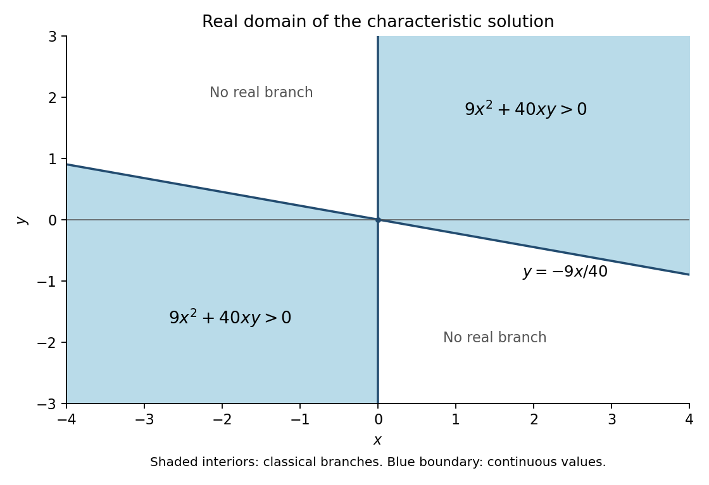

<h1 id="8/solution">Solution</h1>

↑ **Parent:** [8](../8.md)

Use the characteristic parameter $t$ and write

$$
\dot x=3y-4u,\qquad\dot y=-3x+5u,\qquad\dot u=4x-5y.
$$

Direct [differentiation](../../../differentiation.md) gives

$$
\frac d{dt}(5x+4y+3u)=0,\qquad\frac d{dt}(x^2+y^2+u^2)=0.
$$

A characteristic beginning at $(s,0,0)$ therefore satisfies $5x+4y+3u=5s$ and $x^2+y^2+u^2=s^2$. Eliminating $s$ gives

$$
16u^2-(30x+24y)u+9y^2-40xy=0.
$$

Its discriminant as a quadratic in $u$ is $100(9x^2+40xy)$. Requiring the root to be zero when $y=0$ selects

$$
\boxed{u(x,y)=\begin{cases}\dfrac{15x+12y-5\sqrt{9x^2+40xy}}{16},&x>0,\\[5pt]\dfrac{15x+12y+5\sqrt{9x^2+40xy}}{16},&x<0.\end{cases}}
$$

The selected branch is differentiable in each of the two regions where the radical is strictly positive, and substitution into the differentiated quadratic identity verifies the [partial differential equation](../../../partial-differential-equation-split.md) there. On the initial line away from the origin the characteristic vector has nonzero $y$ component $-3s$, so these are the locally unique branches determined by that line.

The maximal real-valued continuation of these branches has the printed domain

$$
\boxed{D=\{9x^2+40xy\ge0\}=\{x\ge0,\ y\ge-9x/40\}\cup\{x\le0,\ y\le-9x/40\}.}
$$

At $x=0$ the [continuous](../../../continuous-function.md) limiting value is $u(0,y)=3y/4$. The two bounding lines are $x=0$ and $y=-9x/40$, and the included sectors are the one above the sloping line on the right and the one below it on the left.

As in the [fold boundary of a characteristic graph](../../../fold-boundary-of-a-characteristic-graph.md), the closed-domain statement concerns the formula's real values. A [classical solution](../../../classical-solution.md) requires first derivatives on an [open set](../../../open-set.md). Along the nonzero boundary points $9x^2+40xy=0$, the radical's transverse [derivative](../../../derivative.md) is singular, so the formula is generally not a [classical solution](../../../classical-solution.md) there; its two classical domains are the interiors of the shaded sectors. The origin is characteristic for the initial data and does not supply a differentiable neighborhood solution. This qualification preserves the source's stated closed set while distinguishing it from the domain of a [classical solution](../../../classical-solution.md).

**[Figure 1](#8/image-real-domain-and-classical-interiors-of-the-characteristic-solution). Real domain and classical interiors of the characteristic solution**.

## ↑ Ancestors (11)

1. [8](../8.md)
2. [2008 printed variant](../../2008-printed-variant-split.md)
3. [Past exam of the algebra, analysis and differential equations II course of the University of Oxford](../../split.md)
4. [Algebra, analysis and differential equations II course of the University of Oxford](../../../algebra-analysis-and-differential-equations-ii-course-of-the-university-of-oxford.md)
5. [Year 2 of the mathematics course of the University of Oxford](../../../year-2-of-the-mathematics-course-of-the-university-of-oxford.md)
6. [Mathematics course of the University of Oxford](../../../mathematics-course-of-the-university-of-oxford.md)
7. [Undergraduate course of the University of Oxford](../../../undergraduate-course-of-the-university-of-oxford.md)
8. [Course of the University of Oxford](../../../course-of-the-university-of-oxford.md)
9. [University of Oxford](../../../university-of-oxford-split.md)
10. [List of universities](../../../list-of-universities.md)
11. [Codex Wiki](../../../split.md)
