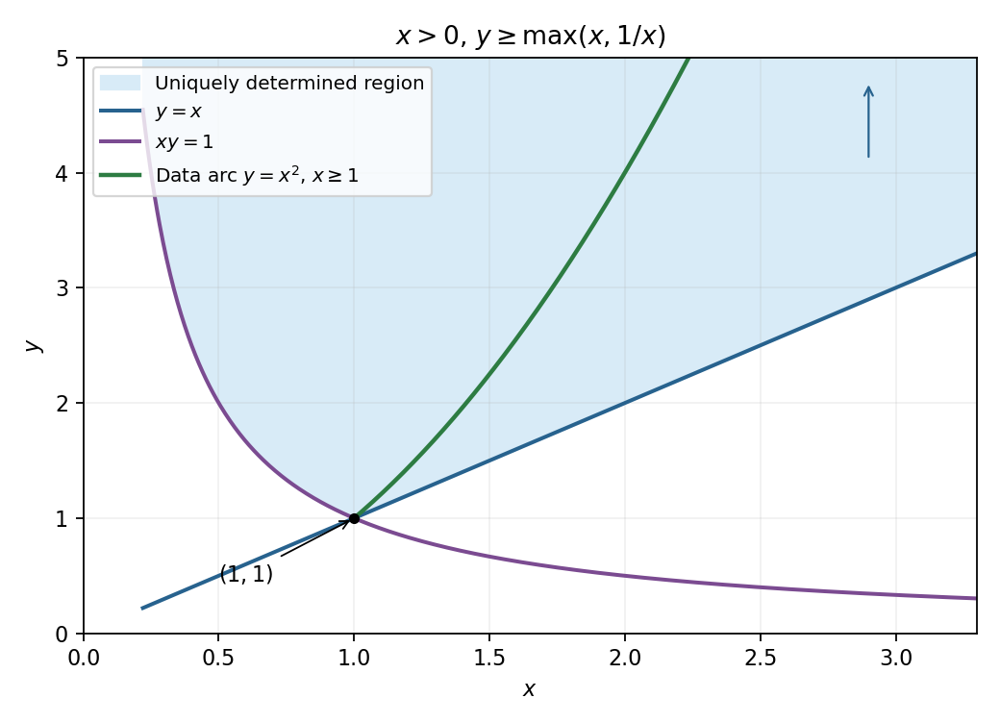

<h1 id="differential-equations/8">8</h1>

↑ **Parent:** [Differential equations](../differential-equations.md)

For the particular equation, write $D_x=x\partial_x$ and $D_y=y\partial_y$. Its left side is $(D_x^2-D_y^2)u$. Choose $\phi=xy$ and $\psi=x/y$; these are smooth invertible coordinates in the [positive quadrant](../../../positive-quadrant.md), with inverse $x=\sqrt{\phi\psi}$, $y=\sqrt{\phi/\psi}$. In them $D_x=\phi\partial_\phi+\psi\partial_\psi$ and $D_y=\phi\partial_\phi-\psi\partial_\psi$. Subtraction of their squares leaves $4\phi\psi\,u_{\phi\psi}$, so the canonical equation is $u_{\phi\psi}=0$. Integrating it gives $u=F(\phi)+G(\psi)$.

Parameterize the data curve by $(x,y)=(s,s^2)$, $s\ge1$. Its coordinate values are $(\phi,\psi)=(s^3,s^{-1})$, so

$$
F(s^3)+G(s^{-1})=s^6+s^{-1},\qquad s^2F'(s^3)+s^{-2}G'(s^{-1})=2s^5+s^{-2}.
$$

Differentiate the first identity along the curve to get $3s^2F'(s^3)-s^{-2}G'(s^{-1})=6s^5-s^{-2}$. Adding gives $F'(s^3)=2s^3$, and then $G'(s^{-1})=1$. Thus $F(\phi)=\phi^2+C$ for $\phi\ge1$ and $G(\psi)=\psi-C$ for $0<\psi\le1$. Therefore

$$
\boxed{u(x,y)=x^2y^2+x/y\quad\text{where }xy\ge1,\ x/y\le1.}
$$

The coordinate rectangle gives exactly the region

$$
\boxed{x>0,\qquad y\ge\max(x,1/x).}
$$

Its boundary consists of $xy=1$ up to $(1,1)$ and the ray $y=x$ from that point onward. It is unbounded upward. The original data curve lies inside this region. The sketch displays both characteristic boundaries and that data arc.

**[Figure 1](#differential-equations/8/image-region-fixed-by-the-partial-cauchy-data-and-its-characteristic-boundaries). Region fixed by the partial Cauchy data and its characteristic boundaries**.

To establish the exact extent of uniqueness, outside this region either $\phi<1$ or $\psi>1$. A [smooth function](../../../smooth-function.md) supported in that unprescribed coordinate range can be added to $F$ or $G$ without changing either datum on the arc. Hence the displayed global formula is one extension, but data alone do not uniquely determine values outside the shaded region. Boundary values are fixed by [continuity](../../../continuous-function.md). The following classification criteria are pointwise and assume a nonzero principal coefficient [matrix](../../../matrix.md).

**Table of contents**

- [i](8/i.md)
  - [Solution](8/i/solution.md)
- [ii](8/ii.md)
  - [Solution](8/ii/solution.md)
- [iii](8/iii.md)
  - [Solution](8/iii/solution.md)

## ↑ Ancestors (11)

1. [Differential equations](../differential-equations.md)
2. [2009](../../2009-split.md)
3. [Past exam of the algebra, analysis and differential equations II course of the University of Oxford](../../split.md)
4. [Algebra, analysis and differential equations II course of the University of Oxford](../../../algebra-analysis-and-differential-equations-ii-course-of-the-university-of-oxford.md)
5. [Year 2 of the mathematics course of the University of Oxford](../../../year-2-of-the-mathematics-course-of-the-university-of-oxford.md)
6. [Mathematics course of the University of Oxford](../../../mathematics-course-of-the-university-of-oxford.md)
7. [Undergraduate course of the University of Oxford](../../../undergraduate-course-of-the-university-of-oxford.md)
8. [Course of the University of Oxford](../../../course-of-the-university-of-oxford.md)
9. [University of Oxford](../../../university-of-oxford-split.md)
10. [List of universities](../../../list-of-universities.md)
11. [Codex Wiki](../../../split.md)
