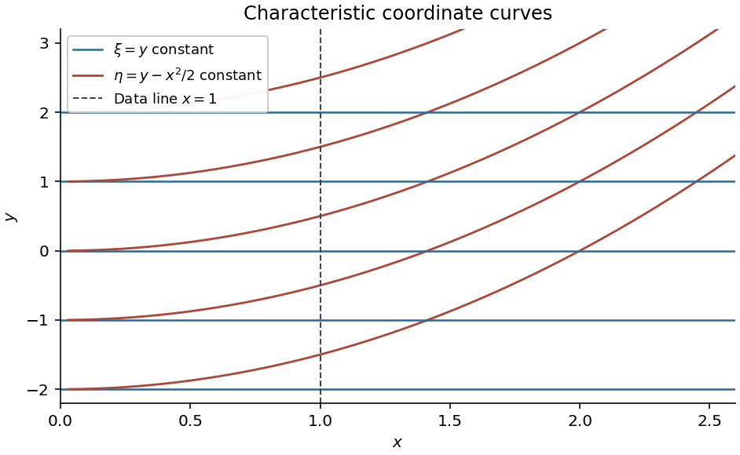

<h1 id="differential-equations/8/solution">Solution</h1>

↑ **Parent:** [8](../8.md)

For a nonzero second-order principal part, the discriminant is $Q^2-PR$: positive gives a [hyperbolic partial differential equation](../../../../hyperbolic-partial-differential-equation.md), negative an [elliptic partial differential equation](../../../../elliptic-partial-differential-equation.md), and zero the [parabolic type](../../../../parabolic-partial-differential-equation.md) when the principal part has rank one. If all three coefficients vanish, the equation is instead degenerate to lower order.

Here $P=x$, $2Q=x^2$, $R=0$, so $Q^2-PR=x^4/4>0$ for $x>0$. The characteristic equation is

$$
P\,dy^2-2Q\,dx\,dy+R\,dx^2=x\,dy(dy-x\,dx)=0.
$$

Thus choose

$$
\boxed{\xi=y,\qquad\eta=y-\frac{x^2}{2}.}
$$

Their Jacobian [determinant](../../../../determinant.md) with respect to $(x,y)$ is $x\neq0$, so they are valid coordinates on the specified half-plane. The level sets are horizontal lines and the right-hand halves of parabolas $y=x^2/2+\eta$.

**[Figure 1](#differential-equations/8/image-the-two-characteristic-families-for-the-hyperbolic-equation). The two characteristic families for the hyperbolic equation**.

Writing $z(x,y)=Z(\xi,\eta)$, the [chain rule](../../../../chain-rule.md) gives

$$
z_x=-xZ_\eta,\quad z_{xx}=-Z_\eta+x^2Z_{\eta\eta},\quad
z_{xy}=-x(Z_{\xi\eta}+Z_{\eta\eta}).
$$

The original equation reduces to $-xZ_\eta-x^3Z_{\xi\eta}=-xZ_\eta+x^3$, hence the canonical form is $\boxed{Z_{\xi\eta}=-1}$. Integrating once in each characteristic variable gives

$$
Z=f(\xi)+g(\eta)-\xi\eta,
$$

or

$$
\boxed{z=f(y)+g(y-x^2/2)-y^2+yx^2/2.}
$$

On $x=1$, differentiation gives $z_x=y-g'(y-1/2)$. The specified [derivative](../../../../derivative.md) therefore forces $g'=0$ for every argument, so $g$ is a constant. The specified value then gives $f(y)+g=1+y^2-y/2$. Consequently

$$
\boxed{z(x,y)=1+\frac y2(x^2-1).}
$$

Its derivatives are $z_x=xy$, $z_{xx}=y$ and $z_{xy}=x$, which verify both the equation and the data directly.

## ↑ Ancestors (12)

1. [8](../8.md)
2. [Differential Equations](../../differential-equations.md)
3. [2011](../../../2011-split.md)
4. [Past exam of the algebra, analysis and differential equations II course of the University of Oxford](../../../split.md)
5. [Algebra, analysis and differential equations II course of the University of Oxford](../../../../algebra-analysis-and-differential-equations-ii-course-of-the-university-of-oxford.md)
6. [Year 2 of the mathematics course of the University of Oxford](../../../../year-2-of-the-mathematics-course-of-the-university-of-oxford.md)
7. [Mathematics course of the University of Oxford](../../../../mathematics-course-of-the-university-of-oxford.md)
8. [Undergraduate course of the University of Oxford](../../../../undergraduate-course-of-the-university-of-oxford.md)
9. [Course of the University of Oxford](../../../../course-of-the-university-of-oxford.md)
10. [University of Oxford](../../../../university-of-oxford-split.md)
11. [List of universities](../../../../list-of-universities.md)
12. [Codex Wiki](../../../../split.md)
