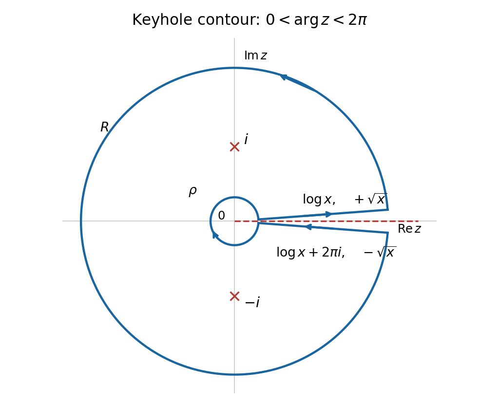
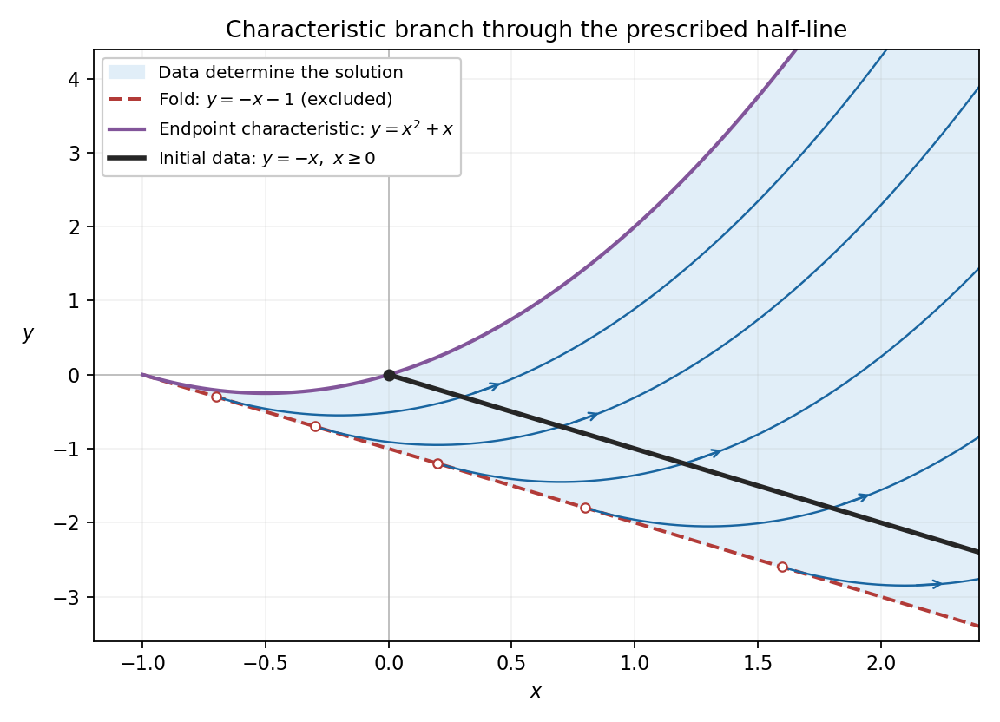

# 2012

↑ **Parent:** [Past exam of the algebra, analysis and differential equations II course of the University of Oxford](../past-exam-of-the-algebra-analysis-and-differential-equations-2-course-of-the-university-of-oxford.md)

Source release: [Oxford examination archive](https://www.whatdotheyknow.com/request/maths_papers_2/response/1850333/attach/3/FOI%2020210708%201%20Data.zip?cookie_passthrough=1), member `FOI-20210708-1 - Data/4302.pdf`. The cover prints formal code `4302`, paper label AC2, the title “Algebra, Analysis and [Differential equations](../differential-equation.md) II”, and Tuesday 19 June in Trinity Term 2012.

Answer availability checked on 28 October 2026: a bounded search of official Oxford sources found no advertisement of complete or selected-part solutions for this exact paper. The general advertisement of even-year solutions dating back to at least 2016 does not establish coverage of 2012.[Mathematical Institute, “Past papers and model solutions”: even-year solutions dating back to at least 2016](https://www.maths.ox.ac.uk/members/students/undergraduate-courses/examinations-assessments/overview-examinations)

**Table of contents**

- [1](#1)
  - [a](#1/a)
    - [Solution](#1/a/solution)
  - [b](#1/b)
    - [Solution](#1/b/solution)
  - [c](#1/c)
    - [Solution](#1/c/solution)
- [2](#2)
  - [a](#2/a)
    - [Solution](#2/a/solution)
  - [b](#2/b)
    - [Solution](#2/b/solution)
  - [c](#2/c)
    - [Solution](#2/c/solution)
- [3](#3)
  - [a](#3/a)
    - [Solution](#3/a/solution)
  - [b](#3/b)
    - [Solution](#3/b/solution)
  - [c](#3/c)
    - [Solution](#3/c/solution)
- [4](#4)
  - [a](#4/a)
    - [Solution](#4/a/solution)
  - [b](#4/b)
    - [i](#4/b/i)
      - [Solution](#4/b/i/solution)
    - [ii](#4/b/ii)
      - [Solution](#4/b/ii/solution)
  - [c](#4/c)
    - [i](#4/c/i)
      - [Solution](#4/c/i/solution)
    - [ii](#4/c/ii)
      - [Solution](#4/c/ii/solution)
- [5](#5)
  - [a](#5/a)
    - [Solution](#5/a/solution)
  - [b](#5/b)
    - [i](#5/b/i)
      - [Solution](#5/b/i/solution)
    - [ii](#5/b/ii)
      - [Solution](#5/b/ii/solution)
    - [iii](#5/b/iii)
      - [Solution](#5/b/iii/solution)
    - [iv](#5/b/iv)
      - [Solution](#5/b/iv/solution)
  - [c](#5/c)
    - [Solution](#5/c/solution)
  - [d](#5/d)
    - [i](#5/d/i)
      - [Solution](#5/d/i/solution)
    - [ii](#5/d/ii)
      - [Solution](#5/d/ii/solution)
- [6](#6)
  - [a](#6/a)
    - [Solution](#6/a/solution)
  - [b](#6/b)
    - [Solution](#6/b/solution)
- [7](#7)
  - [a](#7/a)
    - [i](#7/a/i)
      - [Solution](#7/a/i/solution)
    - [ii](#7/a/ii)
      - [Solution](#7/a/ii/solution)
    - [iii](#7/a/iii)
      - [Solution](#7/a/iii/solution)
    - [iv](#7/a/iv)
      - [Solution](#7/a/iv/solution)
    - [v](#7/a/v)
      - [Solution](#7/a/v/solution)
    - [vi](#7/a/vi)
      - [Solution](#7/a/vi/solution)
  - [b](#7/b)
    - [Solution](#7/b/solution)
  - [c](#7/c)
    - [Solution](#7/c/solution)
- [8](#8)
  - [a](#8/a)
    - [Solution](#8/a/solution)
  - [b](#8/b)
    - [Solution](#8/b/solution)
  - [c](#8/c)
    - [Solution](#8/c/solution)
- [9](#9)
  - [a](#9/a)
    - [Solution](#9/a/solution)
  - [b](#9/b)
    - [i](#9/b/i)
      - [Solution](#9/b/i/solution)
    - [ii](#9/b/ii)
      - [Solution](#9/b/ii/solution)
    - [iii](#9/b/iii)
      - [Solution](#9/b/iii/solution)
    - [iv](#9/b/iv)
      - [Solution](#9/b/iv/solution)
    - [v](#9/b/v)
      - [Solution](#9/b/v/solution)
    - [vi](#9/b/vi)
      - [Solution](#9/b/vi/solution)

## 1

↑ **Parent:** [2012](2012.md)

<h3 id="1/a">a</h3>

↑ **Parent:** [1](#1)

<h4 id="1/a/solution">Solution</h4>

↑ **Parent:** [A](#1/a)

The [minimal polynomial](../linear-operator-theory.md#minimal-polynomial) $m_T(t)$ is the unique monic [polynomial](../polynomial.md) of least positive [polynomial degree](../polynomial.md#degree-of-a-polynomial) satisfying $m_T(T)=0$. Such an annihilating [polynomial](../polynomial.md) exists without using the [Cayley-Hamilton theorem](../cayley-hamilton-theorem.md): the [vector space](../vector-space.md) $\operatorname{End}(V)$ has [dimension of a vector space](../vector-space.md#dimension-vector-space) equal to $n^2$, so $I,T,\ldots,T^{n^2}$ are [linearly dependent](../vector-space.md#linear-dependence). Normalize a nonzero annihilating [polynomial](../polynomial.md) to be monic and choose one of least degree. Two distinct monic choices of that degree would have an annihilating difference of lower degree, contradicting minimality. A nonzero constant cannot annihilate $T$ because $V\ne0$.

Choose a [basis](../vector-space.md#basis) $B$ and let $A=[T]_B$. The [characteristic polynomial](../linear-operator-theory.md#characteristic-polynomial) is

$$
\boxed{\chi_T(t)=\det(tI-A).}
$$

It is independent of the chosen [basis](../vector-space.md#basis). Indeed a change of basis replaces $A$ by a [similar matrix](../linear-algebra.md#matrix-similarity) $P^{-1}AP$, and

$$
\det(tI-P^{-1}AP)=\det\bigl(P^{-1}(tI-A)P\bigr)=\det(tI-A)
$$

by multiplicativity of the [determinant](../multilinear-algebra.md#determinant). Thus this monic degree-$n$ [polynomial](../polynomial.md) is an invariant of the [linear transformation](../vector-space.md#linear-map) itself.

<h3 id="1/b">b</h3>

↑ **Parent:** [1](#1)

<h4 id="1/b/solution">Solution</h4>

↑ **Parent:** [B](#1/b)

Since $v$ is a [cyclic vector](../linear-operator-theory.md#cyclic-vector) and $V\ne0$, $v\ne0$. Finite [dimension of a vector space](../vector-space.md#dimension-vector-space) forces a first dependence in the sequence $v,Tv,T^2v,\ldots$. Let $k\geq1$ be the smallest index with $T^kv$ in the [linear span](../vector-space.md#linear-span) of its predecessors. Then

$$
B=(v,Tv,\ldots,T^{k-1}v)
$$

is [linearly independent](../vector-space.md#linear-independence). Its [linear span](../vector-space.md#linear-span) $W$ is invariant under $T$: all but the last [basis](../vector-space.md#basis) candidate map to the next, and the last maps to $T^kv\in W$. Induction therefore puts every $T^jv$ in $W$. Cyclicity gives $W=V$, so **$B$ is a [basis](../vector-space.md#basis) and $k=n$**.

Write

$$
T^nv=-a_0v-a_1Tv-\cdots-a_{n-1}T^{n-1}v.
$$

The [matrix](../vector-space.md#matrix) of $T$ in this [basis](../vector-space.md#basis) is the [companion matrix](../linear-operator-theory.md#companion-matrix)

$$
C=\begin{pmatrix}
0&0&\cdots&0&-a_0\\
1&0&\cdots&0&-a_1\\
0&1&\cdots&0&-a_2\\
\vdots&\vdots&\ddots&\vdots&\vdots\\
0&0&\cdots&1&-a_{n-1}
\end{pmatrix}.
$$

For $p(t)=t^n+a_{n-1}t^{n-1}+\cdots+a_0$, the defining relation says $p(T)v=0$. Since $p(T)$ commutes with $T$, it also annihilates every $T^jv$ in $B$, hence $p(T)=0$. No nonzero [polynomial](../polynomial.md) of degree less than $n$ can annihilate $v$, because that would contradict [linear independence](../vector-space.md#linear-independence) of $B$. Thus $m_T=p$.

Finally the [characteristic polynomial of a companion matrix](../linear-operator-theory.md#characteristic-polynomial-of-a-companion-matrix) is $p$, by direct [determinant](../multilinear-algebra.md#determinant) expansion. Explicitly, expansion along the first row of $tI-C$ gives the recurrence

$$
D_n(t;a_0,\ldots,a_{n-1})
=tD_{n-1}(t;a_1,\ldots,a_{n-1})+a_0,
$$

starting from $D_1=t+a_0$. It yields $D_n=t^n+a_{n-1}t^{n-1}+\cdots+a_0$. Consequently

$$
\boxed{m_T(t)=\chi_T(t).}
$$

This proves that a [cyclic operator has equal minimal and characteristic polynomials](../linear-operator-theory.md#cyclic-operator-has-equal-minimal-and-characteristic-polynomials) by the cyclic [basis](../vector-space.md#basis) and a direct determinant calculation, with no appeal to the [Cayley-Hamilton theorem](../cayley-hamilton-theorem.md).

<h3 id="1/c">c</h3>

↑ **Parent:** [1](#1)

<h4 id="1/c/solution">Solution</h4>

↑ **Parent:** [C](#1/c)

For $T_1$, choose the third [standard basis](../vector-space.md#standard-basis) [vector](../vector-space.md#vector) $v=e_3$. Its first three orbit [vectors](../vector-space.md#vector) are

$$
v=e_3,\qquad T_1v=e_2+e_3,\qquad T_1^2v=e_1+2e_2+e_3.
$$

They are [linearly independent](../vector-space.md#linear-independence): their [matrix](../vector-space.md#matrix) of columns has [determinant](../multilinear-algebra.md#determinant) $-1$. They therefore span $\mathbb R^3$, proving **$T_1$ has a [cyclic vector](../linear-operator-theory.md#cyclic-vector), namely $e_3$**.

For $T_2$, write $T_2=I+N$ where $N^2=0$. The [binomial theorem](../binomial-coefficient.md#binomial-theorem) gives $T_2^jv=v+jNv$ for every integer $j\geq0$. The entire orbit of any $v$ lies in $\operatorname{span}\{v,Nv\}$, which has [dimension of a vector space](../vector-space.md#dimension-vector-space) at most two. Therefore **$T_2$ has no [cyclic vector](../linear-operator-theory.md#cyclic-vector)** in the three-dimensional space. Equivalently, its [minimal polynomial](../linear-operator-theory.md#minimal-polynomial) is $(t-1)^2$, while its [characteristic polynomial](../linear-operator-theory.md#characteristic-polynomial) is $(t-1)^3$.

## 2

↑ **Parent:** [2012](2012.md)

Use the [inner product](../inner-product.md) convention that the first argument is linear and the second is conjugate-linear. This is the convention corresponding to the conjugated [eigenvalue](../linear-operator-theory.md#eigenvalue) in part (c).

<h3 id="2/a">a</h3>

↑ **Parent:** [2](#2)

<h4 id="2/a/solution">Solution</h4>

↑ **Parent:** [A](#2/a)

An **[orthonormal basis](../inner-product.md#orthonormal-basis)** $(q_1,\ldots,q_n)$ is a [basis](../vector-space.md#basis) with $\langle q_i,q_j\rangle=\delta_{ij}$, where $\delta_{ij}$ is the [Kronecker delta](../multilinear-algebra.md#kronecker-delta). Each [vector](../vector-space.md#vector) has [norm](../normed-vector-space.md#norm) one and distinct [vectors](../vector-space.md#vector) are [orthogonal](../inner-product.md#orthogonal-vectors).

The [Gram-Schmidt process](../inner-product.md#gram-schmidt-process) starts from a [basis](../vector-space.md#basis) $(e_1,\ldots,e_n)$ and defines

$$
u_1=e_1,\qquad q_1=\frac{u_1}{\|u_1\|},\qquad
u_k=e_k-\sum_{j=1}^{k-1}\langle e_k,q_j\rangle q_j,\qquad
q_k=\frac{u_k}{\|u_k\|}.
$$

The [coefficients](../vector-space.md#coefficient) are in this order because the [inner product](../inner-product.md) is linear in its first argument. For $i<k$, taking the [inner product](../inner-product.md) with $q_i$ gives $\langle u_k,q_i\rangle=0$. The residual $u_k$ cannot be zero: otherwise $e_k$ would belong to the [linear span](../vector-space.md#linear-span) of $e_1,\ldots,e_{k-1}$, contradicting the initial [basis](../vector-space.md#basis). Normalization makes $\|q_k\|=1$, while induction preserves

$$
\operatorname{span}(q_1,\ldots,q_k)=\operatorname{span}(e_1,\ldots,e_k).
$$

Thus the process produces an [orthonormal basis](../inner-product.md#orthonormal-basis) of all of $V$.

<h3 id="2/b">b</h3>

↑ **Parent:** [2](#2)

<h4 id="2/b/solution">Solution</h4>

↑ **Parent:** [B](#2/b)

In an [orthonormal basis](../inner-product.md#orthonormal-basis), every [vector](../vector-space.md#vector) $w$ has the coordinate expansion $w=\sum_i\langle w,e_i\rangle e_i$. If $\langle Su,v\rangle=\langle u,Rv\rangle$ for all $u,v$, apply it to $u=e_i$, $v=e_j$ and take complex conjugates:

$$
\langle Re_j,e_i\rangle=\langle e_j,Se_i\rangle.
$$

Consequently

$$
\boxed{Re_j=\sum_{i=1}^n\langle e_j,Se_i\rangle e_i.}
$$

Conversely, this formula gives

$$
\langle e_i,Re_j\rangle=\overline{\langle e_j,Se_i\rangle}=\langle Se_i,e_j\rangle.
$$

Linearity in the first argument and conjugate-linearity in the second extend the equality from [basis](../vector-space.md#basis) [vectors](../vector-space.md#vector) to all $u,v$. This proves the equivalence.

The displayed formula specifies exactly one image for each [basis](../vector-space.md#basis) [vector](../vector-space.md#vector), so it defines a unique [linear transformation](../vector-space.md#linear-map) $S^*$ and proves the existence and uniqueness of the [adjoint on an inner product space](../hilbert-space.md#adjoint-on-an-inner-product-space).

Conjugate symmetry gives

$$
\langle S^*u,v\rangle
=\overline{\langle v,S^*u\rangle}
=\overline{\langle Sv,u\rangle}
=\langle u,Sv\rangle.
$$

By uniqueness of the [adjoint operator](../hilbert-space.md#adjoint-operator), $\boxed{(S^*)^*=S}$. Also

$$
\langle STu,v\rangle=\langle Tu,S^*v\rangle
=\langle u,T^*S^*v\rangle,
$$

so uniqueness gives $\boxed{(ST)^*=T^*S^*}$. The reversal of order follows directly from moving the two factors across the [inner product](../inner-product.md) one at a time.

<h3 id="2/c">c</h3>

↑ **Parent:** [2](#2)

<h4 id="2/c/solution">Solution</h4>

↑ **Parent:** [C](#2/c)

For a nonzero [eigenvector](../linear-operator-theory.md#eigenvector) $u$ of $S^*S$,

$$
\|Su\|^2=\langle Su,Su\rangle
=\langle u,S^*Su\rangle
=\langle u,\lambda u\rangle
=\overline\lambda\|u\|^2.
$$

Therefore $\overline\lambda=\|Su\|^2/\|u\|^2$ is real and nonnegative, and so **every [eigenvalue](../linear-operator-theory.md#eigenvalue) $\lambda$ is real and nonnegative**.

The preceding adjoint identities give $(S^*S)^*=S^*S$, so this [linear operator](../vector-space.md#linear-operator) is [self-adjoint](../linear-operator-theory.md#self-adjoint-operator). The stated finite-dimensional [spectral theorem](../hilbert-space.md#spectral-theorem) supplies an [orthonormal basis](../inner-product.md#orthonormal-basis) $e_j$ with $S^*Se_j=\lambda_j e_j$. If $v=\sum_jc_je_j$, then

$$
\|v\|^2=\sum_j|c_j|^2,\qquad
\|Sv\|^2=\langle v,S^*Sv\rangle=\sum_j\lambda_j|c_j|^2.
$$

Since $\lambda_-\leq\lambda_j\leq\lambda_+$,

$$
\lambda_-\|v\|^2\leq\|Sv\|^2\leq\lambda_+\|v\|^2.
$$

Taking nonnegative [square roots](../algebra.md#square-root) proves

$$
\boxed{\sqrt{\lambda_-}\|v\|\leq\|Sv\|\leq\sqrt{\lambda_+}\|v\|.}
$$

The square roots of these extreme [eigenvalues](../linear-operator-theory.md#eigenvalue) are the smallest and largest [singular values](../linear-algebra.md#singular-value) of $S$; the lower bound can be zero if $S$ has a nontrivial [kernel of a linear map](../kernel-of-a-linear-map.md).

## 3

↑ **Parent:** [2012](2012.md)

<h3 id="3/a">a</h3>

↑ **Parent:** [3](#3)

<h4 id="3/a/solution">Solution</h4>

↑ **Parent:** [A](#3/a)

A **[unit in a ring](../algebra.md#unit-in-a-ring)** is an element $u$ with a multiplicative inverse in $R$, so $uv=1$ for some $v\in R$.

An **[irreducible element](../commutative-algebra.md#irreducible-element)** is a nonzero nonunit $a$ such that every factorization $a=bc$ has at least one of $b,c$ a [unit in a ring](../algebra.md#unit-in-a-ring).

A **[prime element](../commutative-algebra.md#prime-element)** is a nonzero nonunit $p$ such that $p\mid bc$ implies $p\mid b$ or $p\mid c$. Equivalently its [principal ideal](../commutative-algebra.md#principal-ideal) $(p)$ is a nonzero [prime ideal](../commutative-algebra.md#prime-ideal). These are definitions in the given commutative [ring](../commutative-algebra.md#ring); the equivalence between irreducibility and primality requires additional hypotheses on the [ring](../commutative-algebra.md#ring).

<h3 id="3/b">b</h3>

↑ **Parent:** [3](#3)

<h4 id="3/b/solution">Solution</h4>

↑ **Parent:** [B](#3/b)

A [Euclidean domain](../commutative-algebra.md#euclidean-domain) is an [integral domain](../commutative-algebra.md#integral-domain) $R$ with a [function](../function.md) $d:R\setminus\{0\}\to\mathbb N_0$ such that, for $a\in R$ and nonzero $b\in R$, there exist $q,r\in R$ with $a=qb+r$ and either $r=0$ or $d(r)<d(b)$. This is the Euclidean-ring convention used here.

If an [ideal](../commutative-algebra.md#ideal) $I$ is zero, it is generated by zero. Otherwise choose nonzero $a\in I$ with $d(a)$ minimal. For any $b\in I$, Euclidean division gives $b=qa+r$, with $r\in I$. A nonzero remainder would have $d(r)<d(a)$, contradicting the choice. Hence $r=0$ and $b\in aR$. The reverse inclusion follows from $a\in I$, proving

$$
\boxed{I=aR.}
$$

Now suppose $a$ is an [irreducible element](../commutative-algebra.md#irreducible-element). Its [principal ideal](../commutative-algebra.md#principal-ideal) is proper because $a$ is not a unit. If $aR\subseteq J\subseteq R$, write $J=bR$ by the result just proved. Then $a=bc$ for some $c\in R$. Irreducibility gives either $b$ a unit, so $J=R$, or $c$ a unit, so $bR=aR$. There is no intermediate proper [ideal](../commutative-algebra.md#ideal), and therefore **$aR$ is a [maximal ideal](../commutative-algebra.md#maximal-ideal)**.

For a [field](../algebra.md#field) $F$, the [polynomial ring](../commutative-algebra.md#polynomial-ring) $F[X]$ is an [integral domain](../commutative-algebra.md#integral-domain) and the [polynomial division algorithm](../polynomial.md#polynomial-division) gives $A=QB+R$ with $R=0$ or $\deg R<\deg B$. Thus the [polynomial degree](../polynomial.md#degree-of-a-polynomial) is a Euclidean function, proving **$F[X]$ is a [Euclidean domain](../commutative-algebra.md#euclidean-domain)**.

<h3 id="3/c">c</h3>

↑ **Parent:** [3](#3)

<h4 id="3/c/solution">Solution</h4>

↑ **Parent:** [C](#3/c)

The [polynomial](../polynomial.md) $X^n-2$ is irreducible over $\mathbb Q$ by [Eisenstein's criterion](../commutative-algebra.md#eisenstein-criterion) with prime two: all [coefficients](../vector-space.md#coefficient) except the leading one are divisible by two, while the constant [coefficient](../vector-space.md#coefficient) is not divisible by four. Together with [Gauss's lemma](../riemannian-geometry.md#gauss-s-lemma-riemannian-geometry), this establishes irreducibility in $\mathbb Q[X]$. Part (b) shows that its [principal ideal](../commutative-algebra.md#principal-ideal) is a [maximal ideal](../commutative-algebra.md#maximal-ideal), so

$$
\boxed{K_n=\mathbb Q[X]/(X^n-2)\text{ is a field}.}
$$

Let $\alpha$ denote the residue class of $X$. The [polynomial division algorithm](../polynomial.md#polynomial-division) gives every residue class a representative of degree less than $n$, so $1,\alpha,\ldots,\alpha^{n-1}$ span $K_n$ over $\mathbb Q$. If a [linear combination](../vector-space.md#linear-combination) of them vanished, its degree-less-than-$n$ representative would be a multiple of the degree-$n$ [polynomial](../polynomial.md) $X^n-2$, and hence would be zero. They are therefore a [basis](../vector-space.md#basis), giving

$$
\boxed{\dim_{\mathbb Q}K_n=n.}
$$

The [quadratic polynomial](../polynomial.md#quadratic-polynomial) $X^2+1$ has no rational root, so it is irreducible over $\mathbb Q$. The same maximal-ideal argument proves **$L=\mathbb Q[X]/(X^2+1)$ is a [field](../algebra.md#field)**.

These two quadratic fields are **not isomorphic**. In $L$, the class of $X$ squares to $-1$. But $K_2$ embeds in $\mathbb R$ by sending its class of $X$ to $\sqrt2$: evaluation at $\sqrt2$ has kernel $(X^2-2)$, by irreducibility and [polynomial](../polynomial.md) division. No [real number](../arithmetic.md#real-number) squares to $-1$, so no element of $K_2$ does. A [field isomorphism](../galois-theory.md#field-isomorphism) preserves one, minus one and squaring, so it cannot carry $L$ to $K_2$.

## 4

↑ **Parent:** [2012](2012.md)

<h3 id="4/a">a</h3>

↑ **Parent:** [4](#4)

<h4 id="4/a/solution">Solution</h4>

↑ **Parent:** [A](#4/a)

The [Cauchy integral formula](../analysis.md#cauchy-integral-formula) says that if $f$ is [holomorphic](../holomorphic-function.md) on the [simply connected](../algebraic-topology.md#simply-connected-space) [open set](../topology.md#open-set) $U$, and $\gamma$ is a positively oriented [simple closed curve](../geometry-and-topology.md#simple-closed-curve) in $U$, then, for every $z$ in its interior,

$$
\boxed{f(z)=\frac1{2\pi i}\int_\gamma\frac{f(\zeta)}{\zeta-z}\,d\zeta.}
$$

Here the contour and its enclosed region lie in $U$; the contour can be taken piecewise continuously differentiable. More generally, the same formula needs only [holomorphic function](../holomorphic-function.md) on an [open neighbourhood](../topology.md#open-neighbourhood) of that closed region. The orientation is counterclockwise, so the [winding number](../complex-analysis.md#winding-number) about an interior point is one.

<h3 id="4/b">b</h3>

↑ **Parent:** [4](#4)

<h4 id="4/b/i">i</h4>

↑ **Parent:** [B](#4/b)

<h5 id="4/b/i/solution">Solution</h5>

↑ **Parent:** [I](#4/b/i)

Write $M=|f(z_0)|$. The local maximum property gives a [disk](../topology.md#disk-mathematics) around $z_0$ on which $|f|\leq M$, contained in the [unit disk](../euclidean-geometry.md#unit-disk). If $M=0$, then $f=0$ on that neighbourhood, and the [identity theorem](../complex-analysis.md#identity-theorem) makes $f$ zero on the connected [unit disk](../euclidean-geometry.md#unit-disk).

Otherwise multiply $f$ by the unit [complex number](../complex-analysis.md#complex-number) $\overline{f(z_0)}/M$, obtaining a [holomorphic function](../holomorphic-function.md) $g$ with $g(z_0)=M$ and $|g|\leq M$ nearby. Applying the [Cauchy integral formula](../analysis.md#cauchy-integral-formula) on any sufficiently small circle of radius $r$ gives the [mean value property](../partial-differential-equation.md#mean-value-property-for-harmonic-functions)

$$
M=\frac1{2\pi}\int_0^{2\pi}g(z_0+re^{it})\,dt.
$$

Take real parts. The continuous function $M-\operatorname{Re}g$ is nonnegative on the circle and has [integral](../integral.md) zero, so it vanishes everywhere there. Since $|g|\leq M$, having real part $M$ forces imaginary part zero. Thus $g=M$ throughout the circle. The zeros of $g-M$ have an accumulation point inside its domain, so the [identity theorem](../complex-analysis.md#identity-theorem) gives **$f$ constant on the entire [unit disk](../euclidean-geometry.md#unit-disk)**. This proves the local [maximum modulus principle](../complex-analysis.md#maximum-modulus-principle) directly from the [Cauchy integral formula](../analysis.md#cauchy-integral-formula).

<h4 id="4/b/ii">ii</h4>

↑ **Parent:** [B](#4/b)

<h5 id="4/b/ii/solution">Solution</h5>

↑ **Parent:** [Ii](#4/b/ii)

The closed [unit disk](../euclidean-geometry.md#unit-disk) is a [compact set](../topology.md#compact-space), and $|f|$ is [continuous](../calculus.md#continuous-function) on it because $f$ is [holomorphic](../holomorphic-function.md) on an [open neighbourhood](../topology.md#open-neighbourhood). The [extreme value theorem](../real-analysis.md#extreme-value-theorem) therefore supplies a point where its maximum is attained. If such a point is on the boundary, the conclusion follows. If it is in the interior, part (i) makes $f$ constant on the open disk; [continuity](../calculus.md#continuous-function) then gives the same value on the boundary. Consequently

$$
\boxed{\max_{|z|\leq1}|f(z)|=\max_{|z|=1}|f(z)|.}
$$

The assumption that the closed disk lies in $U$ is what makes the boundary values and the compactness argument available.

<h3 id="4/c">c</h3>

↑ **Parent:** [4](#4)

<h4 id="4/c/i">i</h4>

↑ **Parent:** [C](#4/c)

<h5 id="4/c/i/solution">Solution</h5>

↑ **Parent:** [I](#4/c/i)

Because $f(0)=0$, the [Taylor series](../calculus.md#taylor-series) of $f$ at zero shows that

$$
h(z)=\begin{cases}f(z)/z,&z\ne0,\\f'(0),&z=0\end{cases}
$$

is [holomorphic](../holomorphic-function.md) throughout the [unit disk](../euclidean-geometry.md#unit-disk). Fix $0<r<1$. On $|z|=r$ we have $|h(z)|<1/r$, and the [maximum modulus principle](../complex-analysis.md#maximum-modulus-principle) on the closed disk of radius $r$ gives $|h(z)|\leq1/r$ for $|z|\leq r$. For any fixed $z$ inside the [unit disk](../euclidean-geometry.md#unit-disk) we may let $r$ increase to one, obtaining $|h(z)|\leq1$. Hence the [Schwarz lemma](../analysis.md#schwarz-lemma) inequalities are

$$
\boxed{|f(z)|\leq|z|,\qquad |f'(0)|\leq1.}
$$

The [derivative](../calculus.md#derivative) bound is the same estimate at $z=0$, using the holomorphic extension of the quotient.

<h4 id="4/c/ii">ii</h4>

↑ **Parent:** [C](#4/c)

<h5 id="4/c/ii/solution">Solution</h5>

↑ **Parent:** [Ii](#4/c/ii)

Either equality condition says that the [holomorphic function](../holomorphic-function.md) $h$ from part (i) has modulus one at an interior point: at zero in the [derivative](../calculus.md#derivative) case, or at the given nonzero point in the other case. Since $|h|\leq1$ everywhere, the [maximum modulus principle](../complex-analysis.md#maximum-modulus-principle) makes $h$ a constant $w$ with $|w|=1$. Therefore

$$
\boxed{f(z)=wz,\qquad |w|=1.}
$$

These maps are rotations of the [unit disk](../euclidean-geometry.md#unit-disk) and do achieve both equalities, so this also identifies all equality cases of the [Schwarz lemma](../analysis.md#schwarz-lemma).

## 5

↑ **Parent:** [2012](2012.md)

<h3 id="5/a">a</h3>

↑ **Parent:** [5](#5)

<h4 id="5/a/solution">Solution</h4>

↑ **Parent:** [A](#5/a)

The [Laurent theorem](../analysis.md#laurent-theorem) states that a [holomorphic function](../holomorphic-function.md) on the [annulus](../topology.md#annulus-mathematics) $R<|z-a|<S$ has a unique [Laurent series](../analysis.md#laurent-series)

$$
\boxed{f(z)=\sum_{n=-\infty}^{\infty}c_n(z-a)^n,\qquad c_n=\frac1{2\pi i}\int_{|\zeta-a|=\rho}\frac{f(\zeta)}{(\zeta-a)^{n+1}}\,d\zeta,\quad R<\rho<S.}
$$

The integration circle is counterclockwise. The series converges absolutely at every point of the annulus and uniformly on every compact subannulus. The [coefficient](../vector-space.md#coefficient) [integrals](../integral.md) are independent of the choice of $\rho$ by the [Cauchy integral theorem](../complex-analysis.md#cauchy-s-integral-theorem) applied between two such circles. These statements include $R=0$ or $S=\infty$ when the indicated annulus has those endpoints.

<h3 id="5/b">b</h3>

↑ **Parent:** [5](#5)

<h4 id="5/b/i">i</h4>

↑ **Parent:** [B](#5/b)

<h5 id="5/b/i/solution">Solution</h5>

↑ **Parent:** [I](#5/b/i)

An **[isolated singularity](../isolated-singularity.md)** at $z_0$ means that some radius $r>0$ has $f$ [holomorphic](../holomorphic-function.md) on the punctured disk $0<|z-z_0|<r$, while $f$ is not initially defined as a [holomorphic function](../holomorphic-function.md) at $z_0$. The adjective isolated refers to the absence of other singularities in this punctured neighbourhood; it permits a [removable singularity](../isolated-singularity.md#removable-singularity).

<h4 id="5/b/ii">ii</h4>

↑ **Parent:** [B](#5/b)

<h5 id="5/b/ii/solution">Solution</h5>

↑ **Parent:** [Ii](#5/b/ii)

The point is a **[removable singularity](../isolated-singularity.md#removable-singularity)** if assigning a value to $f(z_0)$ makes $f$ [holomorphic](../holomorphic-function.md) on a full neighbourhood of $z_0$. Equivalently, its [Laurent series](../analysis.md#laurent-series) has no nonzero [coefficients](../vector-space.md#coefficient) of negative powers. The assigned value is its constant [coefficient](../vector-space.md#coefficient), or equivalently the finite limit $\lim_{z\to z_0}f(z)$.

<h4 id="5/b/iii">iii</h4>

↑ **Parent:** [B](#5/b)

<h5 id="5/b/iii/solution">Solution</h5>

↑ **Parent:** [Iii](#5/b/iii)

A **[pole](../isolated-singularity.md#pole)** of order $n\geq1$ means

$$
\boxed{f(z)=(z-z_0)^{-n}h(z),\qquad h\text{ holomorphic near }z_0,\quad h(z_0)\ne0.}
$$

Equivalently, the [Laurent series](../analysis.md#laurent-series) has a finite nonzero [principal part](../complex-geometry.md#principal-part-of-a-meromorphic-function), with lowest power exactly $(z-z_0)^{-n}$. Thus $(z-z_0)^nf(z)$ extends holomorphically with nonzero value at $z_0$; using a smaller positive power would not remove the singularity.

<h4 id="5/b/iv">iv</h4>

↑ **Parent:** [B](#5/b)

<h5 id="5/b/iv/solution">Solution</h5>

↑ **Parent:** [Iv](#5/b/iv)

An **[essential singularity](../isolated-singularity.md#essential-singularity)** is an [isolated singularity](../isolated-singularity.md) that is neither a [removable singularity](../isolated-singularity.md#removable-singularity) nor a [pole](../isolated-singularity.md#pole). In its [Laurent series](../analysis.md#laurent-series), infinitely many [coefficients](../vector-space.md#coefficient) of negative powers are nonzero. The alternatives follow because no negative terms give a removable singularity, while finitely many with a lowest nonzero power give a pole.

<h3 id="5/c">c</h3>

↑ **Parent:** [5](#5)

<h4 id="5/c/solution">Solution</h4>

↑ **Parent:** [C](#5/c)

Inside the unit circle, use the [geometric series](../sequence-and-series.md#geometric-series) for $1/(1-z)$:

$$
\boxed{\frac1{z^2(z-1)}=-\sum_{n=0}^{\infty}z^{n-2}=-\frac1{z^2}-\frac1z-1-z-z^2-\cdots,\qquad0<|z|<1.}
$$

Outside the unit circle, expand in powers of $1/z$ instead:

$$
\boxed{\frac1{z^2(z-1)}=\frac1{z^3}\frac1{1-z^{-1}}=\sum_{n=0}^{\infty}z^{-n-3},\qquad |z|>1.}
$$

The different [Laurent series](../analysis.md#laurent-series) reflect different annuli separated by the [pole](../isolated-singularity.md#pole) at one. Both follow from absolutely convergent [geometric series](../sequence-and-series.md#geometric-series) in their stated regions.

<h3 id="5/d">d</h3>

↑ **Parent:** [5](#5)

<h4 id="5/d/i">i</h4>

↑ **Parent:** [D](#5/d)

<h5 id="5/d/i/solution">Solution</h5>

↑ **Parent:** [I](#5/d/i)

Take the [Laurent series](../analysis.md#laurent-series) of $f$ on $0<|z|<r$. For every integer $k\geq1$, its [coefficient](../vector-space.md#coefficient) of $z^{-k}$ satisfies, on a circle of radius $0<\rho<r$,

$$
|c_{-k}|=\left|\frac1{2\pi i}\int_{|\zeta|=\rho}f(\zeta)\zeta^{k-1}\,d\zeta\right|\leq m\rho^k.
$$

The [coefficient](../vector-space.md#coefficient) is independent of $\rho$. Letting $\rho\downarrow0$ therefore gives $c_{-k}=0$ for every $k\geq1$. The [Laurent series](../analysis.md#laurent-series) is a [power series](../sequence-and-series.md#power-series) with no negative powers and supplies a [holomorphic extension](../holomorphic-function.md#holomorphic-extension) at zero. Thus **zero is a [removable singularity](../isolated-singularity.md#removable-singularity)**. This is the [Riemann removable singularity theorem](../isolated-singularity.md#riemann-removable-singularity-theorem), with boundedness used to eliminate the entire principal part.

<h4 id="5/d/ii">ii</h4>

↑ **Parent:** [D](#5/d)

<h5 id="5/d/ii/solution">Solution</h5>

↑ **Parent:** [Ii](#5/d/ii)

Suppose, towards a contradiction, that for some $r,w,\varepsilon$ the punctured-disk image misses the open disk of radius $\varepsilon$ about $w$. Then

$$
h(z)=\frac1{f(z)-w}
$$

is [holomorphic](../holomorphic-function.md) and bounded by $1/\varepsilon$ on $0<|z|<r$. Part (i) extends it to a [holomorphic function](../holomorphic-function.md) $H$ on the full disk. If $H(0)\ne0$, then $w+1/H$ extends $f$ holomorphically at zero, making zero a [removable singularity](../isolated-singularity.md#removable-singularity).

If $H(0)=0$, the function $H$ is not identically zero, since it is nonzero on the punctured disk. The [Taylor series](../calculus.md#taylor-series) and [identity theorem](../complex-analysis.md#identity-theorem) give a finite zero order $k\geq1$, so $H(z)=z^kq(z)$ with $q$ holomorphic and $q(0)\ne0$. Hence

$$
f(z)=w+z^{-k}/q(z)
$$

has a [pole](../isolated-singularity.md#pole) of order $k$. Both alternatives contradict an [essential singularity](../isolated-singularity.md#essential-singularity). Consequently

$$
\boxed{\overline{f(\{z:0<|z|<r\})}=\mathbb C\quad\text{for every }0<r<s.}
$$

This is the [Casorati-Weierstrass theorem](../isolated-singularity.md#casorati-weierstrass-theorem): every complex value can be approximated arbitrarily closely in every punctured neighbourhood of an essential singularity.

## 6

↑ **Parent:** [2012](2012.md)

<h3 id="6/a">a</h3>

↑ **Parent:** [6](#6)

<h4 id="6/a/solution">Solution</h4>

↑ **Parent:** [A](#6/a)

The [tangent half-angle substitution](../geometry-and-topology.md#tangent-half-angle-substitution) $u=\tan(t/2)$ maps $0\leq t<\pi$ to $0\leq u<\infty$, with

$$
\cos t=\frac{1-u^2}{1+u^2},\qquad dt=\frac{2\,du}{1+u^2}.
$$

Because $a>1$, both $a+1$ and $a-1$ are positive. Thus

$$
\int_0^\pi\frac{dt}{a+\cos t}=2\int_0^\infty\frac{du}{(a+1)+(a-1)u^2}=\frac2{\sqrt{a^2-1}}\left[\arctan\left(u\sqrt{\frac{a-1}{a+1}}\right)\right]_0^\infty.
$$

Evaluating the [improper integral](../real-analysis.md#improper-integral) gives

$$
\boxed{\frac{\pi}{\sqrt{a^2-1}}.}
$$

Although the change of variable has an infinite endpoint, the original integrand is continuous on the closed interval, and the transformed integrand decays as $u^{-2}$, so the limiting substitution is justified.

<h3 id="6/b">b</h3>

↑ **Parent:** [6](#6)

<h4 id="6/b/solution">Solution</h4>

↑ **Parent:** [B](#6/b)

Use the [branch of the complex logarithm](../analysis.md#branch-of-the-complex-logarithm) with $0<\arg z<2\pi$, so the [branch cut](../analysis.md#branch-cut) is the positive real axis, and take $\sqrt z=\exp(\operatorname{Log}z/2)$ on the same slit plane. Apply the [residue theorem](../analysis.md#residue-theorem) to

$$
F(z)=\frac{\operatorname{Log}z}{(z^2+1)\sqrt z}
$$

on a positively oriented [keyhole contour](../complex-analysis.md#keyhole-contour) with inner radius $\rho<1$ and outer radius $R>1$. The upper bank travels from $\rho$ to $R$, the large circle counterclockwise, the lower bank from $R$ to $\rho$, and the small circle clockwise. One may first keep the banks at small nonzero angles and then take their limits.

On the upper bank, $\operatorname{Log}x=\log x$ and $\sqrt x$ is positive. On the lower bank, the corresponding limits are $\log x+2\pi i$ and $-\sqrt x$. Reversing the lower-bank orientation therefore makes the sum of the bank [integrals](../integral.md) tend to

$$
2I+2\pi iJ,\qquad I=\int_0^\infty\frac{\log x}{(x^2+1)\sqrt x}\,dx,\qquad J=\int_0^\infty\frac{dx}{(x^2+1)\sqrt x}.
$$

Both are absolutely convergent: near zero compare with $x^{-1/2}(1+|\log x|)$, and near infinity with $x^{-5/2}(1+\log x)$. On the large circle, $|z^2+1|\geq R^2-1$, so its contribution is $O((\log R+1)R^{-3/2})$. On the small circle it is $O(\sqrt\rho(1+|\log\rho|))$. Both tend to zero.

**[Figure 1](#6/b/image-the-keyhole-contour-and-the-two-boundary-values-on-its-branch-cut). The keyhole contour and the two boundary values on its branch cut**.

The two simple [poles](../isolated-singularity.md#pole) are $i$ and $-i$. On the chosen branch their arguments are $\pi/2$ and $3\pi/2$, respectively. Consequently their [residues](../analysis.md#residue) are

$$
\operatorname{Res}(F,i)=\frac{\pi}{4\sqrt2}(1-i),\qquad \operatorname{Res}(F,-i)=\frac{3\pi}{4\sqrt2}(1+i).
$$

For example, the first follows from $\operatorname{Log}i=i\pi/2$, $\sqrt i=e^{i\pi/4}$ and the [derivative](../calculus.md#derivative) $2i$ of the denominator factor $z^2+1$. The second uses $\sqrt{-i}=e^{3\pi i/4}$, rather than the value from the principal square-root branch. Adding and applying the [residue theorem](../analysis.md#residue-theorem) yields

$$
2I+2\pi iJ=2\pi i\left(\frac\pi{\sqrt2}+\frac{i\pi}{2\sqrt2}\right)=-\frac{\pi^2}{\sqrt2}+i\sqrt2\pi^2.
$$

As $J$ is real, taking real parts gives

$$
\boxed{I=-\frac{\pi^2}{2\sqrt2}.}
$$

The imaginary part also gives $J=\pi/\sqrt2$, an independent consistency check on the orientation and branch factors.

## 7

↑ **Parent:** [2012](2012.md)

<h3 id="7/a">a</h3>

↑ **Parent:** [7](#7)

A [critical point of a dynamical system](../dynamical-systems.md#equilibrium-point-of-a-dynamical-system) or [equilibrium](../dynamical-systems.md#equilibrium-point-of-a-dynamical-system) is a point $(a,b)$ with $f(a,b)=g(a,b)=0$, so the constant function $(x,y)=(a,b)$ is a solution. Put $u=x-a$, $v=y-b$. For a continuously differentiable [vector field](../multivariable-calculus.md#vector-field), its [linearization](../algebra.md#linearization) is

$$
\frac{d}{dt}\begin{pmatrix}u\\v\end{pmatrix}=M\begin{pmatrix}u\\v\end{pmatrix},\qquad M=D(f,g)(a,b),
$$

with remainder $o(\sqrt{u^2+v^2})$ in the original nonlinear system. For distinct [eigenvalues](../linear-operator-theory.md#eigenvalue), $M$ is diagonalizable over $\mathbb C$, and the linear solutions are combinations of $e^{\lambda_jt}w_j$, where $w_j$ are corresponding [eigenvectors](../linear-operator-theory.md#eigenvector). Real parts determine growth or decay; nonzero imaginary parts give rotation. For [hyperbolic equilibria](../dynamical-systems.md#hyperbolic-equilibrium-point), meaning no [eigenvalue](../linear-operator-theory.md#eigenvalue) has zero real part, the [Hartman-Grobman theorem](../dynamical-systems.md#hartman-grobman-theorem) transfers the local stability and qualitative orbit pattern to the nonlinear system. A purely imaginary pair is not hyperbolic: it determines a linear centre, while higher-order terms decide whether the nonlinear system actually has a centre.

<h4 id="7/a/i">i</h4>

↑ **Parent:** [A](#7/a)

<h5 id="7/a/i/solution">Solution</h5>

↑ **Parent:** [I](#7/a/i)

A [stable node](../dynamical-systems.md#stable-node) has

$$
\boxed{\lambda_1,\lambda_2\in\mathbb R,\qquad\lambda_1<0,\quad\lambda_2<0.}
$$

Both exponential modes decay as $t\to\infty$, so the [equilibrium](../dynamical-systems.md#equilibrium-point-of-a-dynamical-system) is [asymptotically stable](../dynamical-systems.md#asymptotic-stability). Generic linear orbits approach tangent to the [eigenvector](../linear-operator-theory.md#eigenvector) for the less negative [eigenvalue](../linear-operator-theory.md#eigenvalue); the [eigenvector](../linear-operator-theory.md#eigenvector) directions themselves are invariant straight lines. There is no rotation because both [eigenvalues](../linear-operator-theory.md#eigenvalue) are real.

<h4 id="7/a/ii">ii</h4>

↑ **Parent:** [A](#7/a)

<h5 id="7/a/ii/solution">Solution</h5>

↑ **Parent:** [Ii](#7/a/ii)

An [unstable node](../dynamical-systems.md#unstable-node) has

$$
\boxed{\lambda_1,\lambda_2\in\mathbb R,\qquad\lambda_1>0,\quad\lambda_2>0.}
$$

Both linear modes grow forward in time. Nearby nonconstant orbits move away from the [equilibrium](../dynamical-systems.md#equilibrium-point-of-a-dynamical-system), and approach it under reversed time; their local directions come from the two real [eigenvectors](../linear-operator-theory.md#eigenvector).

<h4 id="7/a/iii">iii</h4>

↑ **Parent:** [A](#7/a)

<h5 id="7/a/iii/solution">Solution</h5>

↑ **Parent:** [Iii](#7/a/iii)

A [saddle equilibrium](../dynamical-systems.md#saddle-equilibrium) has

$$
\boxed{\lambda_1,\lambda_2\in\mathbb R,\qquad\lambda_1\lambda_2<0.}
$$

The negative [eigenvalue](../linear-operator-theory.md#eigenvalue) gives a [stable manifold](../dynamical-systems.md#stable-manifold) direction and the positive [eigenvalue](../linear-operator-theory.md#eigenvalue) an [unstable manifold](../dynamical-systems.md#unstable-manifold) direction. Perturbations along the latter grow, so the [equilibrium](../dynamical-systems.md#equilibrium-point-of-a-dynamical-system) is unstable even though there are special trajectories approaching it.

<h4 id="7/a/iv">iv</h4>

↑ **Parent:** [A](#7/a)

<h5 id="7/a/iv/solution">Solution</h5>

↑ **Parent:** [Iv](#7/a/iv)

A [centre equilibrium](../dynamical-systems.md#center-equilibrium) of the linearized real planar system has

$$
\boxed{\lambda_1=i\omega,\qquad\lambda_2=-i\omega,\qquad\omega\in\mathbb R\setminus\{0\}.}
$$

After a real invertible [linear change of coordinates](../vector-space.md#linear-change-of-coordinates), the system is a constant angular rotation. Its nonzero orbits are ellipses of period $2\pi/|\omega|$, so it is stable but not asymptotically stable. This is a classification of the **[linearization](../algebra.md#linearization)**: [a centre in the linearization need not be a nonlinear centre](../dynamical-systems.md#a-centre-in-the-linearization-need-not-be-a-nonlinear-centre). In particular, imaginary [eigenvalues](../linear-operator-theory.md#eigenvalue) alone do not prove a nonlinear [centre equilibrium](../dynamical-systems.md#center-equilibrium), which requires a punctured neighbourhood filled with [periodic orbits](../dynamical-systems.md#periodic-orbit). Part (c) illustrates exactly this limitation.

<h4 id="7/a/v">v</h4>

↑ **Parent:** [A](#7/a)

<h5 id="7/a/v/solution">Solution</h5>

↑ **Parent:** [V](#7/a/v)

A [stable spiral](../dynamical-systems.md#stable-spiral) has the complex conjugate [eigenvalues](../linear-operator-theory.md#eigenvalue)

$$
\boxed{\lambda_{1,2}=\alpha\pm i\beta,\qquad\alpha<0,\quad\beta\ne0.}
$$

In suitable real coordinates the radius decays like $e^{\alpha t}$ while the angle changes at rate $\beta$. The orbit therefore spirals towards the [equilibrium](../dynamical-systems.md#equilibrium-point-of-a-dynamical-system), which is asymptotically stable. This is also called a [stable focus](../dynamical-systems.md#stable-spiral).

<h4 id="7/a/vi">vi</h4>

↑ **Parent:** [A](#7/a)

<h5 id="7/a/vi/solution">Solution</h5>

↑ **Parent:** [Vi](#7/a/vi)

An [unstable spiral](../dynamical-systems.md#unstable-spiral) has

$$
\boxed{\lambda_{1,2}=\alpha\pm i\beta,\qquad\alpha>0,\quad\beta\ne0.}
$$

Rotation is accompanied by exponentially increasing radius in suitable real coordinates. Thus nearby nonconstant orbits spiral away, and the [equilibrium](../dynamical-systems.md#equilibrium-point-of-a-dynamical-system) is unstable. This is also called an [unstable focus](../dynamical-systems.md#unstable-spiral).

<h3 id="7/b">b</h3>

↑ **Parent:** [7](#7)

<h4 id="7/b/solution">Solution</h4>

↑ **Parent:** [B](#7/b)

The first component of the [vector field](../multivariable-calculus.md#vector-field) vanishes only when $y=0$ or $x=\pm1$. The second vanishes only when $y=1$ or $x+y=3$. Intersecting these alternatives gives exactly five [equilibria](../dynamical-systems.md#equilibrium-point-of-a-dynamical-system). Their [Jacobian matrix](../multivariable-calculus.md#jacobian-matrix) is

$$
M(x,y)=\begin{pmatrix}2xy&x^2-1\\y-1&x+2y-4\end{pmatrix}.
$$

At $(3,0)$,

$$
M=\begin{pmatrix}0&8\\-1&-1\end{pmatrix},\qquad\det(\lambda I-M)=\lambda^2+\lambda+8,\qquad\lambda=\frac{-1\pm i\sqrt{31}}2.
$$

The real parts are negative and the imaginary parts are nonzero, so **$(3,0)$ is a [stable spiral](../dynamical-systems.md#stable-spiral)**.

At $(1,1)$ the [Jacobian matrix](../multivariable-calculus.md#jacobian-matrix) is $\operatorname{diag}(2,-1)$. Its real [eigenvalues](../linear-operator-theory.md#eigenvalue) have opposite signs, so **$(1,1)$ is a [saddle equilibrium](../dynamical-systems.md#saddle-equilibrium)**.

At $(1,2)$,

$$
M=\begin{pmatrix}4&0\\1&1\end{pmatrix},\qquad\lambda=4,1.
$$

Both [eigenvalues](../linear-operator-theory.md#eigenvalue) are positive, so **$(1,2)$ is an [unstable node](../dynamical-systems.md#unstable-node)**.

At $(-1,1)$ the [Jacobian matrix](../multivariable-calculus.md#jacobian-matrix) is $\operatorname{diag}(-2,-3)$, giving **a [stable node](../dynamical-systems.md#stable-node)**.

At $(-1,4)$,

$$
M=\begin{pmatrix}-8&0\\3&3\end{pmatrix},\qquad\lambda=-8,3,
$$

so **$(-1,4)$ is a [saddle equilibrium](../dynamical-systems.md#saddle-equilibrium)**. All five [equilibria](../dynamical-systems.md#equilibrium-point-of-a-dynamical-system) are [hyperbolic](../dynamical-systems.md#hyperbolic-equilibrium-point), so these linear classifications determine their nonlinear local stability as well.

<h3 id="7/c">c</h3>

↑ **Parent:** [7](#7)

<h4 id="7/c/solution">Solution</h4>

↑ **Parent:** [C](#7/c)

The [Bendixson-Dulac theorem](../dynamical-systems.md#bendixson-dulac-theorem) states that if $(P,Q)$ is a continuously differentiable planar [vector field](../multivariable-calculus.md#vector-field) on a [simply connected](../algebraic-topology.md#simply-connected-space) open region $D$, and a continuously differentiable [Dulac function](../dynamical-systems.md#dulac-function) $B$ makes

$$
\frac{\partial(BP)}{\partial x}+\frac{\partial(BQ)}{\partial y}
$$

have one weak sign throughout $D$, without vanishing identically on any nonempty open subset, then there is no nonconstant [periodic orbit](../dynamical-systems.md#periodic-orbit) contained in $D$. To see why, a hypothetical simple [periodic orbit](../dynamical-systems.md#periodic-orbit) bounds a region in $D$. The [divergence theorem](../multivariable-calculus.md#divergence-theorem) gives the [integral](../integral.md) of this expression as the outward flux of $B(P,Q)$ across the orbit. The flux is zero because the [vector](../vector-space.md#vector) field is tangent to its orbit, whereas the one-sign area [integral](../integral.md) is nonzero, a contradiction. The usual stricter version assumes a strictly positive or strictly negative expression everywhere.

For the printed [polynomial](../polynomial.md) system, the origin is an [equilibrium](../dynamical-systems.md#equilibrium-point-of-a-dynamical-system) and

$$
M(0,0)=\begin{pmatrix}0&1\\-1&0\end{pmatrix},\qquad\lambda=\pm i.
$$

Thus **its [linearization](../algebra.md#linearization) is a [centre equilibrium](../dynamical-systems.md#center-equilibrium)**. For the full system take $B=1$. The [divergence](../multivariable-calculus.md#divergence) is

$$
P_x+Q_y=x^4-3x^2+x^2y^2=x^2(x^2+y^2-3).
$$

On the open disk $x^2+y^2<3$ this is nonpositive, and is negative wherever $x\ne0$. Its zero set inside the disk is a line, so it cannot vanish on any open subset. The [Bendixson-Dulac theorem](../dynamical-systems.md#bendixson-dulac-theorem) therefore proves

$$
\boxed{\text{There are no nonconstant periodic orbits contained in }x^2+y^2<3.}
$$

This also exposes a terminology problem in the source: a nonlinear [centre equilibrium](../dynamical-systems.md#center-equilibrium) has surrounding closed orbits, so the printed claim of a centre cannot hold in that sense. The imaginary [eigenvalues](../linear-operator-theory.md#eigenvalue) establish only a centre of the linearized system. In fact the full [equilibrium](../dynamical-systems.md#equilibrium-point-of-a-dynamical-system) is an **asymptotically stable [weak focus](../dynamical-systems.md#weak-focus)**, as the following direct check shows.

A [quartic Lyapunov correction for a weak focus](../dynamical-systems.md#quartic-lyapunov-correction-for-a-weak-focus) makes the nonlinear damping visible. Put $r^2=x^2+y^2$ and consider the [Lyapunov function](../dynamical-systems.md#lyapunov-function)

$$
V(x,y)=\frac{x^2+y^2}{2}-\frac{5x^3y+3xy^3}{8}=\frac{r^2}{2}+O(r^4).
$$

It is positive definite sufficiently close to zero. Differentiating along the [polynomial](../polynomial.md) [vector](../vector-space.md#vector) field gives

$$
\dot V=-\frac38(x^2+y^2)^2+O(r^6)=-\frac38r^4+O(r^6).
$$

For clarity, the quartic terms come from $-x^4$ in the [derivative](../calculus.md#derivative) of $r^2/2$, and from applying $y\partial_x-x\partial_y$ to the quartic correction. Their sum is $-3x^4/8-3x^2y^2/4-3y^4/8$; all other terms have degree at least six. Therefore $\dot V<0$ in a sufficiently small punctured neighbourhood, proving [asymptotic stability](../dynamical-systems.md#asymptotic-stability) by [Second Lyapunov theorem](../dynamical-systems.md#second-lyapunov-theorem). Finally

$$
\dot\theta=\frac{xQ-yP}{r^2}=-1+O(r^2),
$$

so nonconstant nearby orbits turn clockwise as they converge. The [equilibrium](../dynamical-systems.md#equilibrium-point-of-a-dynamical-system) is a weak focus despite the centre in its [linearization](../algebra.md#linearization). This interpretation resolves both the local dynamics and the absence of closed orbits without changing the printed [coefficients](../vector-space.md#coefficient).

## 8

↑ **Parent:** [2012](2012.md)

<h3 id="8/a">a</h3>

↑ **Parent:** [8](#8)

<h4 id="8/a/solution">Solution</h4>

↑ **Parent:** [A](#8/a)

For the [linear differential operator](../analysis.md#linear-differential-operator) $L=D^2+4D+5$, the [characteristic equation](../linear-ordinary-differential-equation.md#characteristic-equation-of-a-constant-coefficient-differential-equation) is $m^2+4m+5=0$, with roots $-2\pm i$. Take the [fundamental system of solutions](../linear-ordinary-differential-equation.md#fundamental-system-of-solutions)

$$
u(x)=e^{-2x}\cos x,\qquad v(x)=e^{-2x}\sin x,\qquad W(x)=uv'-u'v=e^{-4x}.
$$

The [Wronskian](../linear-ordinary-differential-equation.md#wronskian) is never zero, so [variation of parameters](../linear-ordinary-differential-equation.md#variation-of-parameters) is valid on the whole interval. Write a particular solution as $a(x)u(x)+b(x)v(x)$, and impose the auxiliary condition $a'u+b'v=0$. Substitution then gives $a'u'+b'v'=f$. These two equations give

$$
a'=-\frac{vf}{W},\qquad b'=\frac{uf}{W}.
$$

Choosing both [integrals](../integral.md) to start at zero makes the resulting particular solution and its first [derivative](../calculus.md#derivative) vanish there:

$$
y_p(x)=-u(x)\int_0^x\frac{v(t)f(t)}{W(t)}\,dt+v(x)\int_0^x\frac{u(t)f(t)}{W(t)}\,dt=e^{-2x}\int_0^xe^{2t}\sin(x-t)f(t)\,dt.
$$

A general solution is $Au+Cv+y_p$. The [boundary condition](../differential-equation.md#boundary-condition) at zero sets $A=0$. The condition at $\ell=\pi/2$ gives

$$
C=-\int_0^{\pi/2}e^{2t}\cos t\,f(t)\,dt,
$$

because $\sin\ell=1$ and $\sin(\ell-t)=\cos t$. Combining the two [integrals](../integral.md) yields the [Green's function](../green-s-function.md) representation

$$
\boxed{y(x)=\int_0^{\pi/2}G(x,t)f(t)\,dt,\qquad G(x,t)=-e^{2(t-x)}\sin(\min(x,t))\cos(\max(x,t)).}
$$

Indeed, for $t<x$ the kernel is $-e^{2(t-x)}\sin t\cos x$, since $\sin(x-t)-\sin x\cos t=-\cos x\sin t$; for $x<t$ it is $-e^{2(t-x)}\sin x\cos t$.

For fixed interior $t$, the [Green's function](../green-s-function.md) vanishes at both endpoints, is continuous at $x=t$, solves the homogeneous equation away from $t$, and satisfies

$$
G_x(t^+,t)-G_x(t^-,t)=\sin^2t+\cos^2t=1.
$$

This [derivative](../calculus.md#derivative) jump is the normalization required by the leading [coefficient](../vector-space.md#coefficient) one in $L$. Finally, a [homogeneous solution](../linear-ordinary-differential-equation.md#homogeneous-solution) satisfying the first [boundary condition](../differential-equation.md#boundary-condition) is $Ce^{-2x}\sin x$, and the second [boundary condition](../differential-equation.md#boundary-condition) at $\pi/2$ forces $C=0$. Thus the [boundary value problem](../boundary-value-problem.md) has exactly one solution for every continuous forcing, justifying the unique inverse represented by this kernel.

<h3 id="8/b">b</h3>

↑ **Parent:** [8](#8)

<h4 id="8/b/solution">Solution</h4>

↑ **Parent:** [B](#8/b)

For this forcing the [integral](../integral.md) in part (a) simplifies to

$$
y_p(x)=e^{-2x}\int_0^x\sin(x-t)\,dt=e^{-2x}(1-\cos x),\qquad C=-\int_0^{\pi/2}\cos t\,dt=-1.
$$

Consequently the unique [boundary value problem](../boundary-value-problem.md) solution is

$$
\boxed{y(x)=e^{-2x}(1-\sin x-\cos x).}
$$

It vanishes at zero and at $\pi/2$. To check the [differential equation](../differential-equation.md) directly, set $y=e^{-2x}w$. Then $Ly=e^{-2x}(w''+w)$. For $w=1-\sin x-\cos x$, one has $w''+w=1$, as required.

<h3 id="8/c">c</h3>

↑ **Parent:** [8](#8)

<h4 id="8/c/solution">Solution</h4>

↑ **Parent:** [C](#8/c)

The same [variation of parameters](../linear-ordinary-differential-equation.md#variation-of-parameters) construction works on $[0,\pi]$. All solutions satisfying the [boundary condition](../differential-equation.md#boundary-condition) at zero have the form

$$
y(x)=e^{-2x}\left[C\sin x+\int_0^xe^{2t}\sin(x-t)f(t)\,dt\right].
$$

At $x=\pi$, the homogeneous term vanishes for every $C$; it can no longer be chosen to correct the final boundary value. Since $\sin(\pi-t)=\sin t$, that boundary value is zero exactly when

$$
\boxed{\int_0^\pi e^{2t}\sin t\,f(t)\,dt=0.}
$$

This condition is necessary by the displayed general solution, and sufficient by the same formula. When it holds, the full answer is

$$
\boxed{y(x)=e^{-2x}\left[C\sin x+\int_0^xe^{2t}\sin(x-t)f(t)\,dt\right],\qquad C\in\mathbb R.}
$$

For complex-valued forcing, allow $C\in\mathbb C$ instead. The freedom is addition of the nonzero homogeneous Dirichlet solution $e^{-2x}\sin x$. At this endpoint separation, the homogeneous boundary problem has a nonzero solution. The resulting [Fredholm solvability condition](../sturm-liouville-theory.md#fredholm-solvability-condition) restricts the forcing to the compatible functions described above. In the language of the [Fredholm alternative](../compact-operator.md#fredholm-alternative), the condition is orthogonality to the adjoint null solution $e^{2x}\sin x$ of $D^2-4D+5$ with zero endpoint values.

## 9

↑ **Parent:** [2012](2012.md)

<h3 id="9/a">a</h3>

↑ **Parent:** [9](#9)

<h4 id="9/a/solution">Solution</h4>

↑ **Parent:** [A](#9/a)

For a [quasilinear partial differential equation](../partial-differential-equation.md#quasilinear-partial-differential-equation), the [characteristic equations for a quasilinear equation](../transport-equation.md#characteristic-equations-for-a-first-order-quasilinear-equation) are the ordinary [differential equations](../differential-equation.md)

$$
\boxed{\frac{dx}{ds}=P(x,y,z),\qquad\frac{dy}{ds}=Q(x,y,z),\qquad\frac{dz}{ds}=R(x,y,z).}
$$

A [solution surface](../partial-differential-equation.md#solution-surface) is locally a differentiable graph $z=u(x,y)$ whose tangent plane contains the [vector](../vector-space.md#vector) $(P,Q,R)$ at every point. Its normal is $(-u_x,-u_y,1)$, so the tangency condition is precisely $Pu_x+Qu_y=R$. Thus every characteristic lying on that graph follows the [vector](../vector-space.md#vector) field without leaving the graph.

Parameterize the given initial curve by $\gamma(t)=(x_0(t),y_0(t),z_0(t))$. For each $t$, solve the [characteristic equations for a quasilinear equation](../transport-equation.md#characteristic-equations-for-a-first-order-quasilinear-equation) with initial value $\gamma(t)$ at $s=0$. The resulting map $(s,t)\mapsto(x(s,t),y(s,t),z(s,t))$ sweeps out a candidate solution surface. If the [coefficients](../vector-space.md#coefficient) and initial data are continuously differentiable, the [Picard-Lindelöf theorem](../differential-equation.md#picard-lindelof-theorem) supplies this local family. To make it a graph we also need the projection $(s,t)\mapsto(x,y)$ to be locally invertible. At $s=0$ its [Jacobian determinant](../multivariable-calculus.md#jacobian-determinant) is

$$
J(0,t)=P(\gamma(t))y_0'(t)-Q(\gamma(t))x_0'(t).
$$

The [Noncharacteristic Cauchy data](../partial-differential-equation.md#noncharacteristic-cauchy-data) condition is $J(0,t)\ne0$. The [inverse function theorem](../multivariable-calculus.md#inverse-function-theorem) then gives $s=s(x,y)$ and $t=t(x,y)$, and hence $u(x,y)=z(s(x,y),t(x,y))$. Its [derivatives](../calculus.md#derivative) obey the PDE by the [chain rule](../calculus.md#chain-rule). The same characteristic initial-value uniqueness gives local uniqueness of this solution wherever the projection remains invertible and the relevant characteristic meets the prescribed data.

<h3 id="9/b">b</h3>

↑ **Parent:** [9](#9)

<h4 id="9/b/i">i</h4>

↑ **Parent:** [B](#9/b)

<h5 id="9/b/i/solution">Solution</h5>

↑ **Parent:** [I](#9/b/i)

The [characteristic equations for a quasilinear equation](../transport-equation.md#characteristic-equations-for-a-first-order-quasilinear-equation) here are

$$
x_s=1,\qquad y_s=z,\qquad z_s=2.
$$

Successive integration gives the general characteristic

$$
\boxed{x=s+a,\qquad z=2s+c,\qquad y=s^2+cs+b,}
$$

where $a,b,c$ are integration constants. Equivalently $z-2x$ and $y-z^2/4$ are constant along each curve: differentiating them with respect to $s$ gives zero. Three constants occur because shifting the origin of the parameter $s$ describes the same geometric curve again; there are two independent curve invariants.

<h4 id="9/b/ii">ii</h4>

↑ **Parent:** [B](#9/b)

<h5 id="9/b/ii/solution">Solution</h5>

↑ **Parent:** [Ii](#9/b/ii)

Use $t\geq0$ to label the initial half-line, with $(x,y,z)=(t,-t,1)$ at $s=0$. In the general characteristic from part (i), this sets $a=t$, $b=-t$, $c=1$. The parametric [solution surface](../partial-differential-equation.md#solution-surface) is therefore

$$
\boxed{x=t+s,\qquad y=-t+s+s^2,\qquad z=1+2s,\qquad t\geq0.}
$$

At $s=0$ this recovers exactly the given data. Moreover $(x_s,y_s,z_s)=(1,1+2s,2)=(1,z,2)$, so the surface follows the required characteristic [vector](../vector-space.md#vector) field. The branch defining a classical graph through the data is determined below by restricting to the side of the projection fold containing $s=0$.

<h4 id="9/b/iii">iii</h4>

↑ **Parent:** [B](#9/b)

<h5 id="9/b/iii/solution">Solution</h5>

↑ **Parent:** [Iii](#9/b/iii)

For fixed $t$, eliminate $s=x-t$ to obtain the projected [parabola](../euclidean-geometry.md#parabola)

$$
\boxed{y=x-2t+(x-t)^2.}
$$

Along that curve,

$$
x+y+1=(s+1)^2\geq0.
$$

Equality occurs at $s=-1$, where the point is $(t-1,-t)$. Also $dy/dx=y_s/x_s=1+2s=-1$ there, so the [tangent line](../calculus.md#tangent-line) has the same slope as the line $x+y=-1$ and passes through a point of that line. Thus every projected characteristic is tangent to that line, with no crossing of it. Because $t\geq0$, the attained tangency points form only the half-line $x\geq-1$, $y=-x-1$.

<h4 id="9/b/iv">iv</h4>

↑ **Parent:** [B](#9/b)

<h5 id="9/b/iv/solution">Solution</h5>

↑ **Parent:** [Iv](#9/b/iv)

Differentiating the projected parameterization gives

$$
\boxed{J=\frac{\partial(x,y)}{\partial(s,t)}=\det\begin{pmatrix}1&1\\1+2s&-1\end{pmatrix}=-2(s+1).}
$$

It vanishes exactly when $s=-1$. The image is the tangency half-line from part (iii), $x=t-1$, $y=-t$, $t\geq0$. This is a [fold caustic](../transport-equation.md#fold-caustic): the parameterized surface itself remains regular, but its projection ceases to be locally invertible, so it cannot there be expressed as a differentiable single-valued graph over the plane.

<h4 id="9/b/v">v</h4>

↑ **Parent:** [B](#9/b)

<h5 id="9/b/v/solution">Solution</h5>

↑ **Parent:** [V](#9/b/v)

Put $W=1+x+y$. The identity $W=(s+1)^2$ gives $s=-1\pm\sqrt W$, and hence $z=-1\pm2\sqrt W$. On the initial half-line $W=1$ and the prescribed value is $z=1$, which selects the positive sign. The branch containing the data has $s>-1$, so

$$
\boxed{z(x,y)=-1+2\sqrt{1+x+y}.}
$$

For $W>0$, its [derivatives](../calculus.md#derivative) are $z_x=z_y=W^{-1/2}$. Substitution checks the [partial differential equation](../partial-differential-equation.md):

$$
z_x+zz_y=\frac{1+z}{\sqrt W}=2.
$$

On the data $y=-x$, the value is one. The other algebraic branch gives $z=-3$ there and does not meet these data. The positive-branch formula defines a solution on the larger half-plane $W>0$, but the part uniquely fixed by the prescribed half-line also requires a nonnegative characteristic footpoint $t$, as part (vi) explains.

<h4 id="9/b/vi">vi</h4>

↑ **Parent:** [B](#9/b)

<h5 id="9/b/vi/solution">Solution</h5>

↑ **Parent:** [Vi](#9/b/vi)

To find the [characteristic domain from data on a half-line](../partial-differential-equation.md#characteristic-domain-from-data-on-a-half-line), retain the allowed range of its initial parameter. The portion connected to the initial data before the [fold caustic](../transport-equation.md#fold-caustic) has $s>-1$ and $t\geq0$. Inverting the positive branch gives

$$
s=-1+\sqrt{1+x+y},\qquad t=x+1-\sqrt{1+x+y}.
$$

The square root must be positive, and $t\geq0$ requires $x+1\geq\sqrt{1+x+y}>0$. Squaring is now legitimate and gives $y\leq x^2+x$. Thus the full characteristic-covered set on this branch is

$$
\boxed{x>-1,\qquad -x-1<y\leq x^2+x.}
$$

Its open interior, where both the data parameter and the projection are interior and nonsingular, is the classical [domain of dependence](../partial-differential-equation.md#domain-of-dependence)

$$
\boxed{D=\{(x,y):x>-1,\ -x-1<y<x^2+x\}.}
$$

**[Figure 2](#9/b/vi/image-the-domain-of-dependence-from-the-initial-half-line-bounded-by-the-endpoint-characteristic-and-the-fold-caustic). The domain of dependence from the initial half-line, bounded by the endpoint characteristic and the fold caustic**.

Each point of $D$ has exactly one backward characteristic meeting the interior $t>0$ of the prescribed data, so the [Picard-Lindelöf theorem](../differential-equation.md#picard-lindelof-theorem) fixes its value. The upper boundary is the characteristic issuing from the endpoint $t=0$ and is fixed by the endpoint datum, consistently with the continuous trace from $D$. The lower boundary is excluded: $s=-1$ there, the [Jacobian determinant](../multivariable-calculus.md#jacobian-determinant) vanishes, and the explicit solution [derivatives](../calculus.md#derivative) diverge as $W\downarrow0$.

Points of the half-plane $W>0$ outside this set have $t<0$ on the branch through the data. Their characteristic footpoints would lie on the unprescribed continuation of the initial line, so these values are not determined by the given half-line alone. For example, extend the initial value to negative $t$ as $1+\varepsilon h(t)$, where $h$ is a [smooth function](../analysis.md#smooth-function) supported on the negative half-line. Such extensions agree with all the prescribed data and, where noncharacteristic, produce different local extensions by the [method of characteristics](../transport-equation.md#method-of-characteristics). The displayed formula supplies one possible extension there, but the data do not select it uniquely. This is why retaining the restriction on the initial half-line is essential. Continuing the parameterized surface past $s=-1$ instead produces the other sheet of the fold; it does not give a differentiable graph continuation through the caustic.

## ↑ Ancestors (9)

1. [Past exam of the algebra, analysis and differential equations II course of the University of Oxford](../past-exam-of-the-algebra-analysis-and-differential-equations-2-course-of-the-university-of-oxford.md)
2. [Algebra, analysis and differential equations II course of the University of Oxford](../university-of-oxford.md#algebra-analysis-and-differential-equations-ii-course-of-the-university-of-oxford)
3. [Year 2 of the mathematics course of the University of Oxford](../university-of-oxford.md#year-2-of-the-mathematics-course-of-the-university-of-oxford)
4. [Mathematics course of the University of Oxford](../university-of-oxford.md#mathematics-course-of-the-university-of-oxford)
5. [Undergraduate course of the University of Oxford](../university-of-oxford.md#undergraduate-course-of-the-university-of-oxford)
6. [Course of the University of Oxford](../university-of-oxford.md#course-of-the-university-of-oxford)
7. [University of Oxford](../university-of-oxford.md)
8. [List of universities](../README.md#list-of-universities)
9. [Codex Wiki](../README.md)
