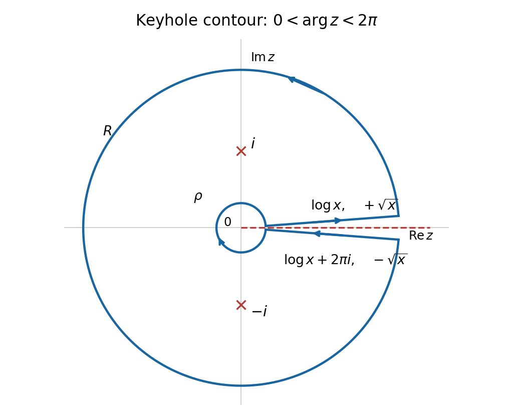

<h1 id="6/b/solution">Solution</h1>

↑ **Parent:** [B](../b.md)

Use the [branch of the complex logarithm](../../../../branch-of-the-complex-logarithm.md) with $0<\arg z<2\pi$, so the [branch cut](../../../../branch-cut.md) is the positive real axis, and take $\sqrt z=\exp(\operatorname{Log}z/2)$ on the same slit plane. Apply the [residue theorem](../../../../residue-theorem.md) to

$$
F(z)=\frac{\operatorname{Log}z}{(z^2+1)\sqrt z}
$$

on a positively oriented [keyhole contour](../../../../keyhole-contour.md) with inner radius $\rho<1$ and outer radius $R>1$. The upper bank travels from $\rho$ to $R$, the large circle counterclockwise, the lower bank from $R$ to $\rho$, and the small circle clockwise. One may first keep the banks at small nonzero angles and then take their limits.

On the upper bank, $\operatorname{Log}x=\log x$ and $\sqrt x$ is positive. On the lower bank, the corresponding limits are $\log x+2\pi i$ and $-\sqrt x$. Reversing the lower-bank orientation therefore makes the sum of the bank [integrals](../../../../integral-split.md) tend to

$$
2I+2\pi iJ,\qquad I=\int_0^\infty\frac{\log x}{(x^2+1)\sqrt x}\,dx,\qquad J=\int_0^\infty\frac{dx}{(x^2+1)\sqrt x}.
$$

Both are absolutely convergent: near zero compare with $x^{-1/2}(1+|\log x|)$, and near infinity with $x^{-5/2}(1+\log x)$. On the large circle, $|z^2+1|\geq R^2-1$, so its contribution is $O((\log R+1)R^{-3/2})$. On the small circle it is $O(\sqrt\rho(1+|\log\rho|))$. Both tend to zero.

**[Figure 1](#6/b/image-the-keyhole-contour-and-the-two-boundary-values-on-its-branch-cut). The keyhole contour and the two boundary values on its branch cut**.

The two simple [poles](../../../../pole.md) are $i$ and $-i$. On the chosen branch their arguments are $\pi/2$ and $3\pi/2$, respectively. Consequently their [residues](../../../../residue.md) are

$$
\operatorname{Res}(F,i)=\frac{\pi}{4\sqrt2}(1-i),\qquad \operatorname{Res}(F,-i)=\frac{3\pi}{4\sqrt2}(1+i).
$$

For example, the first follows from $\operatorname{Log}i=i\pi/2$, $\sqrt i=e^{i\pi/4}$ and the [derivative](../../../../derivative.md) $2i$ of the denominator factor $z^2+1$. The second uses $\sqrt{-i}=e^{3\pi i/4}$, rather than the value from the principal square-root branch. Adding and applying the [residue theorem](../../../../residue-theorem.md) yields

$$
2I+2\pi iJ=2\pi i\left(\frac\pi{\sqrt2}+\frac{i\pi}{2\sqrt2}\right)=-\frac{\pi^2}{\sqrt2}+i\sqrt2\pi^2.
$$

As $J$ is real, taking real parts gives

$$
\boxed{I=-\frac{\pi^2}{2\sqrt2}.}
$$

The imaginary part also gives $J=\pi/\sqrt2$, an independent consistency check on the orientation and branch factors.

## ↑ Ancestors (12)

1. [B](../b.md)
2. [6](../../6.md)
3. [2012](../../../2012-split.md)
4. [Past exam of the algebra, analysis and differential equations II course of the University of Oxford](../../../split.md)
5. [Algebra, analysis and differential equations II course of the University of Oxford](../../../../algebra-analysis-and-differential-equations-ii-course-of-the-university-of-oxford.md)
6. [Year 2 of the mathematics course of the University of Oxford](../../../../year-2-of-the-mathematics-course-of-the-university-of-oxford.md)
7. [Mathematics course of the University of Oxford](../../../../mathematics-course-of-the-university-of-oxford.md)
8. [Undergraduate course of the University of Oxford](../../../../undergraduate-course-of-the-university-of-oxford.md)
9. [Course of the University of Oxford](../../../../course-of-the-university-of-oxford.md)
10. [University of Oxford](../../../../university-of-oxford-split.md)
11. [List of universities](../../../../list-of-universities.md)
12. [Codex Wiki](../../../../split.md)
