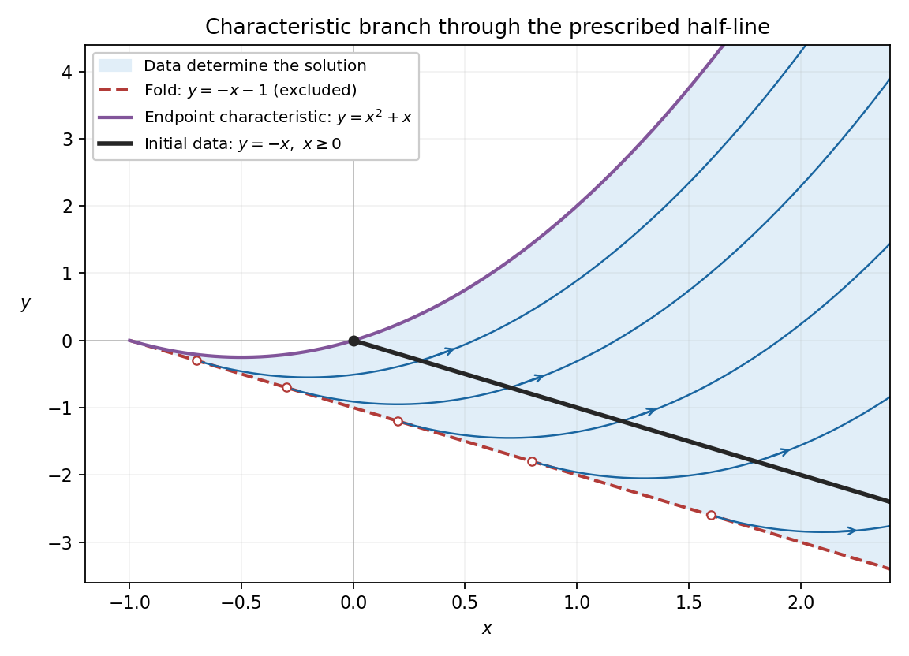

<h1 id="9/b/vi/solution">Solution</h1>

↑ **Parent:** [Vi](../vi.md)

To find the [characteristic domain from data on a half-line](../../../../../characteristic-domain-from-data-on-a-half-line.md), retain the allowed range of its initial parameter. The portion connected to the initial data before the [fold caustic](../../../../../fold-caustic.md) has $s>-1$ and $t\geq0$. Inverting the positive branch gives

$$
s=-1+\sqrt{1+x+y},\qquad t=x+1-\sqrt{1+x+y}.
$$

The square root must be positive, and $t\geq0$ requires $x+1\geq\sqrt{1+x+y}>0$. Squaring is now legitimate and gives $y\leq x^2+x$. Thus the full characteristic-covered set on this branch is

$$
\boxed{x>-1,\qquad -x-1<y\leq x^2+x.}
$$

Its open interior, where both the data parameter and the projection are interior and nonsingular, is the classical [domain of dependence](../../../../../domain-of-dependence.md)

$$
\boxed{D=\{(x,y):x>-1,\ -x-1<y<x^2+x\}.}
$$

**[Figure 2](#9/b/vi/image-the-domain-of-dependence-from-the-initial-half-line-bounded-by-the-endpoint-characteristic-and-the-fold-caustic). The domain of dependence from the initial half-line, bounded by the endpoint characteristic and the fold caustic**.

Each point of $D$ has exactly one backward characteristic meeting the interior $t>0$ of the prescribed data, so the [Picard-Lindelöf theorem](../../../../../picard-lindelof-theorem.md) fixes its value. The upper boundary is the characteristic issuing from the endpoint $t=0$ and is fixed by the endpoint datum, consistently with the continuous trace from $D$. The lower boundary is excluded: $s=-1$ there, the [Jacobian determinant](../../../../../jacobian-determinant.md) vanishes, and the explicit solution [derivatives](../../../../../derivative.md) diverge as $W\downarrow0$.

Points of the half-plane $W>0$ outside this set have $t<0$ on the branch through the data. Their characteristic footpoints would lie on the unprescribed continuation of the initial line, so these values are not determined by the given half-line alone. For example, extend the initial value to negative $t$ as $1+\varepsilon h(t)$, where $h$ is a [smooth function](../../../../../smooth-function.md) supported on the negative half-line. Such extensions agree with all the prescribed data and, where noncharacteristic, produce different local extensions by the [method of characteristics](../../../../../method-of-characteristics.md). The displayed formula supplies one possible extension there, but the data do not select it uniquely. This is why retaining the restriction on the initial half-line is essential. Continuing the parameterized surface past $s=-1$ instead produces the other sheet of the fold; it does not give a differentiable graph continuation through the caustic.

## ↑ Ancestors (13)

1. [Vi](../vi.md)
2. [B](../../b.md)
3. [9](../../../9.md)
4. [2012](../../../../2012-split.md)
5. [Past exam of the algebra, analysis and differential equations II course of the University of Oxford](../../../../split.md)
6. [Algebra, analysis and differential equations II course of the University of Oxford](../../../../../algebra-analysis-and-differential-equations-ii-course-of-the-university-of-oxford.md)
7. [Year 2 of the mathematics course of the University of Oxford](../../../../../year-2-of-the-mathematics-course-of-the-university-of-oxford.md)
8. [Mathematics course of the University of Oxford](../../../../../mathematics-course-of-the-university-of-oxford.md)
9. [Undergraduate course of the University of Oxford](../../../../../undergraduate-course-of-the-university-of-oxford.md)
10. [Course of the University of Oxford](../../../../../course-of-the-university-of-oxford.md)
11. [University of Oxford](../../../../../university-of-oxford-split.md)
12. [List of universities](../../../../../list-of-universities.md)
13. [Codex Wiki](../../../../../split.md)
