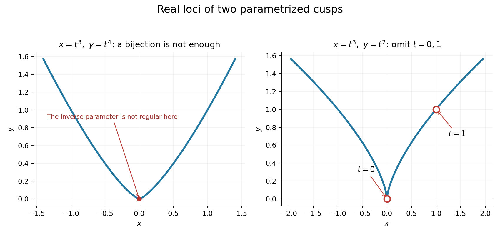

# 2011

↑ **Parent:** [Past exam of the algebraic Geometry course of the University of Oxford](../past-exam-of-the-algebraic-geometry-course-of-the-university-of-oxford.md)

Source paper: [FOI request thread](https://www.whatdotheyknow.com/request/maths_past_papers_3). The intact cover identifies Algebraic Geometry, C3.1a, Tuesday 7 June 2011, 2.30pm to 4.00pm. Its three readable pages are original private-bundle pages 413–415.

**Table of contents**

- [1](#1)
  - [a](#1/a)
    - [Solution](#1/a/solution)
  - [b](#1/b)
    - [Solution](#1/b/solution)
  - [c](#1/c)
    - [Solution](#1/c/solution)
  - [d](#1/d)
    - [Solution](#1/d/solution)
  - [e](#1/e)
    - [Solution](#1/e/solution)
- [2](#2)
  - [a](#2/a)
    - [Solution](#2/a/solution)
  - [b](#2/b)
    - [Solution](#2/b/solution)
  - [c](#2/c)
    - [Solution](#2/c/solution)
  - [d](#2/d)
    - [Solution](#2/d/solution)
  - [e](#2/e)
    - [Solution](#2/e/solution)
- [3](#3)
  - [a](#3/a)
    - [Solution](#3/a/solution)
  - [b](#3/b)
    - [Solution](#3/b/solution)
  - [c](#3/c)
    - [Solution](#3/c/solution)
    - [i](#3/c/i)
      - [Solution](#3/c/i/solution)
    - [ii](#3/c/ii)
      - [Solution](#3/c/ii/solution)
  - [d](#3/d)
    - [Solution](#3/d/solution)
  - [e](#3/e)
    - [Solution](#3/e/solution)

## 1

↑ **Parent:** [2011](2011.md)

<h3 id="1/a">a</h3>

↑ **Parent:** [1](#1)

<h4 id="1/a/solution">Solution</h4>

↑ **Parent:** [A](#1/a)

An [affine variety](../algebraic-variety.md#affine-algebraic-set) in $\mathbb A_k^n$ is the common [zero set](../polynomial.md#zero-set) of a collection of [polynomials](../polynomial.md) in $k[x_1,\ldots,x_n]$, with its [Zariski topology](../algebraic-geometry.md#zariski-topology). We use the convention of this question that such a [variety](../algebraic-variety.md) need not be [irreducible](../algebraic-geometry.md#irreducible-topological-space). Its [vanishing ideal](../algebraic-variety.md#vanishing-ideal) and [coordinate ring](../algebraic-variety.md#coordinate-ring) are

$$
\boxed{I(X)=\{f:f(p)=0\text{ for every }p\in X\},\qquad A(X)=k[x_1,\ldots,x_n]/I(X).}
$$

The quotient identifies [polynomials](../polynomial.md) that give the same function on $X$, so its elements are exactly [polynomial functions](../polynomial.md#polynomial-function) on $X$.

For affine embeddings $X\subseteq\mathbb A^n$ and $Y\subseteq\mathbb A^m$, a [morphism of affine varieties](../algebraic-variety.md#morphism-of-affine-varieties) is a map $F=(f_1,\ldots,f_m)$ with $f_i\in A(X)$ and [image](../set-theory.md#image-of-a-function) in $Y$. [Pullback](../category.md#pullback-category-theory) of [polynomial functions](../polynomial.md#polynomial-function) defines the contravariant [homomorphism](../algebra.md#homomorphism)

$$
\boxed{F^\#:A(Y)\longrightarrow A(X),\qquad [g]\longmapsto g\circ F.}
$$

It is well defined because any [polynomial](../polynomial.md) vanishing on $Y$ pulls back to zero on $X$, and it preserves addition, multiplication, one, and the constants in $k$.

<h3 id="1/b">b</h3>

↑ **Parent:** [1](#1)

<h4 id="1/b/solution">Solution</h4>

↑ **Parent:** [B](#1/b)

The [radical of an ideal](../commutative-algebra.md#radical-of-an-ideal) is

$$
\boxed{\sqrt I=\{f\in R:f^N\in I\text{ for some integer }N\geq1\}.}
$$

The [ideal](../commutative-algebra.md#ideal) is [radical](../chemistry.md#radical-chemistry) if $I=\sqrt I$. Its [zero set](../polynomial.md#zero-set) is $V(I)=\{a\in k^n:f(a)=0\text{ for every }f\in I\}$, an [affine variety](../algebraic-variety.md#affine-algebraic-set) by definition.

Every $f\in I$ vanishes at every [point](../geometry-and-topology.md#point-geometry) of $V(I)$, so $I\subseteq I(V(I))$. If $g^N\in I(V(I))$, then $g(a)^N=0$ in the [field](../algebra.md#field) $k$ for every $a\in V(I)$, so $g(a)=0$ for each such [point](../geometry-and-topology.md#point-geometry). Hence $g\in I(V(I))$ and

$$
\boxed{I(V(I))\text{ is a radical ideal containing }I.}
$$

<h3 id="1/c">c</h3>

↑ **Parent:** [1](#1)

<h4 id="1/c/solution">Solution</h4>

↑ **Parent:** [C](#1/c)

Part (b) immediately gives $\sqrt I\subseteq I(V(I))$. For the reverse inclusion, let $h\in I(V(I))$. The case $h=0$ is immediate, so assume $h\neq0$. [Noetherianity](../algebra.md#noetherian-ring) gives finite generators $I=(f_1,\ldots,f_r)$.

Use the [Rabinowitsch trick](../algebraic-geometry.md#rabinowitsch-trick): in the [polynomial ring](../commutative-algebra.md#polynomial-ring) with one auxiliary variable, form

$$
J=(f_1,\ldots,f_r,1-th)\subseteq k[x_1,\ldots,x_n,t].
$$

Apply the assumed maximal-ideal description to [polynomial rings](../commutative-algebra.md#polynomial-ring), including this [ring](../commutative-algebra.md#ring) in $n+1$ variables. If $J$ were proper, it would lie in the [maximal ideal](../commutative-algebra.md#maximal-ideal) of some [point](../geometry-and-topology.md#point-geometry) $(a,b)$. Then $a\in V(I)$ and $1-bh(a)=0$, impossible because $h$ vanishes on $V(I)$. Therefore $J$ is the whole [ring](../commutative-algebra.md#ring), and there is an identity

$$
1=\sum_{i=1}^r P_i(x,t)f_i(x)+Q(x,t)(1-th(x)).
$$

Substitute $t=h^{-1}$ in the [localization](../commutative-algebra.md#localization-of-a-ring) $R_h$. The last term vanishes; clearing the finitely many powers of $h$ from the remaining denominators yields $h^N\in I$ for some $N$. Thus $h\in\sqrt I$ and

$$
\boxed{I(V(I))=\sqrt I.}
$$

This proves the strong [Hilbert Nullstellensatz](../algebraic-geometry.md#hilbert-nullstellensatz) from the polynomial-ring weak form by converting nonvanishing into an extra equation.

<h3 id="1/d">d</h3>

↑ **Parent:** [1](#1)

<h4 id="1/d/solution">Solution</h4>

↑ **Parent:** [D](#1/d)

Here [subvariety](../algebraic-variety.md#closed-subvariety) means a closed affine [subvariety](../algebraic-variety.md#closed-subvariety). Suppose first that $F^\#$ is onto, and write $X\subseteq\mathbb A^n$, $Y\subseteq\mathbb A^m$. Put $J=\ker F^\#$ and $Z=V_Y(J)$. Choose $g_i\in A(Y)$ with $F^\#g_i=x_i|_X$ and let $G:Z\to\mathbb A^n$ have components $g_i|_Z$.

If $h\in I(X)$, then $F^\#(h(g_1,\ldots,g_n))=h|_X=0$, so $h(g_1,\ldots,g_n)\in J$. It vanishes on $Z$, proving $G(Z)\subseteq X$. The chosen lifts give $G\circ F=\operatorname{id}_X$, and $F(X)\subseteq Z$ by the definition of $J$.

Let the components of $F$ be [polynomial functions](../polynomial.md#polynomial-function) $f_1,\ldots,f_m$ on $X$. For each target coordinate $y_j$, the element $y_j-f_j(g_1,\ldots,g_n)$ has zero [pullback](../category.md#pullback-category-theory), hence belongs to $J$. It vanishes on $Z$, giving $F\circ G=\operatorname{id}_Z$. Both maps have [polynomial](../polynomial.md) components, so $F$ is an [isomorphism](../algebra.md#isomorphism) onto the [closed subvariety](../algebraic-variety.md#closed-subvariety) $Z$.

Conversely, if $F:X\to Z\subseteq Y$ is an [isomorphism](../algebra.md#isomorphism) onto a [closed subvariety](../algebraic-variety.md#closed-subvariety), [restriction](../function.md#restriction-mathematics) $A(Y)\to A(Z)$ is [surjective](../algebra.md#surjective-function), and the [pullback](../category.md#pullback-category-theory) $A(Z)\to A(X)$ of that [isomorphism](../algebra.md#isomorphism) is an [isomorphism](../algebra.md#isomorphism). Their composition is $F^\#$, proving

$$
\boxed{F^\#\text{ onto}\iff F\text{ is a closed embedding}.}
$$

The word closed matters: an [isomorphism](../algebra.md#isomorphism) onto a merely locally [closed subset](../topology.md#closed-set) need not induce a [surjective](../algebra.md#surjective-function) coordinate-ring map. For example $\mathbb G_m\hookrightarrow\mathbb A^1$ induces $k[t]\hookrightarrow k[t,t^{-1}]$.

<h3 id="1/e">e</h3>

↑ **Parent:** [1](#1)

<h4 id="1/e/solution">Solution</h4>

↑ **Parent:** [E](#1/e)

The parametrization lands on the curve because $(t^3)^4=(t^4)^3$. Its [pullback](../category.md#pullback-category-theory) has [image](../set-theory.md#image-of-a-function)

$$
\operatorname{im}F^\#=k[t^3,t^4]\subset k[t]=A(\mathbb A^1).
$$

Every [monomial](../polynomial.md#monomial) in this subalgebra has exponent $3a+4b$ for nonnegative integers $a,b$. No such exponent is one, so no [linear combination](../vector-space.md#linear-combination) of these [monomials](../polynomial.md#monomial) is $t$. Thus $F^\#$ is not [surjective](../algebra.md#surjective-function) and **$F$ is not an [isomorphism](../algebra.md#isomorphism)**.

It is nevertheless [bijective](../function.md#bijection) on [points](../geometry-and-topology.md#point-geometry). Away from the origin, $x\neq0$ and $t=y/x$ gives $t^3=x$ and $t^4=y$ using $x^4=y^3$; the origin comes only from $t=0$. The rational inverse cannot extend regularly at the origin: if $t=P(t^3,t^4)/Q(t^3,t^4)$ with $Q(0)\neq0$, then $tQ(t^3,t^4)$ has a nonzero degree-one term, whereas $P(t^3,t^4)$ has none.

$$
\boxed{F\text{ is bijective, but its inverse is not regular at the cusp}.}
$$

This distinguishes a set-theoretic [bijection](../function.md#bijection) from an [isomorphism](../algebra.md#isomorphism) of [varieties](../algebraic-variety.md) in every [characteristic](../algebra.md#characteristic-of-a-field).

**[Figure 1](#1/e/image-cusp-parametrizations-reveal-which-rational-coordinates-fail-to-be-regular). Cusp parametrizations reveal which rational coordinates fail to be regular**. The left curve uses x=t cubed and y=t to the fourth; recovering t fails regularly at its origin. The right curve uses x=t cubed and y=t squared; the open subset used later omits the parameter values zero and one, marked with hollow circles.

This is a [bijective monomial cusp parametrization with nonregular inverse](../algebraic-variety.md#bijective-monomial-cusp-parametrization-with-nonregular-inverse).

## 2

↑ **Parent:** [2011](2011.md)

<h3 id="2/a">a</h3>

↑ **Parent:** [2](#2)

<h4 id="2/a/solution">Solution</h4>

↑ **Parent:** [A](#2/a)

A [projective variety](../projective-space.md#projective-variety) is a Zariski-closed [subset](../set.md#subset) of [projective space](../projective-space.md) $\mathbb P_k^n$, equivalently the common [zero set](../polynomial.md#zero-set) of [homogeneous polynomials](../algebra.md#homogeneous-polynomial). [Homogeneity](../real-analysis.md#homogeneity) makes their vanishing independent of the nonzero scalar used to represent a projective [point](../geometry-and-topology.md#point-geometry).

A [morphism](../algebraic-variety.md#morphism-of-algebraic-varieties) is a map locally given by regular coordinate functions in [affine charts](../locally-ringed-space.md#affine-chart-of-a-variety). Equivalently, near each [point](../geometry-and-topology.md#point-geometry) of a projective source embedded in $\mathbb P^n$, a [morphism](../algebraic-variety.md#morphism-of-algebraic-varieties) to $\mathbb P^m$ can be written

$$
\boxed{[x]\longmapsto[F_0(x):\cdots:F_m(x)]}
$$

using [homogeneous polynomials](../algebra.md#homogeneous-polynomial) of a common degree that are not all zero on that [neighbourhood](../topology.md#neighbourhood-mathematics). The expressions must agree on overlaps, and for a specified target [variety](../algebraic-variety.md) their values must lie in it. A single global tuple is a sufficient description when available, but is not part of the general definition.

<h3 id="2/b">b</h3>

↑ **Parent:** [2](#2)

<h4 id="2/b/solution">Solution</h4>

↑ **Parent:** [B](#2/b)

The [Segre embedding](../projective-space.md#segre-embedding) is

$$
\boxed{\sigma_{n,m}([x_0:\cdots:x_n],[y_0:\cdots:y_m])=[x_iy_j]_{0\leq i\leq n,\ 0\leq j\leq m}.}
$$

Rescaling the two representatives multiplies every target coordinate by the same scalar, and at least one [product](../arithmetic.md#product-of-numbers) is nonzero, so the map is well defined. In affine source charts its coordinate ratios are regular [products](../arithmetic.md#product-of-numbers), so it is a [morphism](../algebraic-variety.md#morphism-of-algebraic-varieties).

Arrange target coordinates into a [matrix](../vector-space.md#matrix) $Z=(z_{ij})$. Every [image](../set-theory.md#image-of-a-function) [matrix](../vector-space.md#matrix) has [rank](../quadratic-form.md#rank-one-quadratic-form) one and satisfies all homogeneous equations

$$
z_{ij}z_{k\ell}-z_{i\ell}z_{kj}=0.
$$

Conversely, a nonzero [matrix](../vector-space.md#matrix) satisfying these equations has [rank](../quadratic-form.md#rank-one-quadratic-form) one. Choose $z_{i_0j_0}\neq0$ and [set](../set.md) $x_i=z_{ij_0}$, $y_j=z_{i_0j}/z_{i_0j_0}$. The [minors](../vector-space.md#minor-linear-algebra) imply $z_{ij}=x_iy_j$. Therefore

$$
\boxed{\operatorname{im}\sigma_{n,m}=V(\text{all }2\times2\text{ minors}),}
$$

a [projective variety](../projective-space.md#projective-variety). The two projective factors are uniquely recoverable from a nonzero column and row. This also shows [injectivity](../algebra.md#injective-function) and supplies the local inverse formulas used in the next part.

<h3 id="2/c">c</h3>

↑ **Parent:** [2](#2)

<h4 id="2/c/solution">Solution</h4>

↑ **Parent:** [C](#2/c)

Choose projective embeddings $X\subseteq\mathbb P^n$ and $Y\subseteq\mathbb P^m$. Define their [product](../arithmetic.md#product-of-numbers) as the Segre [image](../set-theory.md#image-of-a-function) of the [set](../set.md) of pairs $(x,y)$, with its induced [variety](../algebraic-variety.md) structure.

It is closed in the Segre [variety](../algebraic-variety.md). To see this directly, for every homogeneous $f\in I(X)$ impose the equations $f(z_{0j},\ldots,z_{nj})=0$ on every column, and for every homogeneous $g\in I(Y)$ impose $g(z_{i0},\ldots,z_{im})=0$ on every row. For a [rank-one matrix](../vector-space.md#rank-one-matrix) $z_{ij}=x_iy_j$, the column equations are $y_j^{\deg f}f(x)=0$. A nonzero $y_j$ therefore forces $x\in X$. The row equations similarly force $y\in Y$. Thus these homogeneous equations together with the [minors](../vector-space.md#minor-linear-algebra) cut out exactly $X\times Y$, proving it is projective.

On a chart where $z_{i_0j_0}\neq0$, the projections have formulas

$$
\pi_X([Z])=[z_{0j_0}:\cdots:z_{nj_0}],\qquad
\pi_Y([Z])=[z_{i_00}:\cdots:z_{i_0m}].
$$

These [homogeneous coordinate](../projective-space.md#homogeneous-coordinate) tuples are nonzero on the chart and agree on overlaps, so both projections are [morphisms](../algebraic-variety.md#morphism-of-algebraic-varieties).

Given [morphisms](../algebraic-variety.md#morphism-of-algebraic-varieties) $\alpha:Z\to X$ and $\beta:Z\to Y$, define $\gamma(z)=\sigma_{n,m}(\alpha(z),\beta(z))$. Locally write their coordinates as $[a_0:\cdots:a_n]$ and $[b_0:\cdots:b_m]$. Then $\gamma$ has coordinates $[a_ib_j]$, which are regular with a nonzero coordinate near each [point](../geometry-and-topology.md#point-geometry). Hence $\gamma$ is a [morphism](../algebraic-variety.md#morphism-of-algebraic-varieties) and

$$
\boxed{\pi_X\circ\gamma=\alpha,\qquad\pi_Y\circ\gamma=\beta.}
$$

The two projections determine the underlying pair uniquely, so this [morphism](../algebraic-variety.md#morphism-of-algebraic-varieties) is unique. This is the [product](../arithmetic.md#product-of-numbers) [universal property](../category-theory.md#universal-property), and it makes the construction independent up to canonical [isomorphism](../algebra.md#isomorphism) of the chosen embeddings.

<h3 id="2/d">d</h3>

↑ **Parent:** [2](#2)

<h4 id="2/d/solution">Solution</h4>

↑ **Parent:** [D](#2/d)

Let $S=k[x_0,\ldots,x_n]$ and let $B=S/I(X)$ be the [homogeneous coordinate ring](../projective-space.md#homogeneous-coordinate-ring) of a nonempty [projective variety](../projective-space.md#projective-variety). Its [Hilbert function](../commutative-algebra.md#hilbert-function) is $h_X(t)=\dim_k B_t$. For all sufficiently large integers $t$, this function agrees with a [polynomial](../polynomial.md) $P_X(t)$, the [Hilbert polynomial](../algebraic-geometry.md#hilbert-polynomial).

The [dimension](../algebraic-geometry.md#dimension-of-an-algebraic-set) $r$ is the largest length of a strict chain of nonempty [irreducible](../algebraic-geometry.md#irreducible-topological-space) closed [subvarieties](../algebraic-variety.md#closed-subvariety) of $X$. Equivalently $r=\dim B-1=\deg P_X$. The degree of the embedded [variety](../algebraic-variety.md) is the integer specified by the leading term

$$
\boxed{P_X(t)=\frac{\deg X}{r!}t^r+\text{lower-degree terms}.}
$$

Geometrically it is the number of [intersection](../set.md#set-intersection) [points](../geometry-and-topology.md#point-geometry) with a general [linear subspace](../vector-space.md#vector-subspace) of codimension $r$, counted with [intersection multiplicities](../algebraic-geometry.md#intersection-multiplicity). The [polynomial](../polynomial.md)'s degree is the [dimension](../algebraic-geometry.md#dimension-of-an-algebraic-set) $r$; the [variety](../algebraic-variety.md)'s degree is the [leading coefficient](../polynomial.md#leading-coefficient-of-a-polynomial) multiplied by $r!$. Keeping those two meanings separate is important in the next computation.

<h3 id="2/e">e</h3>

↑ **Parent:** [2](#2)

<h4 id="2/e/solution">Solution</h4>

↑ **Parent:** [E](#2/e)

The [homogeneous coordinate ring](../projective-space.md#homogeneous-coordinate-ring) of the Segre [image](../set-theory.md#image-of-a-function) is the subalgebra $k[x_iy_j]\subseteq k[x_0,\ldots,x_n,y_0,\ldots,y_m]$, grading each [product](../arithmetic.md#product-of-numbers) $x_iy_j$ as degree one. Its degree-$t$ part is precisely the space of [polynomials](../polynomial.md) bihomogeneous of bidegree $(t,t)$.

Indeed, every [product](../arithmetic.md#product-of-numbers) of $t$ generators has those two degrees. Conversely, any [monomial](../polynomial.md#monomial) of bidegree $(t,t)$ can pair its $t$ individual $x$ factors with its $t$ individual $y$ factors, expressing it as a [product](../arithmetic.md#product-of-numbers) of generators. The distinct resulting [monomials](../polynomial.md#monomial) are [linearly independent](../vector-space.md#linear-independence). Counting them gives

$$
\boxed{P_X(t)=\binom{t+n}{n}\binom{t+m}{m}.}
$$

In fact this agrees with the [Hilbert function](../commutative-algebra.md#hilbert-function) for every integer $t\geq0$. Its [leading coefficient](../polynomial.md#leading-coefficient-of-a-polynomial) is $1/(n!m!)$, so the two degree quantities are

$$
\boxed{\deg P_X=n+m,\qquad\deg X=\frac{(n+m)!}{n!m!}=\binom{n+m}{n}.}
$$

Thus the Segre [variety](../algebraic-variety.md) has [dimension](../algebraic-geometry.md#dimension-of-an-algebraic-set) $n+m$ and embedded projective degree $\binom{n+m}{n}$.

This gives the [Segre Hilbert polynomial and degree](../projective-space.md#segre-hilbert-polynomial-and-degree) directly from its graded [monomials](../polynomial.md#monomial).

## 3

↑ **Parent:** [2011](2011.md)

<h3 id="3/a">a</h3>

↑ **Parent:** [3](#3)

<h4 id="3/a/solution">Solution</h4>

↑ **Parent:** [A](#3/a)

A [quasi-projective variety](../algebraic-variety.md#quasi-projective-variety) is a locally [closed subset](../topology.md#closed-set) of [projective space](../projective-space.md): equivalently an [open subset](../topology.md#open-set) of some [projective variety](../projective-space.md#projective-variety), with the induced [algebraic variety](../algebraic-variety.md) structure. [Affine varieties](../algebraic-variety.md#affine-algebraic-set) are examples, via the standard [affine chart](../locally-ringed-space.md#affine-chart-of-a-variety) in [projective space](../projective-space.md).

It is [irreducible](../algebraic-geometry.md#irreducible-topological-space) if it is nonempty and cannot be written as the [union](../set.md#set-union) of two proper [closed subsets](../topology.md#closed-set). Equivalently, every two nonempty [open subsets](../topology.md#open-set) meet, or every nonempty [open subset](../topology.md#open-set) is [dense](../topology.md#dense-set). Closed and open are interpreted in the induced [Zariski topology](../algebraic-geometry.md#zariski-topology) of $X$.

<h3 id="3/b">b</h3>

↑ **Parent:** [3](#3)

<h4 id="3/b/solution">Solution</h4>

↑ **Parent:** [B](#3/b)

For a [multiplicatively closed set](../commutative-algebra.md#multiplicatively-closed-set) $S$ containing one, the [localization of a ring](../commutative-algebra.md#localization-of-a-ring) $S^{-1}R$ consists of fractions $r/s$ with $r\in R,s\in S$, under the equivalence

$$
\boxed{\frac rs=\frac{r'}{s'}\iff\exists u\in S:\ u(rs'-r's)=0.}
$$

The factor $u$ is needed when the [ring](../commutative-algebra.md#ring) has [zero divisors](../mathematics.md#zero-divisor). Addition and multiplication are

$$
\frac rs+\frac{r'}{s'}=\frac{rs'+r's}{ss'},\qquad
\frac rs\frac{r'}{s'}=\frac{rr'}{ss'}.
$$

The canonical map sends $r$ to $r/1$ and makes every element of $S$ a [unit](../algebra.md#unit-in-a-ring). It is universal with this property: a [ring homomorphism](../commutative-algebra.md#ring-homomorphism) $\phi:R\to T$ taking $S$ into [units](../algebra.md#unit-in-a-ring) extends uniquely by $r/s\mapsto\phi(r)\phi(s)^{-1}$. Usually zero is excluded from $S$; if it is included, this construction is the [zero ring](../commutative-algebra.md#zero-ring).

<h3 id="3/c">c</h3>

↑ **Parent:** [3](#3)

<h4 id="3/c/solution">Solution</h4>

↑ **Parent:** [C](#3/c)

A [regular function](../locally-ringed-space.md#regular-function) on $U$ is a function $f:U\to k$ locally representable, in an [affine chart](../locally-ringed-space.md#affine-chart-of-a-variety) of the ambient [projective space](../projective-space.md), as a quotient $a/b$ of [polynomial functions](../polynomial.md#polynomial-function) with denominator nonzero on that [neighbourhood](../topology.md#neighbourhood-mathematics). Equivalently it is locally a quotient of homogeneous forms of the same degree. The equal-degree condition makes the quotient independent of the chosen projective representative.

The [ring](../commutative-algebra.md#ring) $\mathcal O_{X,p}$ is the [ring](../commutative-algebra.md#ring) of [germs](../sheaf-of-modules.md#germ-of-a-sheaf-section) of such functions near $p$. Two representatives $(U,f)$ and $(V,g)$ define the same [germ](../sheaf-of-modules.md#germ-of-a-sheaf-section) when they agree on some smaller [neighbourhood](../topology.md#neighbourhood-mathematics) of $p$. Addition and multiplication use a common [neighbourhood](../topology.md#neighbourhood-mathematics). It is a [local ring](../commutative-algebra.md#local-ring): its unique [maximal ideal](../commutative-algebra.md#maximal-ideal) consists of [germs](../sheaf-of-modules.md#germ-of-a-sheaf-section) vanishing at $p$, and any [germ](../sheaf-of-modules.md#germ-of-a-sheaf-section) nonzero at $p$ has a regular reciprocal on a smaller [neighbourhood](../topology.md#neighbourhood-mathematics).

$$
\boxed{\mathfrak m_p=\{[f]_p:f(p)=0\},\qquad\mathcal O_{X,p}/\mathfrak m_p\cong k.}
$$

<h4 id="3/c/i">i</h4>

↑ **Parent:** [C](#3/c)

<h5 id="3/c/i/solution">Solution</h5>

↑ **Parent:** [I](#3/c/i)

A [morphism](../algebraic-variety.md#morphism-of-algebraic-varieties) $F:X\to Y$ is a [continuous](../calculus.md#continuous-function) map in the Zariski topologies such that for every open $V\subseteq Y$ and every [regular function](../locally-ringed-space.md#regular-function) $h$ on $V$, the [pullback](../category.md#pullback-category-theory) $h\circ F$ is regular on $F^{-1}(V)$.

Equivalently, near every [point](../geometry-and-topology.md#point-geometry), choose [affine charts](../locally-ringed-space.md#affine-chart-of-a-variety) of source and target; the target coordinates of $F$ must then be [regular functions](../locally-ringed-space.md#regular-function) of the source coordinates. These local conditions agree on overlaps. In particular a [morphism](../algebraic-variety.md#morphism-of-algebraic-varieties) is defined at every [point](../geometry-and-topology.md#point-geometry) of its source, not merely on a [dense](../topology.md#dense-set) [open subset](../topology.md#open-set).

<h4 id="3/c/ii">ii</h4>

↑ **Parent:** [C](#3/c)

<h5 id="3/c/ii/solution">Solution</h5>

↑ **Parent:** [Ii](#3/c/ii)

A [rational map](../isolated-singularity.md#rational-map-complex-analysis) from [irreducible](../algebraic-geometry.md#irreducible-topological-space) $X$ to $Y$ is an equivalence class of [morphisms](../algebraic-variety.md#morphism-of-algebraic-varieties) $F_U:U\to Y$ defined on nonempty [open subsets](../topology.md#open-set) $U\subseteq X$. Two representatives are equivalent if they agree on a nonempty [open subset](../topology.md#open-set) of their [intersection](../set.md#set-intersection).

[Irreducibility](../algebraic-geometry.md#irreducible-topological-space) makes all these nonempty opens [dense](../topology.md#dense-set) and ensures their [intersections](../set.md#set-intersection) are nonempty, so the equivalence expresses agreement at general [points](../geometry-and-topology.md#point-geometry). A [rational map](../isolated-singularity.md#rational-map-complex-analysis) need not extend across all of $X$, and it need not be dominant. An [injective](../algebra.md#injective-function) [homomorphism](../algebra.md#homomorphism) of [function fields](../algebraic-variety.md#function-field-of-an-algebraic-variety) additionally requires a [dominant morphism of affine varieties](../algebraic-variety.md#dominant-morphism-of-affine-varieties), or the corresponding condition on a [rational map](../isolated-singularity.md#rational-map-complex-analysis).

<h3 id="3/d">d</h3>

↑ **Parent:** [3](#3)

<h4 id="3/d/solution">Solution</h4>

↑ **Parent:** [D](#3/d)

[Polynomial functions](../polynomial.md#polynomial-function) are regular, giving an [injective](../algebra.md#injective-function) map $A(X)\hookrightarrow\mathcal O_X(X)$; [injectivity](../algebra.md#injective-function) follows from quotienting by the full [vanishing ideal](../algebraic-variety.md#vanishing-ideal). To prove [surjectivity](../algebra.md#surjective-function), let $f$ be globally regular and consider the denominator [ideal](../commutative-algebra.md#ideal)

$$
J=\{g\in A(X):gf\text{ is a polynomial function on }X\}.
$$

It is an [ideal](../commutative-algebra.md#ideal) because sums and [polynomial](../polynomial.md) multiples preserve this property.

Fix $p\in X$. Locally $f=a/b$ on a [neighbourhood](../topology.md#neighbourhood-mathematics) $V$ of $p$, with $b$ nonzero there. Principal affine opens form a [basis](../vector-space.md#basis), so choose $h\in A(X)$ with $h(p)\neq0$ and $D(h)\subseteq V$. Then

$$
(hb)f=ha
$$

as functions on all of $X$: on $D(h)$ it follows from the local fraction, and off $D(h)$ both sides vanish because $h=0$. Hence $hb\in J$ and $(hb)(p)\neq0$.

Thus $J$ has no common zero on $X$. By the weak Nullstellensatz for $A(X)$, every proper [ideal](../commutative-algebra.md#ideal) lies in a [maximal ideal](../commutative-algebra.md#maximal-ideal) belonging to a [point](../geometry-and-topology.md#point-geometry) of $X$; therefore $J$ cannot be proper. We get $1\in J$, so $f$ itself is [polynomial](../polynomial.md). This proves

$$
\boxed{\mathcal O_X(X)\cong A(X).}
$$

The argument works for reducible [affine varieties](../algebraic-variety.md#affine-algebraic-set) as well: it uses functions and denominator [ideals](../commutative-algebra.md#ideal) rather than assuming a single [fraction field](../commutative-algebra.md#field-of-fractions).

This is the [denominator ideal proof for global regular functions](../locally-ringed-space.md#denominator-ideal-proof-for-global-regular-functions).

<h3 id="3/e">e</h3>

↑ **Parent:** [3](#3)

<h4 id="3/e/solution">Solution</h4>

↑ **Parent:** [E](#3/e)

For any [affine variety](../algebraic-variety.md#affine-algebraic-set) and [point](../geometry-and-topology.md#point-geometry) $p$, with $\mathfrak m_p=\{f\in A(X):f(p)=0\}$, the standard [localization](../commutative-algebra.md#localization-of-a-ring) description is

$$
\boxed{\mathcal O_{X,p}\cong A(X)_{\mathfrak m_p}.}
$$

Also $\mathcal O_X(D(g))\cong A(X)_g$ for a [principal open subset](../locally-ringed-space.md#principal-open-subscheme). One way to see the latter is to realize $D(g)$ as the [affine variety](../algebraic-variety.md#affine-algebraic-set) $\{(x,z):g(x)z=1\}$; its [coordinate ring](../algebraic-variety.md#coordinate-ring) is $A(X)[z]/(gz-1)=A(X)_g$ and part (d) applies.

For this [cusp](../algebraic-geometry.md#cusp-algebraic-geometry) use $x=t^3,y=t^2$, identifying $A(X)$ with $k[t^2,t^3]$ inside $k(t)$. The parametrization gives exactly the relation $x^2=y^3$; its kernel is generated by this binomial. For example reduce a [polynomial](../polynomial.md) modulo $x^2-y^3$ to $a(y)+xb(y)$; substitution has even powers from $a(t^2)$ and odd powers at least three from $t^3b(t^2)$, so it can vanish only when both [polynomials](../polynomial.md) are zero.

Write $g=x-y=t^2(t-1)$. The [open set](../topology.md#open-set) corresponds to $t\neq0,1$, and

$$
\mathcal O_X(U)=k[t^2,t^3]_{t^2(t-1)}.
$$

To simplify this [ring](../commutative-algebra.md#ring) without assuming the normalization coordinate is present, observe that in $A(X)$

$$
g^2=(x-y)^2=y(y^2-2x+y).
$$

Thus $y$ becomes a [unit](../algebra.md#unit-in-a-ring) after inverting $g$, with inverse $(y^2-2x+y)/g^2$. Consequently $t=x/y$ belongs to the [localization](../commutative-algebra.md#localization-of-a-ring). Since $g=t^2(t-1)$ is a [unit](../algebra.md#unit-in-a-ring), both $t$ and $t-1$ become [units](../algebra.md#unit-in-a-ring). Conversely every original generator lies in the corresponding two-point [localization](../commutative-algebra.md#localization-of-a-ring) of $k[t]$. Hence

$$
\boxed{\mathcal O_X(U)=k[t,t^{-1},(t-1)^{-1}].}
$$

Finally $p=(1,1)$ corresponds to $t=1$. It lies outside $U$, so compute its [local ring](../commutative-algebra.md#local-ring) from $X$, at $\mathfrak m=(x-1,y-1)$. The element $y$ is a [unit](../algebra.md#unit-in-a-ring) there, hence $t=x/y$ belongs to $A(X)_{\mathfrak m}$. Every [polynomial](../polynomial.md) in $t$ nonzero at one is then a [unit](../algebra.md#unit-in-a-ring). Conversely a denominator from $A(X)\setminus\mathfrak m$ remains nonzero at $t=1$. These inclusions prove

$$
\boxed{\mathcal O_{X,p}=\bigl(k[x,y]/(x^2-y^3)\bigr)_{(x-1,y-1)}\cong k[t]_{(t-1)}.}
$$

This [smooth](../analysis.md#smooth-function) [point](../geometry-and-topology.md#point-geometry) has the ordinary one-variable [local ring](../commutative-algebra.md#local-ring), even though the global curve has a [cusp](../algebraic-geometry.md#cusp-algebraic-geometry) at its origin.

The [localization](../commutative-algebra.md#localization-of-a-ring) calculation describes [regular functions on a cusp with two points removed](../algebraic-variety.md#regular-functions-on-a-cusp-with-two-points-removed).

## ↑ Ancestors (9)

1. [Past exam of the algebraic Geometry course of the University of Oxford](../past-exam-of-the-algebraic-geometry-course-of-the-university-of-oxford.md)
2. [Algebraic Geometry course of the University of Oxford](../university-of-oxford.md#algebraic-geometry-course-of-the-university-of-oxford)
3. [Year 4 of the mathematics course of the University of Oxford](../university-of-oxford.md#year-4-of-the-mathematics-course-of-the-university-of-oxford)
4. [Mathematics course of the University of Oxford](../university-of-oxford.md#mathematics-course-of-the-university-of-oxford)
5. [Undergraduate course of the University of Oxford](../university-of-oxford.md#undergraduate-course-of-the-university-of-oxford)
6. [Course of the University of Oxford](../university-of-oxford.md#course-of-the-university-of-oxford)
7. [University of Oxford](../university-of-oxford.md)
8. [List of universities](../README.md#list-of-universities)
9. [Codex Wiki](../README.md)
