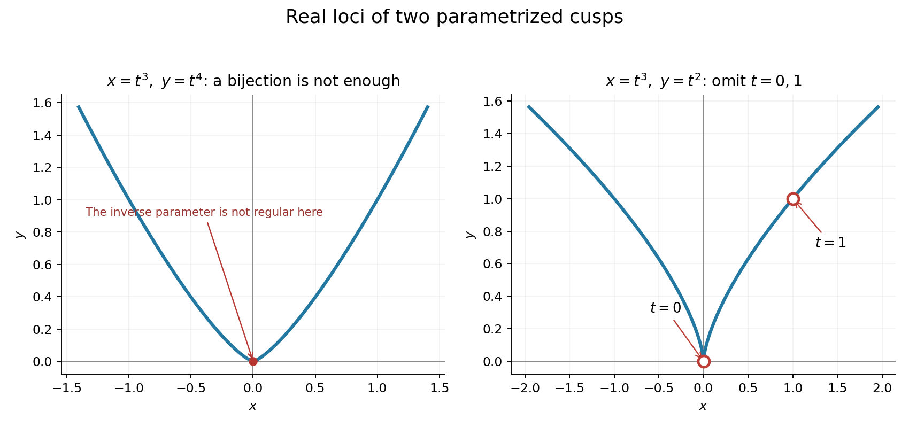

<h1 id="1/e/solution">Solution</h1>

↑ **Parent:** [E](../e.md)

The parametrization lands on the curve because $(t^3)^4=(t^4)^3$. Its [pullback](../../../../pullback-category-theory.md) has [image](../../../../image-of-a-function.md)

$$
\operatorname{im}F^\#=k[t^3,t^4]\subset k[t]=A(\mathbb A^1).
$$

Every [monomial](../../../../monomial.md) in this subalgebra has exponent $3a+4b$ for nonnegative integers $a,b$. No such exponent is one, so no [linear combination](../../../../linear-combination.md) of these [monomials](../../../../monomial.md) is $t$. Thus $F^\#$ is not [surjective](../../../../surjective-function.md) and **$F$ is not an [isomorphism](../../../../isomorphism.md)**.

It is nevertheless [bijective](../../../../bijection.md) on [points](../../../../point-geometry.md). Away from the origin, $x\neq0$ and $t=y/x$ gives $t^3=x$ and $t^4=y$ using $x^4=y^3$; the origin comes only from $t=0$. The rational inverse cannot extend regularly at the origin: if $t=P(t^3,t^4)/Q(t^3,t^4)$ with $Q(0)\neq0$, then $tQ(t^3,t^4)$ has a nonzero degree-one term, whereas $P(t^3,t^4)$ has none.

$$
\boxed{F\text{ is bijective, but its inverse is not regular at the cusp}.}
$$

This distinguishes a set-theoretic [bijection](../../../../bijection.md) from an [isomorphism](../../../../isomorphism.md) of [varieties](../../../../algebraic-variety-split.md) in every [characteristic](../../../../characteristic-of-a-field.md).

**[Figure 1](#1/e/image-cusp-parametrizations-reveal-which-rational-coordinates-fail-to-be-regular). Cusp parametrizations reveal which rational coordinates fail to be regular**. The left curve uses x=t cubed and y=t to the fourth; recovering t fails regularly at its origin. The right curve uses x=t cubed and y=t squared; the open subset used later omits the parameter values zero and one, marked with hollow circles.

This is a [bijective monomial cusp parametrization with nonregular inverse](../../../../bijective-monomial-cusp-parametrization-with-nonregular-inverse.md).

## ↑ Ancestors (12)

1. [E](../e.md)
2. [1](../../1.md)
3. [2011](../../../2011-split.md)
4. [Past exam of the algebraic Geometry course of the University of Oxford](../../../split.md)
5. [Algebraic Geometry course of the University of Oxford](../../../../algebraic-geometry-course-of-the-university-of-oxford.md)
6. [Year 4 of the mathematics course of the University of Oxford](../../../../year-4-of-the-mathematics-course-of-the-university-of-oxford.md)
7. [Mathematics course of the University of Oxford](../../../../mathematics-course-of-the-university-of-oxford.md)
8. [Undergraduate course of the University of Oxford](../../../../undergraduate-course-of-the-university-of-oxford.md)
9. [Course of the University of Oxford](../../../../course-of-the-university-of-oxford.md)
10. [University of Oxford](../../../../university-of-oxford-split.md)
11. [List of universities](../../../../list-of-universities.md)
12. [Codex Wiki](../../../../split.md)
