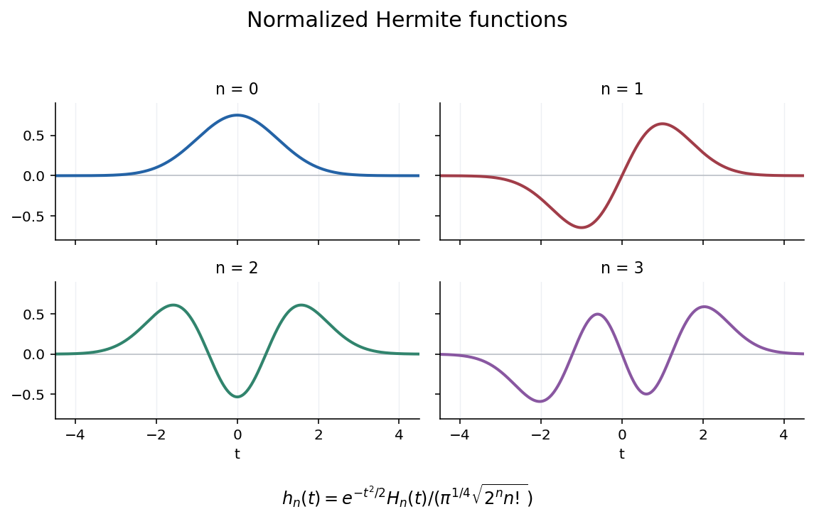

# 2007

↑ **Parent:** [Past exam of the analysis course of the University of Oxford](../past-exam-of-the-analysis-course-of-the-university-of-oxford.md)

**Table of contents**

- [A](#a)
  - [1](#a/1)
    - [Solution](#a/1/solution)
  - [2](#a/2)
    - [Solution](#a/2/solution)
  - [3](#a/3)
    - [Solution](#a/3/solution)
  - [4](#a/4)
    - [Solution](#a/4/solution)
- [B](#b)
  - [5](#b/5)
    - [a](#b/5/a)
      - [Solution](#b/5/a/solution)
    - [b](#b/5/b)
      - [i](#b/5/b/i)
        - [Solution](#b/5/b/i/solution)
      - [ii](#b/5/b/ii)
        - [Solution](#b/5/b/ii/solution)
      - [iii](#b/5/b/iii)
        - [Solution](#b/5/b/iii/solution)
      - [iv](#b/5/b/iv)
        - [Solution](#b/5/b/iv/solution)
  - [6](#b/6)
    - [a](#b/6/a)
      - [Solution](#b/6/a/solution)
    - [b](#b/6/b)
      - [Solution](#b/6/b/solution)
    - [c](#b/6/c)
      - [Solution](#b/6/c/solution)
  - [7](#b/7)
    - [Solution](#b/7/solution)
  - [8](#b/8)
    - [Solution](#b/8/solution)

## A

↑ **Parent:** [2007](2007.md)

<h3 id="a/1">1</h3>

↑ **Parent:** [A](#a)

<h4 id="a/1/solution">Solution</h4>

↑ **Parent:** [1](#a/1)

A [norm](../normed-vector-space.md#norm) on a [complex vector space](../vector-space.md#complex-vector-space) is a map $\|\cdot\|:X\to[0,\infty)$ that vanishes only at zero, satisfies $\|\lambda x\|=|\lambda|\|x\|$, and obeys the [triangle inequality](../topological-analysis.md#triangle-inequality). The space is Banach when every [Cauchy sequence](../sequence-and-series.md#cauchy-sequence) in the resulting [metric](../topological-analysis.md#metric) converges in $X$.

If $X$ is Banach and $\sum_j\|x_j\|<\infty$, the estimate $\|\sum_{j=m}^nx_j\|\leq\sum_{j=m}^n\|x_j\|$ shows that its [partial sums](../sequence-and-series.md#partial-sum) are Cauchy, hence converge. Conversely let every such [series](../sequence-and-series.md#series-mathematics) converge and take a [Cauchy sequence](../sequence-and-series.md#cauchy-sequence) $(y_n)$. Choose a subsequence with $\|y_{n_{k+1}}-y_{n_k}\|<2^{-k}$. The [series](../sequence-and-series.md#series-mathematics) consisting of $y_{n_1}$ followed by these successive differences is absolutely summable in [norm](../normed-vector-space.md#norm), so converges by hypothesis; its [partial sums](../sequence-and-series.md#partial-sum) are exactly this subsequence. A [Cauchy sequence](../sequence-and-series.md#cauchy-sequence) with a convergent subsequence converges to the same limit, proving **the [absolute-series criterion for completeness](../banach-space.md#absolute-series-criterion-for-completeness)**.

On the [absolutely summable sequence space](../banach-space.md#absolutely-summable-sequence-space) $\ell^1$, coordinatewise addition and scalar multiplication preserve membership, and summing the scalar [triangle inequality](../topological-analysis.md#triangle-inequality) verifies its [norm](../normed-vector-space.md#norm) axioms. To prove [completeness](../topological-analysis.md#completeness) using the criterion, let $x^{(k)}=(x_j^{(k)})\in\ell^1$ with $\sum_k\|x^{(k)}\|_1<\infty$. For each $j$ the sum $x_j=\sum_kx_j^{(k)}$ converges absolutely, and the permitted interchange of nonnegative double sums gives

$$
\sum_j|x_j|\leq\sum_j\sum_k|x_j^{(k)}|=\sum_k\|x^{(k)}\|_1<\infty.
$$

Thus $x\in\ell^1$. Moreover

$$
\left\|x-\sum_{k=1}^Nx^{(k)}\right\|_1\leq\sum_{k>N}\|x^{(k)}\|_1\to0.
$$

Every absolutely [norm](../normed-vector-space.md#norm)-summable [series](../sequence-and-series.md#series-mathematics) therefore converges in $\ell^1$, proving **$\ell^1$ is a [Banach space](../banach-space.md)**.

<h3 id="a/2">2</h3>

↑ **Parent:** [A](#a)

<h4 id="a/2/solution">Solution</h4>

↑ **Parent:** [2](#a/2)

The [continuous dual space](../continuous-dual-space.md) $X'$ consists of all bounded complex-linear [functionals](../calculus-of-variations.md#functional) $f:X\to\mathbb C$, with pointwise vector operations and [norm](../normed-vector-space.md#norm) $\|f\|=\sup_{\|x\|\leq1}|f(x)|$. This is finite by boundedness. The scalar [norm](../normed-vector-space.md#norm) identity and [triangle inequality](../topological-analysis.md#triangle-inequality) follow under the supremum; if the [norm](../normed-vector-space.md#norm) is zero, scaling every nonzero vector into the unit ball shows that $f$ vanishes. Hence $X'$ is a normed [complex vector space](../vector-space.md#complex-vector-space).

For the [dual of the convergent sequence space](../continuous-dual-space.md#dual-of-the-convergent-sequence-space), take $\beta\in\ell^1$. The displayed formula is a [bounded linear functional](../topological-vector-space.md#continuous-linear-functional), since the [series](../sequence-and-series.md#series-mathematics) is absolutely convergent and

$$
|\phi(\beta)(\alpha)|\leq\left(|\beta_1|+\sum_{j\geq1}|\beta_{j+1}|\right)\|\alpha\|_\infty.
$$

It is linear in $\beta$, so $\|\phi(\beta)\|\leq\|\beta\|_1$. For equality fix $N$, choose $\alpha_j$ for $j\leq N$ of modulus at most one so that $\alpha_j\beta_{j+1}=|\beta_{j+1}|$, and make all later terms equal a constant $c$ of modulus at most one with $c\beta_1=|\beta_1|$. The choices for a zero coefficient can be arbitrary. This sequence lies in the unit ball of $c$ and converges to $c$. The [reverse triangle inequality](../topological-analysis.md#reverse-triangle-inequality) gives

$$
|\phi(\beta)(\alpha)|\geq|\beta_1|+\sum_{j=1}^N|\beta_{j+1}|-\sum_{j>N}|\beta_{j+1}|.
$$

Letting $N\to\infty$ proves **$\|\phi(\beta)\|=\|\beta\|_1$**, including injectivity.

For surjectivity let $F\in c'$. By the permitted description of $c_0'$, there is $\gamma\in\ell^1$ with $F(z)=\sum_j\gamma_jz_j$ on $c_0$. Every $\alpha\in c$ decomposes as $\alpha-\alpha_\infty\mathbf1\in c_0$ plus $\alpha_\infty\mathbf1$. Consequently

$$
F(\alpha)=\sum_j\gamma_j\alpha_j+\alpha_\infty\left(F(\mathbf1)-\sum_j\gamma_j\right).
$$

Take $\beta_{j+1}=\gamma_j$ and $\beta_1=F(\mathbf1)-\sum_j\gamma_j$. This is an $\ell^1$ sequence and $F=\phi(\beta)$, proving **the stated isometric linear isomorphism onto $c'$**. No complex conjugation is inserted, since these are complex-linear dual [functionals](../calculus-of-variations.md#functional).

<h3 id="a/3">3</h3>

↑ **Parent:** [A](#a)

<h4 id="a/3/solution">Solution</h4>

↑ **Parent:** [3](#a/3)

The [complex Hahn-Banach theorem](../functional-analysis.md#complex-hahn-banach-theorem) extends every bounded complex-[linear functional](../dual-space.md#linear-functional) on a subspace to the whole normed space with exactly the same [norm](../normed-vector-space.md#norm). Let $d=\operatorname{dist}(x_0,M)>0$ and define on $M+\mathbb Cx_0$

$$
g_0(y+\lambda x_0)=\lambda d.
$$

The representation is unique. The distance inequality $\|y+\lambda x_0\|\geq|\lambda|d$ gives $\|g_0\|\leq1$. Taking $y=-m$ with $\|x_0-m\|\downarrow d$ proves the reverse [norm](../normed-vector-space.md#norm) bound. Extend by the [Hahn-Banach theorem](../functional-analysis.md#hahn-banach-theorem) to $g\in X'$; then **$g|_M=0$, $\|g\|=1$, and $g(x_0)=d\ne0$**. The labels (a)-(c) specify these simultaneous properties of this one functional.

Let $Y=\overline{\operatorname{span}F}$. Every functional vanishing on $F$ vanishes on $Y$ by linearity and continuity, so $Y\subseteq(F^\circ)_\circ$. If $x\notin Y$, the separation just proved gives a bounded functional zero on $Y$ and nonzero at $x$. It belongs to $F^\circ$ and excludes $x$ from its preannihilator. Therefore

$$
\boxed{(F^\circ)_\circ=\overline{\operatorname{span}F}.}
$$

For the dual-side counterexample take $X=\ell^1$, $X'=\ell^\infty$, and $G=c_0$. It is [norm](../normed-vector-space.md#norm) closed, since a uniform limit of sequences tending to zero still tends to zero. Every coordinate [unit vector](../vector-space.md#unit-vector) belongs to $G$, so the only $x\in\ell^1$ annihilated by every element of $G$ has all coordinates zero. Thus $G_\circ=\{0\}$ and

$$
\boxed{(G_\circ)^\circ=\ell^\infty\ne c_0=G.}
$$

The dual-side double annihilator corresponds to weak-star [closure](../topology.md#closure-topology), which need not equal [norm](../normed-vector-space.md#norm) [closure](../topology.md#closure-topology).

<h3 id="a/4">4</h3>

↑ **Parent:** [A](#a)

<h4 id="a/4/solution">Solution</h4>

↑ **Parent:** [4](#a/4)

The [spectrum of a bounded operator](../linear-operator-theory.md#spectrum-of-a-bounded-operator) consists of $\lambda$ for which $T-\lambda I$ has no bounded two-sided inverse. The [point spectrum](../linear-operator-theory.md#point-spectrum) consists of [eigenvalues](../linear-operator-theory.md#eigenvalue), so $\ker(T-\lambda I)\ne0$. The [approximate point spectrum](../banach-algebra.md#approximate-point-spectrum) consists of $\lambda$ admitting [unit vectors](../vector-space.md#unit-vector) $x_n$ with $\|(T-\lambda I)x_n\|\to0$; equivalently $T-\lambda I$ is not bounded below.

If $T-\lambda I$ is invertible, its inverse bounds it below and its [Banach-space adjoint](../continuous-dual-space.md#transpose-of-a-bounded-linear-operator) is invertible. Thus neither alternative on the right of the claimed union occurs. Conversely suppose $\lambda$ belongs to neither term and write $S=T-\lambda I$. There is $c>0$ with $\|Sx\|\geq c\|x\|$, so $S$ is injective and has closed range: convergence of $Sx_n$ makes $x_n$ Cauchy, and [completeness](../topological-analysis.md#completeness) supplies a preimage of its limit. Also $\ker S'=0$. The allowed annihilator identity makes the range dense, hence equal to $X$. Its inverse has [norm](../normed-vector-space.md#norm) at most $1/c$. This proves the [spectrum decomposition through the Banach-space adjoint](../banach-algebra.md#spectrum-decomposition-through-the-banach-space-adjoint):

$$
\boxed{\sigma(T)=\operatorname{ap}\sigma(T)\cup\operatorname p\sigma(T').}
$$

For the right shift on $\ell^1$, $\|T\|=1$, so the allowed [norm](../normed-vector-space.md#norm) bound puts its spectrum in the closed unit disc. Under the linear pairing with $\ell^\infty$, its [Banach-space adjoint](../continuous-dual-space.md#transpose-of-a-bounded-linear-operator) is the left shift $T'(b_1,b_2,\ldots)=(b_2,b_3,\ldots)$. For each $|\lambda|\leq1$ the bounded nonzero sequence $(1,\lambda,\lambda^2,\ldots)$ is an [eigenvector](../linear-operator-theory.md#eigenvector) of $T'$ with [eigenvalue](../linear-operator-theory.md#eigenvalue) $\lambda$. The union identity gives the reverse inclusion. Hence **$\sigma(T)=\{\lambda:|\lambda|\leq1\}$**. This [Banach-space adjoint](../continuous-dual-space.md#transpose-of-a-bounded-linear-operator) uses the complex-linear dual, so its [eigenvalue](../linear-operator-theory.md#eigenvalue) is $\lambda$ itself.

## B

↑ **Parent:** [2007](2007.md)

<h3 id="b/5">5</h3>

↑ **Parent:** [B](#b)

<h4 id="b/5/a">a</h4>

↑ **Parent:** [5](#b/5)

<h5 id="b/5/a/solution">Solution</h5>

↑ **Parent:** [A](#b/5/a)

Expand both squared [norms](../normed-vector-space.md#norm) using sesquilinearity and [conjugate symmetry](../linear-algebra.md#conjugate-symmetry). Their mixed terms $\langle u,v\rangle+\langle v,u\rangle$ appear with opposite signs and cancel. Hence

$$
\boxed{\|u+v\|^2+\|u-v\|^2=2\|u\|^2+2\|v\|^2,}
$$

the [parallelogram identity](../quadratic-form.md#parallelogram-law).

<h4 id="b/5/b">b</h4>

↑ **Parent:** [5](#b/5)

<h5 id="b/5/b/i">i</h5>

↑ **Parent:** [B](#b/5/b)

<h6 id="b/5/b/i/solution">Solution</h6>

↑ **Parent:** [I](#b/5/b/i)

Put $Q(u)=\|u\|^2$ and $B(u,w)=\tfrac14[Q(u+w)-Q(u-w)]$. Then $B(0,w)=0$ and the [parallelogram identity](../quadratic-form.md#parallelogram-law), applied to $u+w,v$ and to $u-w,v$ and subtracted, gives

$$
B(u+v,w)+B(u-v,w)=2B(u,w).
$$

Taking $v=u$ shows $B(2u,w)=2B(u,w)$. Replacing $u,v$ in the identity by $(u+v)/2,(u-v)/2$ now gives

$$
B(u,w)+B(v,w)=2B((u+v)/2,w)=B(u+v,w).
$$

The proposed complex pairing is $P(u,w)=B(u,w)+iB(u,iw)$. Applying these same identities with $w$ and $iw$ proves **both asserted midpoint and additivity equalities for $P$**.

<h5 id="b/5/b/ii">ii</h5>

↑ **Parent:** [B](#b/5/b)

<h6 id="b/5/b/ii/solution">Solution</h6>

↑ **Parent:** [Ii](#b/5/b/ii)

Repeated additivity gives $P(mu,v)=mP(u,v)$ for every positive integer $m$. Since $u$ is the sum of $n$ copies of $u/n$, $P(u/n,v)=P(u,v)/n$. Combining these proves

$$
\boxed{P((m/n)u,v)=(m/n)P(u,v).}
$$

The case $m=0$ also holds by additivity at zero.

<h5 id="b/5/b/iii">iii</h5>

↑ **Parent:** [B](#b/5/b)

<h6 id="b/5/b/iii/solution">Solution</h6>

↑ **Parent:** [Iii](#b/5/b/iii)

Additivity applied to $u+(-u)=0$ gives $P(-u,v)=-P(u,v)$. Multiplication by $i$ preserves the [norm](../normed-vector-space.md#norm), so

$$
B(iu,v)=-B(u,iv),\qquad B(iu,iv)=B(u,v).
$$

For example the first follows by multiplying $iu\pm v$ by $-i$ inside each [norm](../normed-vector-space.md#norm). Consequently

$$
P(iu,v)=-B(u,iv)+iB(u,v)=iP(u,v).
$$

This proves **the two required identities**, with the convention of linearity in the first argument.

<h5 id="b/5/b/iv">iv</h5>

↑ **Parent:** [B](#b/5/b)

<h6 id="b/5/b/iv/solution">Solution</h6>

↑ **Parent:** [Iv](#b/5/b/iv)

For a fixed second argument the [norm](../normed-vector-space.md#norm) formula makes $P$ continuous in its first argument. Rational homogeneity therefore extends to real homogeneity by rational approximation; additivity and $P(iu,v)=iP(u,v)$ then give full complex linearity in that argument.

The real pairing $B$ is symmetric, and $B(v,iu)=B(iu,v)=-B(u,iv)$. Hence $P(v,u)=\overline{P(u,v)}$, giving conjugate linearity in the second argument. Finally $B(u,u)=Q(u)$ and $B(u,iu)=0$, because $\|(1+i)u\|=\|(1-i)u\|$. Therefore

$$
\boxed{P(u,u)=\|u\|^2,}
$$

which is positive for $u\ne0$. This proves **$P$ is a complex [inner product](../inner-product.md) inducing exactly the original [norm](../normed-vector-space.md#norm)**. The assumed Banach [completeness](../topological-analysis.md#completeness) makes the resulting [inner product](../inner-product.md) space Hilbert. This is the [Jordan-von Neumann theorem](../quadratic-form.md#jordan-von-neumann-theorem).

<h3 id="b/6">6</h3>

↑ **Parent:** [B](#b)

<h4 id="b/6/a">a</h4>

↑ **Parent:** [6](#b/6)

<h5 id="b/6/a/solution">Solution</h5>

↑ **Parent:** [A](#b/6/a)

Differentiating the Rodrigues identity gives $H_0=1$ and $H_{n+1}=2tH_n-H_n'$. Induct with the proposed finite sum. The coefficient at $t^{n+1-2j}$ in this recurrence is the contribution from $2tH_n$ minus the derivative contribution with previous index $j-1$:

$$
\frac{n!(-1)^j2^{n+1-2j}}{j!(n-2j)!}-\frac{n!(-1)^{j-1}2^{n-2j+2}}{(j-1)!(n-2j+1)!}.
$$

Using a common denominator, this equals $(n+1)!(-1)^j2^{n+1-2j}/[j!(n+1-2j)!]$. At an endpoint omit terms whose factorial indices would be negative; the same formula then covers the sole remaining term. Thus

$$
\boxed{H_n(t)=n!\sum_{j=0}^{\lfloor n/2\rfloor}\frac{(-1)^j2^{n-2j}}{j!(n-2j)!}t^{n-2j}.}
$$

The initial value and recurrence identify these polynomials with the given Rodrigues definition.

<h4 id="b/6/b">b</h4>

↑ **Parent:** [6](#b/6)

<h5 id="b/6/b/solution">Solution</h5>

↑ **Parent:** [B](#b/6/b)

Substitute the finite formula and write $n=m+2j$. Under the allowed rearrangements,

$$
\sum_{n\geq0}\frac{H_n(t)z^n}{n!}=\sum_{m,j\geq0}\frac{(2tz)^m}{m!}\frac{(-z^2)^j}{j!}=e^{2tz}e^{-z^2}.
$$

Hence **$G(t,z)=e^{2tz-z^2}$**, with the normalization of the physicists' [Hermite polynomials](../orthogonal-polynomial.md#hermite-polynomial) used in the source.

<h4 id="b/6/c">c</h4>

↑ **Parent:** [6](#b/6)

<h5 id="b/6/c/solution">Solution</h5>

↑ **Parent:** [C](#b/6/c)

Complete the square to obtain, initially for real $y,z$,

$$
\int_{\mathbb R}e^{-t^2}G(t,y)G(t,z)dt=e^{-y^2-z^2}\int_{\mathbb R}e^{-t^2+2t(y+z)}dt=\sqrt\pi e^{2yz}.
$$

Compare coefficients of $y^mz^n$ on the two sides. The left coefficient is $(m!n!)^{-1}\int e^{-t^2}H_m(t)H_n(t)dt$, and the right is zero unless $m=n$, in which case it is $\sqrt\pi2^n/n!$. The polynomials are real on the real line, so these are the complex $L^2$ [inner products](../inner-product.md) of the $\phi_n$. Thus

$$
\boxed{\langle\phi_m,\phi_n\rangle=\delta_{mn}\sqrt\pi\,2^nn!,\qquad\|\phi_n\|_2=\pi^{1/4}\sqrt{2^nn!}.}
$$

Polynomial times Gaussian decay also directly shows each $\phi_n$ lies in $L^2$.

**[Figure 1](#b/6/c/image-normalized-hermite-functions-for-orders-zero-through-three). Normalized Hermite functions for orders zero through three**.

<h3 id="b/7">7</h3>

↑ **Parent:** [B](#b)

<h4 id="b/7/solution">Solution</h4>

↑ **Parent:** [7](#b/7)

The classical [Fourier partial sums](../fourier-series.md#fourier-partial-sum) are

$$
s_n^f(t)=\frac{a_0}2+\sum_{j=1}^n[a_j\cos jt+b_j\sin jt],\quad a_j=\frac1\pi\int_{-\pi}^\pi f(t)\cos jt\,dt,\quad b_j=\frac1\pi\int_{-\pi}^\pi f(t)\sin jt\,dt.
$$

Here $a_0=\pi^{-1}\int f$, and functions are extended periodically. One version of the [Dini test for Fourier series](../fourier-series.md#dini-test-for-fourier-series) states that if one-sided limits $L_+,L_-$ at $t$ exist and

$$
\int_0^\delta\frac{|f(t+s)+f(t-s)-L_+-L_-|}{s}\,ds<\infty,
$$

then $s_n^f(t)\to(L_++L_-)/2$. A [step function](../measure-theory.md#step-function) on a finite interval is constant on each side of any given point for sufficiently small distance, so its displayed numerator is zero there. [Dini test for Fourier series](../fourier-series.md#dini-test-for-fourier-series) gives exactly the asserted midpoint of the two one-sided values, including at jumps.

Let $P_n=s_n$ on $L^2$. It is the [orthogonal projection](../hilbert-space.md#orthogonal-projection) onto the span of the displayed trigonometric functions through frequency $n$, hence $\|P_n\|\leq1$. For a step-function approximation $\psi$,

$$
\|P_nf-f\|_2\leq\|P_n(f-\psi)\|_2+\|P_n\psi-\psi\|_2+\|\psi-f\|_2\leq2\|f-\psi\|_2+\|P_n\psi-\psi\|_2.
$$

The [convergence on a dense set under a uniform operator bound](../banach-space.md#banach-steinhaus-convergence-theorem), here applied using the allowed convergence for $\psi$ and density of [step functions](../measure-theory.md#step-function), proves **$P_nf\to f$ in $L^2$**. Consequently the union of these finite trigonometric spans is dense, which is precisely [completeness](../topological-analysis.md#completeness) of the [orthonormal system](../hilbert-space.md#orthonormal-sequence). It also proves Parseval's equality by passing to the limit in the Pythagorean projection identity.

For $f(t)=t^2$, oddness gives $b_j=0$, direct integration gives $a_0=2\pi^2/3$, and two integrations by parts give $a_j=4(-1)^j/j^2$. Thus

$$
\boxed{t^2=\frac{\pi^2}3+4\sum_{j\geq1}\frac{(-1)^j\cos jt}{j^2}.}
$$

[Dini test for Fourier series](../fourier-series.md#dini-test-for-fourier-series) justifies this pointwise on the interval, or absolute coefficient summability gives its continuous extension after the $L^2$ identification. At zero it yields **$\sum_{j\geq1}(-1)^{j-1}/j^2=\pi^2/12$**. Parseval gives

$$
\frac{2\pi^5}5=\int_{-\pi}^\pi t^4dt=\frac\pi2\left(\frac{2\pi^2}3\right)^2+16\pi\sum_{j\geq1}\frac1{j^4}.
$$

Therefore **$\sum_{j\geq1}j^{-4}=\pi^4/90$**.

<h3 id="b/8">8</h3>

↑ **Parent:** [B](#b)

<h4 id="b/8/solution">Solution</h4>

↑ **Parent:** [8](#b/8)

[Anti-self-adjoint](../functional-analysis.md#skew-adjoint-generator) means $T^*=-T$. Unitary means $T^*T=TT^*=I$, so $T^{-1}=T^*$. For a [unitary operator](../vector-space.md#unitary-operator) $\|Tu\|^2=\langle u,T^*Tu\rangle=\|u\|^2$, and the space is nonzero. Thus **$\|T\|=1$**.

The [series](../sequence-and-series.md#series-mathematics) for the exponential converges absolutely in the [Banach algebra](../banach-algebra.md) $B(V)$, since $\sum_n\|T^n/n!\|\leq e^{\|T\|}$. The adjoint is [norm](../normed-vector-space.md#norm) continuous and conjugate linear, and its action on these real scalar coefficients gives $(e^T)^*=e^{T^*}$. The absolutely convergent Cauchy product gives

$$
e^Te^{-T}=e^{-T}e^T=I,
$$

because its degree-$n$ coefficient for $n>0$ is $T^n\sum_{j=0}^n(-1)^j/[j!(n-j)!]=0$. If $T^*=-T$, these identities prove **$e^T$ is unitary**.

If $T$ is invertible, zero is outside the spectrum of $T^{-1}$. For $\mu\ne0$ the factorization

$$
T^{-1}-\mu I=-\mu T^{-1}(T-\mu^{-1}I)
$$

shows that the left side is invertible exactly when the final factor is. Hence

$$
\boxed{\sigma(T^{-1})=\{\lambda^{-1}:\lambda\in\sigma(T)\}.}
$$

For unitary $T$, both $T$ and $T^{-1}=T^*$ have [norm](../normed-vector-space.md#norm) one. The [norm](../normed-vector-space.md#norm) bound on each spectrum gives $|\lambda|\leq1$ and $|\lambda^{-1}|\leq1$, forcing **$\sigma(T)$ to lie on the unit circle**.

The converse fails: on $\mathbb C^2$ with its usual [inner product](../inner-product.md) take

$$
\boxed{T=\begin{pmatrix}1&1\\0&1\end{pmatrix}.}
$$

Its spectrum is $\{1\}$, but $T^*T=\begin{pmatrix}1&1\\1&2\end{pmatrix}\ne I$, so it is not unitary.

## ↑ Ancestors (9)

1. [Past exam of the analysis course of the University of Oxford](../past-exam-of-the-analysis-course-of-the-university-of-oxford.md)
2. [Analysis course of the University of Oxford](../university-of-oxford.md#analysis-course-of-the-university-of-oxford)
3. [Year 3 of the mathematics course of the University of Oxford](../university-of-oxford.md#year-3-of-the-mathematics-course-of-the-university-of-oxford)
4. [Mathematics course of the University of Oxford](../university-of-oxford.md#mathematics-course-of-the-university-of-oxford)
5. [Undergraduate course of the University of Oxford](../university-of-oxford.md#undergraduate-course-of-the-university-of-oxford)
6. [Course of the University of Oxford](../university-of-oxford.md#course-of-the-university-of-oxford)
7. [University of Oxford](../university-of-oxford.md)
8. [List of universities](../README.md#list-of-universities)
9. [Codex Wiki](../README.md)
