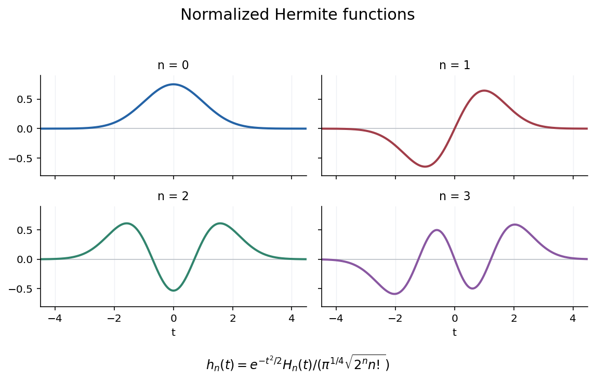

<h1 id="b/6/c/solution">Solution</h1>

↑ **Parent:** [C](../c.md)

Complete the square to obtain, initially for real $y,z$,

$$
\int_{\mathbb R}e^{-t^2}G(t,y)G(t,z)dt=e^{-y^2-z^2}\int_{\mathbb R}e^{-t^2+2t(y+z)}dt=\sqrt\pi e^{2yz}.
$$

Compare coefficients of $y^mz^n$ on the two sides. The left coefficient is $(m!n!)^{-1}\int e^{-t^2}H_m(t)H_n(t)dt$, and the right is zero unless $m=n$, in which case it is $\sqrt\pi2^n/n!$. The polynomials are real on the real line, so these are the complex $L^2$ [inner products](../../../../../inner-product-split.md) of the $\phi_n$. Thus

$$
\boxed{\langle\phi_m,\phi_n\rangle=\delta_{mn}\sqrt\pi\,2^nn!,\qquad\|\phi_n\|_2=\pi^{1/4}\sqrt{2^nn!}.}
$$

Polynomial times Gaussian decay also directly shows each $\phi_n$ lies in $L^2$.

**[Figure 1](#b/6/c/image-normalized-hermite-functions-for-orders-zero-through-three). Normalized Hermite functions for orders zero through three**.

## ↑ Ancestors (13)

1. [C](../c.md)
2. [6](../../6.md)
3. [B](../../../b.md)
4. [2007](../../../../2007-split.md)
5. [Past exam of the analysis course of the University of Oxford](../../../../split.md)
6. [Analysis course of the University of Oxford](../../../../../analysis-course-of-the-university-of-oxford.md)
7. [Year 3 of the mathematics course of the University of Oxford](../../../../../year-3-of-the-mathematics-course-of-the-university-of-oxford.md)
8. [Mathematics course of the University of Oxford](../../../../../mathematics-course-of-the-university-of-oxford.md)
9. [Undergraduate course of the University of Oxford](../../../../../undergraduate-course-of-the-university-of-oxford.md)
10. [Course of the University of Oxford](../../../../../course-of-the-university-of-oxford.md)
11. [University of Oxford](../../../../../university-of-oxford-split.md)
12. [List of universities](../../../../../list-of-universities.md)
13. [Codex Wiki](../../../../../split.md)
