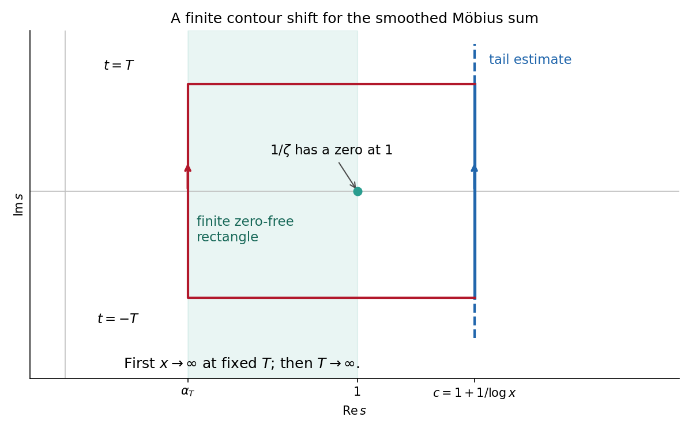

<h1 id="a/3/solution">Solution</h1>

↑ **Parent:** [3](../3.md)

Write $s=\sigma+it$; the source's rectangle notation $|\operatorname{Im}(t)|\leq T$ is interpreted as the intended height restriction $|t|\leq T$. We use the standard facts that $\zeta$ has no zeros on $\sigma\geq1$, has a [simple pole](../../../../simple-pole.md) at one, and is meromorphic with no other pole. The function $(s-1)\zeta(s)$ is [holomorphic function](../../../../holomorphic-function-split.md) and nonzero on the [compact set](../../../../compact-space.md) $\{1+it:|t|\leq T\}$, including its removable value one at $s=1$. It remains nonzero in a neighborhood of this [compact set](../../../../compact-space.md). Together with nonvanishing to its right this gives some $0<\alpha_T<1$ such that the whole closed rectangle $\alpha_T\leq\sigma\leq2$, $|t|\leq T$ contains no zeta zero. The pole at one is harmless: $1/\zeta$ extends holomorphically there with value zero.

The linearly smoothed Perron kernel, for $y>0$ and $c>0$, is

$$
\frac1{2\pi i}\int_{c-i\infty}^{c+i\infty}
\frac{y^{s+1}}{s(s+1)}\,ds
=\begin{cases}y-1,&y>1,\\0,&0<y\leq1.\end{cases}
$$

For $y>1$ shift the [contour](../../../../complex-integration-contour.md) left across the [simple poles](../../../../simple-pole.md) at zero and minus one, whose [residues](../../../../residue.md) are $y$ and $-1$. For $y<1$ shift right, crossing no pole. At $y=1$ the integral is zero, also obtained by direct integration of $1/s-1/(s+1)$. The quadratic denominator gives absolute integrability on the original vertical line.

For $c>1$ use the absolutely convergent [Dirichlet series](../../../../dirichlet-series.md) $1/\zeta(s)=\sum\mu(n)n^{-s}$. Interchanging the sum and the [contour integral](../../../../contour-integral.md) is justified by $\sum|\mu(n)|n^{-c}<\infty$ and the integrable denominator. The term for $n$ is $n$ times the kernel at $y=x/n$, hence $(x-n)$ when $n<x$ and zero otherwise. Consequently

$$
\boxed{M_1(x):=\sum_{n\leq x}\mu(n)(x-n)
=\frac1{2\pi i}\int_{c-i\infty}^{c+i\infty}
\frac{x^{s+1}}{\zeta(s)s(s+1)}\,ds.}
$$

Here is a [contour](../../../../complex-integration-contour.md) argument that needs only the stated bound, with no unproved uniform estimate left of one. Take $x>e$, $c=1+1/\log x$, and first hold $T\geq2$ fixed. On the two tails $|t|>T$, the given bound and $x^{c+1}=ex^2$ give

$$
\left|\text{tail contribution}\right|
\leq Cx^2\int_T^\infty\frac{\log^7(2+t)}{t^2}\,dt.
$$

Shift the remaining segment to $\sigma=\alpha_T$. The integrand is [holomorphic function](../../../../holomorphic-function-split.md) inside the rectangle: the zero of $1/\zeta$ at one cancels the apparent zeta pole, and $0,-1$ lie outside. On the fixed left side its integral is $O_T(x^{1+\alpha_T})=o_T(x^2)$. On the two horizontal sides, $1/(\zeta(s)s(s+1))$ is bounded by some finite constant depending on $T$. Therefore their integrals are bounded by

$$
C_T\int_{\alpha_T}^{c}x^{\sigma+1}\,d\sigma
\leq C_T\frac{x^{c+1}}{\log x}
=o_T(x^2).
$$

It follows that

$$
\limsup_{x\to\infty}\frac{|M_1(x)|}{x^2}
\leq C\int_T^\infty\frac{\log^7(2+t)}{t^2}\,dt.
$$

Now let $T\to\infty$; the integrable tail tends to zero. Thus

$$
\boxed{\sum_{n\leq x}\mu(n)(x-n)=o(x^2).}
$$

The order of limits matters: first $x\to\infty$ for each fixed rectangle, then $T\to\infty$. This is [linearly smoothed Möbius cancellation from finite zero-free rectangles](../../../../linearly-smoothed-mobius-cancellation-from-finite-zero-free-rectangles.md).

**[Figure 1](#a/3/image-shift-a-finite-central-perron-contour-while-bounding-the-two-infinite-tails-on-the-right). Shift a finite central Perron contour while bounding the two infinite tails on the right**.

## ↑ Ancestors (12)

1. [3](../3.md)
2. [A](../../a.md)
3. [2009](../../../2009-split.md)
4. [Past exam of the analytic number theory and elliptic curves course of the University of Oxford](../../../split.md)
5. [Analytic number theory and elliptic curves course of the University of Oxford](../../../../analytic-number-theory-and-elliptic-curves-course-of-the-university-of-oxford.md)
6. [Year 4 of the mathematics course of the University of Oxford](../../../../year-4-of-the-mathematics-course-of-the-university-of-oxford.md)
7. [Mathematics course of the University of Oxford](../../../../mathematics-course-of-the-university-of-oxford.md)
8. [Undergraduate course of the University of Oxford](../../../../undergraduate-course-of-the-university-of-oxford.md)
9. [Course of the University of Oxford](../../../../course-of-the-university-of-oxford.md)
10. [University of Oxford](../../../../university-of-oxford-split.md)
11. [List of universities](../../../../list-of-universities.md)
12. [Codex Wiki](../../../../split.md)
