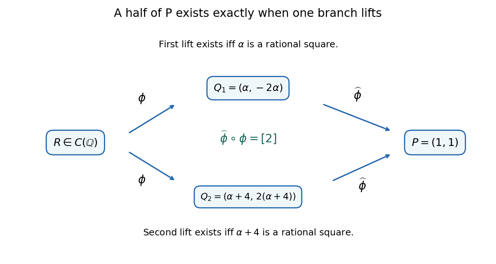

<h1 id="b/6/c/solution">Solution</h1>

↑ **Parent:** [C](../c.md)

Use the [two-isogeny formula](../../../../../two-isogeny-formula.md) formula with $a=\alpha$ and $b=-\alpha$. Its companion is

$$
D:v^2=u\bigl(u^2-2\alpha u+\alpha(\alpha+4)\bigr).
$$

Both curves are nonsingular because $\alpha\neq0,-4$. With $b'=\alpha(\alpha+4)$, choose

$$
\phi(x,y)=\left(x+\alpha-\frac{\alpha}{x},
y\left(1+\frac{\alpha}{x^2}\right)\right),
$$

$$
\widehat\phi(u,v)=
\left(\frac{u-2\alpha+b'/u}{4},
\frac{v(1-b'/u^2)}8\right).
$$

Each map extends across its exceptional affine points, and $\widehat\phi\phi=[2]$. On $D$, the first coordinate of the dual can also be written $v^2/(4u^2)$.

Let $P=(1,1)$ and solve $\widehat\phi(u,v)=P$. The first coordinate gives $v^2=4u^2$. Since $u\neq0$, the equation of $D$ then gives

$$
u^2-(2\alpha+4)u+\alpha(\alpha+4)=0
\quad\Longleftrightarrow\quad
(u-\alpha)(u-\alpha-4)=0.
$$

The second coordinate selects the signs. The two rational preimages are exactly

$$
Q_1=(\alpha,-2\alpha),\qquad
Q_2=(\alpha+4,2(\alpha+4)).
$$

Substituting into the dual formula checks that both map to $(1,1)$. Their coordinates are nonexceptional under the assumptions, and the degree-two map has no further preimages.

The [two-torsion square-class homomorphism](../../../../../two-torsion-square-class-homomorphism.md) $\alpha_D$ has kernel $\phi(C(\mathbb Q))$, and on these two points it is their nonzero $u$-coordinate modulo squares. Thus $Q_1$ is in the image of $\phi$ exactly when $\alpha$ is a rational square, and $Q_2$ is in that image exactly when $\alpha+4$ is a rational square.

If $P=2R$, then $\phi(R)$ is one of the two preimages, because $\widehat\phi\phi(R)=2R=P$. Conversely, if $Q_j=\phi(R)$, applying the dual shows $P=2R$. Therefore

$$
P\in2C(\mathbb Q)
\Longleftrightarrow
\alpha\in\mathbb Q^2\ \text{or}\ \alpha+4\in\mathbb Q^2.
$$

Finally, if an [integer](../../../../../integer-split.md) equals $(a/b)^2$ in lowest terms, then $b^2\mid a^2$ forces $b=1$. Thus rational squareness of these [integer](../../../../../integer-split.md) parameters is exactly [integer](../../../../../integer-split.md) squareness, and

$$
\boxed{(1,1)\in2C(\mathbb Q)
\iff\alpha\text{ or }\alpha+4\text{ is an integer square}.}
$$

This is the [two-isogeny halving criterion for the alpha family](../../../../../two-isogeny-halving-criterion-for-the-alpha-family.md).

**[Figure 2](#b/6/c/image-halving-the-point-is-equivalent-to-lifting-either-of-its-two-dual-isogeny-preimages). Halving the point is equivalent to lifting either of its two dual-isogeny preimages**.

## ↑ Ancestors (13)

1. [C](../c.md)
2. [6](../../6.md)
3. [B](../../../b.md)
4. [2009](../../../../2009-split.md)
5. [Past exam of the analytic number theory and elliptic curves course of the University of Oxford](../../../../split.md)
6. [Analytic number theory and elliptic curves course of the University of Oxford](../../../../../analytic-number-theory-and-elliptic-curves-course-of-the-university-of-oxford.md)
7. [Year 4 of the mathematics course of the University of Oxford](../../../../../year-4-of-the-mathematics-course-of-the-university-of-oxford.md)
8. [Mathematics course of the University of Oxford](../../../../../mathematics-course-of-the-university-of-oxford.md)
9. [Undergraduate course of the University of Oxford](../../../../../undergraduate-course-of-the-university-of-oxford.md)
10. [Course of the University of Oxford](../../../../../course-of-the-university-of-oxford.md)
11. [University of Oxford](../../../../../university-of-oxford-split.md)
12. [List of universities](../../../../../list-of-universities.md)
13. [Codex Wiki](../../../../../split.md)
