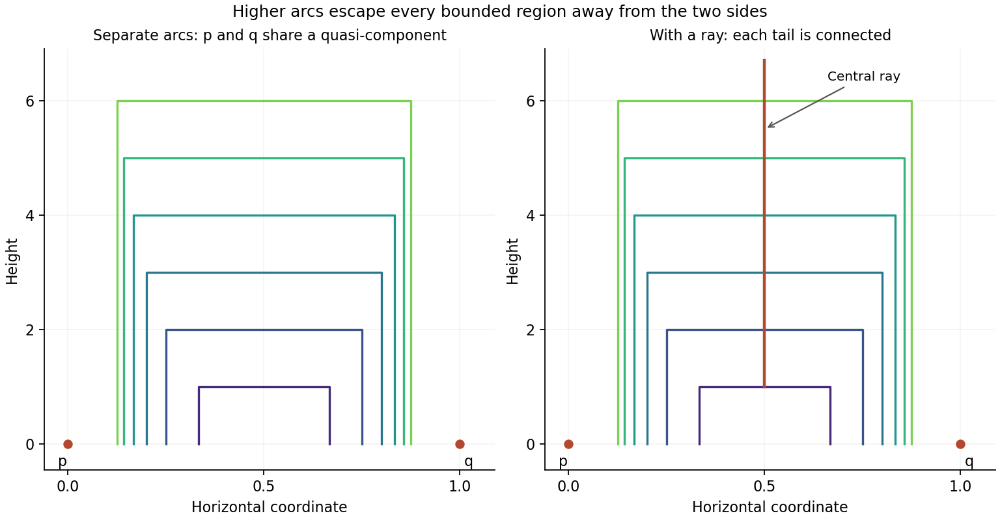

<h1 id="a/3/solution">Solution</h1>

↑ **Parent:** [3](../3.md)

The [open sets](../../../../open-set.md) $U$ and $X\setminus C_\lambda$ cover $X$. A finite subcover exists by [compactness](../../../../compact-space.md), and taking complements yields

$$
\boxed{\bigcap_{\lambda\in\Lambda_0}C_\lambda\subseteq U}
$$

for a finite index set. This is the [finite intersection characterization of compactness](../../../../finite-intersection-characterization-of-compactness.md) in a neighborhood form; the finite index set may be empty when $U=X$.

The [Šura-Bura lemma](../../../../sura-bura-lemma.md) states that in a [compact Hausdorff space](../../../../compact-hausdorff-space.md) the [connected component](../../../../connected-component.md) $C(x)$ of a point equals its [quasi-component](../../../../quasi-component.md), the [intersection](../../../../set-intersection.md) of all [clopen](../../../../clopen-set.md) neighborhoods of that point. It also follows that each component has a neighborhood basis of [clopen](../../../../clopen-set.md) sets. Here is a proof of both assertions.

Let $Q$ be the [intersection](../../../../set-intersection.md) of the [clopen](../../../../clopen-set.md) neighborhoods of $x$. Every [connected set](../../../../connected-set.md) containing $x$ lies in each such neighborhood, so $C(x)\subseteq Q$. The set $Q$ is closed and [compact](../../../../compact-space.md). If $Q$ were disconnected, write it as the disjoint [union](../../../../set-union.md) of nonempty relatively [closed sets](../../../../closed-set.md) $A,B$, choosing $x\in A$. Both are [compact](../../../../compact-space.md) and closed in $X$. Normality gives disjoint [open sets](../../../../open-set.md) $O_A,O_B$ containing them. By the finite-intersection result, a finite [intersection](../../../../set-intersection.md) $V$ of [clopen](../../../../clopen-set.md) neighborhoods of $x$ satisfies $Q\subseteq V\subseteq O_A\cup O_B$. Then $V\cap O_A$ is [clopen](../../../../clopen-set.md) in $V$, hence [clopen](../../../../clopen-set.md) in $X$, and contains $x$ while excluding $B$. This contradicts the definition of $Q$. Thus $Q$ is [connected](../../../../connected-space.md) and equals $C(x)$. Given any [open neighborhood](../../../../open-neighbourhood.md) of the component, the same finite-intersection argument supplies a [clopen](../../../../clopen-set.md) neighborhood inside it. This proves the neighborhood-basis form as well.

For an explicit [noncompact counterexample to the Šura-Bura lemma](../../../../noncompact-counterexample-to-the-sura-bura-lemma.md), put $p=(0,0)$, $q=(1,0)$, and $\varepsilon_m=1/(m+2)$ for $m\geq1$. Let $A_m$ be the polygonal arc with successive vertices

$$
(\varepsilon_m,0),\quad(\varepsilon_m,m),\quad(1-\varepsilon_m,m),\quad(1-\varepsilon_m,0),
$$

and give $Z=\{p,q\}\cup\bigcup_{m\geq1}A_m$ its [subspace topology](../../../../subspace-topology.md) from the plane. The arcs are pairwise disjoint: a higher arc has its vertical sides outside the horizontal span of any lower arc. Each $A_m$ is [compact](../../../../compact-space.md) and relatively open in $Z$, so is [clopen](../../../../clopen-set.md). For relative openness, all sufficiently high arcs have vertical sides close to $x=0,1$ and horizontal sides above a fixed bounded neighborhood of $A_m$; the remaining finitely many [compact](../../../../compact-space.md) disjoint arcs have positive distance from it.

A [connected](../../../../connected-space.md) subset containing $p$ cannot meet any of these [clopen](../../../../clopen-set.md) arcs, so it lies in $\{p,q\}$ and is just $\{p\}$. But any [clopen](../../../../clopen-set.md) neighborhood of $p$ contains the left endpoints of all sufficiently high arcs. [Connectedness](../../../../connected-space.md) of each arc forces the entire arc into that neighborhood, and closedness then forces the limit $q$ of their right endpoints into it. Conversely the [clopen](../../../../clopen-set.md) set $Z\setminus A_m$ excludes every point of $A_m$. Therefore

$$
\boxed{C_Z(p)=\{p\},\qquad Q_Z(p)=\{p,q\}.}
$$

The [compact](../../../../compact-space.md) set containing the endpoints has lost the connection supplied by arcs escaping to arbitrarily large height; [compactness](../../../../compact-space.md) of the ambient space is essential to the lemma.

Now let $D=\bigcap_n C_n$ for the decreasing [compact](../../../../compact-space.md) [connected sets](../../../../connected-set.md) in the [compact](../../../../compact-space.md) [Hausdorff](../../../../hausdorff-space.md) setting. Every finite [intersection](../../../../set-intersection.md) is one of the nonempty $C_n$, so the [finite intersection property](../../../../finite-intersection-property.md) gives $D\ne\varnothing$. It is closed and hence [compact](../../../../compact-space.md). If it were disconnected, its two nonempty [compact](../../../../compact-space.md) pieces would have disjoint [open neighborhoods](../../../../open-neighbourhood.md) $U,V$ in $X$. Since $D\subseteq U\cup V$, the initial finite-intersection result and the decreasing property give $C_N\subseteq U\cup V$ for some $N$. This set meets both neighborhoods because it contains $D$, contradicting its [connectedness](../../../../connected-space.md). Thus

$$
\boxed{D\text{ is nonempty, compact, and connected}.}
$$

The argument does not need [connectedness](../../../../connected-space.md) of the whole ambient space.

For the requested failure without ambient [compactness](../../../../compact-space.md), add the central ray $L=\{(1/2,t):t\geq1\}$ to the previous example and put $X=Z\cup L$. For $n\geq1$ define

$$
\boxed{C_n=\{p,q\}\cup\bigcup_{m\geq n}A_m\cup\{(1/2,t):t\geq n\}.}
$$

Each graph formed by the displayed arcs and ray is [connected](../../../../connected-space.md): each arc meets the ray at its top. Adding $p,q$, which are limit points of the graph, preserves [connectedness](../../../../connected-space.md) because the [closure](../../../../closure-topology.md) of a [connected set](../../../../connected-set.md) is [connected](../../../../connected-space.md). Its relative [closure](../../../../closure-topology.md) in $X$ adds exactly these two points, so $C_n$ is closed in $X$. To check that no omitted point is a further limit, a bounded neighborhood away from the lines $x=0,1$ meets only finitely many arcs; the deleted initial arcs are disjoint [compact](../../../../compact-space.md) sets, and the deleted ray segment lies strictly below the remaining ray. All other planar limit points on $x=0,1$ are outside $X$.

The sets are decreasing and nonempty, and $X=C_1$ is [connected](../../../../connected-space.md) and [Hausdorff](../../../../hausdorff-space.md). Every individual arc and every point of finite height on the ray disappears from sufficiently late sets. Consequently

$$
\boxed{\bigcap_{n\geq1}C_n=\{p,q\},}
$$

a nonempty [compact](../../../../compact-space.md) disconnected set. Reindexing by $n+1$ gives the source's indexing by $\omega$. The graph is unbounded, so the ambient subspace is not [compact](../../../../compact-space.md). This is an explicit [decreasing closed connected sets with disconnected compact intersection](../../../../decreasing-closed-connected-sets-with-disconnected-compact-intersection.md) example.

**[Figure 1](#a/3/image-arcs-escaping-to-infinity-distinct-components-in-the-left-space-and-connected-tails-in-the-right-space). Arcs escaping to infinity: distinct components in the left space and connected tails in the right space**.

## ↑ Ancestors (12)

1. [3](../3.md)
2. [A](../../a.md)
3. [2010](../../../2010-split.md)
4. [Past exam of the analytic topology and axiomatic set theory course of the University of Oxford](../../../split.md)
5. [Analytic topology and axiomatic set theory course of the University of Oxford](../../../../analytic-topology-and-axiomatic-set-theory-course-of-the-university-of-oxford.md)
6. [Year 4 of the mathematics course of the University of Oxford](../../../../year-4-of-the-mathematics-course-of-the-university-of-oxford.md)
7. [Mathematics course of the University of Oxford](../../../../mathematics-course-of-the-university-of-oxford.md)
8. [Undergraduate course of the University of Oxford](../../../../undergraduate-course-of-the-university-of-oxford.md)
9. [Course of the University of Oxford](../../../../course-of-the-university-of-oxford.md)
10. [University of Oxford](../../../../university-of-oxford-split.md)
11. [List of universities](../../../../list-of-universities.md)
12. [Codex Wiki](../../../../split.md)
