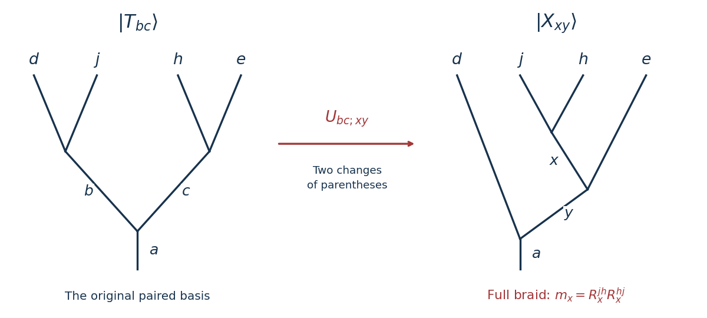

# 2025

↑ **Parent:** [Past exam of the anyons and topological quantum field theories course of the University of Oxford](../past-exam-of-the-anyons-and-topological-quantum-field-theories-course-of-the-university-of-oxford.md)

Source PDF: [https://mmathphys.physics.ox.ac.uk/sites/g/files/vzsiac2991/files/mmathphys/documents/media/a18926h1.pdf](https://mmathphys.physics.ox.ac.uk/sites/g/files/vzsiac2991/files/mmathphys/documents/media/a18926h1.pdf)

These solutions use the source paper's crossing convention for [anyon R-matrices](../topological-quantum-matter.md#anyon-r-matrix), its [physics normalization of anyon diagrams](../topological-quantum-matter.md#physics-normalization-of-anyon-diagrams) in Question 1, and its [isotopy normalization of anyon diagrams](../topological-quantum-matter.md#isotopy-normalization-of-anyon-diagrams) in Question 2. In particular, its [normalized Kirby color](../knot-theory.md#normalized-kirby-color) is $\Omega=\mathcal D^{-1}\sum_a d_a a$.

TODO: establish the year coverage of the lecturer's prior-exam solutions collection: [https://www-thphys.physics.ox.ac.uk/people/SteveSimon/topological2026/topological2026.html.](https://www-thphys.physics.ox.ac.uk/people/SteveSimon/topological2026/topological2026.html.)

**Table of contents**

- [1](#1)
  - [a](#1/a)
    - [Solution](#1/a/solution)
  - [b](#1/b)
    - [Solution](#1/b/solution)
  - [c](#1/c)
    - [Solution](#1/c/solution)
  - [d](#1/d)
    - [Solution](#1/d/solution)
- [2](#2)
  - [a](#2/a)
    - [Solution](#2/a/solution)
  - [b](#2/b)
    - [Solution](#2/b/solution)
  - [c](#2/c)
    - [Solution](#2/c/solution)
  - [d](#2/d)
    - [Solution](#2/d/solution)

## 1

↑ **Parent:** [2025](2025.md)

<h3 id="1/a">a</h3>

↑ **Parent:** [1](#1)

<h4 id="1/a/solution">Solution</h4>

↑ **Parent:** [A](#1/a)

Read the arrows upwards through the central part of the diagram. The lower [anyon fusion tree](../topological-quantum-matter.md#anyon-fusion-tree) first splits $a$ into $b,c$, then $b$ into $d,j$ and $c$ into $h,e$. The upper [anyon fusion tree](../topological-quantum-matter.md#anyon-fusion-tree) combines $d,j$ into $f$, $h,e$ into $g$, and finally $f,g$ into $a$. The two interior crossings are not vertices. Thus admissibility requires the six [anyon fusion multiplicities](../topological-quantum-matter.md#anyon-fusion-multiplicity)

$$
N^a_{bc}N^b_{dj}N^c_{he}N^f_{dj}N^g_{he}N^a_{fg}=1.
$$

If any factor vanishes, the diagram has zero value.

Make an [anyon vertex gauge transformation](../topological-quantum-matter.md#anyon-vertex-gauge-transformation) by multiplying each splitting vertex $z\to x,y$ by an independent [wave phase](../wave.md#phase-waves) $u^{xy}_z$ and its adjoint fusion vertex by $(u^{xy}_z)^{-1}$. The diagram changes by

$$
G=\frac{u^{bc}_a u^{dj}_b u^{he}_c}{u^{fg}_a u^{dj}_f u^{he}_g}.
$$

Therefore the label-matching condition for cancellation of all [anyon vertex gauge transformation](../topological-quantum-matter.md#anyon-vertex-gauge-transformation) factors is

$$
\boxed{b=f,\qquad c=g,}
$$

with $a,d,e,h,j$ otherwise unrestricted apart from the [anyon fusion rules](../topological-quantum-matter.md#anyon-fusion-rule). This statement also allows coincident labels: the three ordered vertex triples in the numerator must equal those in the denominator as multisets; matching the triples in any of the six possible orders still forces $b=f,c=g$. Conversely, these equalities visibly give $G=1$.

Closure of the drawing alone does not guarantee invariance under an [anyon vertex gauge transformation](../topological-quantum-matter.md#anyon-vertex-gauge-transformation): unmatched fusion and splitting vertices retain their independently chosen basis phases. A zero value is, of course, invariant regardless of phases; the boxed condition describes cancellation of the vertex factors themselves.

<h3 id="1/b">b</h3>

↑ **Parent:** [1](#1)

<h4 id="1/b/solution">Solution</h4>

↑ **Parent:** [B](#1/b)

Write $c_{u,v}$ for [braiding](../category-theory.md#braiding) and $M_{u,v}=c_{v,u}c_{u,v}$ for [anyon monodromy](../topological-quantum-matter.md#anyon-monodromy). Transparency says $M_{a,x}=1$ for every $x$. The [hexagon identities for braiding](../category-theory.md#hexagon-identity-for-braiding) express [braiding](../category-theory.md#braiding) a composite $a\otimes b$ past $x$ as successive [braidings](../category-theory.md#braiding) of its two factors past $x$. If $a,b$ are both [transparent anyons](../topological-quantum-matter.md#transparent-anyon), move $x$ around $b$ and then around $a$; both full moves are identities, hence

$$
M_{a\otimes b,x}=1.
$$

This is the [fusion closure of transparent anyons](../topological-quantum-matter.md#fusion-closure-of-transparent-anyons) at the level of the composite object.

For completeness, let $i:c\to a\otimes b$ and $p:a\otimes b\to c$ be an inclusion and projection for an allowed [anyon fusion](../topological-quantum-matter.md#anyon-fusion-rule) summand, with $pi=1_c$. Naturality of [braiding](../category-theory.md#braiding) gives

$$
M_{c,x}=(p\otimes1_x)M_{a\otimes b,x}(i\otimes1_x)=1_{c\otimes x}.
$$

Thus

$$
\boxed{a,b\text{ transparent and }N^c_{ab}>0\quad\Longrightarrow\quad c\text{ transparent}.}
$$

The [vacuum anyon](../topological-quantum-matter.md#vacuum-anyon) belongs to this collection, and taking duals preserves transparency, so it is also closed under [antianyons](../topological-quantum-matter.md#antianyon).

There is a further restriction on the [spin of a transparent anyon](../topological-quantum-matter.md#spin-of-a-transparent-anyon). Apply the [anyon balancing identity](../topological-quantum-matter.md#anyon-balancing-identity) to the [vacuum anyon](../topological-quantum-matter.md#vacuum-anyon) channel of $a\times\bar a$:

$$
1=R^{a\bar a}_1R^{\bar a a}_1=\frac{\theta_1}{\theta_a\theta_{\bar a}}=\frac1{\theta_a^2}.
$$

Here ribbon duality gives $\theta_{\bar a}=\theta_a$ and $\theta_1=1$. Consequently

$$
\boxed{\theta_a=+1\ \text{or}\ -1.}
$$

Their [topological spins](../topological-quantum-matter.md#topological-spin) are those of [bosons](../tensor-product-of-quantum-systems.md#boson) or [fermions](../tensor-product-of-quantum-systems.md#fermion). This does not imply $d_a=1$: a [transparent anyon](../topological-quantum-matter.md#transparent-anyon) can have several [anyon fusion](../topological-quantum-matter.md#anyon-fusion-rule) channels, with nontrivial exchange action within them, even though every full [anyon monodromy](../topological-quantum-matter.md#anyon-monodromy) is trivial. If the theory is additionally a [modular tensor category](../category-theory.md#modular-tensor-category), the only [transparent anyon](../topological-quantum-matter.md#transparent-anyon) is the [vacuum anyon](../topological-quantum-matter.md#vacuum-anyon); Question 1 need not impose that extra hypothesis.

<h3 id="1/c">c</h3>

↑ **Parent:** [1](#1)

<h4 id="1/c/solution">Solution</h4>

↑ **Parent:** [C](#1/c)

The two crossings of $j,h$ make their full [anyon monodromy](../topological-quantum-matter.md#anyon-monodromy). For a [transparent anyon](../topological-quantum-matter.md#transparent-anyon) $h$, this is the identity, so that pair of crossings can be removed together. No single-crossing exchange phase, and no [topological spin](../topological-quantum-matter.md#topological-spin) from a twist, is introduced.

After this removal the upper and lower [anyon fusion trees](../topological-quantum-matter.md#anyon-fusion-tree) differ only in their intermediate labels. In the [physics normalization of anyon diagrams](../topological-quantum-matter.md#physics-normalization-of-anyon-diagrams), successive split-fuse bubbles give the [Kronecker deltas](../multilinear-algebra.md#kronecker-delta) $\delta_{bf}$ and $\delta_{cg}$. The remaining closed normalized state has norm one. Hence, for the admissible labelings of [a](#1/a),

$$
\boxed{\mathcal A_{bc;fg}=\delta_{bf}\delta_{cg}.}
$$

In particular, every admissible diagram satisfying the label matching in [a](#1/a) evaluates to $1$. There is no factor $d_a$ here: the source explicitly permits the [physics normalization of anyon diagrams](../topological-quantum-matter.md#physics-normalization-of-anyon-diagrams), in which a closed normalized state has value $1$.

<h3 id="1/d">d</h3>

↑ **Parent:** [1](#1)

<h4 id="1/d/solution">Solution</h4>

↑ **Parent:** [D](#1/d)

Use an [anyon fusion tree](../topological-quantum-matter.md#anyon-fusion-tree) in which the two crossing charges combine first. With external charges in the order $d,j,h,e$, define the normalized trees

$$
|T_{bc}\rangle=|((d j)_b(h e)_c)_a\rangle,\qquad
|X_{xy}\rangle=|(d((j h)_x e)_y)_a\rangle.
$$

The desired value is the matrix element of [anyon monodromy](../topological-quantum-matter.md#anyon-monodromy) between $|T_{bc}\rangle$ and $|T_{fg}\rangle$. Their closure is understood in the [physics normalization of anyon diagrams](../topological-quantum-matter.md#physics-normalization-of-anyon-diagrams).

First apply the [anyon F-matrix](../topological-quantum-matter.md#anyon-f-matrix) to the three charges $d,j,c$, and then an inverse [anyon F-matrix](../topological-quantum-matter.md#anyon-f-matrix) to $j,h,e$. With the source convention $|((uv)_r w)_t\rangle=\sum_s[F^{uvw}_t]_{rs}|(u(vw)_s)_t\rangle$, this gives

$$
|T_{bc}\rangle=\sum_{x,y}U_{bc;xy}|X_{xy}\rangle,\qquad
U_{bc;xy}=[F^{djc}_a]_{by}\,[F^{jhe}_y]^*_{xc}.
$$

Only allowed [anyon fusion](../topological-quantum-matter.md#anyon-fusion-rule) channels enter the sums: in the second tree these require $N^x_{jh}N^y_{xe}N^a_{dy}=1$. The complex conjugate in $U$ comes from the inverse change of parentheses, not from reversing a crossing.

**[Figure 1](#1/d/image-recoupling-exposes-the-inner-pair-on-which-the-full-braid-acts-diagonally). Recoupling exposes the inner pair on which the full braid acts diagonally**.

Reading the actual overcrossings from bottom to top gives two positive exchanges in the source's [anyon R-matrix](../topological-quantum-matter.md#anyon-r-matrix) convention. Their product is

$$
m_x=R^{jh}_xR^{hj}_x.
$$

The order of $h,j$ is restored after the second exchange. In the $X$ basis this [anyon monodromy](../topological-quantum-matter.md#anyon-monodromy) is diagonal, so

$$
\boxed{\mathcal A_{bc;fg}=\sum_{x,y}U_{bc;xy}\,R^{jh}_xR^{hj}_x\,U^*_{fg;xy}.}
$$

Equivalently, entirely in terms of [anyon F-matrices](../topological-quantum-matter.md#anyon-f-matrix) and [anyon R-matrices](../topological-quantum-matter.md#anyon-r-matrix),

$$
\boxed{\mathcal A_{bc;fg}=\sum_{x,y}[F^{djc}_a]_{by}[F^{jhe}_y]^*_{xc}\,R^{jh}_xR^{hj}_x\,[F^{djg}_a]^*_{fy}[F^{jhe}_y]_{xg}.}
$$

This expression is also meaningful for $b\ne f$ or $c\ne g$: it then carries the unmatched [anyon vertex gauge transformation](../topological-quantum-matter.md#anyon-vertex-gauge-transformation) factors identified in [a](#1/a).

To check the transparent limit, put $m_x=1$ in every allowed channel. The [unitary matrix](../linear-operator-theory.md#unitary-matrix) identity for $F^{jhe}_y$ first gives

$$
\sum_x[F^{jhe}_y]^*_{xc}[F^{jhe}_y]_{xg}=\delta_{cg}.
$$

Once $c=g$, the [unitary matrix](../linear-operator-theory.md#unitary-matrix) identity for $F^{djc}_a$ gives

$$
\mathcal A_{bc;fg}=\delta_{cg}\sum_y[F^{djc}_a]_{by}[F^{djc}_a]^*_{fy}=\boxed{\delta_{cg}\delta_{bf}},
$$

as in [c](#1/c). The same cancellation proves that the recoupling expression is an identity operator whenever the full [anyon monodromy](../topological-quantum-matter.md#anyon-monodromy) is trivial, including when the individual exchanges have fermionic signs.

## 2

↑ **Parent:** [2025](2025.md)

<h3 id="2/a">a</h3>

↑ **Parent:** [2](#2)

<h4 id="2/a/solution">Solution</h4>

↑ **Parent:** [A](#2/a)

Cut one nonseparating circle on each handle of the closed [orientable surface](../differential-geometry.md#orientable-surface) $\Sigma_g$ of [genus](../topological-surface.md#genus-of-a-surface) $g$. The cut surface is a [sphere](../euclidean-geometry.md#sphere) with $2g$ boundary circles. Gluing a pair back together requires an [anyon](../topological-quantum-matter.md#anyon) label $a_i$ on one boundary and the [antianyon](../topological-quantum-matter.md#antianyon) label $\bar a_i$ on the oppositely oriented boundary. Sum over these labels independently for the $g$ handles.

For a fixed labeling, the [dimension](../vector-space.md#dimension-vector-space) of the resulting [anyon fusion space](../topological-quantum-matter.md#anyon-fusion-space) on the [sphere](../euclidean-geometry.md#sphere), with total [vacuum anyon](../topological-quantum-matter.md#vacuum-anyon) charge, is

$$
\left[N_{a_1}N_{\bar a_1}\cdots N_{a_g}N_{\bar a_g}\right]_{11}.
$$

The gluing rule of the [topological quantum field theory](../quantum-field-theory.md#topological-quantum-field-theory) therefore gives the [handle-cut formula for anyon ground-state degeneracy](../category-theory.md#handle-cut-formula-for-anyon-ground-state-degeneracy):

$$
\boxed{\operatorname{GSD}(\Sigma_g)=\sum_{a_1,\ldots,a_g}\left[N_{a_1}N_{\bar a_1}\cdots N_{a_g}N_{\bar a_g}\right]_{11}=\left[\left(\sum_aN_aN_{\bar a}\right)^g\right]_{11}.}
$$

Here $1$ denotes the [vacuum anyon](../topological-quantum-matter.md#vacuum-anyon), and the [anyon fusion matrices](../topological-quantum-matter.md#anyon-fusion-matrix) have entries $(N_b)_{ac}=N^c_{ab}$, as in the source. At $g=0$, the empty product is the identity [matrix](../vector-space.md#matrix), giving one [ground state](../quantum-mechanics.md#ground-state). At $g=1$, $(N_aN_{\bar a})_{11}=1$ for each simple charge, so the [ground-state degeneracy](../quantum-mechanics.md#ground-state-degeneracy) of the [torus](../topological-surface.md#torus) is the number of [anyon](../topological-quantum-matter.md#anyon) types.

<h3 id="2/b">b</h3>

↑ **Parent:** [2](#2)

<h4 id="2/b/solution">Solution</h4>

↑ **Parent:** [B](#2/b)

Put $K=\sum_aN_aN_{\bar a}$. The [Verlinde formula](../category-theory.md#verlinde-formula) diagonalizes every [anyon fusion matrix](../topological-quantum-matter.md#anyon-fusion-matrix) using the same [modular S-matrix](../category-theory.md#modular-s-matrix):

$$
N_a=S\,\operatorname{diag}_x\left(\frac{S_{ax}}{S_{1x}}\right)S^\dagger.
$$

Because $S_{\bar a x}=S_{ax}^*$, the [eigenvalue](../linear-operator-theory.md#eigenvalue) of $K$ in column $x$ is

$$
\kappa_x=\sum_a\frac{S_{ax}S_{\bar a x}}{S_{1x}^2}=\frac{\sum_a|S_{ax}|^2}{S_{1x}^2}=\frac1{S_{1x}^2}.
$$

The last equality uses [unitary matrix](../linear-operator-theory.md#unitary-matrix) orthogonality. Therefore

$$
(K^g)_{11}=\sum_x|S_{1x}|^2\kappa_x^g=\sum_xS_{1x}^{2-2g}.
$$

Finally, insert $S_{1x}=d_x/\mathcal D$, where $d_x$ is the [quantum dimension](../category-theory.md#quantum-dimension) and $\mathcal D^2=\sum_xd_x^2$ is the squared [total quantum dimension](../category-theory.md#total-quantum-dimension):

$$
\boxed{\operatorname{GSD}(\Sigma_g)=\mathcal D^{2g-2}\sum_xd_x^{2-2g}=\left(\sum_xd_x^2\right)^{g-1}\sum_xd_x^{2-2g}.}
$$

Although only [quantum dimensions](../category-theory.md#quantum-dimension) remain, the result is an integer because [a](#2/a) counts an [anyon fusion space](../topological-quantum-matter.md#anyon-fusion-space).

The [sphere](../euclidean-geometry.md#sphere) value is $\mathcal D^{-2}\sum_xd_x^2=1$, and the [torus](../topological-surface.md#torus) value is $\sum_x1$. If all $n$ simple [anyons](../topological-quantum-matter.md#anyon) have [quantum dimension](../category-theory.md#quantum-dimension) one, the answer is $n^g$, agreeing with the Abelian handle count. These checks also fix the exponent $2g-2$.

<h3 id="2/c">c</h3>

↑ **Parent:** [2](#2)

<h4 id="2/c/solution">Solution</h4>

↑ **Parent:** [C](#2/c)

Let $B^{ab}_c$ denote the split-fuse diagram with a charge-$c$ edge joining the lower fusion vertex to the upper splitting vertex, and outer strands $a,b$. Completeness in the [isotopy normalization of anyon diagrams](../topological-quantum-matter.md#isotopy-normalization-of-anyon-diagrams) reads

$$
1_{a\otimes b}=\sum_c\sqrt{\frac{d_c}{d_ad_b}}\,B^{ab}_c.
$$

Resolve the two strands inside the encircling [normalized Kirby color](../knot-theory.md#normalized-kirby-color) loop in this way. Move that loop onto the intermediate charge-$c$ edge. The [Kirby killing property](../knot-theory.md#kirby-killing-property) multiplies it by $\mathcal D\delta_{c1}$, leaving

$$
K_\Omega(a,b)=\mathcal D\sqrt{\frac{d_1}{d_ad_b}}\,B^{ab}_1.
$$

The [vacuum anyon](../topological-quantum-matter.md#vacuum-anyon) channel is allowed only for $b=\bar a$, and then $d_b=d_a$ and $d_1=1$. Erasing the vacuum edge turns $B^{a\bar a}_1$ into the cup-cap diagram $E_a$, which connects the incoming pair by a cap and the outgoing pair by a cup. Thus the requested [two-strand Kirby projector](../knot-theory.md#two-strand-kirby-projector) is

$$
\boxed{K_\Omega(a,b)=\delta_{b,\bar a}\frac{\mathcal D}{d_a}\,E_a=\mathcal D P^{ab}_1.}
$$

Here $P^{a\bar a}_1=E_a/d_a$ is the [orthogonal projection](../hilbert-space.md#orthogonal-projection) onto total [vacuum anyon](../topological-quantum-matter.md#vacuum-anyon) charge; for $b\ne\bar a$ it is zero. Both strands in the source point upwards, so the condition is $b=\bar a$, not $b=a$ unless $a$ is self-dual.

The coefficient can be checked without a convention guess: stacking two cup-cap diagrams creates one charge-$a$ loop, so $E_a^2=d_aE_a$. Consequently $(E_a/d_a)^2=E_a/d_a$, as required of an [orthogonal projection](../hilbert-space.md#orthogonal-projection). Omitting $1/d_a$ would fail this check.

<h3 id="2/d">d</h3>

↑ **Parent:** [2](#2)

<h4 id="2/d/solution">Solution</h4>

↑ **Parent:** [D](#2/d)

Use the [Witten-Reshetikhin-Turaev invariant](../quantum-field-theory.md#witten-reshetikhin-turaev-invariant) with the source's [normalized Kirby color](../knot-theory.md#normalized-kirby-color) on all $2g+1$ surgery components. Since the [signature](../quadratic-form.md#signature-of-a-quadratic-form) of the [linking matrix](../knot-theory.md#linking-matrix) is zero, the framing-anomaly factor is one, and the [TQFT partition function](../quantum-field-theory.md#topological-quantum-field-theory-partition-function) is

$$
Z(\Sigma_g\times S^1)=\frac1{\mathcal D}\,\langle L(\Omega,\ldots,\Omega)\rangle.
$$

All evaluations in this part use the [isotopy normalization of anyon diagrams](../topological-quantum-matter.md#isotopy-normalization-of-anyon-diagrams) and preserve the indicated [blackboard framing](../knot-theory.md#blackboard-framing).

Expand the long component as $\mathcal D^{-1}\sum_a d_a a$ and fix its charge $a$. Each pair of auxiliary components is in the [Borromean rings](../knot-theory.md#borromean-rings) arrangement with this component. Eliminate such a pair using the [two-strand Kirby projector](../knot-theory.md#two-strand-kirby-projector) from [c](#2/c): bend the long component to expose its two oppositely oriented portions, viewed as equally oriented strands labeled $a,\bar a$. The first encircling [normalized Kirby color](../knot-theory.md#normalized-kirby-color) loop replaces these by a vacuum cup-cap with coefficient $\mathcal D/d_a$. This vacuum connection opens the second encircling loop so that the same [two-strand Kirby projector](../knot-theory.md#two-strand-kirby-projector) applies once more. Removing the resulting vacuum edges and straightening the bends restores the original charge-$a$ strand. Thus the [Borromean handle-pair evaluation](../knot-theory.md#borromean-handle-pair-evaluation) multiplies the bare strand by

$$
H_a=\left(\frac{\mathcal D}{d_a}\right)^2.
$$

There is no residual twist. This is a relative strand evaluation: the final closure of the long component is counted separately. As a normalization check, when $a=1$ the two auxiliary components become two unlinked [normalized Kirby color](../knot-theory.md#normalized-kirby-color) loops, each of value $\mathcal D$, giving $H_1=\mathcal D^2$.

The $g$ pairs occupy disjoint portions of the long component, so their factors multiply. Closing that component gives its [quantum dimension](../category-theory.md#quantum-dimension) $d_a$. Combining this with its [normalized Kirby color](../knot-theory.md#normalized-kirby-color) coefficient $d_a/\mathcal D$ gives

$$
\begin{aligned}
\langle L(\Omega,\ldots,\Omega)\rangle
&=\sum_a\frac{d_a}{\mathcal D}\,d_a\left(\frac{\mathcal D^2}{d_a^2}\right)^g\\
&=\mathcal D^{2g-1}\sum_a d_a^{2-2g}.
\end{aligned}
$$

Applying the overall surgery prefactor yields

$$
\boxed{Z(\Sigma_g\times S^1)=\mathcal D^{2g-2}\sum_a d_a^{2-2g}.}
$$

Finally, the [topological quantum field theory](../quantum-field-theory.md#topological-quantum-field-theory) assigns the identity map to a cylinder over $\Sigma_g$. Closing its time direction takes the [trace](../linear-algebra.md#matrix-trace) of that identity, so

$$
\boxed{\operatorname{GSD}(\Sigma_g)=\dim V(\Sigma_g)=Z(\Sigma_g\times S^1).}
$$

This independently reproduces [b](#2/b). For $g=0$ the surgery link is one zero-framed [normalized Kirby color](../knot-theory.md#normalized-kirby-color) [unknot](../knot-theory.md#unknot): its value $\mathcal D$ cancels the surgery prefactor and gives $Z(S^2\times S^1)=1$. For $g=1$ the result is the number of simple [anyons](../topological-quantum-matter.md#anyon), as required for the [torus](../topological-surface.md#torus).

## ↑ Ancestors (9)

1. [Past exam of the anyons and topological quantum field theories course of the University of Oxford](../past-exam-of-the-anyons-and-topological-quantum-field-theories-course-of-the-university-of-oxford.md)
2. [Anyons and topological quantum field theories course of the University of Oxford](../university-of-oxford.md#anyons-and-topological-quantum-field-theories-course-of-the-university-of-oxford)
3. [Year 4 of the mathematical and theoretical physics course of the University of Oxford](../university-of-oxford.md#year-4-of-the-mathematical-and-theoretical-physics-course-of-the-university-of-oxford)
4. [Mathematical and theoretical physics course of the University of Oxford](../university-of-oxford.md#mathematical-and-theoretical-physics-course-of-the-university-of-oxford)
5. [Undergraduate course of the University of Oxford](../university-of-oxford.md#undergraduate-course-of-the-university-of-oxford)
6. [Course of the University of Oxford](../university-of-oxford.md#course-of-the-university-of-oxford)
7. [University of Oxford](../university-of-oxford.md)
8. [List of universities](../README.md#list-of-universities)
9. [Codex Wiki](../README.md)
