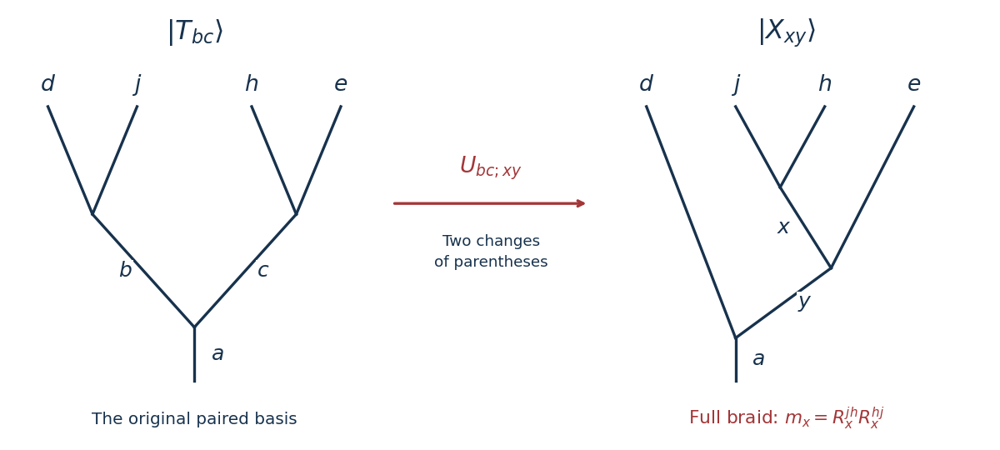

<h1 id="1/d/solution">Solution</h1>

↑ **Parent:** [D](../d.md)

Use an [anyon fusion tree](../../../../anyon-fusion-tree.md) in which the two crossing charges combine first. With external charges in the order $d,j,h,e$, define the normalized trees

$$
|T_{bc}\rangle=|((d j)_b(h e)_c)_a\rangle,\qquad
|X_{xy}\rangle=|(d((j h)_x e)_y)_a\rangle.
$$

The desired value is the matrix element of [anyon monodromy](../../../../anyon-monodromy.md) between $|T_{bc}\rangle$ and $|T_{fg}\rangle$. Their closure is understood in the [physics normalization of anyon diagrams](../../../../physics-normalization-of-anyon-diagrams.md).

First apply the [anyon F-matrix](../../../../anyon-f-matrix.md) to the three charges $d,j,c$, and then an inverse [anyon F-matrix](../../../../anyon-f-matrix.md) to $j,h,e$. With the source convention $|((uv)_r w)_t\rangle=\sum_s[F^{uvw}_t]_{rs}|(u(vw)_s)_t\rangle$, this gives

$$
|T_{bc}\rangle=\sum_{x,y}U_{bc;xy}|X_{xy}\rangle,\qquad
U_{bc;xy}=[F^{djc}_a]_{by}\,[F^{jhe}_y]^*_{xc}.
$$

Only allowed [anyon fusion](../../../../anyon-fusion-rule.md) channels enter the sums: in the second tree these require $N^x_{jh}N^y_{xe}N^a_{dy}=1$. The complex conjugate in $U$ comes from the inverse change of parentheses, not from reversing a crossing.

**[Figure 1](#1/d/image-recoupling-exposes-the-inner-pair-on-which-the-full-braid-acts-diagonally). Recoupling exposes the inner pair on which the full braid acts diagonally**.

Reading the actual overcrossings from bottom to top gives two positive exchanges in the source's [anyon R-matrix](../../../../anyon-r-matrix.md) convention. Their product is

$$
m_x=R^{jh}_xR^{hj}_x.
$$

The order of $h,j$ is restored after the second exchange. In the $X$ basis this [anyon monodromy](../../../../anyon-monodromy.md) is diagonal, so

$$
\boxed{\mathcal A_{bc;fg}=\sum_{x,y}U_{bc;xy}\,R^{jh}_xR^{hj}_x\,U^*_{fg;xy}.}
$$

Equivalently, entirely in terms of [anyon F-matrices](../../../../anyon-f-matrix.md) and [anyon R-matrices](../../../../anyon-r-matrix.md),

$$
\boxed{\mathcal A_{bc;fg}=\sum_{x,y}[F^{djc}_a]_{by}[F^{jhe}_y]^*_{xc}\,R^{jh}_xR^{hj}_x\,[F^{djg}_a]^*_{fy}[F^{jhe}_y]_{xg}.}
$$

This expression is also meaningful for $b\ne f$ or $c\ne g$: it then carries the unmatched [anyon vertex gauge transformation](../../../../anyon-vertex-gauge-transformation.md) factors identified in [a](../a.md).

To check the transparent limit, put $m_x=1$ in every allowed channel. The [unitary matrix](../../../../unitary-matrix.md) identity for $F^{jhe}_y$ first gives

$$
\sum_x[F^{jhe}_y]^*_{xc}[F^{jhe}_y]_{xg}=\delta_{cg}.
$$

Once $c=g$, the [unitary matrix](../../../../unitary-matrix.md) identity for $F^{djc}_a$ gives

$$
\mathcal A_{bc;fg}=\delta_{cg}\sum_y[F^{djc}_a]_{by}[F^{djc}_a]^*_{fy}=\boxed{\delta_{cg}\delta_{bf}},
$$

as in [c](../c.md). The same cancellation proves that the recoupling expression is an identity operator whenever the full [anyon monodromy](../../../../anyon-monodromy.md) is trivial, including when the individual exchanges have fermionic signs.

## ↑ Ancestors (12)

1. [D](../d.md)
2. [1](../../1.md)
3. [2025](../../../2025-split.md)
4. [Past exam of the anyons and topological quantum field theories course of the University of Oxford](../../../split.md)
5. [Anyons and topological quantum field theories course of the University of Oxford](../../../../anyons-and-topological-quantum-field-theories-course-of-the-university-of-oxford.md)
6. [Year 4 of the mathematical and theoretical physics course of the University of Oxford](../../../../year-4-of-the-mathematical-and-theoretical-physics-course-of-the-university-of-oxford.md)
7. [Mathematical and theoretical physics course of the University of Oxford](../../../../mathematical-and-theoretical-physics-course-of-the-university-of-oxford.md)
8. [Undergraduate course of the University of Oxford](../../../../undergraduate-course-of-the-university-of-oxford.md)
9. [Course of the University of Oxford](../../../../course-of-the-university-of-oxford.md)
10. [University of Oxford](../../../../university-of-oxford-split.md)
11. [List of universities](../../../../list-of-universities.md)
12. [Codex Wiki](../../../../split.md)
