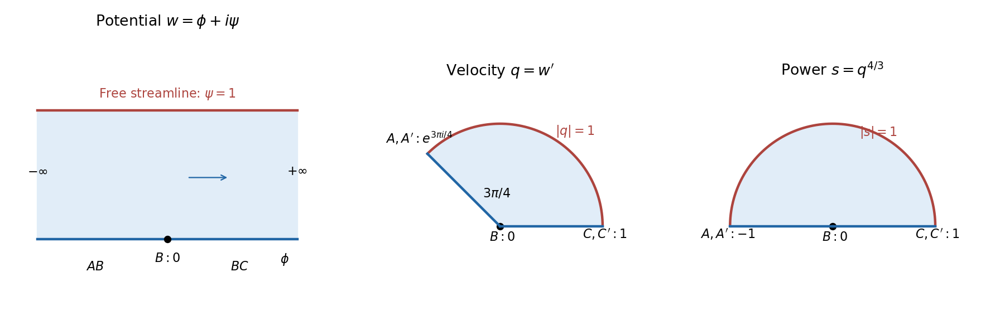
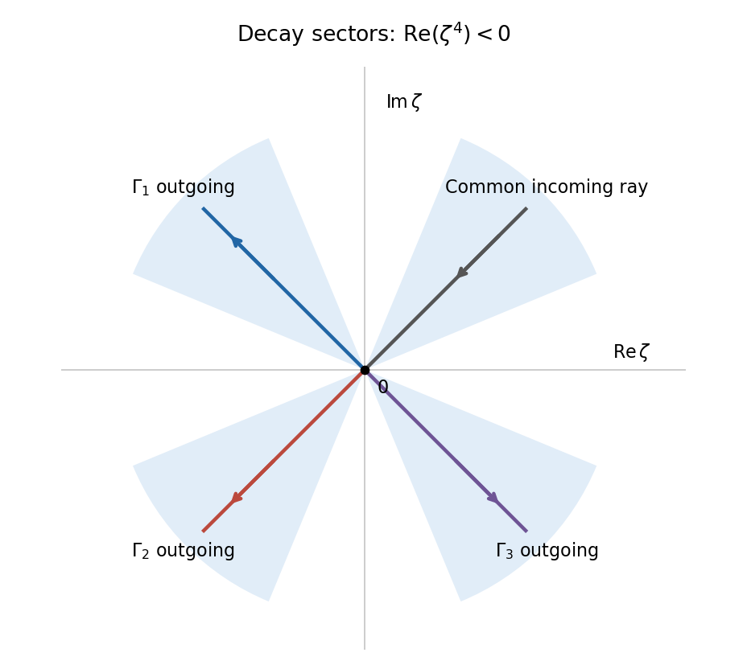

# 2011

↑ **Parent:** [Past exam of the applied complex variables course of the University of Oxford](../past-exam-of-the-applied-complex-variables-course-of-the-university-of-oxford.md)

Source release: [Oxford examination archive release thread](https://www.whatdotheyknow.com/request/maths_past_papers_3). The four-page scan is from pages 434–437 of the released Part C bundle. The cover identifies paper C6.3b, formal codes `DMAC 2B68` and `DMCO 2B68`, and Thursday 9 June 2011.

Answer availability checked on 28 October 2026: bounded searches of official Oxford sources by year, course name, paper label and formal code found no advertisement of complete or selected-part answers for this exact paper. The [departmental examination overview](https://www.maths.ox.ac.uk/members/students/undergraduate-courses/examinations-assessments/overview-examinations) does not establish solution availability for this 2011 paper.

**Table of contents**

- [1](#1)
  - [a](#1/a)
    - [i](#1/a/i)
      - [Solution](#1/a/i/solution)
    - [ii](#1/a/ii)
      - [Solution](#1/a/ii/solution)
  - [b](#1/b)
    - [i](#1/b/i)
      - [Solution](#1/b/i/solution)
    - [ii](#1/b/ii)
      - [Solution](#1/b/ii/solution)
- [2](#2)
  - [a](#2/a)
    - [Solution](#2/a/solution)
  - [b](#2/b)
    - [Solution](#2/b/solution)
- [3](#3)
  - [a](#3/a)
    - [Solution](#3/a/solution)
  - [b](#3/b)
    - [i](#3/b/i)
      - [Solution](#3/b/i/solution)
    - [ii](#3/b/ii)
      - [Solution](#3/b/ii/solution)
    - [iii](#3/b/iii)
      - [Solution](#3/b/iii/solution)

## 1

↑ **Parent:** [2011](2011.md)

<h3 id="1/a">a</h3>

↑ **Parent:** [1](#1)

<h4 id="1/a/i">i</h4>

↑ **Parent:** [A](#1/a)

<h5 id="1/a/i/solution">Solution</h5>

↑ **Parent:** [I](#1/a/i)

Put $\alpha_j=1-\beta_j$, so the interior [angle](../geometry-and-topology.md#angle) at the $j$th [polygon](../euclidean-geometry.md#polygon) vertex is $\pi\alpha_j$. A [conformal map](../geometry-and-topology.md#conformal-map) straightens that corner by a power: locally,

$$
f(z)-f(x_j)\sim A_j(z-x_j)^{\alpha_j},\qquad f'(z)\sim\alpha_jA_j(z-x_j)^{-\beta_j}.
$$

This follows by composing with the power $1/\alpha_j$ that maps the corner to a half-plane and using [Schwarz reflection](../complex-analysis.md#schwarz-reflection-principle) along its straight edges. The reflected map has a nonzero first [derivative](../calculus.md#derivative) in the straightened coordinates.

For an upper-half-plane [branch of the complex logarithm](../analysis.md#branch-of-the-complex-logarithm), define

$$
P(z)=\prod_{j=1}^n\exp\bigl(-\beta_j\operatorname{Log}(z-x_j)\bigr).
$$

Along each open interval of the real axis, $P$ has constant [argument](../complex-analysis.md#argument-complex-analysis). Crossing $x_j$ from left to right decreases $\arg(z-x_j)$ from $\pi$ to zero, so the [argument](../complex-analysis.md#argument-complex-analysis) of $P$ increases by $\beta_j\pi$. This is exactly the exterior turning [angle](../geometry-and-topology.md#angle) of the polygon [boundary](../topology.md#boundary-of-a-set). Thus $f'/P$ has one constant [boundary](../topology.md#boundary-of-a-set) [argument](../complex-analysis.md#argument-complex-analysis) on all the intervals. The corner asymptotics remove its apparent [singularity](../complex-analysis.md#complex-singularity) at each [prevertex](../geometry-and-topology.md#prevertex-of-a-schwarz-christoffel-map).

For a bounded polygon, the sum of exterior [angles](../geometry-and-topology.md#angle) gives $\sum_j\beta_j=2$. Since every vertex has a finite [prevertex](../geometry-and-topology.md#prevertex-of-a-schwarz-christoffel-map), [infinity](../mathematics.md#infinity) maps to an ordinary point of an edge. In the local coordinate $1/z$, [Schwarz reflection](../complex-analysis.md#schwarz-reflection-principle) gives $f(z)=f(\infty)+d/z+O(z^{-2})$ with $d\ne0$. Hence $f'/P$ has a finite nonzero limit at [infinity](../mathematics.md#infinity). After multiplication by one unit [complex number](../complex-analysis.md#complex-number), its [boundary values](../differential-equation.md#boundary-value) are real. Reflecting across the real axis extends it to an [entire function](../holomorphic-function.md#entire-function), including each removed [prevertex](../geometry-and-topology.md#prevertex-of-a-schwarz-christoffel-map), and it is bounded at [infinity](../mathematics.md#infinity). [Liouville's theorem](../complex-analysis.md#liouville-theorem) makes it constant. Therefore the [Schwarz-Christoffel formula](../geometry-and-topology.md#schwarz-christoffel-mapping) is

$$
\boxed{f'(z)=c\prod_{j=1}^n(z-x_j)^{-\beta_j},\qquad c\ne0.}
$$

Integration introduces one further additive constant.

The [Möbius transformations](../group-theory.md#mobius-transformation) preserving the [upper half-plane](../complex-analysis.md#upper-half-plane-complex-analysis) have three real parameters:

$$
z\longmapsto\frac{az+b}{cz+d},\qquad a,b,c,d\in\mathbb R,\quad ad-bc>0,
$$

with common nonzero scaling irrelevant. They can send any cyclically ordered triple of [boundary](../topology.md#boundary-of-a-set) points to another such triple. Consequently **three prevertices may be fixed independently**; the other $n-3$ are constrained by the polygon's shape, through its side-length ratios. The constants of integration and multiplication account for translation, rotation and scale of the image, rather than further [prevertex](../geometry-and-topology.md#prevertex-of-a-schwarz-christoffel-map) freedom.

If the last [prevertex](../geometry-and-topology.md#prevertex-of-a-schwarz-christoffel-map) is [infinity](../mathematics.md#infinity), use $1/z$ as its local coordinate. Its factor is absorbed into the overall normalization, leaving

$$
\boxed{f'(z)=c\prod_{j=1}^{n-1}(z-x_j)^{-\beta_j}.}
$$

For a finite image vertex at [infinity](../mathematics.md#infinity)'s preimage, this has asymptotic order $z^{\beta_n-2}$, because $f(z)-f(\infty)$ is of order $z^{-(1-\beta_n)}$. Thus the omitted factor is not evaluated by substituting [infinity](../mathematics.md#infinity) into the finite product; its [angle](../geometry-and-topology.md#angle) is encoded by the behavior at [infinity](../mathematics.md#infinity).

<h4 id="1/a/ii">ii</h4>

↑ **Parent:** [A](#1/a)

<h5 id="1/a/ii/solution">Solution</h5>

↑ **Parent:** [Ii](#1/a/ii)

The two approaches to the slit base are distinct [boundary](../topology.md#boundary-of-a-set) points, each with interior [angle](../geometry-and-topology.md#angle) $\pi/2$, whereas the slit tip has interior [angle](../geometry-and-topology.md#angle) $2\pi$. Their exponents in the [Schwarz-Christoffel formula](../geometry-and-topology.md#schwarz-christoffel-mapping) are therefore $-1/2$, $1$ and $-1/2$. Write $a=x_2\in(-1,1)$ and take

$$
S(z)=\sqrt{z^2-1}
$$

on the [upper half-plane](../complex-analysis.md#upper-half-plane-complex-analysis), with the branch normalized by $S(z)\sim z$ at [infinity](../mathematics.md#infinity). The [derivative](../calculus.md#derivative) has the form

$$
f'(z)=c\frac{z-a}{S(z)}.
$$

On $-1<x<1$, the upper [boundary value](../differential-equation.md#boundary-value) is $S_+(x)=i\sqrt{1-x^2}$. Both endpoints of this interval map to the slit base, so

$$
0=f(1)-f(-1)=c\int_{-1}^1\frac{x-a}{i\sqrt{1-x^2}}\,dx=i\pi ca.
$$

The odd term integrates to zero, and $c\ne0$; hence $\boxed{x_2=0}$. Now $S'(z)=z/S(z)$, so $f=cS+b$. The endpoint values force $b=0$, and the tip value, using $S(0)=i$ as a [boundary](../topology.md#boundary-of-a-set) limit, forces $c=1$. Thus

$$
\boxed{f(z)=\sqrt{z^2-1},\qquad f(z)\sim z\text{ at infinity}.}
$$

The branch is important: on $x>1$ its [boundary value](../differential-equation.md#boundary-value) is positive real, on $x<-1$ negative real, and on $(-1,1)$ positive imaginary. The intervals $(-1,0)$ and $(0,1)$ traverse the two sides of the slit, meeting at its tip.

The map is injective in the [upper half-plane](../complex-analysis.md#upper-half-plane-complex-analysis): equal images imply $z_1^2=z_2^2$, and the alternative $z_1=-z_2$ cannot put both points in that half-plane. Its [derivative](../calculus.md#derivative) has no interior zero. The image has positive [imaginary part](../complex-analysis.md#imaginary-part), by [continuity](../calculus.md#continuous-function) of the branch and the fact that an interior real image would require $z^2-1$ to be nonnegative real, which is impossible for $\operatorname{Im}z>0$. Conversely, a point $\zeta$ in the [upper half-plane](../complex-analysis.md#upper-half-plane-complex-analysis) outside the slit gives a unique upper-half-plane root of $z^2=\zeta^2+1$. A point $\zeta=iy$ with $0<y\leq1$ gives only real roots or zero and is excluded. These observations verify that the image is exactly the required slit domain, rather than just matching its [boundary](../topology.md#boundary-of-a-set).

<h3 id="1/b">b</h3>

↑ **Parent:** [1](#1)

<h4 id="1/b/i">i</h4>

↑ **Parent:** [B](#1/b)

<h5 id="1/b/i/solution">Solution</h5>

↑ **Parent:** [I](#1/b/i)

The [imaginary part](../complex-analysis.md#imaginary-part) of the [complex potential of a two-dimensional potential flow](../fluid-mechanics.md#complex-potential-of-a-two-dimensional-potential-flow) is the [stream function](../fluid-mechanics.md#stream-function). Its constant values on the wall and the free [boundary](../topology.md#boundary-of-a-set) make the potential domain the horizontal strip

$$
\boxed{0<\operatorname{Im}w<1.}
$$

The lower edge is the rigid wall, with $B$ at $w=0$. The upstream end has $\operatorname{Re}w\to-\infty$, and the downstream end has $\operatorname{Re}w\to+\infty$. The upper edge is the [free streamline](../fluid-mechanics.md#free-streamline). Thus $AB$ and $BC$ are the negative and positive portions of the real $w$ axis, respectively.

Write $q=w'=u-iv$ for the [complex velocity](../fluid-mechanics.md#complex-velocity). Downstream $q\to1$. Upstream the fluid moves towards the corner along a wall of inclination $\pi/4$, so its physical [velocity](../classical-mechanics.md#velocity) has [argument](../complex-analysis.md#argument-complex-analysis) $-3\pi/4$ and its [complex velocity](../fluid-mechanics.md#complex-velocity) has [argument](../complex-analysis.md#argument-complex-analysis) $3\pi/4$. Along each straight wall the [velocity](../classical-mechanics.md#velocity) direction is fixed. At the corner the fluid [angle](../geometry-and-topology.md#angle) is $\pi/4$, giving local behavior $w\sim K(z-B)^4$ and hence $q\to0$: **$B$ is a [stagnation point](../fluid-mechanics.md#stagnation-point)**. On the [free streamline](../fluid-mechanics.md#free-streamline), the [speed](../classical-mechanics.md#speed) is one, so $|q|=1$.

The corresponding simple-jet [hodograph plane](../fluid-mechanics.md#hodograph-plane) is therefore the circular sector

$$
\boxed{0<\arg q<\frac{3\pi}{4},\qquad0<|q|<1.}
$$

The radius at [argument](../complex-analysis.md#argument-complex-analysis) $3\pi/4$ represents $AB$, the positive real radius represents $BC$, and the unit-circle arc represents the free [boundary](../topology.md#boundary-of-a-set). The upstream and downstream ends are $e^{3\pi i/4}$ and one, respectively; the corner is the sector's origin.

**[Figure 1](#1/b/i/image-the-complex-potential-of-a-two-dimensional-potential-flow-strip-and-hodograph-plane-with-an-intermediate-power-map). The complex potential of a two-dimensional potential flow strip and hodograph plane, with an intermediate power map**.

<h4 id="1/b/ii">ii</h4>

↑ **Parent:** [B](#1/b)

<h5 id="1/b/ii/solution">Solution</h5>

↑ **Parent:** [Ii](#1/b/ii)

Starting from the [hodograph plane](../fluid-mechanics.md#hodograph-plane), take the [complex power](../analysis.md#complex-exponentiation)

$$
s=q^{4/3},\qquad0<\arg q<3\pi/4.
$$

It takes the [velocity](../classical-mechanics.md#velocity) sector bijectively to the upper half of the [unit disk](../euclidean-geometry.md#unit-disk). The [boundary](../topology.md#boundary-of-a-set) points representing the upstream end, the corner and the downstream end become $-1$, zero and one. Next use the [Möbius transformation](../group-theory.md#mobius-transformation)

$$
T=\frac{s+1}{s-1}.
$$

The diameter $-1<s<1$ maps to the negative real axis, while for $s=e^{i\theta}$ on the upper semicircle,

$$
T=-i\cot(\theta/2),
$$

which is on the negative imaginary axis. The interior maps to the third quadrant. Squaring therefore gives a [conformal](../geometry-and-topology.md#conformal-map) bijection from that quadrant to the [upper half-plane](../complex-analysis.md#upper-half-plane-complex-analysis):

$$
\eta=T^2=\left(\frac{q^{4/3}+1}{q^{4/3}-1}\right)^2.
$$

The upstream end, corner and downstream end map to zero, one and [infinity](../mathematics.md#infinity), respectively. The two walls map to the positive real axis, and the free [boundary](../topology.md#boundary-of-a-set) maps to the negative real axis.

Independently, the [exponential function](../calculus.md#exponential-function) $\eta=e^{\pi w}$ takes the potential strip to the same [upper half-plane](../complex-analysis.md#upper-half-plane-complex-analysis) with the same [boundary](../topology.md#boundary-of-a-set) correspondence. The strip height fixes the coefficient $\pi$, and the normalization $w(B)=0$ fixes the remaining positive multiplicative constant in $\eta$ to one. Consequently

$$
\boxed{e^{\pi w}=\left(\frac{(w')^{4/3}+1}{(w')^{4/3}-1}\right)^2.}
$$

One can make the branches explicit. In the strip, $p=e^{\pi w/2}$ lies in the first quadrant, whereas $T=-p$. Thus

$$
q^{4/3}=\frac{p-1}{p+1}=\tanh\left(\frac{\pi w}{4}\right),\qquad
q=\left[\tanh\left(\frac{\pi w}{4}\right)\right]^{3/4},
$$

with the power taking [arguments](../complex-analysis.md#argument-complex-analysis) in $(0,\pi)$ to $(0,3\pi/4)$. It gives $q\to e^{3\pi i/4}$ upstream, $q\to1$ downstream, and $q\to0$ at $B$, verifying both the branch choice and the [velocity](../classical-mechanics.md#velocity) normalization.

## 2

↑ **Parent:** [2011](2011.md)

<h3 id="2/a">a</h3>

↑ **Parent:** [2](#2)

<h4 id="2/a/solution">Solution</h4>

↑ **Parent:** [A](#2/a)

Let $\zeta=\zeta(z,t)$ be the inverse [conformal map](../geometry-and-topology.md#conformal-map). With $Q$ real and nonzero, the [function](../function.md) $Q\log|\zeta|$ is [harmonic](../partial-differential-equation.md#harmonic-function) away from the source, vanishes on the moving [boundary](../topology.md#boundary-of-a-set), and has the required logarithmic [singularity](../complex-analysis.md#complex-singularity). Indeed $F(\zeta,t)=a_1(t)\zeta+O(\zeta^2)$ with $a_1\ne0$, so $\log|\zeta|=\log|z|-\log|a_1|+o(1)$ near the origin. Subtracting this candidate from the physical [velocity potential](../fluid-mechanics.md#velocity-potential) leaves a bounded [harmonic function](../partial-differential-equation.md#harmonic-function) near the source. Its [singularity](../complex-analysis.md#complex-singularity) is removable, and the difference has zero [boundary values](../differential-equation.md#boundary-value). The [maximum principle for harmonic functions](../partial-differential-equation.md#maximum-principle-for-harmonic-functions) makes it identically zero. Therefore

$$
\boxed{\phi(z,t)=Q\log|\zeta(z,t)|=\operatorname{Re}\bigl(Q\operatorname{Log}\zeta(z,t)\bigr).}
$$

Only the [real part](../complex-analysis.md#real-part) is needed, so the multivalued [imaginary part](../complex-analysis.md#imaginary-part) of the logarithm causes no ambiguity in $\phi$.

Differentiate $F(\zeta(z,t),t)=z$ while holding the physical point $z$ fixed:

$$
\zeta_t=-\frac{F_t}{F_\zeta},\qquad
\phi_t=-Q\operatorname{Re}\frac{F_t}{\zeta F_\zeta}.
$$

Also the local analytic [complex potential of a two-dimensional potential flow](../fluid-mechanics.md#complex-potential-of-a-two-dimensional-potential-flow) has [derivative](../calculus.md#derivative)

$$
w_z=\frac{Q}{\zeta F_\zeta},\qquad |\nabla\phi|^2=|w_z|^2=\frac{Q^2}{|\zeta F_\zeta|^2}.
$$

The distinction between differentiating at fixed $z$ and fixed $\zeta$ is essential because the [boundary](../topology.md#boundary-of-a-set) map depends on time. Substituting into the [boundary](../topology.md#boundary-of-a-set) evolution law and multiplying by $|\zeta F_\zeta|^2/Q$ gives

$$
\operatorname{Re}\bigl(F_t\overline{\zeta F_\zeta}\bigr)=Q.
$$

Taking the conjugate inside a [real part](../complex-analysis.md#real-part) leaves it unchanged, so the desired [conformal map equation for planar Darcy growth](../porous-media-flow.md#conformal-map-equation-for-planar-darcy-growth) is

$$
\boxed{\operatorname{Re}\left(\zeta F_\zeta\overline{F_t}\right)=Q,\qquad |\zeta|=1.}
$$

As a normalization check, parameterize the [boundary](../topology.md#boundary-of-a-set) by $\zeta=e^{i\theta}$. Its outward [normal vector](../differential-geometry.md#normal-vector) times arclength is $\zeta F_\zeta\,d\theta$, so its [area](../differential-geometry.md#surface-area) growth rate is $\int_0^{2\pi}\operatorname{Re}(F_t\overline{\zeta F_\zeta})d\theta=2\pi Q$, exactly the specified source [flux](../mathematical-physics.md#flux). For an expanding circular map $F=R(t)\zeta$, the equation reduces to $R\dot R=Q$.

<h3 id="2/b">b</h3>

↑ **Parent:** [2](#2)

<h4 id="2/b/solution">Solution</h4>

↑ **Parent:** [B](#2/b)

Orient the [contour](../complex-analysis.md#complex-integration-contour) and call its left-hand side the plus side. At a smooth interior point $t$, take a local arclength parameter $\gamma(s)$ with $\gamma(0)=t$. The [Cauchy principal value](../complex-analysis.md#cauchy-principal-value) means the symmetric deletion limit

$$
\operatorname{PV}\int_\Gamma\frac{f(\zeta)}{\zeta-t}\,d\zeta
=\lim_{\varepsilon\downarrow0}\int_{\Gamma\setminus\gamma((-\varepsilon,\varepsilon))}\frac{f(\zeta)}{\zeta-t}\,d\zeta.
$$

The two local pieces are deleted with the same arclength cutoff. For a sufficiently smooth regular [contour](../complex-analysis.md#complex-integration-contour), an equal-radius deletion about $t$ gives the same limit. The point is assumed to be away from endpoints and self-intersections.

To derive the [Sokhotski–Plemelj formula](../holomorphic-function.md#sokhotski-plemelj-theorem), split the [contour](../complex-analysis.md#complex-integration-contour) into a short smooth arc through $t$ and its complement. The complementary [integral](../integral.md) has the same limit from both sides. On the short arc subtract $f(z)$ from the numerator. Because $f$ is [holomorphic](../holomorphic-function.md) nearby, $(f(\zeta)-f(z))/(\zeta-z)$ extends continuously as $\zeta$ approaches $z$; this part also has the same limit from either side. The remaining local term is $f(z)\int d\zeta/(\zeta-z)$. Straightening the oriented tangent shows its extra contribution is $+i\pi f(t)$ from the left and $-i\pi f(t)$ from the right: on a real segment this is the direct limit of $\int_{-\delta}^{\delta}du/(u\mp i\varepsilon)$. Dividing by $2\pi i$ yields

$$
\boxed{w_\pm(t)=\pm\frac12f(t)+\frac1{2\pi i}\operatorname{PV}\int_\Gamma\frac{f(\zeta)}{\zeta-t}\,d\zeta.}
$$

In particular the jump is $w_+-w_-=f$, while the sum is the principal-value [integral](../integral.md) divided by $\pi i$. Smooth densities on a real interval satisfy the same formulas at every interior point, by the identical subtraction step with a Hölder-[continuous](../calculus.md#continuous-function) remainder.

Now put $h=w/\widetilde w$. On the interval, the sign reversal of the auxiliary [boundary values](../differential-equation.md#boundary-value) gives

$$
h_+-h_-=\frac{w_+}{\widetilde w_+}-\frac{w_-}{\widetilde w_-}=\frac{w_++w_-}{\widetilde w_+}=\frac{G}{\widetilde w_+}.
$$

Thus the required [Cauchy transform](../complex-analysis.md#cauchy-transform) density is

$$
\boxed{F(\xi)=\frac{G(\xi)}{\widetilde w_+(\xi)}.}
$$

Whenever this density is integrable at the endpoints, taking $h=C[F]$ constructs a [function](../function.md) with the required jump. Multiplication back gives $w_++w_-=G$. The jump of the constructed $w$ is

$$
f(x)=w_+(x)-w_-(x)=\widetilde w_+(x)(h_+(x)+h_-(x))
=\boxed{\frac{\widetilde w_+(x)}{\pi i}\operatorname{PV}\int_0^1\frac{G(\xi)}{\widetilde w_+(\xi)(\xi-x)}\,d\xi.}
$$

To conclude that this jump solves the final singular equation, one must additionally justify $w=C[f]$. This reconstruction requires endpoint and [infinity](../mathematics.md#infinity) conditions; the sign reversal of $\widetilde w$ alone does not ensure it. Here is a complete valid normalization. Let

$$
S(z)=\sqrt{z(z-1)},\qquad S(z)\sim z\text{ at infinity},\qquad \widetilde w(z)=\frac1{S(z)}.
$$

The branch is [holomorphic](../holomorphic-function.md) off $[0,1]$, with $S_+(x)=i\sqrt{x(1-x)}$ and $S_-=-S_+$. If $G$ extends smoothly to $[0,1]$, the density $F=G/\widetilde w_+=i\sqrt{x(1-x)}G$ vanishes like a [square root](../algebra.md#square-root) at each endpoint. Its [Cauchy transform](../complex-analysis.md#cauchy-transform) $h$ is bounded at the endpoints and is $O(z^{-1})$ at [infinity](../mathematics.md#infinity). Therefore $w=h/S$ is at most inverse-square-root singular at each endpoint and is $O(z^{-2})$ at [infinity](../mathematics.md#infinity). Its jump $f$ is integrable.

For [Cauchy reconstruction from a jump across a finite interval](../holomorphic-function.md#cauchy-reconstruction-from-a-jump-across-a-finite-interval), apply the [Cauchy integral formula](../analysis.md#cauchy-integral-formula) to $w$ on a large slit [contour](../complex-analysis.md#complex-integration-contour), and shrink its banks to $[0,1]$. The large circle contributes zero in the limit; each small endpoint circle contributes $O(\sqrt\varepsilon)$ and also vanishes. The two banks give the jump $f$, proving $w=C[f]$. The sum part of the [Sokhotski–Plemelj formula](../holomorphic-function.md#sokhotski-plemelj-theorem) now gives

$$
\boxed{\frac1{\pi i}\operatorname{PV}\int_0^1\frac{f(\xi)}{\xi-x}\,d\xi=G(x),\qquad0<x<1.}
$$

This proves the intended [finite Hilbert transform inversion](../fourier-transform.md#finite-hilbert-transform-inversion) with admissible endpoint behavior. Adding a multiple of $1/\sqrt{x(1-x)}$ to $f$ gives a homogeneous solution; equivalently one can add a constant multiple of $1/S$ to $w$, whose [boundary](../topology.md#boundary-of-a-set) sum is zero.

The omitted normalization is a real limitation of the printed claim. To see it explicitly, choose instead $\widetilde w=S$ and $G=1$. This auxiliary [function](../function.md) satisfies all the stated holomorphicity, nonvanishing and sign-reversal requirements. But

$$
\int_0^1\frac{d\xi}{\sqrt{\xi(1-\xi)}(\xi-z)}=-\frac\pi{S(z)},\qquad h=C[1/S_+]=\frac1{2S(z)},\qquad w=Sh=\frac12.
$$

The displayed [integral](../integral.md) identity follows from $\xi=(1+\cos\theta)/2$ and its continuation from real $z>1$. Hence the proposed jump formula gives $f=0$, which does not solve the equation with $G=1$. The failure is the nonzero constant at [infinity](../mathematics.md#infinity): $w-C[f]=1/2$. Thus **the final implication is valid with suitable endpoint and decay conditions, but is false for an unrestricted auxiliary [function](../function.md) as printed**. The valid reciprocal-square-root normalization above supplies an actual solution for $G$ smooth up to the two endpoints.

## 3

↑ **Parent:** [2011](2011.md)

<h3 id="3/a">a</h3>

↑ **Parent:** [3](#3)

<h4 id="3/a/solution">Solution</h4>

↑ **Parent:** [A](#3/a)

In the [Laplace integral method for a differential equation](../bessel-function.md#laplace-integral-method-for-a-differential-equation), differentiate the [integral](../integral.md) three times with respect to $z$, and replace $ze^{z\zeta}$ by $\partial_\zeta e^{z\zeta}$. [Integration by parts](../calculus.md#integration-by-parts) gives

$$
w'''+zw=\left[g(\zeta)e^{z\zeta}\right]_\Gamma+\int_\Gamma\bigl(\zeta^3g(\zeta)-g'(\zeta)\bigr)e^{z\zeta}\,d\zeta.
$$

Thus the weight equation for this construction and its [boundary condition](../differential-equation.md#boundary-condition) are

$$
g'=\zeta^3g,\qquad\left[g(\zeta)e^{z\zeta}\right]_\Gamma=0,
$$

which give

$$
\boxed{g(\zeta)=Ae^{\zeta^4/4},\qquad A\ne0.}
$$

These are the conditions obtained by eliminating the transformed interior term and the endpoint term separately. As usual for this method, differentiation and [integration by parts](../calculus.md#integration-by-parts) need convergence assumptions; the [contours](../complex-analysis.md#complex-integration-contour) constructed next make every such step valid locally uniformly for all complex $z$. A literal necessity claim for arbitrary weights and [contours](../complex-analysis.md#complex-integration-contour) would additionally require uniqueness of the chosen representation by a [Laplace integral](../asymptotic-expansion.md#laplace-integral); a [null weight in a contour Laplace representation](../asymptotic-expansion.md#null-weight-in-a-contour-laplace-representation) can otherwise be added without changing the solution.

Let

$$
u_j=e^{i(\pi/4+j\pi/2)},\qquad j=0,1,2,3.
$$

The [quartic decay sectors for a contour integral](../asymptotic-expansion.md#quartic-decay-sectors-for-a-contour-integral) contain the four rays $\zeta=ru_j$. Along each ray, the quartic term is $\zeta^4/4=-r^4/4$. For $j=1,2,3$, choose $\Gamma_j$ to travel from [infinity](../mathematics.md#infinity) on ray $u_0$ to zero, and then from zero to [infinity](../mathematics.md#infinity) on ray $u_j$. Set $A=1$ and define

$$
\boxed{w_j(z)=\int_{\Gamma_j}e^{\zeta^4/4+z\zeta}\,d\zeta,\qquad j=1,2,3.}
$$

On any [compact set](../topology.md#compact-space) of $z$ values, the integrand and each of its $z$ [derivatives](../calculus.md#derivative) are bounded by a constant times $r^m e^{-r^4/4+Mr}$ for some $M$. These bounds are integrable at [infinity](../mathematics.md#infinity), so [differentiation under the integral sign](../analysis.md#differentiation-under-the-integral-sign) is justified and the [functions](../function.md) are entire. The endpoint term vanishes at both infinite ends. There is no extra term at zero because the two pieces join with the same integrand value and opposite endpoint orientations. Therefore all three [functions](../function.md) solve the [differential equation](../differential-equation.md).

**[Figure 2](#3/a/image-three-independent-laplace-integral-contours-joining-rays-in-quartic-decay-sectors). Three independent Laplace integral contours joining rays in quartic decay sectors**.

To prove independence, evaluate their first three initial data. For $m=0,1,2$,

$$
w_j^{(m)}(0)=C_m(u_j^{m+1}-u_0^{m+1}),\qquad
C_m=\int_0^\infty r^m e^{-r^4/4}\,dr=4^{(m-3)/4}\Gamma\left(\frac{m+1}{4}\right)>0.
$$

If $\sum_{j=1}^3c_jw_j=0$, these initial data give $\sum_{j=1}^3c_j(u_j^\ell-u_0^\ell)=0$ for $\ell=1,2,3$. Define $c_0=-\sum_{j=1}^3c_j$. Then

$$
\sum_{j=0}^3c_ju_j^\ell=0,\qquad\ell=0,1,2,3.
$$

The coefficient matrix is a [Vandermonde matrix](../galois-theory.md#vandermonde-matrix) at four distinct fourth roots of $-1$, and hence is invertible. All $c_j$ vanish. There is also a concrete reason for the earlier qualification about necessity. Deform the incoming ray of $\Gamma_1$ to angle $\pi/3$ and its outgoing ray to angle $2\pi/3$, within their respective quartic decay sectors. The quartic integral is unchanged and remains nonzero. On this deformed contour, the extra entire weight $e^{\zeta^2}$ contributes zero for every $z$: throughout the closing wedge, $\operatorname{Re}(\zeta^2)\leq-r^2/2$, so the large closing arc tends to zero and the [Cauchy integral theorem](../complex-analysis.md#cauchy-s-integral-theorem) gives a zero integral. Thus $g=e^{\zeta^4/4}+e^{\zeta^2}$ represents the same entire solution and has vanishing endpoint terms, although it does not satisfy $g'=\zeta^3g$. The canonical weight equation is the standard sufficient construction, rather than an unconditional uniqueness assertion about contour representations.

Thus **the three [contours](../complex-analysis.md#complex-integration-contour) give [linearly independent](../vector-space.md#linear-independence) nonzero solutions**, and they form a [fundamental system of solutions](../linear-ordinary-differential-equation.md#fundamental-system-of-solutions) for this third-order linear equation. This proves independence directly instead of inferring it merely from the presence of three different [contours](../complex-analysis.md#complex-integration-contour).

<h3 id="3/b">b</h3>

↑ **Parent:** [3](#3)

<h4 id="3/b/i">i</h4>

↑ **Parent:** [B](#3/b)

<h5 id="3/b/i/solution">Solution</h5>

↑ **Parent:** [I](#3/b/i)

Write $Y_\pm=\overline y_\pm$, $y_0=y(0)$ and $d_\pm=y'(0\pm)$. In a common convergence strip, two integrations by parts on each half-line give

$$
\int_0^\infty y''e^{ikx}\,dx=-d_++iky_0-k^2Y_+,\qquad
\int_{-\infty}^0y''e^{ikx}\,dx=d_--iky_0-k^2Y_-.
$$

The [boundary](../topology.md#boundary-of-a-set) terms at [infinity](../mathematics.md#infinity) vanish by exponential decay; the [ordinary differential equations](../differential-equation.md#ordinary-differential-equation) also give decay of the required first [derivatives](../calculus.md#derivative). Substituting the two equations for $y''$ yields

$$
(a^2-k^2)Y_+=d_+-iky_0,\qquad(b^2-k^2)Y_-=-d_-+iky_0.
$$

[Continuity](../calculus.md#continuous-function) makes the $y_0$ terms cancel on addition, while the unit [derivative](../calculus.md#derivative) jump gives

$$
(a^2-k^2)Y_++(b^2-k^2)Y_-=1.
$$

Multiply by $-1/((k-a)(k+b))$ and factor the quadratics. Since $\operatorname{Im}(a+b)>0$, their sum is nonzero, and partial fractions give

$$
\boxed{\frac{k+a}{k+b}Y_++\frac{k-b}{k-a}Y_-=\frac1{a+b}\left(\frac1{k+b}-\frac1{k-a}\right).}
$$

This is the [Wiener-Hopf equation](../boundary-value-problem.md#wiener-hopf-equation) for the two [half-line Fourier transforms](../fourier-transform.md#half-line-fourier-transform). The plus and minus subscripts refer to support in physical space; their [holomorphic](../holomorphic-function.md) domains in transform space are determined next.

<h4 id="3/b/ii">ii</h4>

↑ **Parent:** [B](#3/b)

<h5 id="3/b/ii/solution">Solution</h5>

↑ **Parent:** [Ii](#3/b/ii)

Let $\eta=\operatorname{Im}k$. On $x>0$, the modulus of the Fourier factor is $e^{-\eta x}$, so the given decay bound makes $Y_+$ converge absolutely when $\gamma+\eta>0$. On $x<0$, write $x=-r$; the bound becomes $e^{-(\gamma-\eta)r}$, so $Y_-$ converges absolutely when $\eta<\gamma$. Uniform domination on compact subsets permits differentiation with respect to $k$, proving

$$
\boxed{Y_+\text{ holomorphic for }\operatorname{Im}k>-\gamma,\qquad Y_-\text{ holomorphic for }\operatorname{Im}k<\gamma.}
$$

Thus the half-planes guaranteed directly by the given common decay bound have $\alpha=-\gamma$ and $\beta=\gamma$, and the equation holds on their overlap

$$
\boxed{-\gamma<\operatorname{Im}k<\gamma.}
$$

This is a statement about the domains guaranteed by that bound, not necessarily their largest possible domains. The exact solution below decays at different rates on the two half-lines and gives the sharper convergence half-planes $\operatorname{Im}k>-\operatorname{Im}a$ and $\operatorname{Im}k<\operatorname{Im}b$, with maximal common strip $-\operatorname{Im}a<\operatorname{Im}k<\operatorname{Im}b$.

<h4 id="3/b/iii">iii</h4>

↑ **Parent:** [B](#3/b)

<h5 id="3/b/iii/solution">Solution</h5>

↑ **Parent:** [Iii](#3/b/iii)

The constant-coefficient equations and decay imply that only the modes $e^{iax}$ on the positive half-line and $e^{-ibx}$ on the negative half-line can occur; the opposite modes grow. [Continuity](../calculus.md#continuous-function) and the nonzero [derivative](../calculus.md#derivative) jump then imply nonzero amplitudes, so any common decay exponent satisfies $0<\gamma\leq\operatorname{Im}a<\operatorname{Im}b$. In particular $-b$ lies below the plus [holomorphic](../holomorphic-function.md) half-plane, and $a$ lies outside the minus half-plane. This locates the [poles](../isolated-singularity.md#pole) needed for the transform calculation, without yet computing the amplitudes.

Rearrange the equation from part (i) as

$$
\frac{k+a}{k+b}Y_+-\frac1{(a+b)(k+b)}
=-\left(\frac{k-b}{k-a}Y_-+\frac1{(a+b)(k-a)}\right).
$$

The left side is [holomorphic](../holomorphic-function.md) in the plus half-plane, and the right side in the minus half-plane. Their equality on the overlap glues them into one [entire function](../holomorphic-function.md#entire-function). The assumed decay of $Y_\pm$, together with the rational factors tending to one and the subtracted fractions tending to zero, makes this [entire function](../holomorphic-function.md#entire-function) tend to zero at [infinity](../mathematics.md#infinity). It is therefore identically zero by [Liouville's theorem](../complex-analysis.md#liouville-theorem). This is the additive splitting step of the [Wiener-Hopf method](../boundary-value-problem.md#wiener-hopf-method). Solving the two zero identities gives

$$
\boxed{Y_+(k)=\frac1{(a+b)(k+a)},\qquad Y_-(k)=-\frac1{(a+b)(k-b)}.}
$$

Their apparent cancellation formulas extend holomorphically wherever a cancelled factor vanishes; the only actual [poles](../isolated-singularity.md#pole) are at $-a$ and $b$.

With the Fourier convention in use, inversion has factor $e^{-ikx}$ and normalization $1/(2\pi)$. For $x>0$, close the [contour](../complex-analysis.md#complex-integration-contour) in the [lower half-plane](../complex-analysis.md#lower-half-plane) clockwise, collecting the [pole](../isolated-singularity.md#pole) at $-a$. For $x<0$, close in the [upper half-plane](../complex-analysis.md#upper-half-plane-complex-analysis) counterclockwise, collecting the [pole](../isolated-singularity.md#pole) at $b$. The [residue theorem](../analysis.md#residue-theorem) gives

$$
\boxed{y(x)=\begin{cases}\dfrac{e^{iax}}{i(a+b)},&x>0,\\[6pt]\dfrac{e^{-ibx}}{i(a+b)},&x<0.\end{cases}}
$$

Equivalently, each displayed transform follows immediately by integrating the corresponding decaying exponential on its half-line, so Fourier uniqueness gives the same inversion without a [contour](../complex-analysis.md#complex-integration-contour) estimate. Both values at zero are $1/(i(a+b))$, and the [derivative](../calculus.md#derivative) jump is $(a+b)/(a+b)=1$, directly checking the interface conditions.

The moduli are a nonzero constant times $e^{-\operatorname{Im}a\,x}$ for $x>0$ and $e^{-\operatorname{Im}b\,|x|}$ for $x<0$. Hence the largest common exponential decay rate is

$$
\boxed{\gamma_{\max}=\operatorname{Im}a.}
$$

Strictly, the stated big-$O$ bound is also true for every smaller positive $\gamma$; it does not specify a unique exponent unless the sharp rate is intended. The two transform convergence half-planes are exactly the sharper domains stated in part (ii), and the [poles](../isolated-singularity.md#pole) on their boundaries prevent extending either half-line [integral](../integral.md) domain any farther.

## ↑ Ancestors (9)

1. [Past exam of the applied complex variables course of the University of Oxford](../past-exam-of-the-applied-complex-variables-course-of-the-university-of-oxford.md)
2. [Applied complex variables course of the University of Oxford](../university-of-oxford.md#applied-complex-variables-course-of-the-university-of-oxford)
3. [Year 4 of the mathematics course of the University of Oxford](../university-of-oxford.md#year-4-of-the-mathematics-course-of-the-university-of-oxford)
4. [Mathematics course of the University of Oxford](../university-of-oxford.md#mathematics-course-of-the-university-of-oxford)
5. [Undergraduate course of the University of Oxford](../university-of-oxford.md#undergraduate-course-of-the-university-of-oxford)
6. [Course of the University of Oxford](../university-of-oxford.md#course-of-the-university-of-oxford)
7. [University of Oxford](../university-of-oxford.md)
8. [List of universities](../README.md#list-of-universities)
9. [Codex Wiki](../README.md)
