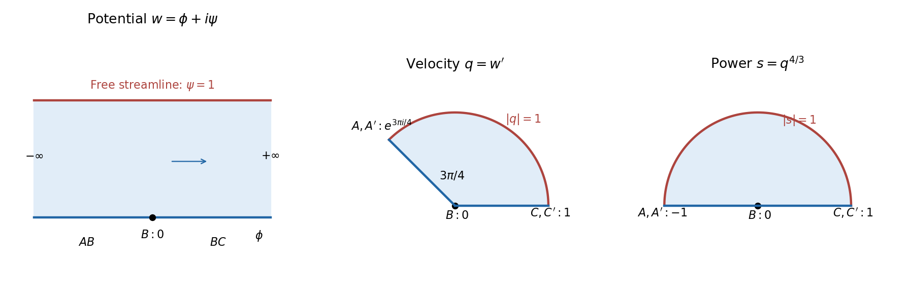

<h1 id="1/b/i/solution">Solution</h1>

↑ **Parent:** [I](../i.md)

The [imaginary part](../../../../../imaginary-part.md) of the [complex potential of a two-dimensional potential flow](../../../../../complex-potential-of-a-two-dimensional-potential-flow.md) is the [stream function](../../../../../stream-function.md). Its constant values on the wall and the free [boundary](../../../../../boundary-of-a-set.md) make the potential domain the horizontal strip

$$
\boxed{0<\operatorname{Im}w<1.}
$$

The lower edge is the rigid wall, with $B$ at $w=0$. The upstream end has $\operatorname{Re}w\to-\infty$, and the downstream end has $\operatorname{Re}w\to+\infty$. The upper edge is the [free streamline](../../../../../free-streamline.md). Thus $AB$ and $BC$ are the negative and positive portions of the real $w$ axis, respectively.

Write $q=w'=u-iv$ for the [complex velocity](../../../../../complex-velocity.md). Downstream $q\to1$. Upstream the fluid moves towards the corner along a wall of inclination $\pi/4$, so its physical [velocity](../../../../../velocity.md) has [argument](../../../../../argument-complex-analysis.md) $-3\pi/4$ and its [complex velocity](../../../../../complex-velocity.md) has [argument](../../../../../argument-complex-analysis.md) $3\pi/4$. Along each straight wall the [velocity](../../../../../velocity.md) direction is fixed. At the corner the fluid [angle](../../../../../angle.md) is $\pi/4$, giving local behavior $w\sim K(z-B)^4$ and hence $q\to0$: **$B$ is a [stagnation point](../../../../../stagnation-point.md)**. On the [free streamline](../../../../../free-streamline.md), the [speed](../../../../../speed.md) is one, so $|q|=1$.

The corresponding simple-jet [hodograph plane](../../../../../hodograph-plane.md) is therefore the circular sector

$$
\boxed{0<\arg q<\frac{3\pi}{4},\qquad0<|q|<1.}
$$

The radius at [argument](../../../../../argument-complex-analysis.md) $3\pi/4$ represents $AB$, the positive real radius represents $BC$, and the unit-circle arc represents the free [boundary](../../../../../boundary-of-a-set.md). The upstream and downstream ends are $e^{3\pi i/4}$ and one, respectively; the corner is the sector's origin.

**[Figure 1](#1/b/i/image-the-complex-potential-of-a-two-dimensional-potential-flow-strip-and-hodograph-plane-with-an-intermediate-power-map). The complex potential of a two-dimensional potential flow strip and hodograph plane, with an intermediate power map**.

## ↑ Ancestors (13)

1. [I](../i.md)
2. [B](../../b.md)
3. [1](../../../1.md)
4. [2011](../../../../2011-split.md)
5. [Past exam of the applied complex variables course of the University of Oxford](../../../../split.md)
6. [Applied complex variables course of the University of Oxford](../../../../../applied-complex-variables-course-of-the-university-of-oxford.md)
7. [Year 4 of the mathematics course of the University of Oxford](../../../../../year-4-of-the-mathematics-course-of-the-university-of-oxford.md)
8. [Mathematics course of the University of Oxford](../../../../../mathematics-course-of-the-university-of-oxford.md)
9. [Undergraduate course of the University of Oxford](../../../../../undergraduate-course-of-the-university-of-oxford.md)
10. [Course of the University of Oxford](../../../../../course-of-the-university-of-oxford.md)
11. [University of Oxford](../../../../../university-of-oxford-split.md)
12. [List of universities](../../../../../list-of-universities.md)
13. [Codex Wiki](../../../../../split.md)
