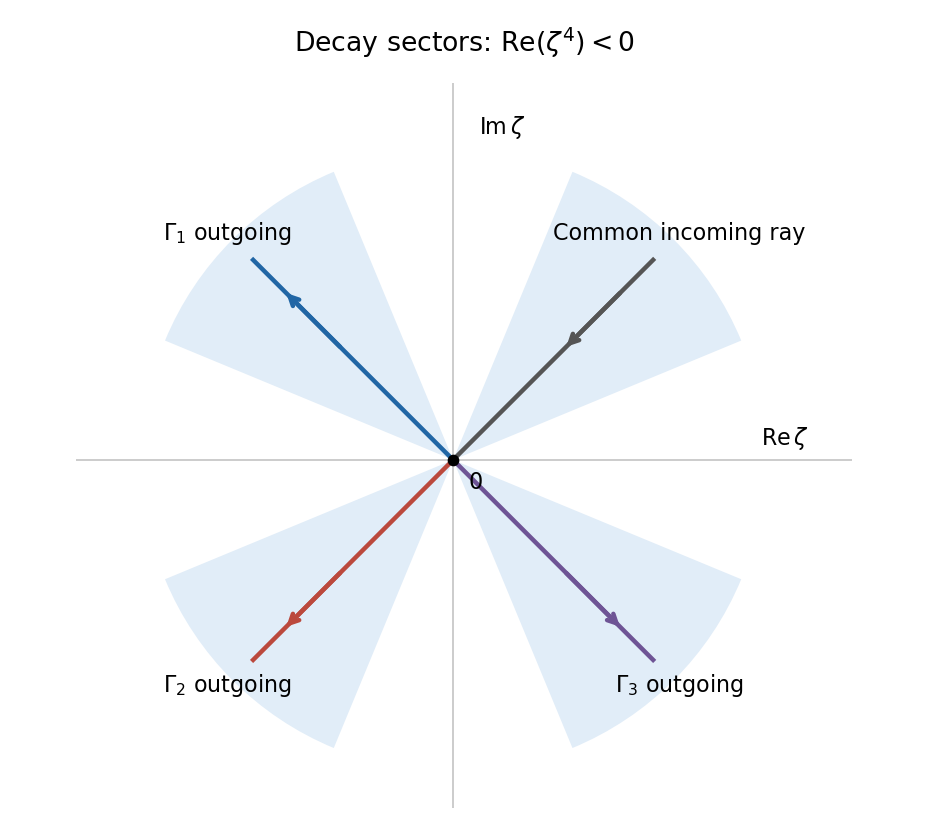

<h1 id="3/a/solution">Solution</h1>

↑ **Parent:** [A](../a.md)

In the [Laplace integral method for a differential equation](../../../../laplace-integral-method-for-a-differential-equation.md), differentiate the [integral](../../../../integral-split.md) three times with respect to $z$, and replace $ze^{z\zeta}$ by $\partial_\zeta e^{z\zeta}$. [Integration by parts](../../../../integration-by-parts.md) gives

$$
w'''+zw=\left[g(\zeta)e^{z\zeta}\right]_\Gamma+\int_\Gamma\bigl(\zeta^3g(\zeta)-g'(\zeta)\bigr)e^{z\zeta}\,d\zeta.
$$

Thus the weight equation for this construction and its [boundary condition](../../../../boundary-condition.md) are

$$
g'=\zeta^3g,\qquad\left[g(\zeta)e^{z\zeta}\right]_\Gamma=0,
$$

which give

$$
\boxed{g(\zeta)=Ae^{\zeta^4/4},\qquad A\ne0.}
$$

These are the conditions obtained by eliminating the transformed interior term and the endpoint term separately. As usual for this method, differentiation and [integration by parts](../../../../integration-by-parts.md) need convergence assumptions; the [contours](../../../../complex-integration-contour.md) constructed next make every such step valid locally uniformly for all complex $z$. A literal necessity claim for arbitrary weights and [contours](../../../../complex-integration-contour.md) would additionally require uniqueness of the chosen representation by a [Laplace integral](../../../../laplace-integral.md); a [null weight in a contour Laplace representation](../../../../null-weight-in-a-contour-laplace-representation.md) can otherwise be added without changing the solution.

Let

$$
u_j=e^{i(\pi/4+j\pi/2)},\qquad j=0,1,2,3.
$$

The [quartic decay sectors for a contour integral](../../../../quartic-decay-sectors-for-a-contour-integral.md) contain the four rays $\zeta=ru_j$. Along each ray, the quartic term is $\zeta^4/4=-r^4/4$. For $j=1,2,3$, choose $\Gamma_j$ to travel from [infinity](../../../../infinity.md) on ray $u_0$ to zero, and then from zero to [infinity](../../../../infinity.md) on ray $u_j$. Set $A=1$ and define

$$
\boxed{w_j(z)=\int_{\Gamma_j}e^{\zeta^4/4+z\zeta}\,d\zeta,\qquad j=1,2,3.}
$$

On any [compact set](../../../../compact-space.md) of $z$ values, the integrand and each of its $z$ [derivatives](../../../../derivative.md) are bounded by a constant times $r^m e^{-r^4/4+Mr}$ for some $M$. These bounds are integrable at [infinity](../../../../infinity.md), so [differentiation under the integral sign](../../../../differentiation-under-the-integral-sign.md) is justified and the [functions](../../../../function-split.md) are entire. The endpoint term vanishes at both infinite ends. There is no extra term at zero because the two pieces join with the same integrand value and opposite endpoint orientations. Therefore all three [functions](../../../../function-split.md) solve the [differential equation](../../../../differential-equation-split.md).

**[Figure 2](#3/a/image-three-independent-laplace-integral-contours-joining-rays-in-quartic-decay-sectors). Three independent Laplace integral contours joining rays in quartic decay sectors**.

To prove independence, evaluate their first three initial data. For $m=0,1,2$,

$$
w_j^{(m)}(0)=C_m(u_j^{m+1}-u_0^{m+1}),\qquad
C_m=\int_0^\infty r^m e^{-r^4/4}\,dr=4^{(m-3)/4}\Gamma\left(\frac{m+1}{4}\right)>0.
$$

If $\sum_{j=1}^3c_jw_j=0$, these initial data give $\sum_{j=1}^3c_j(u_j^\ell-u_0^\ell)=0$ for $\ell=1,2,3$. Define $c_0=-\sum_{j=1}^3c_j$. Then

$$
\sum_{j=0}^3c_ju_j^\ell=0,\qquad\ell=0,1,2,3.
$$

The coefficient matrix is a [Vandermonde matrix](../../../../vandermonde-matrix.md) at four distinct fourth roots of $-1$, and hence is invertible. All $c_j$ vanish. There is also a concrete reason for the earlier qualification about necessity. Deform the incoming ray of $\Gamma_1$ to angle $\pi/3$ and its outgoing ray to angle $2\pi/3$, within their respective quartic decay sectors. The quartic integral is unchanged and remains nonzero. On this deformed contour, the extra entire weight $e^{\zeta^2}$ contributes zero for every $z$: throughout the closing wedge, $\operatorname{Re}(\zeta^2)\leq-r^2/2$, so the large closing arc tends to zero and the [Cauchy integral theorem](../../../../cauchy-s-integral-theorem.md) gives a zero integral. Thus $g=e^{\zeta^4/4}+e^{\zeta^2}$ represents the same entire solution and has vanishing endpoint terms, although it does not satisfy $g'=\zeta^3g$. The canonical weight equation is the standard sufficient construction, rather than an unconditional uniqueness assertion about contour representations.

Thus **the three [contours](../../../../complex-integration-contour.md) give [linearly independent](../../../../linear-independence.md) nonzero solutions**, and they form a [fundamental system of solutions](../../../../fundamental-system-of-solutions.md) for this third-order linear equation. This proves independence directly instead of inferring it merely from the presence of three different [contours](../../../../complex-integration-contour.md).

## ↑ Ancestors (12)

1. [A](../a.md)
2. [3](../../3.md)
3. [2011](../../../2011-split.md)
4. [Past exam of the applied complex variables course of the University of Oxford](../../../split.md)
5. [Applied complex variables course of the University of Oxford](../../../../applied-complex-variables-course-of-the-university-of-oxford.md)
6. [Year 4 of the mathematics course of the University of Oxford](../../../../year-4-of-the-mathematics-course-of-the-university-of-oxford.md)
7. [Mathematics course of the University of Oxford](../../../../mathematics-course-of-the-university-of-oxford.md)
8. [Undergraduate course of the University of Oxford](../../../../undergraduate-course-of-the-university-of-oxford.md)
9. [Course of the University of Oxford](../../../../course-of-the-university-of-oxford.md)
10. [University of Oxford](../../../../university-of-oxford-split.md)
11. [List of universities](../../../../list-of-universities.md)
12. [Codex Wiki](../../../../split.md)
