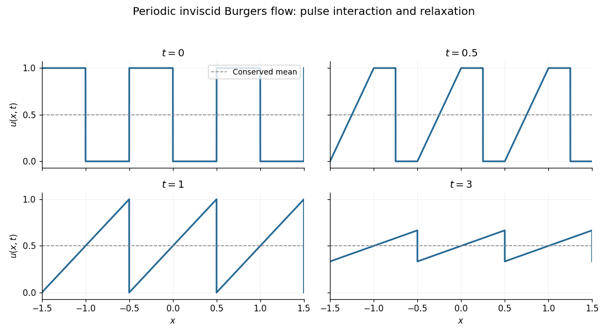

# 2023

↑ **Parent:** [Past exam of the applied partial differential equations course of the University of Oxford](../past-exam-of-the-applied-partial-differential-equations-course-of-the-university-of-oxford.md)

Source: [released examination PDF, pages 224–227](https://www.whatdotheyknow.com/request/request_for_mathematics_examinat/response/3129786/attach/3/FOI%20202507%20740%20Data.pdf#page=224). Solutions follow the numbering of the 14 June 2023 Applied Partial Differential Equations paper.

**Table of contents**

- [1](#1)
  - [a](#1/a)
    - [i](#1/a/i)
      - [Solution](#1/a/i/solution)
    - [ii](#1/a/ii)
      - [Solution](#1/a/ii/solution)
  - [b](#1/b)
    - [Solution](#1/b/solution)
- [2](#2)
  - [a](#2/a)
    - [Solution](#2/a/solution)
  - [b](#2/b)
    - [Solution](#2/b/solution)
  - [c](#2/c)
    - [i](#2/c/i)
      - [Solution](#2/c/i/solution)
    - [ii](#2/c/ii)
      - [Solution](#2/c/ii/solution)
    - [iii](#2/c/iii)
      - [Solution](#2/c/iii/solution)
- [3](#3)
  - [a](#3/a)
    - [Solution](#3/a/solution)
  - [b](#3/b)
    - [Solution](#3/b/solution)
  - [c](#3/c)
    - [Solution](#3/c/solution)

## 1

↑ **Parent:** [2023](2023.md)

<h3 id="1/a">a</h3>

↑ **Parent:** [1](#1)

<h4 id="1/a/i">i</h4>

↑ **Parent:** [A](#1/a)

<h5 id="1/a/i/solution">Solution</h5>

↑ **Parent:** [I](#1/a/i)

The supplied positive free-space kernel satisfies $-\Delta H=\delta$, so use the same sign convention for the [Dirichlet Green function](../green-s-function.md#dirichlet-green-function). For an interior source $Q=(\xi,\eta,\zeta)$, require

$$
-\Delta_PG(P;Q)=\delta_Q(P),\qquad G=0\text{ on }x=0\text{ and }z=0,\qquad G(P;Q)\to0\text{ as }|P|\to\infty.
$$

Away from $Q$, the function is [harmonic](../partial-differential-equation.md#harmonic-function), and $G-H$ is regular near $Q$. The [method of images](../mathematics.md#method-of-images) reflects the source in each coordinate plane, reversing its sign on each reflection. Therefore

$$
\boxed{G(P;Q)=\frac1{4\pi}\sum_{i,j=0}^1\frac{(-1)^{i+j}}{\sqrt{(x-(-1)^i\xi)^2+(y-\eta)^2+(z-(-1)^j\zeta)^2}}}.
$$

On either face, the terms cancel in pairs. Only the original source lies in the domain, so the other three terms are [harmonic](../partial-differential-equation.md#harmonic-function) there; the required singularity and decay also follow. This is the [Dirichlet Green function for a three-dimensional quarter-space](../green-s-function.md#dirichlet-green-function-for-a-three-dimensional-quarter-space). Using $\Delta G=\delta$ instead would change the sign of the kernel and the representation formula together, as in [sign conventions for a Dirichlet Green function](../green-s-function.md#sign-conventions-for-a-dirichlet-green-function).

<h4 id="1/a/ii">ii</h4>

↑ **Parent:** [A](#1/a)

<h5 id="1/a/ii/solution">Solution</h5>

↑ **Parent:** [Ii](#1/a/ii)

For the preceding sign convention, [Green's second identity](../partial-differential-equation.md#green-second-identity) gives the harmonic representation

$$
u(P)=-\int_{\partial D}u(Q)\,\partial_{n_Q}G(P;Q)\,dS_Q,
$$

provided the far-boundary term vanishes or the bounded-solution representation applies. The face $x=0$ contributes nothing because $g_1=0$. On $\zeta=0$, the outward normal is $-e_\zeta$, so the remaining kernel is $-\partial_{n_Q}G=\partial_\zeta G$. Differentiating the image sum gives

$$
\boxed{u(x,y,z)=\frac z{2\pi}\int_{-\infty}^{\infty}\int_0^\infty\left\{\frac1{[(x-\xi)^2+(y-\eta)^2+z^2]^{3/2}}-\frac1{[(x+\xi)^2+(y-\eta)^2+z^2]^{3/2}}\right\}g(\xi,\eta)\,d\xi\,d\eta}.
$$

Thus the requested constants are

$$
\boxed{h(z)=\frac z{2\pi},\qquad\alpha=\frac32,\qquad\alpha_0=1,\quad\alpha_1=-1}.
$$

The [Poisson kernel of a three-dimensional quarter-space](../green-s-function.md#poisson-kernel-of-a-three-dimensional-quarter-space) is the difference of the upper-half-space kernel and its reflection in $x=0$. For bounded, suitably continuous data it produces the bounded harmonic solution, taking the prescribed traces away from the edge. Continuous data at the common edge must be compatible. Without any growth restriction at infinity, boundary values alone do not give uniqueness: a multiple of the harmonic function $xz$ can be added while leaving both face values zero.

<h3 id="1/b">b</h3>

↑ **Parent:** [1](#1)

<h4 id="1/b/solution">Solution</h4>

↑ **Parent:** [B](#1/b)

Introduce the [Euler differential operator](../analysis.md#euler-differential-operator) $D=x\partial_x$. The fourth-order spatial expression is $D^4u$. The moving boundary has similarity coordinate $\xi=1$, so its two conditions give

$$
v(1)=0,\qquad t^\alpha v'(1)=1\quad(t>0).
$$

Hence $\alpha=0$ and $v'(1)=1$. With $D_\xi=\xi\partial_\xi$, substitution in the equation yields

$$
(D_\xi^4-\beta D_\xi)v=0,\qquad v(\xi)\to0\quad(\xi\to\infty).
$$

This is a [Cauchy-Euler equation](../linear-ordinary-differential-equation.md#cauchy-euler-equation); putting $r=\log\xi$ turns it into the constant-coefficient equation $V^{(4)}-\beta V'=0$. Its [characteristic polynomial](../linear-operator-theory.md#characteristic-polynomial) is $n(n^3-\beta)$.

If $\beta>0$, write $a=\beta^{1/3}$. The roots are $0,a,-a/2\pm i\sqrt3a/2$. Decay excludes the constant and growing modes, leaving

$$
v(\xi)=\xi^{-a/2}\left[A\cos\left(\frac{\sqrt3a}2\log\xi\right)+B\sin\left(\frac{\sqrt3a}2\log\xi\right)\right].
$$

The boundary conditions force $A=0$ and $B=2/(\sqrt3a)$. If $\beta<0$, writing $\beta=-a^3$ leaves only one decaying mode, $C\xi^{-a}$; $v(1)=0$ then forces the zero function, which fails the derivative condition. If $\beta=0$, the solutions are polynomials of degree at most three in $\log\xi$, and none can both decay and satisfy $v'(1)=1$.

Consequently all real self-similar solutions are the one-parameter family

$$
\boxed{\alpha=0,\quad\beta>0,\quad s(t)=t^\beta,\quad u(x,t)=\frac{2}{\sqrt3\,\beta^{1/3}}\left(\frac{x}{t^\beta}\right)^{-\beta^{1/3}/2}\sin\left[\frac{\sqrt3\,\beta^{1/3}}2\log\left(\frac{x}{t^\beta}\right)\right]}.
$$

The [decaying profile for a fourth-order dilation equation](../analysis.md#decaying-profile-for-a-fourth-order-dilation-equation) oscillates in logarithmic distance. No positivity condition on $u$ was imposed, so these sign changes are permitted.

## 2

↑ **Parent:** [2023](2023.md)

<h3 id="2/a">a</h3>

↑ **Parent:** [2](#2)

<h4 id="2/a/solution">Solution</h4>

↑ **Parent:** [A](#2/a)

The [Rankine-Hugoniot condition](../transport-equation.md#rankine-hugoniot-conditions) for the flux $f(u)=u^2/2$ gives, for distinct states,

$$
\boxed{\dot s=\frac{f(u_-)-f(u_+)}{u_--u_+}=\frac{u_-+u_+}{2}}.
$$

The [characteristic speed](../transport-equation.md#characteristic-speed) is $f'(u)=u$. A causal [entropy shock](../transport-equation.md#entropy-shock) has characteristics entering from both sides, so $u_->\dot s>u_+$, equivalently

$$
\boxed{u_->u_+}.
$$

An upward jump instead resolves into a [rarefaction wave](../transport-equation.md#rarefaction-wave); the jump condition alone does not select the physical weak solution.

<h3 id="2/b">b</h3>

↑ **Parent:** [2](#2)

<h4 id="2/b/solution">Solution</h4>

↑ **Parent:** [B](#2/b)

The upward jump at $-1/2$ creates a [rarefaction wave](../transport-equation.md#rarefaction-wave) with $u=(x+1/2)/t$, bounded by the characteristic lines $x=-1/2$ and $x=t-1/2$. The downward jump at zero joins the states $1,0$, so part (a) gives the shock position $s(t)=t/2$. The intervening plateau exists exactly while $t-1/2<t/2$, or $t<1$. The fan satisfies the [Inviscid Burgers equation](../transport-equation.md#inviscid-burgers-equation) classically and matches the constant branches continuously; the shock satisfies the [Rankine-Hugoniot condition](../transport-equation.md#rankine-hugoniot-conditions) and is causal because $1>1/2>0$. Its initial trace is the prescribed pulse.

At $t=1$, the fan reaches the shock at $x=1/2$. Subsequently the states immediately to its left and right are $(s(t)+1/2)/t$ and zero, so

$$
\dot s=\frac{s+1/2}{2t},\qquad s(1)=\frac12.
$$

Solving gives $s(t)+1/2=\sqrt t$. Thus the continuation is

$$
\boxed{u(x,t)=\begin{cases}(x+1/2)/t,&-1/2<x<\sqrt t-1/2,\\0,&\text{otherwise},\end{cases}\qquad t\geq1,\qquad s(t)=\sqrt t-\frac12}.
$$

Values assigned precisely at the shock do not affect the [weak solution](../partial-differential-equation.md#weak-solution). Its speed $1/(2\sqrt t)$ lies strictly between the left state $1/\sqrt t$ and zero, so it remains a causal [entropy shock](../transport-equation.md#entropy-shock). The area under the triangular profile is $\tfrac12(\sqrt t)(1/\sqrt t)=1/2$, checking conservation of the initial mass. This is the [rectangular pulse solution of the inviscid Burgers equation](../transport-equation.md#rectangular-pulse-solution-of-the-inviscid-burgers-equation).

<h3 id="2/c">c</h3>

↑ **Parent:** [2](#2)

<h4 id="2/c/i">i</h4>

↑ **Parent:** [C](#2/c)

<h5 id="2/c/i/solution">Solution</h5>

↑ **Parent:** [I](#2/c/i)

The initial condition is a period-one square wave: height one on each interval $[k-1/2,k]$ and zero on each gap $(k,k+1/2)$, for integer $k$. Each period has mean $1/2$.

**[Figure 1](#2/c/i/image-a-periodic-train-of-pulses-evolves-into-a-travelling-sawtooth-of-decreasing-amplitude). A periodic train of pulses evolves into a travelling sawtooth of decreasing amplitude**. Original exact profiles at $t=0$, $t=0.5$, $t=1$, and $t=3$. The dashed line marks the conserved mean $1/2$. Jump-point values can be chosen without changing the weak solution.

<h4 id="2/c/ii">ii</h4>

↑ **Parent:** [C](#2/c)

<h5 id="2/c/ii/solution">Solution</h5>

↑ **Parent:** [Ii](#2/c/ii)

For $0<t<1$, translated copies of the preceding pulse have disjoint interiors of support. In the cell $k-1/2\leq x<k+1/2$, write $r=x-k$. The solution is

$$
\boxed{u(x,t)=\begin{cases}(r+1/2)/t,&-1/2\leq r<t-1/2,\\1,&t-1/2\leq r<t/2,\\0,&t/2\leq r<1/2.\end{cases}}
$$

At $t=0$ use the given initial function. Each fan starts at $k-1/2$, and each shock has position $x=k+t/2$. At $t=1$, the plateau disappears: its left fan catches its right shock at $k+1/2$, which is also the starting edge of the next fan. The shocks must henceforth connect two nonconstant fan branches rather than a fan to a zero interval.

<h4 id="2/c/iii">iii</h4>

↑ **Parent:** [C](#2/c)

<h5 id="2/c/iii/solution">Solution</h5>

↑ **Parent:** [Iii](#2/c/iii)

Let $s_k(t)$ be the shock separating the fans from $k-1/2$ and $k+1/2$. Their traces give

$$
\dot s_k=\frac12\left[\frac{s_k-k+1/2}{t}+\frac{s_k-k-1/2}{t}\right]=\frac{s_k-k}{t},\qquad s_k(1)=k+1/2.
$$

Thus $\boxed{s_k(t)=k+t/2}$. Between consecutive shocks, $u=(x-k+1/2)/t$. Writing $\{r\}=r-\lfloor r\rfloor$ for the [fractional part](../calculus.md#fractional-part), the period-one solution can be expressed, with right-hand shock traces, as

$$
\boxed{u(x,t)=\frac12+\frac{\{x-t/2\}-1/2}{t},\qquad t\geq1}.
$$

To put it in the requested fixed-support sum, take

$$
\boxed{v(x,t)=\begin{cases}\displaystyle\frac12+\frac{\{x-t/2\}-1/2}{t},&-1/2\leq x<1/2,\\0,&\text{otherwise},\end{cases}\qquad u(x,t)=\sum_{k\in\mathbb Z}v(x-k,t)}.
$$

The half-open cells partition the line, so exactly one summand contributes at each point. This is a representation of the periodic solution, not a superposition principle for arbitrary solutions of a nonlinear equation.

The left and right shock states are $1/2+1/(2t)$ and $1/2-1/(2t)$; both average to the shock speed $1/2$, and the strict inequalities certify causality. The [periodic square-wave relaxation for the inviscid Burgers equation](../transport-equation.md#periodic-square-wave-relaxation-for-the-inviscid-burgers-equation) has the uniform estimate

$$
\boxed{\sup_x|u(x,t)-1/2|\leq\frac1{2t}\longrightarrow0}.
$$

The limit is the conserved mean $1/2$.

## 3

↑ **Parent:** [2023](2023.md)

<h3 id="3/a">a</h3>

↑ **Parent:** [3](#3)

<h4 id="3/a/solution">Solution</h4>

↑ **Parent:** [A](#3/a)

Freeze the coefficients at a point. Characteristic normals $(\tau,\xi)\ne(0,0)$ satisfy the homogeneous quadratic [matrix pencil](../vector-space.md#matrix-pencil) equation $\det(\tau A+\xi B)=0$. In the elementary characteristic classification, two distinct real characteristic directions give a hyperbolic system, no real directions an elliptic system, and a repeated real direction the parabolic case. An identically zero determinant polynomial is a further degeneracy, not covered by that nondegenerate classification.

When $A$ is invertible, write $C=A^{-1}B$. The finite characteristic slopes solve $\det(B-\lambda A)=0$, or

$$
\lambda^2-(\operatorname{tr}C)\lambda+\det C=0.
$$

Its discriminant $(\operatorname{tr}C)^2-4\det C$ is positive, negative, or zero in the three cases above. For the well-posed first-order evolution meaning of [hyperbolicity](../partial-differential-equation.md#hyperbolicity), real eigenvalues must also admit a complete eigenbasis: a repeated but diagonalizable pair is non-strictly hyperbolic rather than a defective parabolic system. Distinct real roots suffice for strict hyperbolicity.

For the given [shallow water equations](../mathematical-physics.md#shallow-water-equations), subtracting $u$ times mass conservation from momentum conservation and dividing by $h>0$ gives the primitive-variable system

$$
\begin{pmatrix}h\\u\end{pmatrix}_t+\begin{pmatrix}u&h\\1&u\end{pmatrix}\begin{pmatrix}h\\u\end{pmatrix}_x=0.
$$

The [characteristic polynomial](../linear-operator-theory.md#characteristic-polynomial) is $(u-\lambda)^2-h$, so

$$
\boxed{\lambda_-=u-\sqrt h,\qquad\lambda_+=u+\sqrt h}.
$$

They are real and distinct whenever $h>0$, proving strict [hyperbolicity](../partial-differential-equation.md#hyperbolicity).

<h3 id="3/b">b</h3>

↑ **Parent:** [3](#3)

<h4 id="3/b/solution">Solution</h4>

↑ **Parent:** [B](#3/b)

Apply the [Rankine-Hugoniot conditions](../transport-equation.md#rankine-hugoniot-conditions) to the conserved variables $(h,hu)$ and flux $(hu,hu^2+h^2/2)$. They give

$$
s(h_1-1)=h_1u_1,\qquad sh_1u_1=h_1u_1^2+\frac{h_1^2-1}{2}.
$$

For a genuine shock, $h_1\ne1$. Eliminating $u_1$ yields $s^2=h_1(h_1+1)/2$. Taking the positive branch requested,

$$
\boxed{s=\sqrt{\frac{h_1(h_1+1)}2},\qquad u_1=(h_1-1)\sqrt{\frac{h_1+1}{2h_1}}}.
$$

When $h_1=1$, the jump conditions instead force $u_1=0$ and describe a constant state; the labelled interface can then move at any speed and is not a shock. The nontrivial formulas describe a [shallow-water shock into stationary unit-depth water](../mathematical-physics.md#shallow-water-shock-into-stationary-unit-depth-water).

<h3 id="3/c">c</h3>

↑ **Parent:** [3](#3)

<h4 id="3/c/solution">Solution</h4>

↑ **Parent:** [C](#3/c)

For a strictly hyperbolic two-component [system of conservation laws](../transport-equation.md#system-of-conservation-laws) with ordered speeds $\lambda_-<\lambda_+$, a compressive family-$j$ shock has its family characteristics entering from both sides: $\lambda_j(U_R)<s<\lambda_j(U_L)$. The other family crosses the interface with the same sign of relative speed on both sides. These are the [Lax shock admissibility conditions](../transport-equation.md#lax-shock-admissibility-conditions) and give three incoming characteristic directions for two conservation laws.

In the present problem,

$$
\lambda_\pm(U_R)=\pm1,\qquad\lambda_\pm(U_L)=u_1\pm\sqrt{h_1}.
$$

Since $u_1=s-s/h_1$, we always have $u_1-\sqrt{h_1}<s$. Hence a positive-speed shock of this form cannot be a family-minus shock. For a family-plus shock the remaining strict inequalities are

$$
1<s<u_1+\sqrt{h_1}.
$$

The first is equivalent to $h_1(h_1+1)>2$, or $h_1>1$. The second is equivalent to $s<h_1^{3/2}$, whose square reduces to $h_1+1<2h_1^2$, again equivalent to $h_1>1$ for positive $h_1$. The minus speed on the right is $-1<s$ automatically. Thus all causal inequalities hold exactly when

$$
\boxed{h_1>H,\qquad H=1}.
$$

Depth increases behind the right-moving shock. For $0<h_1<1$, the algebraic jump solution has the wrong characteristic orientation and is an inadmissible expansion shock; equality is the no-jump limit.

## ↑ Ancestors (9)

1. [Past exam of the applied partial differential equations course of the University of Oxford](../past-exam-of-the-applied-partial-differential-equations-course-of-the-university-of-oxford.md)
2. [Applied partial differential equations course of the University of Oxford](../university-of-oxford.md#applied-partial-differential-equations-course-of-the-university-of-oxford)
3. [Year 3 of the mathematics course of the University of Oxford](../university-of-oxford.md#year-3-of-the-mathematics-course-of-the-university-of-oxford)
4. [Mathematics course of the University of Oxford](../university-of-oxford.md#mathematics-course-of-the-university-of-oxford)
5. [Undergraduate course of the University of Oxford](../university-of-oxford.md#undergraduate-course-of-the-university-of-oxford)
6. [Course of the University of Oxford](../university-of-oxford.md#course-of-the-university-of-oxford)
7. [University of Oxford](../university-of-oxford.md)
8. [List of universities](../README.md#list-of-universities)
9. [Codex Wiki](../README.md)
