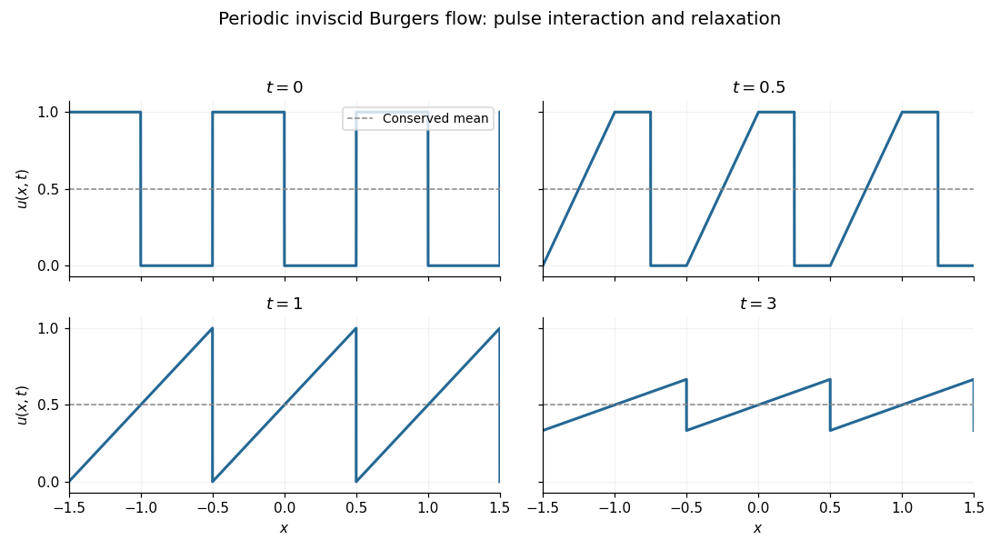

<h1 id="2/c/i/solution">Solution</h1>

↑ **Parent:** [I](../i.md)

The initial condition is a period-one square wave: height one on each interval $[k-1/2,k]$ and zero on each gap $(k,k+1/2)$, for integer $k$. Each period has mean $1/2$.

**[Figure 1](#2/c/i/image-a-periodic-train-of-pulses-evolves-into-a-travelling-sawtooth-of-decreasing-amplitude). A periodic train of pulses evolves into a travelling sawtooth of decreasing amplitude**. Original exact profiles at $t=0$, $t=0.5$, $t=1$, and $t=3$. The dashed line marks the conserved mean $1/2$. Jump-point values can be chosen without changing the weak solution.

## ↑ Ancestors (13)

1. [I](../i.md)
2. [C](../../c.md)
3. [2](../../../2.md)
4. [2023](../../../../2023-split.md)
5. [Past exam of the applied partial differential equations course of the University of Oxford](../../../../split.md)
6. [Applied partial differential equations course of the University of Oxford](../../../../../applied-partial-differential-equations-course-of-the-university-of-oxford.md)
7. [Year 3 of the mathematics course of the University of Oxford](../../../../../year-3-of-the-mathematics-course-of-the-university-of-oxford.md)
8. [Mathematics course of the University of Oxford](../../../../../mathematics-course-of-the-university-of-oxford.md)
9. [Undergraduate course of the University of Oxford](../../../../../undergraduate-course-of-the-university-of-oxford.md)
10. [Course of the University of Oxford](../../../../../course-of-the-university-of-oxford.md)
11. [University of Oxford](../../../../../university-of-oxford-split.md)
12. [List of universities](../../../../../list-of-universities.md)
13. [Codex Wiki](../../../../../split.md)
