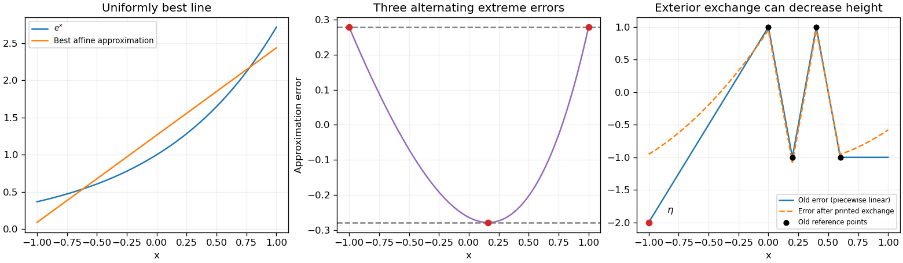

<h1 id="3/solution">Solution</h1>

↑ **Parent:** [3](../3.md)

The [equioscillation theorem](../../../equioscillation-theorem.md) says that $p_n\in P_n$ is the unique [best uniform approximation](../../../best-uniform-approximation.md) to a real [continuous function](../../../continuous-function.md) $u$ on $[-1,1]$ exactly when its error attains alternating values $\pm E_n$ at $n+2$ ordered distinct points. If $E_n=0$, the error vanishes everywhere and the conclusion is immediate.

For the [exponential function](../../../exponential-function.md), write the candidate line as $p_1(x)=ax+b$. Its error $r(x)=e^x-ax-b$ is strictly convex. Equal endpoint errors require $a=(e-e^{-1})/2=\sinh1$, and the interior minimum is at $c=\log a$, because $r'(c)=e^c-a=0$. Equating the endpoint error to the negative interior error gives

$$
\boxed{p_1(x)=ax+\frac{\cosh1+a-a\log a}{2},\quad E_1=\frac{\cosh1-a+a\log a}{2},\quad a=\sinh1.}
$$

Indeed $r(-1)=r(1)=E_1$ and $r(c)=-E_1$; convexity puts every other error value between these extremes. The [equioscillation theorem](../../../equioscillation-theorem.md) proves optimality.

For the reference-point assertions, put $M=\|u-q_a\|_\infty$. The [alternating-reference error bound](../../../alternating-reference-error-bound.md) gives $|h_a|\leq E_n$. In fact this inequality is strict here. To see the equality obstruction explicitly, let $p_n$ be optimal, $d=p_n-q_a$, and

$$
\omega_r=\left[\prod_{s\ne r}(x_r-x_s)\right]^{-1},\qquad r=0,\ldots,n+1.
$$

Since $d$ has [polynomial degree](../../../degree-of-a-polynomial.md) at most $n$, its order-$(n+1)$ [divided difference](../../../divided-difference.md) vanishes: $\sum_r\omega_rd(x_r)=0$. If $E_n=|h_a|>0$, change the overall sign to take $h_a>0$. The error bound for $p_n$ implies $(-1)^rd(x_r)\geq0$. The signs of the weights are $(-1)^{n+1-r}$, so every term in this sum has the same weak sign. Every term must vanish; $d$ then has $n+2$ distinct zeros, forcing $d=0$. This contradicts $M>E_n$. If $h_a=E_n=0$, $u=p_n$ and the same zero-count argument again forces $q_a=p_n$, also a contradiction. Thus

$$
\boxed{|h_a|<E_n<M.}
$$

At every old reference point the absolute error is only $|h_a|$, so a maximizer $\eta$ cannot be one of those points. The printed same-sign choice of $k$ additionally presumes $h_a\ne0$; when $h_a=0$, none of the reference errors has the nonzero sign of the maximal error.

**The printed replacement rule needs an endpoint qualification.** For an interior $\eta\in(x_0,x_{n+1})$ and nonzero $h_a$, replacing the adjacent endpoint of its containing reference interval with the same error sign preserves spatial order and alternating signs. The [single-point exchange in polynomial minimax approximation](../../../single-point-exchange-in-polynomial-minimax-approximation.md) then gives the requested strict increase. On an irregular grid, the globally nearest same-sign reference point need not be that adjacent endpoint, so adjacency must be specified. More generally, for any correctly ordered replacement set $z_0<\cdots<z_{n+1}$ on which the old error alternates in sign, let $w_r=\prod_{s\ne r}(z_r-z_s)^{-1}$. The vanished divided difference of $q_a$ and the new alternation equations show

$$
\boxed{|h_b|=\frac{|w_\eta|M+\sum_{z_r\ne\eta}|w_r|\,|h_a|}{\sum_r|w_r|}>|h_a|.}
$$

This is a strict weighted average because all the weights are positive in absolute value and $M>|h_a|$.

For an exterior $\eta$ whose error sign is opposite that at the nearest endpoint, merely replacing the nearest same-sign point, as printed, need not preserve alternation. A concrete counterexample uses $n=2$, $q_a=0$, $h_a=1$, and reference points

$$
(x_0,x_1,x_2,x_3)=(0,1/5,2/5,3/5).
$$

Let $u$ be the [piecewise linear function](../../../piecewise-linear-function.md) through $(-1,-2),(0,1),(1/5,-1),(2/5,1),(3/5,-1),(1,-1)$. Then $M=2$ at $\eta=-1$, and $1<E_2\leq3/2<2$: the upper bound is achieved by the trial constant $-1/2$, while equality at the lower bound is excluded by the preceding zero-count argument. The printed rule selects $k=1$ and hence $z=(0,-1,2/5,3/5)$. Nevertheless

$$
q_b(x)=\frac3{64}-\frac{25}{32}x\left(x-\frac25\right),\qquad h_b=\frac{61}{64}
$$

satisfy every printed new alternation equation, with $\boxed{|h_b|=61/64<1=|h_a|}$. Direct substitution at the four points checks this failure; reordering those points would destroy their assigned alternating signs.

The corrected exterior rule inserts $\eta$ as the new extreme reference point and drops the farthest endpoint when its sign is opposite the nearest endpoint. If its sign agrees with the nearest endpoint, replace that endpoint. Interior exchanges replace the adjacent reference point with the same sign. These rules preserve an ordered alternating set, so the strict-increase formula applies in every case.

The resulting [Remez algorithm](../../../remez-algorithm.md) solves the $n+2$ linear alternation equations for the [polynomial coefficients](../../../coefficient-of-a-polynomial.md) and reference height, locates a global maximum of the error, and performs a valid exchange unless $M=|h_a|$. The interval $|h_a|\leq E_n\leq M$ is an explicit optimality certificate; a small gap $M-|h_a|$ gives a stopping test. Strict increase of bounded reference heights alone does not prove convergence, so that stronger conclusion needs the additional analysis of the chosen exchange algorithm.

**[Figure 1](#3/image-minimax-linear-approximation-to-the-exponential-and-a-counterexample-to-the-unqualified-exterior-exchange-rule). Minimax linear approximation to the exponential and a counterexample to the unqualified exterior exchange rule**.

## ↑ Ancestors (11)

1. [3](../3.md)
2. [2011](../../2011-split.md)
3. [Past exam of the approximation of functions course of the University of Oxford](../../split.md)
4. [Approximation of functions course of the University of Oxford](../../../approximation-of-functions-course-of-the-university-of-oxford.md)
5. [Year 4 of the mathematics course of the University of Oxford](../../../year-4-of-the-mathematics-course-of-the-university-of-oxford.md)
6. [Mathematics course of the University of Oxford](../../../mathematics-course-of-the-university-of-oxford.md)
7. [Undergraduate course of the University of Oxford](../../../undergraduate-course-of-the-university-of-oxford.md)
8. [Course of the University of Oxford](../../../course-of-the-university-of-oxford.md)
9. [University of Oxford](../../../university-of-oxford-split.md)
10. [List of universities](../../../list-of-universities.md)
11. [Codex Wiki](../../../split.md)
