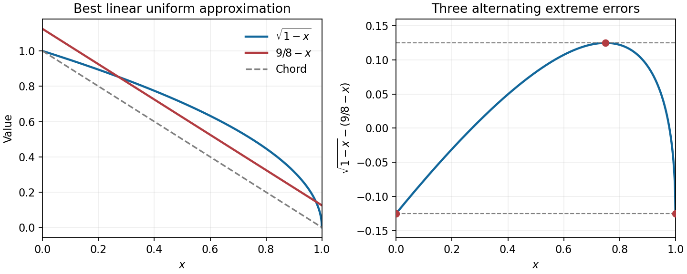

<h1 id="a/4/a/solution">Solution</h1>

↑ **Parent:** [A](../a.md)

The endpoint chord is $l(x)=1-x$. Since the square-root function is concave, the gap $g(x)=\sqrt{1-x}-(1-x)$ is nonnegative. Put $t=\sqrt{1-x}$ to obtain $g=t-t^2$, whose maximum is $1/4$ at $t=1/2$, or $x=3/4$.

Shift the chord upward by half that maximum. Then

$$
\boxed{p(x)=\frac98-x,\qquad
\|\sqrt{1-x}-p\|_\infty=\frac18.}
$$

The errors at $x=0,3/4,1$ are respectively $-1/8,+1/8,-1/8$. These are three alternating extrema, so equioscillation proves optimality and [uniqueness](../../../../../uniqueness.md) for linear [polynomials](../../../../../polynomial-split.md). This is [minimax linear approximation of a square-root endpoint profile](../../../../../minimax-linear-approximation-of-a-square-root-endpoint-profile.md).

**[Figure 1](#a/4/a/image-shifting-the-chord-by-one-eighth-creates-three-alternating-errors). Shifting the chord by one eighth creates three alternating errors**.

## ↑ Ancestors (13)

1. [A](../a.md)
2. [4](../../4.md)
3. [A](../../../a.md)
4. [2007](../../../../2007-split.md)
5. [Past exam of the approximation theory and finite element methods course of the University of Oxford](../../../../split.md)
6. [Approximation theory and finite element methods course of the University of Oxford](../../../../../approximation-theory-and-finite-element-methods-course-of-the-university-of-oxford.md)
7. [Year 4 of the mathematics course of the University of Oxford](../../../../../year-4-of-the-mathematics-course-of-the-university-of-oxford.md)
8. [Mathematics course of the University of Oxford](../../../../../mathematics-course-of-the-university-of-oxford.md)
9. [Undergraduate course of the University of Oxford](../../../../../undergraduate-course-of-the-university-of-oxford.md)
10. [Course of the University of Oxford](../../../../../course-of-the-university-of-oxford.md)
11. [University of Oxford](../../../../../university-of-oxford-split.md)
12. [List of universities](../../../../../list-of-universities.md)
13. [Codex Wiki](../../../../../split.md)
