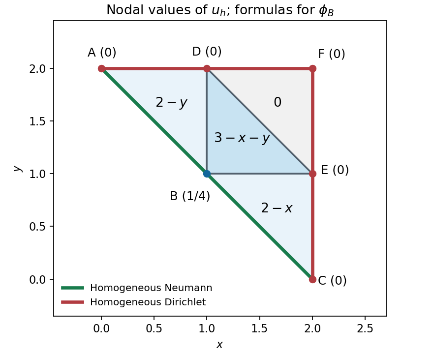

<h1 id="b/6/i/solution">Solution</h1>

↑ **Parent:** [I](../i.md)

Besides $A,B,C$, set $D=(1,2)$, $E=(2,1)$ and $F=(2,2)$. The four triangles are $ABD$, $BCE$, $BDE$ and $DEF$, each of area $1/2$. The nodal function is one at $B$, zero at every other node, and affine on each triangle. The vertex conditions give

$$
\boxed{\phi_B(x,y)=\begin{cases}
2-y,&(x,y)\in ABD,\\
2-x,&(x,y)\in BCE,\\
3-x-y,&(x,y)\in BDE,\\
0,&(x,y)\in DEF.
\end{cases}}
$$

The formulas agree on every shared edge, proving continuity.

**[Figure 2](#b/6/i/image-the-four-triangles-and-the-single-free-nodal-degree-of-freedom). The four triangles and the single free nodal degree of freedom**.

## ↑ Ancestors (13)

1. [I](../i.md)
2. [6](../../6.md)
3. [B](../../../b.md)
4. [2007](../../../../2007-split.md)
5. [Past exam of the approximation theory and finite element methods course of the University of Oxford](../../../../split.md)
6. [Approximation theory and finite element methods course of the University of Oxford](../../../../../approximation-theory-and-finite-element-methods-course-of-the-university-of-oxford.md)
7. [Year 4 of the mathematics course of the University of Oxford](../../../../../year-4-of-the-mathematics-course-of-the-university-of-oxford.md)
8. [Mathematics course of the University of Oxford](../../../../../mathematics-course-of-the-university-of-oxford.md)
9. [Undergraduate course of the University of Oxford](../../../../../undergraduate-course-of-the-university-of-oxford.md)
10. [Course of the University of Oxford](../../../../../course-of-the-university-of-oxford.md)
11. [University of Oxford](../../../../../university-of-oxford-split.md)
12. [List of universities](../../../../../list-of-universities.md)
13. [Codex Wiki](../../../../../split.md)
