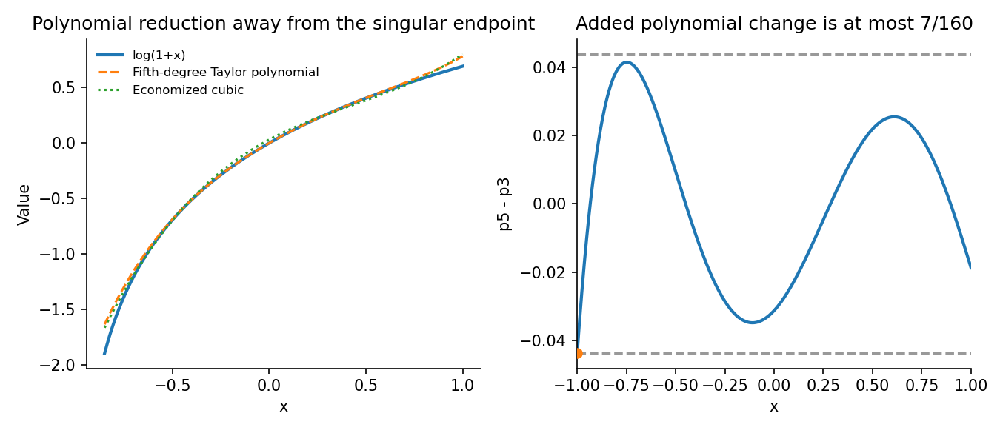
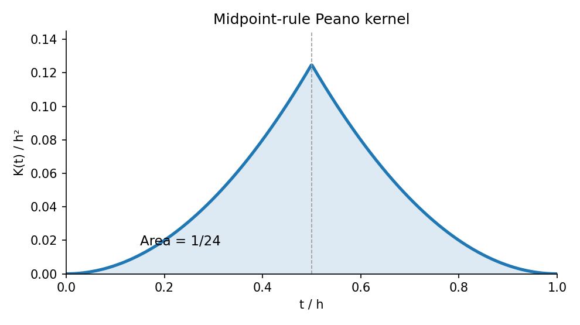

# 2008

↑ **Parent:** [Past exam of the approximation theory and finite element methods course of the University of Oxford](../past-exam-of-the-approximation-theory-and-finite-element-methods-course-of-the-university-of-oxford.md)

**Table of contents**

- [A](#a)
  - [1](#a/1)
    - [a](#a/1/a)
      - [Solution](#a/1/a/solution)
    - [b](#a/1/b)
      - [Solution](#a/1/b/solution)
    - [c](#a/1/c)
      - [Solution](#a/1/c/solution)
  - [2](#a/2)
    - [a](#a/2/a)
      - [Solution](#a/2/a/solution)
    - [b](#a/2/b)
      - [Solution](#a/2/b/solution)
    - [c](#a/2/c)
      - [Solution](#a/2/c/solution)
    - [d](#a/2/d)
      - [Solution](#a/2/d/solution)
  - [3](#a/3)
    - [a](#a/3/a)
      - [Solution](#a/3/a/solution)
    - [b](#a/3/b)
      - [Solution](#a/3/b/solution)
    - [c](#a/3/c)
      - [Solution](#a/3/c/solution)
  - [4](#a/4)
    - [a](#a/4/a)
      - [Solution](#a/4/a/solution)
    - [b](#a/4/b)
      - [Solution](#a/4/b/solution)
- [B](#b)
  - [5](#b/5)
    - [a](#b/5/a)
      - [Solution](#b/5/a/solution)
    - [b](#b/5/b)
      - [Solution](#b/5/b/solution)
    - [c](#b/5/c)
      - [Solution](#b/5/c/solution)
  - [6](#b/6)
    - [a](#b/6/a)
      - [Solution](#b/6/a/solution)
    - [b](#b/6/b)
      - [Solution](#b/6/b/solution)
    - [c](#b/6/c)
      - [Solution](#b/6/c/solution)
  - [7](#b/7)
    - [a](#b/7/a)
      - [Solution](#b/7/a/solution)
    - [b](#b/7/b)
      - [Solution](#b/7/b/solution)
    - [c](#b/7/c)
      - [Solution](#b/7/c/solution)
  - [8](#b/8)
    - [a](#b/8/a)
      - [Solution](#b/8/a/solution)
    - [b](#b/8/b)
      - [Solution](#b/8/b/solution)
    - [c](#b/8/c)
      - [Solution](#b/8/c/solution)

## A

↑ **Parent:** [2008](2008.md)

<h3 id="a/1">1</h3>

↑ **Parent:** [A](#a)

<h4 id="a/1/a">a</h4>

↑ **Parent:** [1](#a/1)

<h5 id="a/1/a/solution">Solution</h5>

↑ **Parent:** [A](#a/1/a)

Put $x=\cos\theta$. The trigonometric identity

$$
\cos((n+1)\theta)+\cos((n-1)\theta)=2\cos\theta\cos(n\theta)
$$

gives the [Chebyshev polynomial](../numerical-analysis.md#chebyshev-polynomial) recurrence $T_{n+1}=2xT_n-T_{n-1}$. Starting from $T_0=1$ and $T_1=x$, successive substitution yields

$$
\boxed{T_0=1,\quad T_1=x,\quad T_2=2x^2-1,\quad
T_3=4x^3-3x,\quad T_4=8x^4-8x^2+1.}
$$

The recurrence also proves by induction that $T_n$ is a [polynomial](../polynomial.md) of degree $n$, with leading coefficient $2^{n-1}$ for $n\geq1$.

<h4 id="a/1/b">b</h4>

↑ **Parent:** [1](#a/1)

<h5 id="a/1/b/solution">Solution</h5>

↑ **Parent:** [B](#a/1/b)

For $n\geq1$, set $p=2^{1-n}T_n$. It is monic by part (a), and its supremum [norm](../normed-vector-space.md#norm) on $[-1,1]$ is $E=2^{1-n}$. At the $n+1$ successive extreme points $x_j=\cos(j\pi/n)$ it alternates between $E$ and $-E$.

Suppose a monic degree-$n$ [polynomial](../polynomial.md) $q$ had $\|q\|_\infty<E$. At each $x_j$, the difference $p-q$ would have the sign of $p$. These signs alternate, so the [intermediate value theorem](../calculus.md#intermediate-value-theorem) forces a root in each of the $n$ successive gaps. But the leading monic terms cancel, making $\deg(p-q)\leq n-1$, a contradiction. Therefore

$$
\boxed{\|2^{1-n}T_n\|_\infty\leq\|q\|_\infty.}
$$

This is the monic [monic Chebyshev extremal polynomial](../numerical-analysis.md#monic-chebyshev-extremal-polynomial). The positive-degree restriction matters: at $n=0$ the printed scaling gives the constant two, while the only monic constant is one, so that version is false. The customary theorem uses $n\geq1$.

<h4 id="a/1/c">c</h4>

↑ **Parent:** [1](#a/1)

<h5 id="a/1/c/solution">Solution</h5>

↑ **Parent:** [C](#a/1/c)

Expand the fifth-degree [Taylor polynomial](../calculus.md#taylor-polynomial) $p_5$ in [Chebyshev polynomials](../numerical-analysis.md#chebyshev-polynomial), using the identities for powers obtained from part (a):

$$
p_5=-\frac{11}{32}T_0+\frac{11}{8}T_1-\frac38T_2
+\frac7{48}T_3-\frac1{32}T_4+\frac1{80}T_5.
$$

Delete the last two Chebyshev terms and convert back to powers. The economized cubic is

$$
\boxed{p_3(x)=\frac1{32}+\frac{15}{16}x-\frac34x^2+\frac7{12}x^3.}
$$

Since $|T_j|\leq1$,

$$
\|p_5-p_3\|_\infty
\leq\frac1{32}+\frac1{80}=\frac7{160}.
$$

Equality holds at $x=-1$, where both deleted terms have negative sign. Thus **the economization changes the [polynomial](../polynomial.md) by at most $7/160$**, exactly in supremum [norm](../normed-vector-space.md#norm) on $[-1,1]$.

For the target itself, $|\log(1+x)-p_3(x)|\leq|\log(1+x)-p_5(x)|+7/160$ wherever $x>-1$. The logarithm is singular at $-1$, so its total uniform error on all of $(-1,1]$ is infinite; the finite estimate concerns the additional [polynomial](../polynomial.md) change, or the increase on any smaller interval where the original error is bounded.

**[Figure 1](#a/1/c/image-chebyshev-economization-removes-two-bounded-high-degree-components). Chebyshev economization removes two bounded high-degree components**.

<h3 id="a/2">2</h3>

↑ **Parent:** [A](#a)

<h4 id="a/2/a">a</h4>

↑ **Parent:** [2](#a/2)

<h5 id="a/2/a/solution">Solution</h5>

↑ **Parent:** [A](#a/2/a)

Use the standard convention that the [orthogonal polynomials](../orthogonal-polynomial.md) are nonzero. Their exact degrees then follow from the stated assumptions by induction: $\phi_0$ is a nonzero constant, and if $\phi_0,\ldots,\phi_{r-1}$ span $P_{r-1}$, a nonzero $\phi_r\in P_r$ orthogonal to all of them cannot lie in $P_{r-1}$.

Let $t_1,\ldots,t_m$ be the distinct sign-changing roots of $\phi_r$ in $(0,1)$, and put $q(x)=\prod_{j=1}^m(x-t_j)$. Then $\phi_rq$ has constant sign between and across all its roots, and is not identically zero. Because $w>0$ in the interior, $\int_0^1w\phi_rq$ is nonzero. If $m<r$, orthogonality to $P_{r-1}$ would make this integral zero. Thus $m\geq r$.

A degree-$r$ [polynomial](../polynomial.md) cannot have more than $r$ roots counted with multiplicity, so **all $r$ roots are real, simple, and strictly inside $(0,1)$**. This is the standard [zeros of orthogonal polynomials](../orthogonal-polynomial.md#zeros-of-orthogonal-polynomials) argument, with the positive weight ensuring strict noncancellation.

<h4 id="a/2/b">b</h4>

↑ **Parent:** [2](#a/2)

<h5 id="a/2/b/solution">Solution</h5>

↑ **Parent:** [B](#a/2/b)

The displayed recurrence requires monic normalization, which is not explicitly stated in the preamble. Arbitrary independent rescaling of [orthogonal polynomials](../orthogonal-polynomial.md) preserves orthogonality but changes the recurrence coefficients. Choose their monic representatives for this and the following calculations.

Expand $x\phi_n$ in the orthogonal [polynomial](../polynomial.md) basis:

$$
x\phi_n=\phi_{n+1}+\sum_{j=0}^na_j\phi_j.
$$

The leading coefficient of $\phi_{n+1}$ is one. For $j\leq n-2$, $(x\phi_n,\phi_j)=(\phi_n,x\phi_j)=0$, because the second factor has degree below $n$. Thus only $j=n,n-1$ remain. Inner products give

$$
a_n=\frac{(\phi_n,x\phi_n)}{\|\phi_n\|^2},\qquad
a_{n-1}=\frac{(\phi_n,x\phi_{n-1})}{\|\phi_{n-1}\|^2}
=\frac{\|\phi_n\|^2}{\|\phi_{n-1}\|^2}.
$$

The last equality uses $x\phi_{n-1}-\phi_n\in P_{n-1}$. Rearranging yields exactly the [three-term recurrence for monic orthogonal polynomials](../orthogonal-polynomial.md#three-term-recurrence-for-monic-orthogonal-polynomials)

$$
\boxed{\phi_{n+1}=(x-a_n)\phi_n-
\frac{\|\phi_n\|^2}{\|\phi_{n-1}\|^2}\phi_{n-1}.}
$$

<h4 id="a/2/c">c</h4>

↑ **Parent:** [2](#a/2)

<h5 id="a/2/c/solution">Solution</h5>

↑ **Parent:** [C](#a/2/c)

For weight $x^2$, the moments are $\int_0^1x^{j+2}\,dx=1/(j+3)$. Monic orthogonalization gives $\phi_0=1$ and $\phi_1=x-(1/4)/(1/3)=x-3/4$.

For $\phi_2=x^2+ax+b$, orthogonality to $1,x$ requires

$$
\frac15+\frac a4+\frac b3=0,\qquad
\frac16+\frac a5+\frac b4=0.
$$

Solving gives $a=-4/3$, $b=2/5$. Hence

$$
\boxed{\phi_0=1,\quad\phi_1=x-\tfrac34,\quad
\phi_2=x^2-\tfrac43x+\tfrac25,}
$$

$$
\boxed{x_1=\frac{10-\sqrt{10}}{15},\qquad
x_2=\frac{10+\sqrt{10}}{15}.}
$$

These are the nodes for the [two-node Gaussian quadrature with quadratic weight](../numerical-analysis.md#two-node-gaussian-quadrature-with-quadratic-weight).

<h4 id="a/2/d">d</h4>

↑ **Parent:** [2](#a/2)

<h5 id="a/2/d/solution">Solution</h5>

↑ **Parent:** [D](#a/2/d)

Exactness on constants and linear [functions](../function.md) gives

$$
a_1+a_2=\frac13,\qquad a_1x_1+a_2x_2=\frac14.
$$

With the nodes just computed, the solution is

$$
\boxed{a_1=\frac{8-\sqrt{10}}{48},\qquad
a_2=\frac{8+\sqrt{10}}{48}.}
$$

To prove cubic exactness rather than merely moment matching, divide a [polynomial](../polynomial.md) $u$ of degree at most three by the monic $\phi_2$:

$$
u=q_1\phi_2+r_1,\qquad \deg q_1,\deg r_1\leq1.
$$

The weighted integral of $q_1\phi_2$ vanishes by orthogonality, and its two nodal values vanish because the nodes are roots of $\phi_2$. The remaining $r_1$ is integrated exactly by the two equations above. This proves [Gaussian quadrature](../numerical-analysis.md#gaussian-quadrature) exactness through degree three.

<h3 id="a/3">3</h3>

↑ **Parent:** [A](#a)

<h4 id="a/3/a">a</h4>

↑ **Parent:** [3](#a/3)

<h5 id="a/3/a/solution">Solution</h5>

↑ **Parent:** [A](#a/3/a)

For a real-valued linear error functional annihilating $P_n$, the [Peano kernel](../numerical-analysis.md#peano-kernel) is

$$
K(t)=\frac1{n!}X[(x-t)_+^n],
$$

where $x$ is the argument on which the functional acts. Under the standard boundedness and extension hypotheses, the [Peano kernel theorem](../numerical-analysis.md#peano-kernel-theorem) states

$$
\boxed{X[u]=\int_0^1K(t)u^{(n+1)}(t)\,dt.}
$$

For example, a bounded functional on continuous [functions](../function.md), represented by a finite signed measure and extended to the truncated powers, has this representation. [Quadrature error](../real-analysis.md#quadrature-error) functionals have precisely this structure.

The source's bare linearity assumption on $C^{n+1}$ is not by itself a complete theorem hypothesis. Truncated powers need not belong to that domain, and interchange of the functional with an integral needs justification. For instance $X[u]=u^{(n+1)}(t_0)$ annihilates $P_n$ but would require a Dirac point mass rather than an ordinary integrable kernel. The statement above supplies the usual functional class needed for the requested theorem and applies directly to part (c).

<h4 id="a/3/b">b</h4>

↑ **Parent:** [3](#a/3)

<h5 id="a/3/b/solution">Solution</h5>

↑ **Parent:** [B](#a/3/b)

If $K$ has one sign, the weighted mean-value theorem applied to the continuous [derivative](../calculus.md#derivative) $u^{(n+1)}$ gives

$$
\int_0^1K(t)u^{(n+1)}(t)\,dt
=u^{(n+1)}(\eta)\int_0^1K(t)\,dt
$$

for some $\eta\in[0,1]$. One may prove this by bounding the weighted integral between the minimum and maximum [derivative](../calculus.md#derivative) values times the total weight, then using the [intermediate value theorem](../calculus.md#intermediate-value-theorem). If the total weight is zero, the fixed-sign kernel is zero almost everywhere and the conclusion is immediate.

Apply the [Peano kernel theorem](../numerical-analysis.md#peano-kernel-theorem) to $u(x)=x^{n+1}$ to get $X[x^{n+1}]=(n+1)!\int_0^1K$. Consequently

$$
\boxed{X[u]=\frac{u^{(n+1)}(\eta)}{(n+1)!}X[x^{n+1}].}
$$

<h4 id="a/3/c">c</h4>

↑ **Parent:** [3](#a/3)

<h5 id="a/3/c/solution">Solution</h5>

↑ **Parent:** [C](#a/3/c)

The midpoint error annihilates affine [functions](../function.md), so here $n=1$. Apply the functional to $(x-t)_+$:

$$
K(t)=\frac12(h-t)^2-h(h/2-t)_+.
$$

Thus

$$
\boxed{K(t)=
\begin{cases}t^2/2,&0\leq t\leq h/2,\\
(h-t)^2/2,&h/2\leq t\leq h.\end{cases}}
$$

It is nonnegative, and symmetry gives $\int_0^hK=2\int_0^{h/2}t^2/2\,dt=h^3/24$. Therefore

$$
\boxed{|X[u]|\leq\frac{h^3}{24}\|u''\|_\infty.}
$$

For a quadratic with constant nonzero second [derivative](../calculus.md#derivative) equality holds, so this [midpoint quadrature rule](../numerical-analysis.md#midpoint-quadrature-rule) error constant is sharp.

**[Figure 2](#a/3/c/image-the-positive-midpoint-peano-kernel-has-area-h-cubed-over-24). The positive midpoint Peano kernel has area h cubed over 24**.

<h3 id="a/4">4</h3>

↑ **Parent:** [A](#a)

<h4 id="a/4/a">a</h4>

↑ **Parent:** [4](#a/4)

<h5 id="a/4/a/solution">Solution</h5>

↑ **Parent:** [A](#a/4/a)

The [equioscillation theorem](../uniform-approximation.md#equioscillation-theorem) says that a best degree-at-most-$n$ [polynomial](../polynomial.md) approximation to a continuous real [function](../function.md) on $[a,b]$ has $n+2$ ordered extreme-error points with alternating signs and equal absolute error. Conversely such alternation proves optimality. If the error is zero, the target is already a [polynomial](../polynomial.md) of the required degree.

For the [single-point exchange in polynomial minimax approximation](../uniform-approximation.md#single-point-exchange-in-polynomial-minimax-approximation), start with $n+2$ ordered reference points $t_j$ and solve the linear system

$$
u(t_j)-p(t_j)=(-1)^jE,\qquad j=0,\ldots,n+1
$$

for the $n+1$ [polynomial](../polynomial.md) coefficients and $E$. Locate a point of largest absolute error on the interval. If its magnitude is no larger than $|E|$ within the desired tolerance, alternation certifies the approximation.

Otherwise insert that point and delete one old reference point so that the ordered signs still alternate. If the new point lies between two reference points, delete the neighboring point with the same error sign. If it lies outside the reference range, either replace the adjacent same-sign endpoint or, for opposite sign, insert it and drop the far endpoint. Solve again and repeat. This is the one-point [Remez algorithm](../uniform-approximation.md#remez-algorithm); a global extreme-error search is required for its stopping certificate, rather than merely checking the old reference points.

<h4 id="a/4/b">b</h4>

↑ **Parent:** [4](#a/4)

<h5 id="a/4/b/solution">Solution</h5>

↑ **Parent:** [B](#a/4/b)

A $C^2$ piecewise cubic supported on $[0,ph]$ has the truncated-power representation with indices $0,\ldots,p$. Vanishing for $x\geq ph$ imposes

$$
\sum_{j=0}^pa_jj^m=0,\qquad m=0,1,2,3,
$$

after expanding its cubic exterior [polynomial](../polynomial.md); powers of $h$ cancel. For $p\leq3$, the [Vandermonde matrix](../galois-theory.md#vandermonde-matrix) columns are independent, forcing every coefficient to be zero. For $p=4$, coefficients proportional to $(1,-4,6,-4,1)$ satisfy these conditions because a fourth finite difference annihilates cubics.

Normalize to get the [Cardinal cubic B-spline](../uniform-approximation.md#cardinal-cubic-b-spline)

$$
\boxed{N_0^3(x)=\frac1{6h^3}\sum_{j=0}^4(-1)^j\binom4j(x-jh)_+^3.}
$$

At its five support knots its values are $0,1/6,2/3,1/6,0$, so their sum is one. Thus **four intervals are necessary and sufficient**.

For $h=1/2$, the five translates active in the interior of $[0,1]=[0,2h]$ are indexed $-3,-2,-1,0,1$. Write $s(x)=\sum_{j=-3}^1c_jN_j^3(x)$. Nodal [interpolation](../interpolation.md) gives

$$
\begin{aligned}
c_{-3}+4c_{-2}+c_{-1}&=6u(0),\\
c_{-2}+4c_{-1}+c_0&=6u(h),\\
c_{-1}+4c_0+c_1&=6u(2h).
\end{aligned}
$$

At the left endpoint the first [derivatives](../calculus.md#derivative) of the three active [functions](../function.md) are $-1/(2h),0,1/(2h)$, and their second [derivatives](../calculus.md#derivative) are $1/h^2,-2/h^2,1/h^2$. The two remaining equations are

$$
\boxed{c_{-1}-c_{-3}=2h\,u'(0),\qquad
c_{-3}-2c_{-2}+c_{-1}=h^2u''(0).}
$$

Together these five equations form the requested system; insert $h=1/2$ if numerical coefficients are desired. The first, fourth and fifth determine the first three coefficients, and the other two then determine $c_0,c_1$, so the system is nonsingular.

The source only assumes $u\in C[0,1]$, which need not have either endpoint [derivative](../calculus.md#derivative). The Hermite conditions require those [derivatives](../calculus.md#derivative) to exist, or to be supplied as separate [interpolation](../interpolation.md) data. The nodal conditions alone remain meaningful for every continuous $u$.

<h2 id="b">B</h2>

↑ **Parent:** [2008](2008.md)

<h3 id="b/5">5</h3>

↑ **Parent:** [B](#b)

<h4 id="b/5/a">a</h4>

↑ **Parent:** [5](#b/5)

<h5 id="b/5/a/solution">Solution</h5>

↑ **Parent:** [A](#b/5/a)

The [Sobolev space](../sobolev-space.md) $H^1(0,1)$ consists of square-integrable [functions](../function.md) whose weak first [derivative](../calculus.md#derivative) is square-integrable, with [norm](../normed-vector-space.md#norm) $\|v\|_{H^1}^2=\int_0^1(v^2+v'^2)$. Its one-dimensional representatives have well-defined endpoint traces.

Multiplying by $v\in H^1$ and integrating by parts gives

$$
\int_0^1fv=\int_0^1(u'v'+\cos x\,uv)-u'(1)v(1)+u'(0)v(0).
$$

The two Robin conditions give $u'(0)=u(0)$ and $u'(1)=-u(1)$, so define

$$
a(u,v)=\int_0^1(u'v'+\cos x\,uv)+u(0)v(0)+u(1)v(1),\qquad
\ell(v)=\int_0^1fv.
$$

A [weak solution](../partial-differential-equation.md#weak-solution) is $u\in H^1(0,1)$ satisfying $a(u,v)=\ell(v)$ for every $v\in H^1(0,1)$. The [boundary conditions](../differential-equation.md#boundary-condition) are natural; no endpoint [derivative](../calculus.md#derivative) is imposed in the trial space.

Since $\cos x\geq\cos1>0$ on this interval,

$$
\boxed{a(v,v)\geq\cos1\,\|v\|_{H^1}^2.}
$$

This proves [coercivity](../real-analysis.md#coercive-function) on the full space. Trace continuity and [Cauchy-Schwarz](../probability-and-statistics.md#cauchy-schwarz-inequality) give continuity of the form, so the [Lax-Milgram theorem](../functional-analysis.md#lax-milgram-theorem) also ensures a unique [weak solution](../partial-differential-equation.md#weak-solution).

<h4 id="b/5/b">b</h4>

↑ **Parent:** [5](#b/5)

<h5 id="b/5/b/solution">Solution</h5>

↑ **Parent:** [B](#b/5/b)

Let $V_h$ be the space spanned by all $N+1$ hats, including the endpoint hats. The solution in a [conforming finite element space](../finite-element-method.md#conforming-finite-element-space) satisfies $a(u_h,v_h)=\ell(v_h)$ for all $v_h\in V_h$. The continuous form remains [coercive](../bilinear-form.md#coercive-bilinear-form) and continuous on this subspace, so the discrete solution is unique.

With $u_h=\sum_jU_j\varphi_j$, its equations are

$$
\boxed{AU=F,\qquad
A_{ij}=\int_0^1(\varphi_i'\varphi_j'+\cos x\,\varphi_i\varphi_j)
+\delta_{i0}\delta_{j0}+\delta_{iN}\delta_{jN},\quad
F_i=\int_0^1f\varphi_i.}
$$

The formula is symmetric in $i,j$. For a nonzero vector $V$, the corresponding spline $v_h=\sum_jV_j\varphi_j$ is nonzero by basis independence, and

$$
V^TAV=a(v_h,v_h)\geq\cos1\,\|v_h\|_{H^1}^2>0.
$$

Thus **$A$ is symmetric positive definite**, proving algebraic solvability as well.

<h4 id="b/5/c">c</h4>

↑ **Parent:** [5](#b/5)

<h5 id="b/5/c/solution">Solution</h5>

↑ **Parent:** [C](#b/5/c)

Testing against compactly supported smooth [functions](../function.md) gives the distributional identity $u''=\cos x\,u-f$. The right side belongs to $L^2$, since $u\in H^1$ and $\cos x$ is bounded. Therefore $u'\in H^1$ and **$u\in H^2(0,1)$**. This also makes the endpoint [derivative](../calculus.md#derivative) traces meaningful, and integrating the weak form by parts recovers the Robin conditions.

The standard piecewise linear [finite element interpolation estimate](../finite-element-method.md#finite-element-interpolation-estimate) is

$$
\|u-I_hu\|_{L^2}\leq C_0h^2\|u''\|_{L^2},\qquad
\|(u-I_hu)'\|_{L^2}\leq C_1h\|u''\|_{L^2},
$$

with constants independent of $h$. Hence $\|u-I_hu\|_{H^1}\leq Ch\|u''\|_{L^2}$ for $h\leq1$. By [Céa's lemma](../finite-element-method.md#cea-s-lemma), with the fixed continuity and [coercivity](../real-analysis.md#coercive-function) constants of $a$,

$$
\boxed{\|u-u_h\|_{H^1}\leq Ch\|u''\|_{L^2}=O(h).}
$$

The constant depends on the continuous problem but not on [mesh](../finite-element-method.md#finite-element-mesh) refinement.

<h3 id="b/6">6</h3>

↑ **Parent:** [B](#b)

<h4 id="b/6/a">a</h4>

↑ **Parent:** [6](#b/6)

<h5 id="b/6/a/solution">Solution</h5>

↑ **Parent:** [A](#b/6/a)

For any $v\in H^1(\Omega)$, expand $J(u+\epsilon v)$ in $\epsilon$. Its linear term must vanish at a minimizer, giving

$$
\int_\Omega(\nabla u\cdot\nabla v+uv)=\int_\Omega fv.
$$

Thus the required functionals are

$$
\boxed{a(u,v)=\int_\Omega(\nabla u\cdot\nabla v+uv),\qquad
\ell(v)=\int_\Omega fv.}
$$

The form is continuous, symmetric, and [coercive](../bilinear-form.md#coercive-bilinear-form), with $a(v,v)=\|v\|_{H^1}^2$. Conversely, this weak equation implies $J(u+w)=J(u)+\frac12a(w,w)$, so its unique solution is indeed the global minimizer.

<h4 id="b/6/b">b</h4>

↑ **Parent:** [6](#b/6)

<h5 id="b/6/b/solution">Solution</h5>

↑ **Parent:** [B](#b/6/b)

For smooth $u$, [Green's first identity](../partial-differential-equation.md#green-s-first-identity) rewrites the weak equation as

$$
\int_\Omega(-\Delta u+u-f)v+\int_\Gamma\partial_nu\,v=0.
$$

Compactly supported test [functions](../function.md) yield $-\Delta u+u=f$. Since the test space is the full $H^1(\Omega)$ and has unrestricted boundary trace, the remaining identity gives the homogeneous Neumann condition.

For a merely [weak solution](../partial-differential-equation.md#weak-solution) on a polygon, the normal [derivative](../calculus.md#derivative) is understood as its weak flux trace. Here $\nabla u\in L^2$ and $\operatorname{div}\nabla u=u-f\in L^2$, so this trace is defined through Green's formula. It vanishes by the same identity. Thus **the natural [boundary condition](../differential-equation.md#boundary-condition) is $\partial_nu=0$**, without assuming global $H^2$ regularity on an arbitrary polygon.

<h4 id="b/6/c">c</h4>

↑ **Parent:** [6](#b/6)

<h5 id="b/6/c/solution">Solution</h5>

↑ **Parent:** [C](#b/6/c)

Take $V_h$ to be all continuous [functions](../function.md) affine on each triangle of the stated negative-diagonal [mesh](../finite-element-method.md#finite-element-mesh). No boundary value is fixed, because the Neumann condition is natural. The discrete problem is

$$
\boxed{u_h\in V_h,\qquad a(u_h,v_h)=\ell(v_h)\quad(v_h\in V_h).}
$$

Its matrix is symmetric positive definite: the reaction contribution $\int u_hv_h$ removes the constant null mode that would occur for pure Neumann Poisson equations. Thus the solution exists uniquely.

For every $v_h\in V_h$, expand the [quadratic functional](../calculus-of-variations.md#quadratic-functional) about $u_h$ and use the discrete weak equation to remove its linear term:

$$
J(v_h)=J(u_h)+\tfrac12a(v_h-u_h,v_h-u_h)\geq J(u_h).
$$

The continuous solution minimizes $J$ over the larger space $H^1$, so

$$
\boxed{J(u)\leq J(u_h)\leq J(v_h).}
$$

<h3 id="b/7">7</h3>

↑ **Parent:** [B](#b)

<h4 id="b/7/a">a</h4>

↑ **Parent:** [7](#b/7)

<h5 id="b/7/a/solution">Solution</h5>

↑ **Parent:** [A](#b/7/a)

Put $e=u-u_h$ and $V=\{v\in H^1(0,1):v(1)=0\}$. The primal solution and its [finite element](../finite-element-method.md#finite-element) approximation lie in the same affine space with value one at the right endpoint, so $e\in V$. Use

$$
a(w,v)=\int_0^1(pw'v'+qwv).
$$

Define the dual solution by

$$
\boxed{-(pz')'+qz=e,\qquad z'(0)=0,\quad z(1)=0.}
$$

Equivalently $z\in V$ satisfies $a(v,z)=(e,v)$ for every $v\in V$. Positivity of $p,q$ gives a unique solution, and one-dimensional regularity gives $z\in H^2$.

Then $\|e\|_{L^2}^2=a(e,z)$. The nodal interpolant $I_hz$ belongs to the homogeneous [finite element](../finite-element-method.md#finite-element) test space, so [Galerkin orthogonality](../finite-element-method.md#galerkin-orthogonality) gives $a(e,I_hz)=0$. Set $w=z-I_hz$. Using the primal weak equation,

$$
\|e\|_{L^2}^2=(f,w)-a(u_h,w).
$$

Integrate the [derivative](../calculus.md#derivative) term separately on each element. Since $w$ vanishes at every [mesh](../finite-element-method.md#finite-element-mesh) node, all endpoint flux and flux-jump terms vanish. Therefore

$$
\boxed{\|e\|_{L^2}^2
=\sum_i\int_{x_{i-1}}^{x_i}R_h(z-I_hz)\,dx.}
$$

The absence of jump terms here follows specifically from one-dimensional nodal [interpolation](../interpolation.md); it is not an assumption that the [finite element](../finite-element-method.md#finite-element) flux itself is continuous.

<h4 id="b/7/b">b</h4>

↑ **Parent:** [7](#b/7)

<h5 id="b/7/b/solution">Solution</h5>

↑ **Parent:** [B](#b/7/b)

Let $p_*=\min p>0$, $q_*=\min q>0$, $q^*=\max q$, and $P_1=\|p'\|_\infty$. Testing the dual equation with $z$ gives

$$
p_*\|z'\|_2^2+q_*\|z\|_2^2\leq\|e\|_2\|z\|_2.
$$

Consequently $\|z\|_2\leq\|e\|_2/q_*$ and $\|z'\|_2\leq\|e\|_2/\sqrt{p_*q_*}$. From $pz''=qz-e-p'z'$,

$$
\|z''\|_2\leq C_{\rm reg}\|e\|_2,\qquad
C_{\rm reg}=\frac1{p_*}\left(1+\frac{q^*}{q_*}
+\frac{P_1}{\sqrt{p_*q_*}}\right).
$$

On an element of length $h_i$, the [interpolation](../interpolation.md) error vanishes at both endpoints and its [derivative](../calculus.md#derivative) has zero mean. Two [Poincaré inequalities](../sobolev-space.md#poincare-inequality) give

$$
\|z-I_hz\|_{L^2(I_i)}
\leq\frac{h_i^2}{\pi^2}\|z''\|_{L^2(I_i)}.
$$

Apply [Cauchy-Schwarz](../probability-and-statistics.md#cauchy-schwarz-inequality) to the residual identity, with factors $h_i^2$ and $h_i^{-2}$:

$$
\|e\|_2^2\leq\frac1{\pi^2}
\left(\sum_ih_i^4\|R_h\|_{L^2(I_i)}^2\right)^{1/2}\|z''\|_2.
$$

If the error is nonzero, cancel its [norm](../normed-vector-space.md#norm) after the regularity estimate; if it is zero the conclusion is immediate. One explicit reliable constant is

$$
\boxed{C=\frac1{\pi^2p_*}
\left(1+\frac{q^*}{q_*}
+\frac{\|p'\|_\infty}{\sqrt{p_*q_*}}\right).}
$$

This proves the requested dual residual bound entirely in terms of the coefficient [functions](../function.md).

<h4 id="b/7/c">c</h4>

↑ **Parent:** [7](#b/7)

<h5 id="b/7/c/solution">Solution</h5>

↑ **Parent:** [C](#b/7/c)

Compute $C$ from part (b), solve the [finite element](../finite-element-method.md#finite-element) equations, and calculate the element indicators $\eta_i^2=h_i^4\|R_h\|_{L^2(I_i)}^2$. Let $\eta=(\sum_i\eta_i^2)^{1/2}$. **Stop when $C\eta<\mathrm{TOL}$**; the proved reliability bound then certifies the requested true-error tolerance.

Otherwise mark elements carrying a chosen fraction of the total indicator, bisect them, and repeat. To ensure termination as well as a valid stopping test, include a uniform-refinement safeguard, for example bisect every element on every second unsuccessful pass. This preserves adaptive refinement on the other passes while forcing $h_{\max}\to0$.

Here termination can be justified directly. On each element $R_h=f+p'u_h'-qu_h$, so its global $L^2$ [norm](../normed-vector-space.md#norm) stays bounded if $\|u_h\|_{H^1}$ stays bounded. That stability follows from [coercivity](../real-analysis.md#coercive-function) after subtracting the fixed lift one at the right endpoint. Hence

$$
\eta\leq h_{\max}^2\|R_h\|_{L^2}\longrightarrow0.
$$

The safeguarded algorithm therefore eventually satisfies the strict tolerance. Reliable numerical evaluation of the residual integrals, or an upper bound for their quadrature errors, is part of using the certificate in an implementation.

<h3 id="b/8">8</h3>

↑ **Parent:** [B](#b)

<h4 id="b/8/a">a</h4>

↑ **Parent:** [8](#b/8)

<h5 id="b/8/a/solution">Solution</h5>

↑ **Parent:** [A](#b/8/a)

Use the full continuous piecewise linear space $V_h\subset H^1(0,1)$, including endpoint basis [functions](../function.md), because the [boundary conditions](../differential-equation.md#boundary-condition) are Neumann. Define

$$
a(w,v)=\int_0^1(w'v'+e^xwv).
$$

Choose $u_h^0$ as the $L^2$ projection of $u_0$ onto $V_h$. For each time step seek $u_h^{m+1}\in V_h$ with

$$
\boxed{\left(\frac{u_h^{m+1}-u_h^m}{\Delta t},v_h\right)
+a\left(\frac{u_h^{m+1}+u_h^m}{2},v_h\right)=0
\quad(v_h\in V_h).}
$$

This is the conforming [Crank-Nicolson method](../runge-kutta-method.md#crank-nicolson-method). The reaction coefficient and the diffusion are both treated at the midpoint; integration by parts has removed the boundary flux through the homogeneous Neumann condition.

<h4 id="b/8/b">b</h4>

↑ **Parent:** [8](#b/8)

<h5 id="b/8/b/solution">Solution</h5>

↑ **Parent:** [B](#b/8/b)

Test the discrete equation with $v_h=u_h^{m+1/2}$. The identity $(a-b,a+b)=\|a\|^2-\|b\|^2$ yields

$$
\frac{\|u_h^{m+1}\|_2^2-\|u_h^m\|_2^2}{2\Delta t}
+a(u_h^{m+1/2},u_h^{m+1/2})=0.
$$

Since $e^x\geq1$ on the interval, $a(v,v)\geq\|v\|_{H^1}^2$. Therefore the requested inequality holds:

$$
\boxed{\frac{\|u_h^{m+1}\|_2^2-\|u_h^m\|_2^2}{2\Delta t}
+\|u_h^{m+1/2}\|_{H^1}^2\leq0.}
$$

Discarding the nonnegative second term and iterating proves $\|u_h^m\|_2\leq\|u_h^0\|_2$ for every positive $\Delta t$, with no restriction relating it to $h$. This is unconditional $L^2$ stability; the initial projection also satisfies $\|u_h^0\|_2\leq\|u_0\|_2$.

<h4 id="b/8/c">c</h4>

↑ **Parent:** [8](#b/8)

<h5 id="b/8/c/solution">Solution</h5>

↑ **Parent:** [C](#b/8/c)

Write $u_h^m=\sum_iU_i^m\varphi_i$ and define the [mass matrix](../finite-element-method.md#mass-matrix) and reaction-diffusion [stiffness matrix](../finite-element-method.md#stiffness-matrix)

$$
M_{ij}=\int_0^1\varphi_i\varphi_j,\qquad
S_{ij}=\int_0^1(\varphi_i'\varphi_j'+e^x\varphi_i\varphi_j).
$$

Then each step is

$$
\boxed{AU^{m+1}=(M/\Delta t-S/2)U^m,\qquad
A=M/\Delta t+S/2.}
$$

Both component matrices are symmetric, so $A$ is symmetric. For a nonzero coefficient vector $v$, its [finite element](../finite-element-method.md#finite-element) [function](../function.md) $v_h$ is nonzero and

$$
v^TAv=\Delta t^{-1}\|v_h\|_2^2+\tfrac12a(v_h,v_h)>0.
$$

Thus $A$ is also positive definite and every update has a unique solution. Because nonneighboring hats have disjoint interior supports, the matrix is tridiagonal in nodal order.

## ↑ Ancestors (9)

1. [Past exam of the approximation theory and finite element methods course of the University of Oxford](../past-exam-of-the-approximation-theory-and-finite-element-methods-course-of-the-university-of-oxford.md)
2. [Approximation theory and finite element methods course of the University of Oxford](../university-of-oxford.md#approximation-theory-and-finite-element-methods-course-of-the-university-of-oxford)
3. [Year 4 of the mathematics course of the University of Oxford](../university-of-oxford.md#year-4-of-the-mathematics-course-of-the-university-of-oxford)
4. [Mathematics course of the University of Oxford](../university-of-oxford.md#mathematics-course-of-the-university-of-oxford)
5. [Undergraduate course of the University of Oxford](../university-of-oxford.md#undergraduate-course-of-the-university-of-oxford)
6. [Course of the University of Oxford](../university-of-oxford.md#course-of-the-university-of-oxford)
7. [University of Oxford](../university-of-oxford.md)
8. [List of universities](../README.md#list-of-universities)
9. [Codex Wiki](../README.md)
