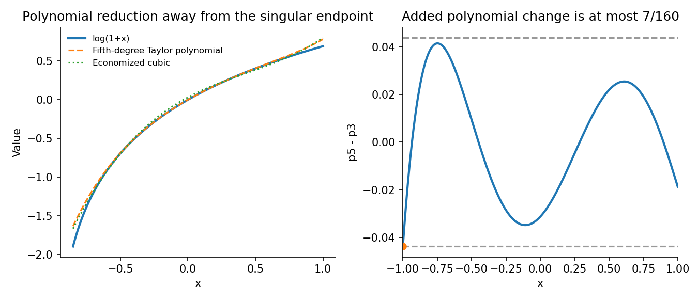

<h1 id="a/1/c/solution">Solution</h1>

↑ **Parent:** [C](../c.md)

Expand the fifth-degree [Taylor polynomial](../../../../../taylor-polynomial.md) $p_5$ in [Chebyshev polynomials](../../../../../chebyshev-polynomial.md), using the identities for powers obtained from part (a):

$$
p_5=-\frac{11}{32}T_0+\frac{11}{8}T_1-\frac38T_2
+\frac7{48}T_3-\frac1{32}T_4+\frac1{80}T_5.
$$

Delete the last two Chebyshev terms and convert back to powers. The economized cubic is

$$
\boxed{p_3(x)=\frac1{32}+\frac{15}{16}x-\frac34x^2+\frac7{12}x^3.}
$$

Since $|T_j|\leq1$,

$$
\|p_5-p_3\|_\infty
\leq\frac1{32}+\frac1{80}=\frac7{160}.
$$

Equality holds at $x=-1$, where both deleted terms have negative sign. Thus **the economization changes the [polynomial](../../../../../polynomial-split.md) by at most $7/160$**, exactly in supremum [norm](../../../../../norm.md) on $[-1,1]$.

For the target itself, $|\log(1+x)-p_3(x)|\leq|\log(1+x)-p_5(x)|+7/160$ wherever $x>-1$. The logarithm is singular at $-1$, so its total uniform error on all of $(-1,1]$ is infinite; the finite estimate concerns the additional [polynomial](../../../../../polynomial-split.md) change, or the increase on any smaller interval where the original error is bounded.

**[Figure 1](#a/1/c/image-chebyshev-economization-removes-two-bounded-high-degree-components). Chebyshev economization removes two bounded high-degree components**.

## ↑ Ancestors (13)

1. [C](../c.md)
2. [1](../../1.md)
3. [A](../../../a.md)
4. [2008](../../../../2008-split.md)
5. [Past exam of the approximation theory and finite element methods course of the University of Oxford](../../../../split.md)
6. [Approximation theory and finite element methods course of the University of Oxford](../../../../../approximation-theory-and-finite-element-methods-course-of-the-university-of-oxford.md)
7. [Year 4 of the mathematics course of the University of Oxford](../../../../../year-4-of-the-mathematics-course-of-the-university-of-oxford.md)
8. [Mathematics course of the University of Oxford](../../../../../mathematics-course-of-the-university-of-oxford.md)
9. [Undergraduate course of the University of Oxford](../../../../../undergraduate-course-of-the-university-of-oxford.md)
10. [Course of the University of Oxford](../../../../../course-of-the-university-of-oxford.md)
11. [University of Oxford](../../../../../university-of-oxford-split.md)
12. [List of universities](../../../../../list-of-universities.md)
13. [Codex Wiki](../../../../../split.md)
