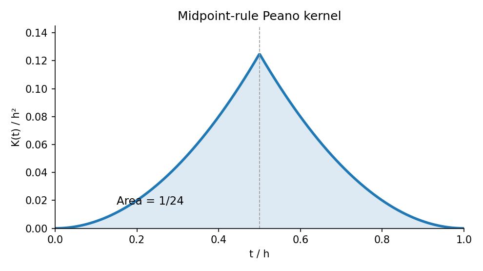

<h1 id="a/3/c/solution">Solution</h1>

↑ **Parent:** [C](../c.md)

The midpoint error annihilates affine [functions](../../../../../function-split.md), so here $n=1$. Apply the functional to $(x-t)_+$:

$$
K(t)=\frac12(h-t)^2-h(h/2-t)_+.
$$

Thus

$$
\boxed{K(t)=
\begin{cases}t^2/2,&0\leq t\leq h/2,\\
(h-t)^2/2,&h/2\leq t\leq h.\end{cases}}
$$

It is nonnegative, and symmetry gives $\int_0^hK=2\int_0^{h/2}t^2/2\,dt=h^3/24$. Therefore

$$
\boxed{|X[u]|\leq\frac{h^3}{24}\|u''\|_\infty.}
$$

For a quadratic with constant nonzero second [derivative](../../../../../derivative.md) equality holds, so this [midpoint quadrature rule](../../../../../midpoint-quadrature-rule.md) error constant is sharp.

**[Figure 2](#a/3/c/image-the-positive-midpoint-peano-kernel-has-area-h-cubed-over-24). The positive midpoint Peano kernel has area h cubed over 24**.

## ↑ Ancestors (13)

1. [C](../c.md)
2. [3](../../3.md)
3. [A](../../../a.md)
4. [2008](../../../../2008-split.md)
5. [Past exam of the approximation theory and finite element methods course of the University of Oxford](../../../../split.md)
6. [Approximation theory and finite element methods course of the University of Oxford](../../../../../approximation-theory-and-finite-element-methods-course-of-the-university-of-oxford.md)
7. [Year 4 of the mathematics course of the University of Oxford](../../../../../year-4-of-the-mathematics-course-of-the-university-of-oxford.md)
8. [Mathematics course of the University of Oxford](../../../../../mathematics-course-of-the-university-of-oxford.md)
9. [Undergraduate course of the University of Oxford](../../../../../undergraduate-course-of-the-university-of-oxford.md)
10. [Course of the University of Oxford](../../../../../course-of-the-university-of-oxford.md)
11. [University of Oxford](../../../../../university-of-oxford-split.md)
12. [List of universities](../../../../../list-of-universities.md)
13. [Codex Wiki](../../../../../split.md)
