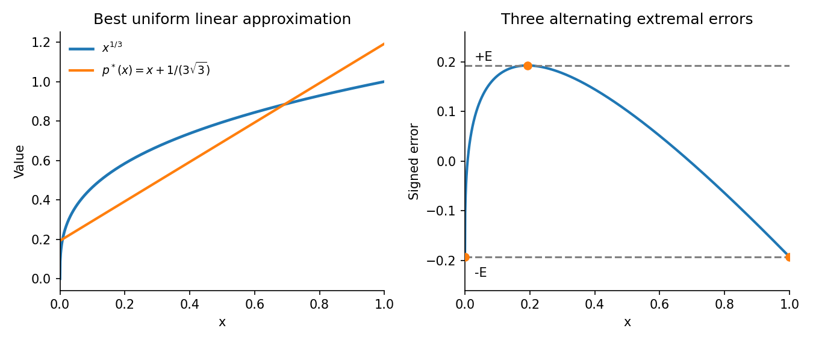

<h1 id="a/3/a/solution">Solution</h1>

↑ **Parent:** [A](../a.md)

By definition, a [best uniform approximation](../../../../../best-uniform-approximation.md) $p^*\in P_n$ minimizes $\|u-p\|_\infty$ over $p\in P_n$. Write $E=\|u-p^*\|_\infty$. The [equioscillation theorem](../../../../../equioscillation-theorem.md) says that, if $E>0$, optimality is equivalent to the existence of $n+2$ ordered points with signed errors

$$
u(\xi_j)-p^*(\xi_j)=\sigma(-1)^jE,\qquad \sigma\in\{1,-1\}.
$$

The absolute-value bars on the left of the printed formula must be omitted for this alternating-sign statement. A nonnegative absolute value cannot equal a negative $-E$.

For sufficiency, suppose a polynomial $p$ had strictly smaller error. At the alternating points, $p-p^*$ must have the same sign as $u-p^*$, since otherwise the new error would have magnitude at least $E$. The difference polynomial therefore changes sign in all $n+1$ successive gaps and has at least $n+1$ distinct roots, impossible for a nonzero element of $P_n$.

For necessity, suppose that no $n+2$ alternating extremal points exist. On the compact extremal set $K=\{x:|u(x)-p^*(x)|=E\}$, group the signs of the error into consecutive blocks. The positive and negative extremal sets are disjoint compact sets, so sign changes are separated by positive distances; the number of blocks is finite. The absence of an $n+2$ alternating selection means there are at most $n+1$ blocks. Place a root in each gap between successive blocks and choose the overall sign of their product $q$ to agree with the error on $K$. Then $\deg q\leq n$ and $q$ is nonzero throughout $K$.

By compactness and continuity, on a neighborhood of $K$ the signs still agree and $|q|$ is bounded below. A sufficiently small positive $\eta$ reduces the error there when $p^*$ is replaced by $p^*+\eta q$. On the compact complement of this neighborhood the old error is below $E$ by a fixed positive margin, and choosing $\eta$ smaller preserves that margin. This gives a strictly better approximation, a contradiction. If $E=0$, the target already lies in $P_n$ and optimality is immediate.

For $u(x)=x^{1/3}$, the chord is $x$. Concavity gives $x^{1/3}-x\geq0$, with maximum at $x_*=1/(3\sqrt3)$ and maximum value $2/(3\sqrt3)$. Shift the chord up by half that amount. The errors at $0,x_*,1$ are respectively $-E,+E,-E$, so

$$
\boxed{p_1^*(x)=x+\frac1{3\sqrt3},\qquad E=\frac1{3\sqrt3}.}
$$

**[Figure 1](#a/3/a/image-three-alternating-extremal-errors-certify-the-best-uniform-line). Three alternating extremal errors certify the best uniform line**.

## ↑ Ancestors (13)

1. [A](../a.md)
2. [3](../../3.md)
3. [A](../../../a.md)
4. [2009](../../../../2009-split.md)
5. [Past exam of the approximation theory and finite element methods course of the University of Oxford](../../../../split.md)
6. [Approximation theory and finite element methods course of the University of Oxford](../../../../../approximation-theory-and-finite-element-methods-course-of-the-university-of-oxford.md)
7. [Year 4 of the mathematics course of the University of Oxford](../../../../../year-4-of-the-mathematics-course-of-the-university-of-oxford.md)
8. [Mathematics course of the University of Oxford](../../../../../mathematics-course-of-the-university-of-oxford.md)
9. [Undergraduate course of the University of Oxford](../../../../../undergraduate-course-of-the-university-of-oxford.md)
10. [Course of the University of Oxford](../../../../../course-of-the-university-of-oxford.md)
11. [University of Oxford](../../../../../university-of-oxford-split.md)
12. [List of universities](../../../../../list-of-universities.md)
13. [Codex Wiki](../../../../../split.md)
