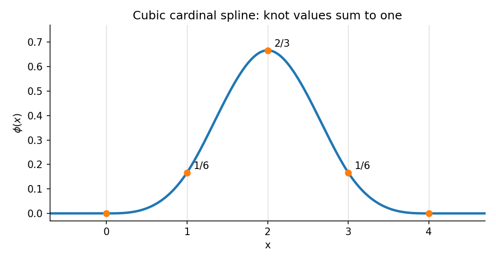

<h1 id="a/3/b/solution">Solution</h1>

↑ **Parent:** [B](../b.md)

Use the standard meaning of a [cubic spline](../../../../../cubic-spline.md): a $C^2$ function that is cubic on each unit interval. If it vanishes on both exterior intervals, continuity of the function and its first two derivatives gives zero endpoint jets at zero and at $k$.

Such a spline can be represented through its third-derivative jumps as

$$
\phi(x)=\sum_{j=0}^kc_j(x-j)_+^3.
$$

For $x\geq k$, this must be the zero polynomial. Expanding in powers of $x$ yields the four moment conditions

$$
\sum_{j=0}^kc_jj^m=0,\qquad m=0,1,2,3.
$$

If $k\leq3$, the columns of this Vandermonde system are linearly independent, so every $c_j=0$. No nonzero spline has such short support.

For $k=4$, a nonzero null vector is $(1,-4,6,-4,1)$, since the fourth finite difference annihilates every cubic. Thus the [Cardinal cubic B-spline](../../../../../cardinal-cubic-b-spline.md) is

$$
\boxed{\phi(x)=\frac16\left[x_+^3-4(x-1)_+^3+6(x-2)_+^3
-4(x-3)_+^3+(x-4)_+^3\right].}
$$

Its knot values at $0,1,2,3,4$ are $0,1/6,2/3,1/6,0$, whose sum is one. It is nonzero and supported on $[0,4]$, proving the minimal value **$k=4$**. Equivalently, on $[0,1]$ it is $x^3/6$, on $[1,2]$ it is $[-3x^3+12x^2-12x+4]/6$, and the other half follows by symmetry $\phi(4-x)=\phi(x)$.

**[Figure 2](#a/3/b/image-the-normalized-cubic-spline-needs-four-knot-intervals-of-support). The normalized cubic spline needs four knot intervals of support**.

## ↑ Ancestors (13)

1. [B](../b.md)
2. [3](../../3.md)
3. [A](../../../a.md)
4. [2009](../../../../2009-split.md)
5. [Past exam of the approximation theory and finite element methods course of the University of Oxford](../../../../split.md)
6. [Approximation theory and finite element methods course of the University of Oxford](../../../../../approximation-theory-and-finite-element-methods-course-of-the-university-of-oxford.md)
7. [Year 4 of the mathematics course of the University of Oxford](../../../../../year-4-of-the-mathematics-course-of-the-university-of-oxford.md)
8. [Mathematics course of the University of Oxford](../../../../../mathematics-course-of-the-university-of-oxford.md)
9. [Undergraduate course of the University of Oxford](../../../../../undergraduate-course-of-the-university-of-oxford.md)
10. [Course of the University of Oxford](../../../../../course-of-the-university-of-oxford.md)
11. [University of Oxford](../../../../../university-of-oxford-split.md)
12. [List of universities](../../../../../list-of-universities.md)
13. [Codex Wiki](../../../../../split.md)
