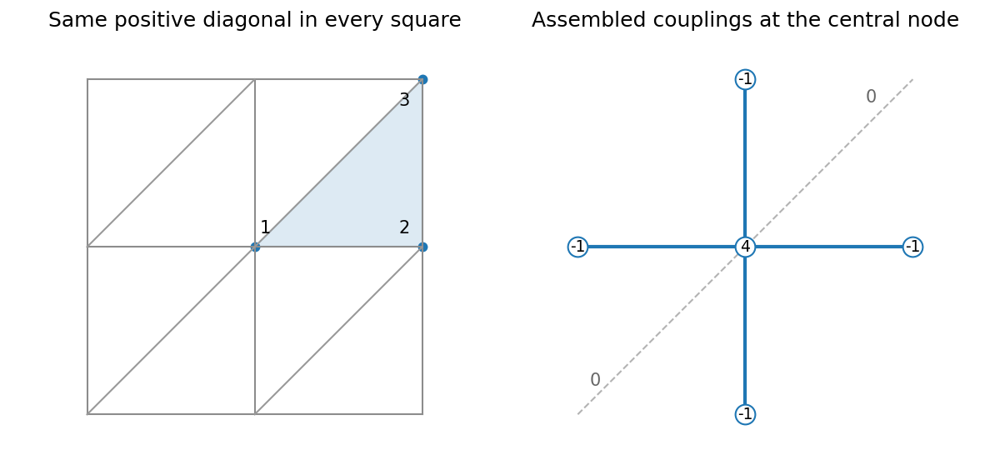

<h1 id="b/4/solution">Solution</h1>

↑ **Parent:** [4](../4.md)

Work in the usual bounded Lipschitz, polygonally triangulated setting in which Sobolev traces and conforming meshes are defined. Choose an $H^1$ lift $G$ of the smooth boundary data. Multiplying the Poisson equation by $v\in H_0^1(\Omega)$ and integrating by parts gives the [weak formulation](../../../../weak-formulation.md)

$$
\int_\Omega\nabla u\cdot\nabla v=\int_\Omega fv,\qquad
u\in G+H_0^1(\Omega).
$$

The test function has zero trace, so the boundary flux term vanishes. This formulation only needs first weak derivatives.

Let $V_h$ be the [conforming finite element space](../../../../conforming-finite-element-space.md) of continuous functions affine on each triangle, and $V_h^0$ its zero-boundary subspace. Choose a nodal interpolation $G_h$ of the boundary lift and seek $u_h\in G_h+V_h^0$ satisfying the same identity for every $v_h\in V_h^0$. General smooth boundary data need not be exactly representable by boundary piecewise linear functions; this is the usual discrete boundary approximation.

With nodal [shape functions](../../../../shape-function.md) $\varphi_j$, interior coefficients $U_j$ satisfy

$$
\sum_{j\in I}A_{ij}U_j=F_i-\sum_{j\in B}A_{ij}g_j,\qquad
A_{ij}=\int_\Omega\nabla\varphi_i\cdot\nabla\varphi_j,\quad
F_i=\int_\Omega f\varphi_i.
$$

Here $I$ and $B$ index interior and boundary vertices. [Finite element assembly](../../../../finite-element-assembly.md) sums the triangle contributions.

Take a translated lower triangle with local vertices $(0,0),(h,0),(h,h)$. Its local functions are $N_1=1-x/h$, $N_2=(x-y)/h$, $N_3=y/h$. Their gradients are constant and the area is $h^2/2$, giving the [stiffness matrix](../../../../stiffness-matrix.md)

$$
\boxed{A^{(T)}=\frac12
\begin{pmatrix}
1&-1&0\\
-1&2&-1\\
0&-1&1
\end{pmatrix}.}
$$

Translations preserve this matrix, while rotations or a different local vertex order permute its entries. The coupling across the hypotenuse is zero.

Each interior grid vertex belongs to six triangles. Summation gives diagonal value 4 and coupling $-1$ to each of its four horizontal and vertical neighbors. Both positive-diagonal edge couplings vanish. Thus, before prescribed boundary values are removed, an interior equation has the five-point stencil

$$
\boxed{4U_{ij}-U_{i-1,j}-U_{i+1,j}-U_{i,j-1}-U_{i,j+1}=F_{ij}.}
$$

There is no $h^{-2}$ factor in the assembled variational matrix; that factor belongs to a differently normalized finite-difference equation.

**[Figure 3](#b/4/image-triangular-mesh-edges-along-diagonals-have-zero-stiffness-coupling). Triangular mesh edges along diagonals have zero stiffness coupling**.

If $h=1/N$ and $m=N-1$, lexicographic ordering makes the Dirichlet-reduced matrix block tridiagonal with diagonal blocks $\operatorname{tridiag}(-1,4,-1)$ and neighboring blocks $-I$. A row with all four neighboring nodes unknown has five nonzeros: 4 once and $-1$ four times. Rows adjacent to the boundary have fewer unknown-neighbor entries; their exact count is $1+1_{i>1}+1_{i<m}+1_{j>1}+1_{j<m}$. Removed boundary contributions appear on the right, rather than as new nonzeros.

## ↑ Ancestors (12)

1. [4](../4.md)
2. [B](../../b.md)
3. [2009](../../../2009-split.md)
4. [Past exam of the approximation theory and finite element methods course of the University of Oxford](../../../split.md)
5. [Approximation theory and finite element methods course of the University of Oxford](../../../../approximation-theory-and-finite-element-methods-course-of-the-university-of-oxford.md)
6. [Year 4 of the mathematics course of the University of Oxford](../../../../year-4-of-the-mathematics-course-of-the-university-of-oxford.md)
7. [Mathematics course of the University of Oxford](../../../../mathematics-course-of-the-university-of-oxford.md)
8. [Undergraduate course of the University of Oxford](../../../../undergraduate-course-of-the-university-of-oxford.md)
9. [Course of the University of Oxford](../../../../course-of-the-university-of-oxford.md)
10. [University of Oxford](../../../../university-of-oxford-split.md)
11. [List of universities](../../../../list-of-universities.md)
12. [Codex Wiki](../../../../split.md)
