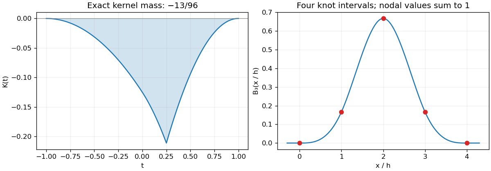

<h1 id="a/1/a/solution">Solution</h1>

↑ **Parent:** [A](../a.md)

Direct evaluation gives $X[1]=X[x]=X[x^2]=0$ and $X[x^3]=-13/16$. Hence the [linear functional](../../../../../linear-functional.md) vanishes on every [polynomial](../../../../../polynomial-split.md) of degree at most two and is nonzero on every genuine cubic [polynomial](../../../../../polynomial-split.md).

The [Peano kernel theorem](../../../../../peano-kernel-theorem.md) with order three gives $X[u]=\int_{-1}^1K(t)u'''(t)\,dt$, where

$$
K(t)=\left(\frac14-t\right)_+-\frac38(1-t)_+^2+\frac14(-t)_+^2+\frac18(-1-t)_+^2.
$$

The first term comes from differentiating $(x-t)_+^2/2$ at $x=1/4$. On the integration interval this simplifies to

$$
\boxed{K(t)=\begin{cases}
-(t+1)^2/8,&-1\leq t\leq0,\\
-(1+2t+3t^2)/8,&0\leq t\leq1/4,\\
-3(1-t)^2/8,&1/4\leq t\leq1.
\end{cases}}
$$

In particular $K\leq0$. Its [L1 norm](../../../../../l1-norm.md) is $-\int K=-X[x^3/6]=13/96$, so the sharp bound is

$$
\boxed{|X[u]|\leq\frac{13}{96}\|u'''\|_\infty.}
$$

**The printed constant $1/12$ is false for the printed functional.** The cubic $u=x^3/6$ has $\|u'''\|_\infty=1$ but $|X[u]|=13/96>1/12$, and it attains the corrected bound. This is an exact [Peano kernel norm](../../../../../peano-kernel-norm.md) calculation, not an error from numerical quadrature.

**[Figure 1](#a/1/a/image-the-negative-peano-kernel-fixes-the-sharp-error-constant-while-the-normalized-compact-cubic-b-spline-spans-four-knot-intervals). The negative Peano kernel fixes the sharp error constant, while the normalized compact cubic B-spline spans four knot intervals**.

## ↑ Ancestors (13)

1. [A](../a.md)
2. [1](../../1.md)
3. [A](../../../a.md)
4. [2010](../../../../2010-split.md)
5. [Past exam of the approximation theory and finite element methods course of the University of Oxford](../../../../split.md)
6. [Approximation theory and finite element methods course of the University of Oxford](../../../../../approximation-theory-and-finite-element-methods-course-of-the-university-of-oxford.md)
7. [Year 4 of the mathematics course of the University of Oxford](../../../../../year-4-of-the-mathematics-course-of-the-university-of-oxford.md)
8. [Mathematics course of the University of Oxford](../../../../../mathematics-course-of-the-university-of-oxford.md)
9. [Undergraduate course of the University of Oxford](../../../../../undergraduate-course-of-the-university-of-oxford.md)
10. [Course of the University of Oxford](../../../../../course-of-the-university-of-oxford.md)
11. [University of Oxford](../../../../../university-of-oxford-split.md)
12. [List of universities](../../../../../list-of-universities.md)
13. [Codex Wiki](../../../../../split.md)
