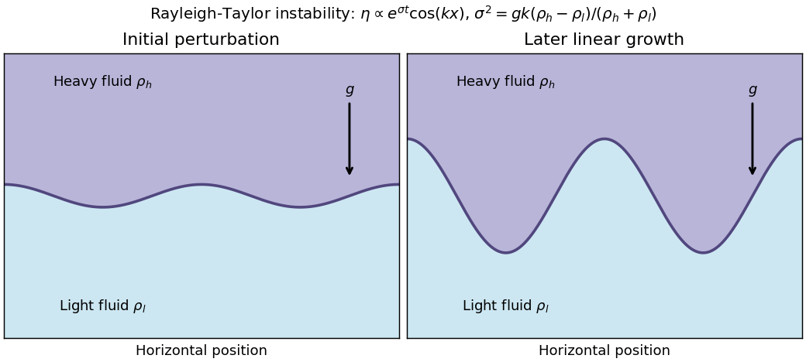
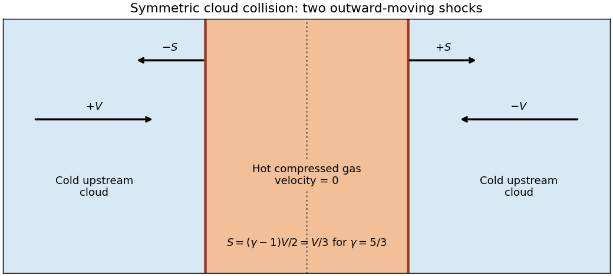

# Paper 1

↑ **Parent:** [2012](../2012.md)

Source: [Cambridge examination PDF, physical pages 215–218; printed paper 5](https://www.whatdotheyknow.com/request/natural_science_tripos_physics_e_2/response/2340776/attach/2/FOI%202023%20399%20Zahid%20materials.pdf?cookie_passthrough=1).

**Table of contents**

- [1](#1)
  - [a](#1/a)
    - [Solution](#1/a/solution)
  - [b](#1/b)
    - [Solution](#1/b/solution)
  - [c](#1/c)
    - [Solution](#1/c/solution)
- [2](#2)
  - [a](#2/a)
    - [Solution](#2/a/solution)
  - [b](#2/b)
    - [Solution](#2/b/solution)
  - [c](#2/c)
    - [Solution](#2/c/solution)
- [3](#3)
  - [Solution](#3/solution)
- [4](#4)
  - [Solution](#4/solution)

## 1

↑ **Parent:** [Paper 1](paper-1.md)

<h3 id="1/a">a</h3>

↑ **Parent:** [1](#1)

<h4 id="1/a/solution">Solution</h4>

↑ **Parent:** [A](#1/a)

The equation describes small plane-wave [perturbations](../../asymptotic-expansion.md#perturbation) of a uniform, stationary [plasma](../../physics.md#plasma-physics) in [ideal magnetohydrodynamics](../../ideal-magnetohydrodynamics.md), with propagation **parallel to the background [magnetic field](../../magnetic-field.md)**. The nonzero field defines $\widehat{\mathbf b}=\mathbf v_A/v_A$; $c_s$ is the [sound speed](../../compressible-flow.md#speed-of-sound) for the assumed thermodynamic closure. Neglect [viscosity](../../dynamic-viscosity.md), [electrical resistivity](../../electric-charge.md#electrical-resistivity), [gravity](../../physics.md#gravity) and microscopic dispersive effects. A uniform background flow would instead introduce its Doppler-shifted [frequency](../../wave.md#frequency).

Decompose $\mathbf u=\mathbf u_\perp+u_\parallel\widehat{\mathbf b}$. The displayed matrix equation then becomes

$$
(k^2v_A^2-\omega^2)\mathbf u_\perp=0,\qquad
(k^2c_s^2-\omega^2)u_\parallel=0.
$$

Thus there are two independent transverse [Alfvén wave](../../ideal-magnetohydrodynamics.md#alfven-wave) [polarizations](../../wave.md#polarization-waves) with $\omega^2=k^2v_A^2$, restored by [magnetic tension](../../magnetohydrodynamics.md#magnetic-tension), and a longitudinal acoustic mode with $\omega^2=k^2c_s^2$, restored by [pressure](../../pressure.md). The transverse modes have no first-order [density](../../fluid-mechanics.md#density) compression; a strictly longitudinal displacement along the field does not bend it. These are the [parallel-propagating ideal magnetohydrodynamic wave](../../ideal-magnetohydrodynamics.md#parallel-propagating-ideal-magnetohydrodynamic-wave) branches. In the general oblique problem, fast and slow magnetosonic modes mix compression and magnetic response; their parallel limits coincide with the faster and slower of these speeds. If $c_s=v_A$, all three [velocity](../../classical-mechanics.md#velocity) [polarizations](../../wave.md#polarization-waves) share the same [frequency](../../wave.md#frequency) magnitude. The [velocity](../../classical-mechanics.md#velocity) equation alone does not enumerate nonpropagating [entropy](../../entropy.md) [perturbations](../../asymptotic-expansion.md#perturbation).

<h3 id="1/b">b</h3>

↑ **Parent:** [1](#1)

<h4 id="1/b/solution">Solution</h4>

↑ **Parent:** [B](#1/b)

Take positive $\dot Q$ to mean net cooling per unit [mass](../../classical-mechanics.md#mass). At fixed [pressure](../../pressure.md) for an [ideal gas](../../ideal-gas.md) of unchanged composition, $\rho\propto T^{-1}$, so $\dot Q=C T^{\alpha-1}-H$ with $C>0$. At [thermal equilibrium](../../thermal-equilibrium.md), $CT_0^{\alpha-1}=H$. Because expansion work is included at fixed [pressure](../../pressure.md), the perturbed [temperature](../../temperature.md) obeys

$$
c_p\frac{d\delta T}{dt}=-\left(\frac{\partial\dot Q}{\partial T}\right)_p\delta T
=-\frac{(\alpha-1)H}{T_0}\delta T.
$$

This [isobaric stability criterion for density-dependent power-law cooling](../../astrophysical-fluid-dynamics.md#isobaric-thermal-stability-of-a-heated-ideal-gas) gives stability for $\alpha>1$ and instability for $\alpha<1$. For optically thin [bremsstrahlung](../../electromagnetic-radiation.md#bremsstrahlung), $\alpha=1/2$, so

$$
\boxed{\frac{d\delta T}{dt}=\frac{H}{2c_pT_0}\delta T,\qquad\text{isobarically unstable}.}
$$

A slightly cooler parcel becomes denser and cools faster; a slightly hotter parcel has reduced cooling and heats further. The conclusion assumes the [sound-crossing time](../../compressible-flow.md#sound-crossing-time) is short enough to maintain nearly common [pressure](../../pressure.md), with conduction and other stabilizing processes omitted.

<h3 id="1/c">c</h3>

↑ **Parent:** [1](#1)

<h4 id="1/c/solution">Solution</h4>

↑ **Parent:** [C](#1/c)

Using a center-to-edge [sound-crossing time](../../compressible-flow.md#sound-crossing-time) $t_s=R/c_s$ and the pressureless uniform-sphere [free-fall time of a uniform sphere](../../astrophysics.md#free-fall-time-of-a-uniform-sphere) $t_{\rm ff}=\sqrt{3\pi/(32G\rho)}$, equality gives

$$
\boxed{R_{\rm cross}=c_s\sqrt{\frac{3\pi}{32G\rho}}\sim\frac{c_s}{\sqrt{G\rho}}.}
$$

On scales larger than this estimate, [pressure](../../pressure.md) information cannot cross the region before its gravitational dynamical evolution. It therefore identifies the order of the [Jeans length](../../linear-cosmological-density-perturbation.md#jeans-length) and separates gravity-dominated from pressure-supported behavior in the simple comparison. It is not an exact normal-mode stability calculation: with the standard Jeans [wavelength](../../wave-equation.md#wavelength) $\lambda_J=c_s\sqrt{\pi/(G\rho)}$, this radius is $\sqrt{3/32}\lambda_J$. Using the diameter rather than the radius as the crossing distance changes the numerical coefficient. [Boundary conditions](../../differential-equation.md#boundary-condition), [density](../../fluid-mechanics.md#density) structure, [turbulence](../../turbulence.md) and magnetic support also matter for an actual cloud.

## 2

↑ **Parent:** [Paper 1](paper-1.md)

<h3 id="2/a">a</h3>

↑ **Parent:** [2](#2)

<h4 id="2/a/solution">Solution</h4>

↑ **Parent:** [A](#2/a)

A [stellar wind](../../stellar-astrophysics.md#stellar-wind) removes [mass](../../classical-mechanics.md#mass) and carries [energy](../../energy.md) and [angular momentum](../../momentum.md#angular-momentum) from a star into its surroundings. Hot gas can escape through thermal [pressure](../../pressure.md); radiation transfers [momentum](../../momentum.md) through continuum or spectral-line [absorption](../../radiometry.md#absorption-electromagnetic-radiation), and radiation acting on dust can drive surrounding gas. Magnetic stresses can extract rotational [energy](../../energy.md) and [angular momentum](../../momentum.md#angular-momentum). These mechanisms have different dependencies on heating, opacity, stellar [luminosity](../../astrophysics.md#luminosity) and field geometry.

For a steady spherical isothermal pressure-driven model, [mass](../../classical-mechanics.md#mass) conservation gives $\dot M=4\pi r^2\rho u$. With $p=a^2\rho$ and constant [isothermal sound speed](../../compressible-flow.md#isothermal-sound-speed) $a$, the radial [Euler equation](../../euler-equations-for-an-inviscid-fluid.md) becomes the [Parker wind equation](../../astrophysical-fluid-dynamics.md#parker-wind-equation)

$$
\left(u-\frac{a^2}{u}\right)\frac{du}{dr}=\frac{2a^2}{r}-\frac{GM}{r^2}.
$$

A smooth [transonic flow](../../compressible-flow.md#transonic-flow) solution crosses $u=a$ at $r_s=GM/(2a^2)$. Its inner subsonic atmosphere connects to a supersonic outflow; continuing heat input is needed to keep that expanding wind isothermal. Other boundary [pressures](../../pressure.md) can select a breeze rather than this escaping branch, and the mass-loss rate needs boundary/heating information. A polytropic outflow instead converts finite [enthalpy](../../enthalpy.md) into escape [energy](../../energy.md) and has a different terminal budget.

**[Figure 1](#2/a/image-pressure-driven-isothermal-wind-a-regular-sonic-crossing-selects-the-transonic-branch). Pressure-driven isothermal wind: a regular sonic crossing selects the transonic branch**.

The [solar wind](../../astrophysics.md#solar-wind) supplies a nearby [plasma](../../physics.md#plasma-physics) example. Spectral-line [Doppler shifts](../../wave.md#doppler-effect) and profiles diagnose more distant winds; blueshifted [absorption](../../radiometry.md#absorption-electromagnetic-radiation) against stellar light indicates material moving toward the observer. Inference of a mass-loss rate additionally needs [density](../../fluid-mechanics.md#density), [ionization](../../atomic-physics.md#ionization), geometry and [velocity](../../classical-mechanics.md#velocity) information, rather than a line shift alone.

<h3 id="2/b">b</h3>

↑ **Parent:** [2](#2)

<h4 id="2/b/solution">Solution</h4>

↑ **Parent:** [B](#2/b)

The [Rayleigh-Taylor instability](../../continuum-mechanics.md#rayleigh-taylor-instability) occurs when a denser fluid is supported against an effective [acceleration](../../classical-mechanics.md#acceleration) by a lighter fluid. Let [density](../../fluid-mechanics.md#density) $\rho_h$ occupy the upper half-space, [density](../../fluid-mechanics.md#density) $\rho_l<\rho_h$ the lower half-space and [gravity](../../physics.md#gravity) point downward. A displaced heavy-fluid finger lowers gravitational [potential energy](../../energy.md#potential-energy) as it sinks; neighboring light fluid rises. For incompressible inviscid half-spaces without [surface tension](../../surface-tension.md), a disturbance $\eta\propto e^{\sigma t+ikx}$ has

$$
\boxed{\sigma^2=gk\frac{\rho_h-\rho_l}{\rho_h+\rho_l}.}
$$

The [density](../../fluid-mechanics.md#density) ratio in this expression is the [Atwood number](../../continuum-mechanics.md#atwood-number). With the [density](../../fluid-mechanics.md#density) ordering reversed, $\sigma^2<0$ and the interface supports stable gravity-wave oscillations in this ideal model.

**[Figure 2](#2/b/image-rayleigh-taylor-growth-a-heavy-layer-above-a-light-layer-develops-growing-fingers). Rayleigh-Taylor growth: a heavy layer above a light layer develops growing fingers**.

[Surface tension](../../surface-tension.md) suppresses sufficiently short [wavelengths](../../wave-equation.md#wavelength), and [viscosity](../../dynamic-viscosity.md) changes the growth dynamics. A [magnetic field](../../magnetic-field.md) parallel to the interface can resist [perturbations](../../asymptotic-expansion.md#perturbation) that bend its lines; interchange directions that do not bend the field need separate consideration. In astrophysics, effective deceleration can make dense ejecta or a swept-up shell supported by a lower-density hot interior unstable. The effective [acceleration](../../classical-mechanics.md#acceleration) and [density](../../fluid-mechanics.md#density) ordering must be evaluated in that moving interface's frame; simply seeing a dense shell does not fix the stability sign.

<h3 id="2/c">c</h3>

↑ **Parent:** [2](#2)

<h4 id="2/c/solution">Solution</h4>

↑ **Parent:** [C](#2/c)

For a steady inviscid [barotropic fluid](../../fluid-mechanics.md#barotropic-fluid) in a conservative [gravitational potential](../../newton-s-law-of-universal-gravitation.md#newtonian-potential-of-a-point-mass), define $h(\rho)=\int dp/\rho$. Dotting the [Euler equation](../../euler-equations-for-an-inviscid-fluid.md) with the [velocity](../../classical-mechanics.md#velocity) gives

$$
\mathbf u\cdot\nabla\left(\frac{u^2}{2}+h+\phi\right)=0.
$$

The [Bernoulli function](../../euler-equations-for-an-inviscid-fluid.md#bernoulli-function) is therefore constant along a [streamline](../../fluid-mechanics.md#streamline). It balances [kinetic energy](../../energy.md#kinetic-energy), [pressure](../../pressure.md) work or [enthalpy](../../enthalpy.md), and gravitational [potential energy](../../energy.md#potential-energy) per unit [mass](../../classical-mechanics.md#mass). Different [streamlines](../../fluid-mechanics.md#streamline) can have different constants; for an [irrotational flow](../../vorticity.md#irrotational-flow), the identity $\nabla H=\mathbf u\times(\nabla\times\mathbf u)$ makes the constant common throughout a connected region.

For an incompressible fluid, $h=p/\rho$ up to a constant, giving $u^2/2+p/\rho+\phi=C$. For a constant-entropy perfect-gas [streamline](../../fluid-mechanics.md#streamline), $h=\gamma p/[(\gamma-1)\rho]$. Together with [mass](../../classical-mechanics.md#mass) conservation, this explains conversion of [enthalpy](../../enthalpy.md) into [kinetic energy](../../energy.md#kinetic-energy) in a nozzle and the need to include [gravity](../../physics.md#gravity) in an escaping wind. Viscous losses, heating and [entropy](../../entropy.md) production require their corresponding [energy](../../energy.md) balance. Across an adiabatic shock the total [stagnation enthalpy](../../enthalpy.md#stagnation-enthalpy) can still be conserved, but the upstream isentropic pressure-density law cannot simply be continued through the [entropy](../../entropy.md) jump.

## 3

↑ **Parent:** [Paper 1](paper-1.md)

<h3 id="3/solution">Solution</h3>

↑ **Parent:** [3](#3)

Interstellar shocks arise when relative flow is supersonic: stellar winds, [supernova](../../stellar-astrophysics.md#supernova) ejecta, colliding clouds and gas moving through strong disturbances can drive them. Neighboring compressive [characteristics](../../algebra.md#characteristic-of-a-field) steepen or a fast flow encounters material it cannot decelerate through upstream sound communication. A thin dissipative front then converts directed [kinetic energy](../../energy.md#kinetic-energy) into thermal [energy](../../energy.md) and increases [entropy](../../entropy.md).

Integrate [mass](../../classical-mechanics.md#mass), normal [momentum](../../momentum.md) and total [energy](../../energy.md) conservation through a planar steady shock in its rest frame. With no [mass](../../classical-mechanics.md#mass) source, negligible external impulse across the thin layer and no radiative [energy](../../energy.md) loss, their normal fluxes are respectively

$$
j=\rho u,\qquad p+\rho u^2,\qquad
j\left(h+\frac{u^2}{2}\right).
$$

For a [perfect gas](../../ideal-gas.md) of constant [adiabatic index](../../ideal-gas.md#heat-capacity-ratio), $h=\gamma p/[(\gamma-1)\rho]$. Equality of the fluxes on the two sides yields the three [Rankine-Hugoniot conditions](../../transport-equation.md#rankine-hugoniot-conditions) in the question. Adiabatic means no [energy](../../energy.md) escapes this control [volume](../../geometry-and-topology.md#volume); it does not make the shock isentropic.

In the strong-shock limit, let $r=\rho_2/\rho_1=u_1/u_2$ and neglect $p_1$. [Momentum](../../momentum.md) conservation gives $p_2=\rho_1u_1^2(1-1/r)$. Substitution into [energy](../../energy.md) conservation gives

$$
\frac{2\gamma}{\gamma-1}(r-1)+1=r^2,
\qquad
(r-1)\left(r-\frac{\gamma+1}{\gamma-1}\right)=0.
$$

The nontrivial compressive root is

$$
\boxed{\frac{\rho_2}{\rho_1}=\frac{u_1}{u_2}=\frac{\gamma+1}{\gamma-1}.}
$$

The $r=1$ root describes no shock. A [monatomic gas](../../ideal-gas.md#monatomic-gas) has the familiar compression four.

For identical colliding clouds in their center-of-momentum frame, [reflection symmetry](../../physics.md#reflection-symmetry) fixes the contact plane and the uniform compressed material on either side at rest. The unshocked clouds still approach at speeds $\pm V$; their supersonic upstream flow has not received a smooth [pressure](../../pressure.md) adjustment ahead of the shock. Let the right shock move to the right at speed $S$. In its own frame the upstream and downstream normal speed magnitudes are $V+S$ and $S$. The same [shock compression ratio](../../compressible-flow.md#shock-compression-ratio) therefore gives

$$
\frac{V+S}{S}=\frac{\gamma+1}{\gamma-1},\qquad
\boxed{S=\frac{\gamma-1}{2}V.}
$$

This is the [shock speed in a symmetric cloud collision](../../transport-equation.md#shock-speed-in-a-symmetric-cloud-collision). For $\gamma=5/3$, the shocks move outward at $V/3$, not at the upstream speed or the relative cloud speed $2V$. As a check, the post-shock [pressure](../../pressure.md) is $p_2=(\gamma+1)\rho_1V^2/2$; in the monatomic case $p_2/\rho_2=V^2/3$, giving specific internal [energy](../../energy.md) $V^2/2$, exactly the initial bulk [kinetic energy](../../energy.md#kinetic-energy) per unit cloud [mass](../../classical-mechanics.md#mass) when brought to rest.

**[Figure 3](#3/image-symmetric-cloud-collision-stationary-compressed-gas-and-two-outward-moving-shocks). Symmetric cloud collision: stationary compressed gas and two outward-moving shocks**.

When a shock reaches a cloud's rear boundary, its supply of cold upstream gas ends. If the surrounding [pressure](../../pressure.md) is low, the hot compressed gas expands outward and a rarefaction travels back into it, converting thermal [energy](../../energy.md) into motion and cooling the gas. A sustained uniform stationary shocked region is no longer the solution. Interaction with an appreciable exterior medium can instead drive another outward disturbance; the boundary [pressure](../../pressure.md) determines that part of the evolution. The stated adiabatic model provides no radiative mechanism that would keep a permanently cold dense sheet at the contact.

## 4

↑ **Parent:** [Paper 1](paper-1.md)

<h3 id="4/solution">Solution</h3>

↑ **Parent:** [4](#4)

Follow a fluid element with position $\mathbf X(t)$ satisfying $\dot{\mathbf X}=\mathbf u(\mathbf X,t)$. The [chain rule](../../calculus.md#chain-rule) gives the [material derivative](../../continuum-mechanics.md#material-derivative)

$$
\boxed{\frac{DQ}{Dt}=\frac d{dt}Q(\mathbf X(t),t)=\partial_tQ+\mathbf u\cdot\nabla Q.}
$$

Apply [Newton's second law](../../force.md#newton-s-second-law) to a material element of [volume](../../geometry-and-topology.md#volume) $dV$ and [mass](../../classical-mechanics.md#mass) $\rho dV$. The net [pressure](../../pressure.md) [force](../../force.md) is $-\nabla p\,dV$, and [gravity](../../physics.md#gravity) gives $-\rho\nabla\phi\,dV$. Dividing by the element [mass](../../classical-mechanics.md#mass), neglecting [viscosity](../../dynamic-viscosity.md) and using the [chain rule](../../calculus.md#chain-rule) componentwise gives the [Euler equation](../../euler-equations-for-an-inviscid-fluid.md)

$$
\partial_t\mathbf u+\mathbf u\cdot\nabla\mathbf u=-\frac1\rho\nabla p-\nabla\phi.
$$

For a static spherical isothermal gas, $p=c_s^2\rho$ and $dp/dr=-GM(r)\rho/r^2$. Trial [density](../../fluid-mechanics.md#density) $\rho=A/r^2$ gives enclosed [mass](../../classical-mechanics.md#mass) $M(r)=4\pi Ar$, so

$$
-\frac{2Ac_s^2}{r^3}=-\frac{4\pi GA^2}{r^3},\qquad
\boxed{A=\frac{c_s^2}{2\pi G}.}
$$

This is the [singular isothermal sphere](../../galaxy.md#singular-isothermal-sphere). Its central [density](../../fluid-mechanics.md#density) diverges, although the enclosed [mass](../../classical-mechanics.md#mass) tends to zero linearly and its total [mass](../../classical-mechanics.md#mass) inside a finite radius is finite. It is not the finite-central-density regular isothermal solution.

Truncate at $r_0$ with boundary [pressure](../../pressure.md) $p_0$. Then $M=4\pi Ar_0=2c_s^2r_0/G$ and $p_0=c_s^2\rho(r_0)$, giving

$$
\boxed{r_0=\frac{GM}{2c_s^2},\qquad p_0=\frac{c_s^4}{2\pi G r_0^2}.}
$$

The external medium is being treated as a prescribed [pressure](../../pressure.md) boundary; its own gravitational field is excluded from the cloud self-energy calculation.

For a monatomic [perfect gas](../../ideal-gas.md), the equilibrium is isothermal but the internal-energy relation still uses its [adiabatic index](../../ideal-gas.md#heat-capacity-ratio) $\gamma=5/3$:

$$
U=\int\frac{p}{\gamma-1}\,dV=\frac32Mc_s^2.
$$

The gravitational self-energy follows by assembling shells:

$$
\Omega=-\int_0^{r_0}\frac{GM(r)}r\,dM(r)
=-16\pi^2GA^2r_0=-\frac{GM^2}{r_0}=-2Mc_s^2.
$$

Both [integrals](../../integral.md) remain finite at the singular center. Consequently

$$
\boxed{2U+\Omega=Mc_s^2=4\pi r_0^3p_0=3p_0\mathcal V,\qquad\mathcal V=4\pi r_0^3/3.}
$$

The [pressure-confined singular isothermal gas sphere](../../galaxy.md#pressure-confined-singular-isothermal-gas-sphere) therefore satisfies the [virial theorem](../../classical-mechanics.md#virial-theorem) including the work of the confining surface [pressure](../../pressure.md). One can see its origin directly by integrating $\mathbf r\cdot\nabla p$: [integration by parts](../../calculus.md#integration-by-parts) gives $\oint p\,\mathbf r\cdot d\mathbf S-3\int p\,dV$, whose surface term is $4\pi r_0^3p_0$. An isolated vacuum-boundary version would omit that term and could not truncate this same positive-temperature isothermal profile at finite radius. The equality expresses equilibrium [force](../../force.md) and [energy](../../energy.md) balance, rather than proving [dynamical stability](../../dynamical-systems.md#stability-theory).

## ↑ Ancestors (11)

1. [2012](../2012.md)
2. [Past exam of the astrophysical fluid dynamics course of the University of Cambridge](../../past-exam-of-the-astrophysical-fluid-dynamics-course-of-the-university-of-cambridge.md)
3. [Astrophysical Fluid Dynamics course of the University of Cambridge](../../university-of-cambridge.md#astrophysical-fluid-dynamics-course-of-the-university-of-cambridge)
4. [Physics course of the year 3 of the natural sciences course of the University of Cambridge](../../university-of-cambridge.md#physics-course-of-the-year-3-of-the-natural-sciences-course-of-the-university-of-cambridge)
5. [Year 3 of the natural sciences course of the University of Cambridge](../../university-of-cambridge.md#year-3-of-the-natural-sciences-course-of-the-university-of-cambridge)
6. [Year of the natural sciences course of the University of Cambridge](../../university-of-cambridge.md#year-of-the-natural-sciences-course-of-the-university-of-cambridge)
7. [Natural sciences course of the University of Cambridge](../../university-of-cambridge.md#natural-sciences-course-of-the-university-of-cambridge)
8. [Course of the University of Cambridge](../../university-of-cambridge.md#course-of-the-university-of-cambridge)
9. [University of Cambridge](../../university-of-cambridge.md)
10. [List of universities](../../README.md#list-of-universities)
11. [Codex Wiki](../../README.md)
