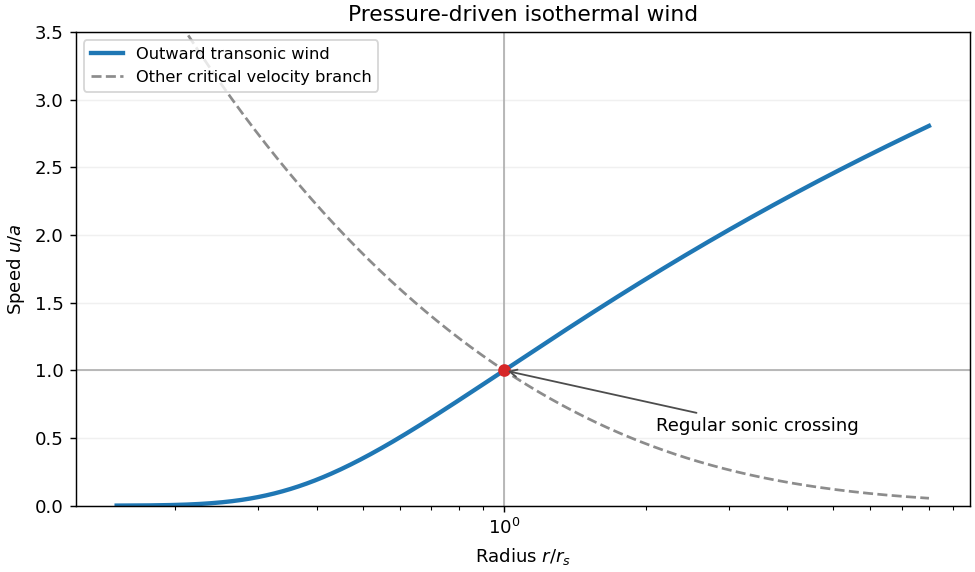

<h1 id="2/a/solution">Solution</h1>

↑ **Parent:** [A](../a.md)

A [stellar wind](../../../../../stellar-wind.md) removes [mass](../../../../../mass.md) and carries [energy](../../../../../energy-split.md) and [angular momentum](../../../../../angular-momentum.md) from a star into its surroundings. Hot gas can escape through thermal [pressure](../../../../../pressure-split.md); radiation transfers [momentum](../../../../../momentum-split.md) through continuum or spectral-line [absorption](../../../../../absorption-electromagnetic-radiation.md), and radiation acting on dust can drive surrounding gas. Magnetic stresses can extract rotational [energy](../../../../../energy-split.md) and [angular momentum](../../../../../angular-momentum.md). These mechanisms have different dependencies on heating, opacity, stellar [luminosity](../../../../../luminosity.md) and field geometry.

For a steady spherical isothermal pressure-driven model, [mass](../../../../../mass.md) conservation gives $\dot M=4\pi r^2\rho u$. With $p=a^2\rho$ and constant [isothermal sound speed](../../../../../isothermal-sound-speed.md) $a$, the radial [Euler equation](../../../../../euler-equations-for-an-inviscid-fluid-split.md) becomes the [Parker wind equation](../../../../../parker-wind-equation.md)

$$
\left(u-\frac{a^2}{u}\right)\frac{du}{dr}=\frac{2a^2}{r}-\frac{GM}{r^2}.
$$

A smooth [transonic flow](../../../../../transonic-flow.md) solution crosses $u=a$ at $r_s=GM/(2a^2)$. Its inner subsonic atmosphere connects to a supersonic outflow; continuing heat input is needed to keep that expanding wind isothermal. Other boundary [pressures](../../../../../pressure-split.md) can select a breeze rather than this escaping branch, and the mass-loss rate needs boundary/heating information. A polytropic outflow instead converts finite [enthalpy](../../../../../enthalpy-split.md) into escape [energy](../../../../../energy-split.md) and has a different terminal budget.

**[Figure 1](#2/a/image-pressure-driven-isothermal-wind-a-regular-sonic-crossing-selects-the-transonic-branch). Pressure-driven isothermal wind: a regular sonic crossing selects the transonic branch**.

The [solar wind](../../../../../solar-wind.md) supplies a nearby [plasma](../../../../../plasma-physics.md) example. Spectral-line [Doppler shifts](../../../../../doppler-effect.md) and profiles diagnose more distant winds; blueshifted [absorption](../../../../../absorption-electromagnetic-radiation.md) against stellar light indicates material moving toward the observer. Inference of a mass-loss rate additionally needs [density](../../../../../density.md), [ionization](../../../../../ionization.md), geometry and [velocity](../../../../../velocity.md) information, rather than a line shift alone.

## ↑ Ancestors (14)

1. [A](../a.md)
2. [2](../../2.md)
3. [Paper 1](../../../paper-1-split.md)
4. [2012](../../../split.md)
5. [Past exam of the astrophysical fluid dynamics course of the University of Cambridge](../../../../split.md)
6. [Astrophysical Fluid Dynamics course of the University of Cambridge](../../../../../astrophysical-fluid-dynamics-course-of-the-university-of-cambridge.md)
7. [Physics course of the year 3 of the natural sciences course of the University of Cambridge](../../../../../physics-course-of-the-year-3-of-the-natural-sciences-course-of-the-university-of-cambridge.md)
8. [Year 3 of the natural sciences course of the University of Cambridge](../../../../../year-3-of-the-natural-sciences-course-of-the-university-of-cambridge.md)
9. [Year of the natural sciences course of the University of Cambridge](../../../../../year-of-the-natural-sciences-course-of-the-university-of-cambridge.md)
10. [Natural sciences course of the University of Cambridge](../../../../../natural-sciences-course-of-the-university-of-cambridge.md)
11. [Course of the University of Cambridge](../../../../../course-of-the-university-of-cambridge.md)
12. [University of Cambridge](../../../../../university-of-cambridge-split.md)
13. [List of universities](../../../../../list-of-universities.md)
14. [Codex Wiki](../../../../../split.md)
